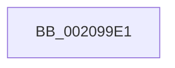

# sub_002099E1

- RVA: `0x002099E1`–`0x002099FA` (길이 `25` bytes)
- VA: `0x00000001402099E1`
- 실행 섹션: `.text`
- PDB 이름 있음: `아니요`; PDB Function 태그: `아니요`
- unwind 정보 RVA: `0x0005D688`
- 디코드: `7`개 명령, `25/25` bytes 표시
- 미해석 바이트: `0` (있으면 어셈블리에 `.byte`로 보존)

> 이 문서는 커널 이미지의 기계어와 PDB 기호를 분석해 생성했습니다. 4번과 5번은 함수 원형과 자료형을 바이너리 사용 방식에서 추정한 C 해석이며 원본 소스 복구 결과는 아닙니다.

## 1. Dependencies

- 직접 호출 지점: **0**; 고유 호출 대상: **0**
- 직접 호출자로 확인된 함수: **0**
- RIP 상대 이미지 참조: **0**

### Outgoing calls
- 직접 디코드된 call 명령이 없습니다.

### Direct callers
- 이 함수 시작 RVA로 연결되는 직접 call은 확인되지 않았습니다. 간접 호출은 완전히 역산할 수 없습니다.

### Static image references
- 디코드된 RIP-relative 메모리 참조가 없습니다.

## 2. Other-region calls and transfers

- 다른 실행 섹션으로 향하는 call: **0**
- call이 아닌 외부 분기/꼬리 이동: **1**
  - `0x002099F5` → [sub_0020959D + 0x50](Unknown_function_0020959D.md) (`tail-transfer`)

## 3. Assembly (complete function range)

```asm
002099E1  0F BA 77 74 10                  btr dword ptr [rdi + 0x74], 0x10
002099E6  0F 92 C3                        setb bl
002099E9  83 E3 01                        and ebx, 1
002099EC  03 DB                           add ebx, ebx
002099EE  83 CB 01                        or ebx, 1
002099F1  89 5C 24 34                     mov dword ptr [rsp + 0x34], ebx
002099F5  E9 F3 FB FF FF                  jmp 0x1402095ed
```

## 4. C-style interpretation (structured pseudocode)

```c
void __fastcall sub_002099E1(void)
{
    __int64 v_rbx;
    unsigned int v_stack_p34;

    v_rbx = (condition_is_below) ? 1 : 0;
    v_rbx = (unsigned int)((v_rbx) & (1));
    v_rbx = (unsigned int)((v_rbx) + ((unsigned int)(v_rbx)));
    v_rbx = (unsigned int)((v_rbx) | (1));
    v_stack_p34 = (unsigned int)(v_rbx);
}
```

## 5. (Beta) C Style

```c
void sub_002099E1(void)
{
    int64_t local_rbx;
    uint32_t v_stack_p34;

    local_rbx = (condition_is_below) ? 1 : 0;
    local_rbx = (uint32_t)((local_rbx) & (1));
    local_rbx = (uint32_t)((local_rbx) + ((uint32_t)(local_rbx)));
    local_rbx = (uint32_t)((local_rbx) | (1));
    v_stack_p34 = (uint32_t)(local_rbx);
}
```

## 6. Execution-region graph

[열기: 2D/3D 그래프와 함수 탐색 컨트롤 패널](../../../control-panel.html?section=text&rva=0x002099E1&view=graph)

- 2D 그래프는 위에서 아래로 흐르고, 3D 그래프는 빈 공간을 드래그해 회전합니다. Shift+드래그는 이동, 휠은 확대·축소, 함수 노드 선택은 대상 보고서 이동입니다.

### Static fallback


