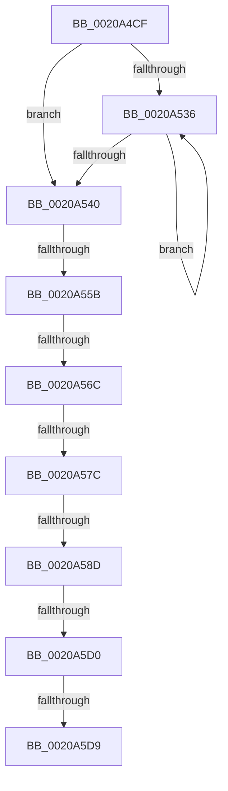

# sub_0020A4CF

- RVA: `0x0020A4CF`–`0x0020A607` (길이 `312` bytes)
- VA: `0x000000014020A4CF`
- 실행 섹션: `.text`
- PDB 이름 있음: `아니요`; PDB Function 태그: `아니요`
- unwind 정보 RVA: `0x0005D70C`
- 디코드: `62`개 명령, `312/312` bytes 표시
- 미해석 바이트: `0` (있으면 어셈블리에 `.byte`로 보존)

> 이 문서는 커널 이미지의 기계어와 PDB 기호를 분석해 생성했습니다. 4번과 5번은 함수 원형과 자료형을 바이너리 사용 방식에서 추정한 C 해석이며 원본 소스 복구 결과는 아닙니다.

## 1. Dependencies

- 직접 호출 지점: **0**; 고유 호출 대상: **0**
- 직접 호출자로 확인된 함수: **0**
- RIP 상대 이미지 참조: **6**

### Outgoing calls
- 직접 디코드된 call 명령이 없습니다.

### Direct callers
- 이 함수 시작 RVA로 연결되는 직접 call은 확인되지 않았습니다. 간접 호출은 완전히 역산할 수 없습니다.

### Static image references
- `0x0020A502` → RVA `0x0041FD10` (`HalpTscQueryCounterOrdered`; read)
- `0x0020A509` → RVA `0x002DDBC0` (`HvlGetReferenceTimeUsingTscPage`; read)
- `0x0020A51A` → RVA `0x00378F50` (`HalpHvCounterQueryCounter`; read)
- `0x0020A540` → RVA `0x00FC3FD0` (`.data`; read)
- `0x0020A55B` → RVA `0x00FC40E0` (`.data`; read)
- `0x0020A5C0` → RVA `0x00FC3FC8` (`.data`; read)

## 2. Other-region calls and transfers

- 다른 실행 섹션으로 향하는 call: **0**
- call이 아닌 외부 분기/꼬리 이동: **7**
  - `0x0020A555` → [sub_0020A643 + 0x7](Unknown_function_0020A643.md) (`tail-transfer`)
  - `0x0020A566` → [sub_0020A643 + 0xE8](Unknown_function_0020A643.md) (`tail-transfer`)
  - `0x0020A576` → [sub_0020A643 + 0x285](Unknown_function_0020A643.md) (`tail-transfer`)
  - `0x0020A587` → [sub_0020A8E8 + 0x26F](Unknown_function_0020A8E8.md) (`tail-transfer`)
  - `0x0020A5CA` → [sub_0020A643 + 0x1BC](Unknown_function_0020A643.md) (`tail-transfer`)
  - `0x0020A5D7` → [sub_0020A643](Unknown_function_0020A643.md) (`tail-transfer`)
  - `0x0020A601` → [sub_0020A8DF](Unknown_function_0020A8DF.md) (`tail-transfer`)

## 3. Assembly (complete function range)

```asm
0020A4CF  48 89 5C 24 58                  mov qword ptr [rsp + 0x58], rbx
0020A4D4  45 33 F6                        xor r14d, r14d
0020A4D7  48 89 6C 24 50                  mov qword ptr [rsp + 0x50], rbp
0020A4DC  48 89 7C 24 40                  mov qword ptr [rsp + 0x40], rdi
0020A4E1  48 BF 40 03 00 00 80 F7 FF FF   movabs rdi, 0xfffff78000000340
0020A4EB  4C 89 6C 24 38                  mov qword ptr [rsp + 0x38], r13
0020A4F0  49 BD 50 03 00 00 80 F7 FF FF   movabs r13, 0xfffff78000000350
0020A4FA  48 89 74 24 48                  mov qword ptr [rsp + 0x48], rsi
0020A4FF  48 8B 1F                        mov rbx, qword ptr [rdi]
0020A502  48 8D 15 07 58 21 00            lea rdx, [rip + 0x215807]
0020A509  4C 8D 15 B0 36 0D 00            lea r10, [rip + 0xd36b0]
0020A510  49 B8 94 02 00 00 80 F7 FF FF   movabs r8, 0xfffff78000000294
0020A51A  4C 8D 1D 2F EA 16 00            lea r11, [rip + 0x16ea2f]
0020A521  41 B9 80 96 98 00               mov r9d, 0x989680
0020A527  48 B8 08 00 00 00 80 F7 FF FF   movabs rax, 0xfffff78000000008
0020A531  F6 C3 01                        test bl, 1
0020A534  74 0A                           je 0x14020a540
0020A536  F3 90                           pause
0020A538  48 8B 1F                        mov rbx, qword ptr [rdi]
0020A53B  F6 C3 01                        test bl, 1
0020A53E  75 F6                           jne 0x14020a536
0020A540  48 8B 2D 89 9A DB 00            mov rbp, qword ptr [rip + 0xdb9a89]
0020A547  4D 8B 7D 00                     mov r15, qword ptr [r13]
0020A54B  4C 8B 20                        mov r12, qword ptr [rax]
0020A54E  83 BD E4 00 00 00 05            cmp dword ptr [rbp + 0xe4], 5
0020A555  0F 85 EF 00 00 00               jne 0x14020a64a
0020A55B  48 83 3D 7D 9B DB 00 00         cmp qword ptr [rip + 0xdb9b7d], 0
0020A563  49 8B F1                        mov rsi, r9
0020A566  0F 84 BF 01 00 00               je 0x14020a72b
0020A56C  F7 85 E0 00 00 00 00 00 01 00   test dword ptr [rbp + 0xe0], 0x10000
0020A576  0F 85 4C 03 00 00               jne 0x14020a8c8
0020A57C  48 8B 4D 48                     mov rcx, qword ptr [rbp + 0x48]
0020A580  48 8B 45 70                     mov rax, qword ptr [rbp + 0x70]
0020A584  48 3B C2                        cmp rax, rdx
0020A587  0F 85 CA 05 00 00               jne 0x14020ab57
0020A58D  0F 01 F9                        rdtscp
0020A590  4C 8D 84 24 90 00 00 00         lea r8, [rsp + 0x90]
0020A598  48 C1 E2 20                     shl rdx, 0x20
0020A59C  41 89 08                        mov dword ptr [r8], ecx
0020A59F  48 0B D0                        or rdx, rax
0020A5A2  48 8B 05 37 9B DB 00            mov rax, qword ptr [rip + 0xdb9b37]
0020A5A9  48 B9 B8 03 00 00 80 F7 FF FF   movabs rcx, 0xfffff780000003b8
0020A5B3  48 8B 40 08                     mov rax, qword ptr [rax + 8]
0020A5B7  4C 8B 19                        mov r11, qword ptr [rcx]
0020A5BA  48 F7 E2                        mul rdx
0020A5BD  4C 03 DA                        add r11, rdx
0020A5C0  48 8B 05 01 9A DB 00            mov rax, qword ptr [rip + 0xdb9a01]
0020A5C7  48 3B E8                        cmp rbp, rax
0020A5CA  0F 85 2F 02 00 00               jne 0x14020a7ff
0020A5D0  90                              nop
0020A5D1  48 8B 07                        mov rax, qword ptr [rdi]
0020A5D4  48 3B C3                        cmp rax, rbx
0020A5D7  75 6A                           jne 0x14020a643
0020A5D9  4C 8B AC 24 80 00 00 00         mov r13, qword ptr [rsp + 0x80]
0020A5E1  48 8B 7C 24 40                  mov rdi, qword ptr [rsp + 0x40]
0020A5E6  48 8B 74 24 48                  mov rsi, qword ptr [rsp + 0x48]
0020A5EB  48 8B 6C 24 50                  mov rbp, qword ptr [rsp + 0x50]
0020A5F0  48 8B 5C 24 58                  mov rbx, qword ptr [rsp + 0x58]
0020A5F5  4D 89 5D 00                     mov qword ptr [r13], r11
0020A5F9  4C 8B 6C 24 38                  mov r13, qword ptr [rsp + 0x38]
0020A5FE  4D 3B DF                        cmp r11, r15
0020A601  0F 86 D8 02 00 00               jbe 0x14020a8df
```

## 4. C-style interpretation (structured pseudocode)

```c
__int64 __fastcall sub_0020A4CF(__int64 a1, __int64 a2, __int64 a3, __int64 a4, __int64 a5, __int64 a6, __int64 a7, __int64 a8, __int64 a9, __int64 a10, __int64 a11, __int64 a12, __int64 a13, __int64 a14, __int64 a15, __int64 a16, __int64 a17, __int64 a18)
{
    __int64 v_r11;
    __int64 v_r14;
    unsigned __int64 v_stack_p38;
    unsigned __int64 v_stack_p40;
    unsigned __int64 v_stack_p48;
    unsigned __int64 v_stack_p50;
    unsigned __int64 v_stack_p58;

    v_stack_p58 = v_rbx;
    v_r14 = 0;
    v_stack_p50 = v_rbp;
    v_stack_p40 = v_rdi;
    v_stack_p38 = v_r13;
    v_stack_p48 = v_rsi;
    if ((((unsigned __int8)(*(unsigned __int64 *)(v_rdi))) & (1)) == 0) goto loc_0020A540;
loc_0020A536:
    if ((((unsigned __int8)(*(unsigned __int64 *)(v_rdi))) & (1)) != 0) goto loc_0020A536;
loc_0020A540:
    a2 = (v_rip + 2185223) << (32);
    *(unsigned int *)(a18) = (unsigned int)(*(unsigned __int64 *)(*(unsigned __int64 *)(v_rip + 14391945) + 72));
    a2 = (a2) | (*(unsigned __int64 *)(*(unsigned __int64 *)(v_rip + 14391945) + 112));
    v_r11 = (*(unsigned __int64 *)(*(unsigned __int64 *)(*(unsigned __int64 *)(v_rip + 14391945) + 72))) + (a2);
    *(unsigned __int64 *)(a16) = v_r11;
}
```

## 5. (Beta) C Style

```c
int64_t sub_0020A4CF(int64_t Arg1, int64_t Arg2, int64_t Arg3, int64_t Arg4, uint64_t Arg5, uint64_t Arg6, int64_t Arg7, int64_t Arg8, int64_t Arg9, int64_t Arg10, int64_t Arg11, uint64_t Arg12, uint64_t Arg13, uint64_t Arg14, uint64_t Arg15, void *Arg16, uint64_t Arg17, int64_t Arg18)
{
    uint8_t *arg16 = (uint8_t *)Arg16;

    int64_t local_r11;
    int64_t local_r14;
    uint64_t v_stack_p38;
    uint64_t v_stack_p40;
    uint64_t v_stack_p48;
    uint64_t v_stack_p50;
    uint64_t v_stack_p58;

    v_stack_p58 = local_rbx;
    local_r14 = 0;
    v_stack_p50 = local_rbp;
    v_stack_p40 = local_rdi;
    v_stack_p38 = local_r13;
    v_stack_p48 = local_rsi;
    if ((((uint8_t)(*(uint64_t *)(local_rdi))) & (1)) == 0) goto loc_0020A540;
loc_0020A536:
    if ((((uint8_t)(*(uint64_t *)(local_rdi))) & (1)) != 0) goto loc_0020A536;
loc_0020A540:
    Arg2 = (v_rip + 2185223) << (32);
    *(uint32_t *)(Arg18) = (uint32_t)(*(uint64_t *)(*(uint64_t *)(v_rip + 0xDB9A89) + 0x48));
    Arg2 = (Arg2) | (*(uint64_t *)(*(uint64_t *)(v_rip + 0xDB9A89) + 0x70));
    local_r11 = (*(uint64_t *)(*(uint64_t *)(*(uint64_t *)(v_rip + 0xDB9A89) + 0x48))) + (Arg2);
    *(uint64_t *)(arg16) = local_r11;
}
```

### 관측된 메모리 오프셋

구조체 형식이 확인되지 않은 접근은 인자 기준의 오프셋으로만 기록했습니다.

| 기준 인자 | 오프셋 표현 | 폭 (bit) | 접근 |
|---|---:|---:|---|
| `Arg16` | `+ 0x0` | `64` | `W` |

## 6. Execution-region graph

[열기: 2D/3D 그래프와 함수 탐색 컨트롤 패널](../../../control-panel.html?section=text&rva=0x0020A4CF&view=graph)

- 2D 그래프는 위에서 아래로 흐르고, 3D 그래프는 빈 공간을 드래그해 회전합니다. Shift+드래그는 이동, 휠은 확대·축소, 함수 노드 선택은 대상 보고서 이동입니다.

### Static fallback


