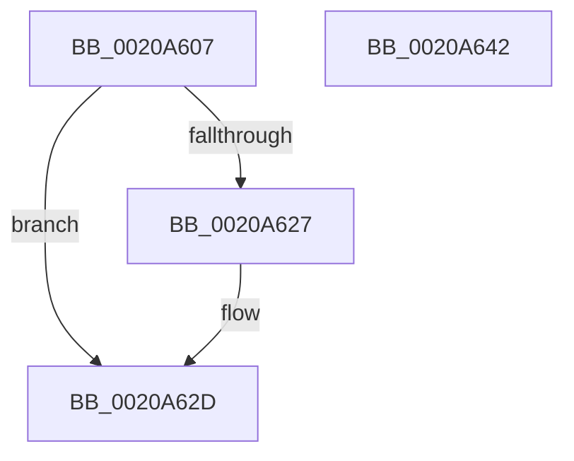

# sub_0020A607

- RVA: `0x0020A607`–`0x0020A643` (길이 `60` bytes)
- VA: `0x000000014020A607`
- 실행 섹션: `.text`
- PDB 이름 있음: `아니요`; PDB Function 태그: `아니요`
- unwind 정보 RVA: `0x0005D730`
- 디코드: `18`개 명령, `60/60` bytes 표시
- 미해석 바이트: `0` (있으면 어셈블리에 `.byte`로 보존)

> 이 문서는 커널 이미지의 기계어와 PDB 기호를 분석해 생성했습니다. 4번과 5번은 함수 원형과 자료형을 바이너리 사용 방식에서 추정한 C 해석이며 원본 소스 복구 결과는 아닙니다.

## 1. Dependencies

- 직접 호출 지점: **0**; 고유 호출 대상: **0**
- 직접 호출자로 확인된 함수: **0**
- RIP 상대 이미지 참조: **0**

### Outgoing calls
- 직접 디코드된 call 명령이 없습니다.

### Direct callers
- 이 함수 시작 RVA로 연결되는 직접 call은 확인되지 않았습니다. 간접 호출은 완전히 역산할 수 없습니다.

### Static image references
- 디코드된 RIP-relative 메모리 참조가 없습니다.

## 2. Other-region calls and transfers

- 다른 실행 섹션으로 향하는 call: **0**
- 별도 외부 분기/꼬리 이동을 확인하지 못했습니다.

## 3. Assembly (complete function range)

```asm
0020A607  A0 69 03 00 00 80 F7 FF FF      movabs al, byte ptr [0xfffff78000000369]
0020A610  4D 2B DF                        sub r11, r15
0020A613  48 BA 60 03 00 00 80 F7 FF FF   movabs rdx, 0xfffff78000000360
0020A61D  49 FF CB                        dec r11
0020A620  48 8B 12                        mov rdx, qword ptr [rdx]
0020A623  84 C0                           test al, al
0020A625  74 06                           je 0x14020a62d
0020A627  0F B6 C8                        movzx ecx, al
0020A62A  49 D3 E3                        shl r11, cl
0020A62D  48 8B C2                        mov rax, rdx
0020A630  49 F7 E3                        mul r11
0020A633  4A 8D 04 22                     lea rax, [rdx + r12]
0020A637  48 83 C4 60                     add rsp, 0x60
0020A63B  41 5F                           pop r15
0020A63D  41 5E                           pop r14
0020A63F  41 5C                           pop r12
0020A641  C3                              ret
0020A642  CC                              int3
```

## 4. C-style interpretation (structured pseudocode)

```c
__int64 __fastcall sub_0020A607(void)
{
    __int64 v_r11;
    __int64 v_rsp;

    v_r11 = (v_r11) - (v_r15);
    v_r11 = (v_r11) - 1;
    if ((unsigned __int8)(result) != 0) {
        a1 = (unsigned __int8)(result);
        v_r11 = (v_r11) << ((unsigned __int8)(a1));
    }
    v_rsp = (v_rsp) + (96);
    return *(unsigned __int64 *)(a2) + v_r12 * 1;
}
```

## 5. (Beta) C Style

```c
void sub_0020A607(void)
{
    int64_t local_r11;
    int64_t local_rsp;

    local_r11 = (local_r11) - (local_r15);
    local_r11 = (local_r11) - 1;
    if ((uint8_t)(result) != 0) {
        a1 = (uint8_t)(result);
        local_r11 = (local_r11) << ((uint8_t)(a1));
    }
    local_rsp = (local_rsp) + (96);
    return *(uint64_t *)(a2) + local_r12 * 1;
}
```

## 6. Execution-region graph

[열기: 2D/3D 그래프와 함수 탐색 컨트롤 패널](../../../control-panel.html?section=text&rva=0x0020A607&view=graph)

- 2D 그래프는 위에서 아래로 흐르고, 3D 그래프는 빈 공간을 드래그해 회전합니다. Shift+드래그는 이동, 휠은 확대·축소, 함수 노드 선택은 대상 보고서 이동입니다.

### Static fallback


