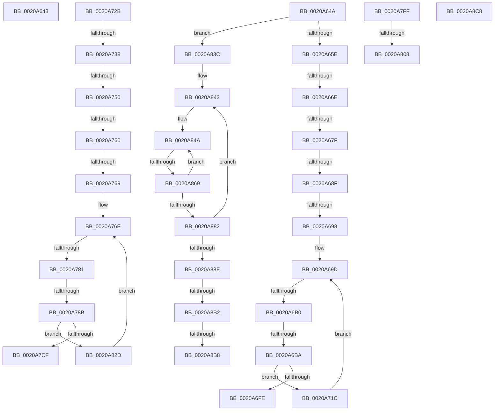

# sub_0020A643

- RVA: `0x0020A643`–`0x0020A8DF` (길이 `668` bytes)
- VA: `0x000000014020A643`
- 실행 섹션: `.text`
- PDB 이름 있음: `아니요`; PDB Function 태그: `아니요`
- unwind 정보 RVA: `0x0005D744`
- 디코드: `143`개 명령, `668/668` bytes 표시
- 미해석 바이트: `0` (있으면 어셈블리에 `.byte`로 보존)

> 이 문서는 커널 이미지의 기계어와 PDB 기호를 분석해 생성했습니다. 4번과 5번은 함수 원형과 자료형을 바이너리 사용 방식에서 추정한 C 해석이며 원본 소스 복구 결과는 아닙니다.

## 1. Dependencies

- 직접 호출 지점: **5**; 고유 호출 대상: **3**
- 직접 호출자로 확인된 함수: **0**
- RIP 상대 이미지 참조: **3**

### Outgoing calls
- `0x0020A73B` → [HalpTimerGetInternalData](HalpTimerGetInternalData_function_00209500.md) (function, `0x00209500`)
- `0x0020A7EC` → [HalpTimerScaleCounter](../37/HalpTimerScaleCounter_function_0037B354.md) (function, `0x0037B354`)
- `0x0020A820` → [HalpTimerScaleCounter](../37/HalpTimerScaleCounter_function_0037B354.md) (function, `0x0037B354`)
- `0x0020A854` → [HalpTimerGetInternalData](HalpTimerGetInternalData_function_00209500.md) (function, `0x00209500`)
- `0x0020A869` → [HalpHpetQueryCounter](../37/HalpHpetQueryCounter_function_00379660.md) (function, `0x00379660`)

### Direct callers
- 이 함수 시작 RVA로 연결되는 직접 call은 확인되지 않았습니다. 간접 호출은 완전히 역산할 수 없습니다.

### Static image references
- `0x0020A67F` → RVA `0x00E11760` (`.data`; read)
- `0x0020A69D` → RVA `0x00FC6D88` (`ALMOSTRO`; read)
- `0x0020A83C` → RVA `0x00379660` (`HalpHpetQueryCounter`; read)

## 2. Other-region calls and transfers

- 다른 실행 섹션으로 향하는 call: **0**
- call이 아닌 외부 분기/꼬리 이동: **22**
  - `0x0020A645` → [sub_0020A4CF + 0x30](Unknown_function_0020A4CF.md) (`tail-transfer`)
  - `0x0020A668` → [sub_0020A8E8 + 0x7E](Unknown_function_0020A8E8.md) (`tail-transfer`)
  - `0x0020A679` → [sub_0020A8E8 + 0x291](Unknown_function_0020A8E8.md) (`tail-transfer`)
  - `0x0020A689` → [sub_0020A8E8 + 0xDC](Unknown_function_0020A8E8.md) (`tail-transfer`)
  - `0x0020A692` → [sub_0020A8E8 + 0x28F](Unknown_function_0020A8E8.md) (`tail-transfer`)
  - `0x0020A6AA` → [sub_0020A8E8 + 0xB1](Unknown_function_0020A8E8.md) (`tail-transfer`)
  - `0x0020A6B4` → [sub_0020A8E8 + 0x95](Unknown_function_0020A8E8.md) (`tail-transfer`)
  - `0x0020A717` → [sub_0020A4CF + 0xF1](Unknown_function_0020A4CF.md) (`tail-transfer`)
  - `0x0020A732` → [sub_0020A8E8 + 0xEF](Unknown_function_0020A8E8.md) (`tail-transfer`)
  - `0x0020A74A` → [sub_0020A8E8 + 0x262](Unknown_function_0020A8E8.md) (`tail-transfer`)
  - `0x0020A75A` → [sub_0020A8E8 + 0x240](Unknown_function_0020A8E8.md) (`tail-transfer`)
  - `0x0020A763` → [sub_0020A8E8 + 0x260](Unknown_function_0020A8E8.md) (`tail-transfer`)
  - `0x0020A77B` → [sub_0020A8E8 + 0x22C](Unknown_function_0020A8E8.md) (`tail-transfer`)
  - `0x0020A785` → [sub_0020A8E8 + 0x1F9](Unknown_function_0020A8E8.md) (`tail-transfer`)
  - `0x0020A7FA` → [sub_0020A4CF + 0xF1](Unknown_function_0020A4CF.md) (`tail-transfer`)
  - `0x0020A802` → [sub_0020A4CF + 0x101](Unknown_function_0020A4CF.md) (`tail-transfer`)
  - `0x0020A828` → [sub_0020A4CF + 0x101](Unknown_function_0020A4CF.md) (`tail-transfer`)
  - `0x0020A863` → [sub_0020A8E8 + 0x282](Unknown_function_0020A8E8.md) (`tail-transfer`)
  - `0x0020A8B0` → [sub_0020A8E8](Unknown_function_0020A8E8.md) (`tail-transfer`)
  - `0x0020A8B6` → [sub_0020A8E8 + 0x4E](Unknown_function_0020A8E8.md) (`tail-transfer`)
  - `0x0020A8C6` → [sub_0020A8E8 + 0x55](Unknown_function_0020A8E8.md) (`tail-transfer`)
  - `0x0020A8DA` → [sub_0020A4CF + 0xB1](Unknown_function_0020A4CF.md) (`tail-transfer`)

## 3. Assembly (complete function range)

```asm
0020A643  F3 90                           pause
0020A645  E9 B5 FE FF FF                  jmp 0x14020a4ff
0020A64A  83 BD DC 00 00 00 40            cmp dword ptr [rbp + 0xdc], 0x40
0020A651  48 8B B5 C0 00 00 00            mov rsi, qword ptr [rbp + 0xc0]
0020A658  0F 85 DE 01 00 00               jne 0x14020a83c
0020A65E  F7 85 E0 00 00 00 00 00 01 00   test dword ptr [rbp + 0xe0], 0x10000
0020A668  0F 85 F8 02 00 00               jne 0x14020a966
0020A66E  48 8B 4D 48                     mov rcx, qword ptr [rbp + 0x48]
0020A672  48 8B 45 70                     mov rax, qword ptr [rbp + 0x70]
0020A676  49 3B C3                        cmp rax, r11
0020A679  0F 85 FA 04 00 00               jne 0x14020ab79
0020A67F  48 8B 05 DA 70 C0 00            mov rax, qword ptr [rip + 0xc070da]
0020A686  48 85 C0                        test rax, rax
0020A689  0F 84 35 03 00 00               je 0x14020a9c4
0020A68F  49 3B C2                        cmp rax, r10
0020A692  0F 85 DF 04 00 00               jne 0x14020ab77
0020A698  4C 89 74 24 28                  mov qword ptr [rsp + 0x28], r14
0020A69D  48 8B 05 E4 C6 DB 00            mov rax, qword ptr [rip + 0xdbc6e4]
0020A6A4  44 8B 08                        mov r9d, dword ptr [rax]
0020A6A7  45 85 C9                        test r9d, r9d
0020A6AA  0F 84 E9 02 00 00               je 0x14020a999
0020A6B0  41 80 38 00                     cmp byte ptr [r8], 0
0020A6B4  0F 84 C3 02 00 00               je 0x14020a97d
0020A6BA  0F 01 F9                        rdtscp
0020A6BD  4C 8D 84 24 98 00 00 00         lea r8, [rsp + 0x98]
0020A6C5  41 89 08                        mov dword ptr [r8], ecx
0020A6C8  48 C1 E2 20                     shl rdx, 0x20
0020A6CC  48 0B D0                        or rdx, rax
0020A6CF  48 8B 05 B2 C6 DB 00            mov rax, qword ptr [rip + 0xdbc6b2]
0020A6D6  48 8B 40 08                     mov rax, qword ptr [rax + 8]
0020A6DA  48 8B 0D A7 C6 DB 00            mov rcx, qword ptr [rip + 0xdbc6a7]
0020A6E1  48 F7 E2                        mul rdx
0020A6E4  4C 8B 41 10                     mov r8, qword ptr [rcx + 0x10]
0020A6E8  48 8B 05 99 C6 DB 00            mov rax, qword ptr [rip + 0xdbc699]
0020A6EF  49 03 D0                        add rdx, r8
0020A6F2  48 89 54 24 28                  mov qword ptr [rsp + 0x28], rdx
0020A6F7  8B 08                           mov ecx, dword ptr [rax]
0020A6F9  41 3B C9                        cmp ecx, r9d
0020A6FC  75 1E                           jne 0x14020a71c
0020A6FE  48 8B 54 24 28                  mov rdx, qword ptr [rsp + 0x28]
0020A703  4C 8B B5 D0 00 00 00            mov r14, qword ptr [rbp + 0xd0]
0020A70A  4D 8D 1C 16                     lea r11, [r14 + rdx]
0020A70E  41 B9 80 96 98 00               mov r9d, 0x989680
0020A714  45 33 F6                        xor r14d, r14d
0020A717  E9 A4 FE FF FF                  jmp 0x14020a5c0
0020A71C  49 B8 94 02 00 00 80 F7 FF FF   movabs r8, 0xfffff78000000294
0020A726  E9 72 FF FF FF                  jmp 0x14020a69d
0020A72B  83 BD DC 00 00 00 40            cmp dword ptr [rbp + 0xdc], 0x40
0020A732  0F 85 9F 02 00 00               jne 0x14020a9d7
0020A738  48 8B CD                        mov rcx, rbp
0020A73B  E8 C0 ED FF FF                  call 0x140209500
0020A740  48 8B C8                        mov rcx, rax
0020A743  48 8B 45 70                     mov rax, qword ptr [rbp + 0x70]
0020A747  49 3B C3                        cmp rax, r11
0020A74A  0F 85 FA 03 00 00               jne 0x14020ab4a
0020A750  48 8B 05 09 70 C0 00            mov rax, qword ptr [rip + 0xc07009]
0020A757  48 85 C0                        test rax, rax
0020A75A  0F 84 C8 03 00 00               je 0x14020ab28
0020A760  49 3B C2                        cmp rax, r10
0020A763  0F 85 DF 03 00 00               jne 0x14020ab48
0020A769  4C 89 74 24 20                  mov qword ptr [rsp + 0x20], r14
0020A76E  48 8B 05 13 C6 DB 00            mov rax, qword ptr [rip + 0xdbc613]
0020A775  44 8B 08                        mov r9d, dword ptr [rax]
0020A778  45 85 C9                        test r9d, r9d
0020A77B  0F 84 93 03 00 00               je 0x14020ab14
0020A781  41 80 38 00                     cmp byte ptr [r8], 0
0020A785  0F 84 56 03 00 00               je 0x14020aae1
0020A78B  0F 01 F9                        rdtscp
0020A78E  4C 8D 84 24 88 00 00 00         lea r8, [rsp + 0x88]
0020A796  41 89 08                        mov dword ptr [r8], ecx
0020A799  48 C1 E2 20                     shl rdx, 0x20
0020A79D  48 0B D0                        or rdx, rax
0020A7A0  48 8B 05 E1 C5 DB 00            mov rax, qword ptr [rip + 0xdbc5e1]
0020A7A7  48 8B 40 08                     mov rax, qword ptr [rax + 8]
0020A7AB  48 8B 0D D6 C5 DB 00            mov rcx, qword ptr [rip + 0xdbc5d6]
0020A7B2  48 F7 E2                        mul rdx
0020A7B5  4C 8B 41 10                     mov r8, qword ptr [rcx + 0x10]
0020A7B9  48 8B 05 C8 C5 DB 00            mov rax, qword ptr [rip + 0xdbc5c8]
0020A7C0  49 03 D0                        add rdx, r8
0020A7C3  48 89 54 24 20                  mov qword ptr [rsp + 0x20], rdx
0020A7C8  8B 08                           mov ecx, dword ptr [rax]
0020A7CA  41 3B C9                        cmp ecx, r9d
0020A7CD  75 5E                           jne 0x14020a82d
0020A7CF  48 8B 54 24 20                  mov rdx, qword ptr [rsp + 0x20]
0020A7D4  4C 8B B5 D0 00 00 00            mov r14, qword ptr [rbp + 0xd0]
0020A7DB  49 8D 0C 16                     lea rcx, [r14 + rdx]
0020A7DF  41 B8 80 96 98 00               mov r8d, 0x989680
0020A7E5  48 8B 95 C0 00 00 00            mov rdx, qword ptr [rbp + 0xc0]
0020A7EC  E8 63 0B 17 00                  call 0x14037b354
0020A7F1  4C 8B D8                        mov r11, rax
0020A7F4  45 8B C8                        mov r9d, r8d
0020A7F7  45 33 F6                        xor r14d, r14d
0020A7FA  E9 C1 FD FF FF                  jmp 0x14020a5c0
0020A7FF  48 85 C0                        test rax, rax
0020A802  0F 84 C8 FD FF FF               je 0x14020a5d0
0020A808  83 B8 E4 00 00 00 05            cmp dword ptr [rax + 0xe4], 5
0020A80F  48 8B D6                        mov rdx, rsi
0020A812  4C 8B 80 C0 00 00 00            mov r8, qword ptr [rax + 0xc0]
0020A819  49 8B CB                        mov rcx, r11
0020A81C  4D 0F 44 C1                     cmove r8, r9
0020A820  E8 2F 0B 17 00                  call 0x14037b354
0020A825  4C 8B D8                        mov r11, rax
0020A828  E9 A3 FD FF FF                  jmp 0x14020a5d0
0020A82D  49 B8 94 02 00 00 80 F7 FF FF   movabs r8, 0xfffff78000000294
0020A837  E9 32 FF FF FF                  jmp 0x14020a76e
0020A83C  4C 8D 2D 1D EE 16 00            lea r13, [rip + 0x16ee1d]
0020A843  4C 8B B5 D0 00 00 00            mov r14, qword ptr [rbp + 0xd0]
0020A84A  48 8B BD C8 00 00 00            mov rdi, qword ptr [rbp + 0xc8]
0020A851  48 8B CD                        mov rcx, rbp
0020A854  E8 A7 EC FF FF                  call 0x140209500
0020A859  48 8B 55 70                     mov rdx, qword ptr [rbp + 0x70]
0020A85D  48 8B C8                        mov rcx, rax
0020A860  49 3B D5                        cmp rdx, r13
0020A863  0F 85 01 03 00 00               jne 0x14020ab6a
0020A869  E8 F2 ED 16 00                  call 0x140379660
0020A86E  4C 8B D0                        mov r10, rax
0020A871  F0 83 0C 24 00                  lock or dword ptr [rsp], 0
0020A876  48 8B 85 C8 00 00 00            mov rax, qword ptr [rbp + 0xc8]
0020A87D  48 3B F8                        cmp rdi, rax
0020A880  75 C8                           jne 0x14020a84a
0020A882  48 8B 8D D0 00 00 00            mov rcx, qword ptr [rbp + 0xd0]
0020A889  4C 3B F1                        cmp r14, rcx
0020A88C  75 B5                           jne 0x14020a843
0020A88E  44 8B 8D DC 00 00 00            mov r9d, dword ptr [rbp + 0xdc]
0020A895  49 BD 50 03 00 00 80 F7 FF FF   movabs r13, 0xfffff78000000350
0020A89F  41 8D 49 FF                     lea ecx, [r9 - 1]
0020A8A3  0F B6 D1                        movzx edx, cl
0020A8A6  49 8B CA                        mov rcx, r10
0020A8A9  48 33 CF                        xor rcx, rdi
0020A8AC  48 0F A3 D1                     bt rcx, rdx
0020A8B0  72 36                           jb 0x14020a8e8
0020A8B2  41 83 F9 40                     cmp r9d, 0x40
0020A8B6  74 7E                           je 0x14020a936
0020A8B8  41 8B C9                        mov ecx, r9d
0020A8BB  BA 01 00 00 00                  mov edx, 1
0020A8C0  48 D3 E2                        shl rdx, cl
0020A8C3  48 FF CA                        dec rdx
0020A8C6  EB 75                           jmp 0x14020a93d
0020A8C8  65 8B 04 25 A4 01 00 00         mov eax, dword ptr gs:[0x1a4]
0020A8D0  0F AF 45 50                     imul eax, dword ptr [rbp + 0x50]
0020A8D4  8B C8                           mov ecx, eax
0020A8D6  48 03 4D 48                     add rcx, qword ptr [rbp + 0x48]
0020A8DA  E9 A1 FC FF FF                  jmp 0x14020a580
```

## 4. C-style interpretation (structured pseudocode)

```c
__int64 __fastcall sub_0020A643(__int64 a1, __int64 a2, __int64 a3)
{
    unsigned int v_stack_p0;
    unsigned __int64 v_stack_p20;
    unsigned __int64 v_stack_p28;
    unsigned __int64 v_stack_p88;
    unsigned __int64 v_stack_p98;
}
```

## 5. (Beta) C Style

```c
int64_t sub_0020A643(int64_t Arg1, int64_t Arg2, int64_t Arg3)
{
    uint32_t v_stack_p0;
    uint64_t v_stack_p20;
    uint64_t v_stack_p28;
    uint64_t v_stack_p88;
    uint64_t v_stack_p98;
}
```

## 6. Execution-region graph

[열기: 2D/3D 그래프와 함수 탐색 컨트롤 패널](../../../control-panel.html?section=text&rva=0x0020A643&view=graph)

- 2D 그래프는 위에서 아래로 흐르고, 3D 그래프는 빈 공간을 드래그해 회전합니다. Shift+드래그는 이동, 휠은 확대·축소, 함수 노드 선택은 대상 보고서 이동입니다.

### Static fallback


