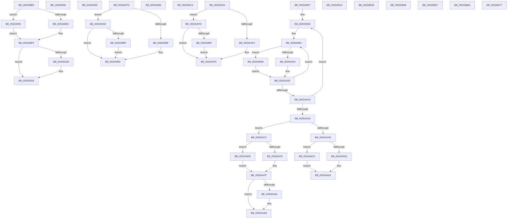

# sub_0020A8E8

- RVA: `0x0020A8E8`–`0x0020AB86` (길이 `670` bytes)
- VA: `0x000000014020A8E8`
- 실행 섹션: `.text`
- PDB 이름 있음: `아니요`; PDB Function 태그: `아니요`
- unwind 정보 RVA: `0x0005D778`
- 디코드: `156`개 명령, `670/670` bytes 표시
- 미해석 바이트: `0` (있으면 어셈블리에 `.byte`로 보존)

> 이 문서는 커널 이미지의 기계어와 PDB 기호를 분석해 생성했습니다. 4번과 5번은 함수 원형과 자료형을 바이너리 사용 방식에서 추정한 C 해석이며 원본 소스 복구 결과는 아닙니다.

## 1. Dependencies

- 직접 호출 지점: **9**; 고유 호출 대상: **4**
- 직접 호출자로 확인된 함수: **0**
- RIP 상대 이미지 참조: **1**

### Outgoing calls
- `0x0020A9A3` → [HvlpGetRegister64](../37/HvlpGetRegister64_function_00379050.md) (function, `0x00379050`)
- `0x0020A9EF` → [HalpTimerGetInternalData](HalpTimerGetInternalData_function_00209500.md) (function, `0x00209500`)
- `0x0020AA04` → [HalpHpetQueryCounter](../37/HalpHpetQueryCounter_function_00379660.md) (function, `0x00379660`)
- `0x0020AB1E` → [HvlpGetRegister64](../37/HvlpGetRegister64_function_00379050.md) (function, `0x00379050`)
- `0x0020AB3E` → [guard_dispatch_icall](../6B/guard_dispatch_icall_function_006BAAD0.md) (function, `0x006BAAD0`)
- `0x0020AB4A` → [guard_dispatch_icall](../6B/guard_dispatch_icall_function_006BAAD0.md) (function, `0x006BAAD0`)
- `0x0020AB57` → [guard_dispatch_icall](../6B/guard_dispatch_icall_function_006BAAD0.md) (function, `0x006BAAD0`)
- `0x0020AB6D` → [guard_dispatch_icall](../6B/guard_dispatch_icall_function_006BAAD0.md) (function, `0x006BAAD0`)
- `0x0020AB79` → [guard_dispatch_icall](../6B/guard_dispatch_icall_function_006BAAD0.md) (function, `0x006BAAD0`)

### Direct callers
- 이 함수 시작 RVA로 연결되는 직접 call은 확인되지 않았습니다. 간접 호출은 완전히 역산할 수 없습니다.

### Static image references
- `0x0020A9D7` → RVA `0x00379660` (`HalpHpetQueryCounter`; read)

## 2. Other-region calls and transfers

- 다른 실행 섹션으로 향하는 call: **0**
- call이 아닌 외부 분기/꼬리 이동: **15**
  - `0x0020A931` → [sub_0020A643 + 0xC7](Unknown_function_0020A643.md) (`tail-transfer`)
  - `0x0020A950` → [sub_0020A643 + 0xC7](Unknown_function_0020A643.md) (`tail-transfer`)
  - `0x0020A978` → [sub_0020A643 + 0x2F](Unknown_function_0020A643.md) (`tail-transfer`)
  - `0x0020A994` → [sub_0020A643 + 0x85](Unknown_function_0020A643.md) (`tail-transfer`)
  - `0x0020A9A8` → [sub_0020A643 + 0xBB](Unknown_function_0020A643.md) (`tail-transfer`)
  - `0x0020A9D2` → [sub_0020A643 + 0xC0](Unknown_function_0020A643.md) (`tail-transfer`)
  - `0x0020AA6D` → [sub_0020A643 + 0x198](Unknown_function_0020A643.md) (`tail-transfer`)
  - `0x0020AABB` → [sub_0020A643 + 0x198](Unknown_function_0020A643.md) (`tail-transfer`)
  - `0x0020AAF8` → [sub_0020A643 + 0x156](Unknown_function_0020A643.md) (`tail-transfer`)
  - `0x0020AB23` → [sub_0020A643 + 0x18C](Unknown_function_0020A643.md) (`tail-transfer`)
  - `0x0020AB36` → [sub_0020A643 + 0x191](Unknown_function_0020A643.md) (`tail-transfer`)
  - `0x0020AB52` → [sub_0020A643 + 0x191](Unknown_function_0020A643.md) (`tail-transfer`)
  - `0x0020AB65` → [sub_0020A4CF + 0xD3](Unknown_function_0020A4CF.md) (`tail-transfer`)
  - `0x0020AB72` → [sub_0020A643 + 0x22B](Unknown_function_0020A643.md) (`tail-transfer`)
  - `0x0020AB81` → [sub_0020A643 + 0xC0](Unknown_function_0020A643.md) (`tail-transfer`)

## 3. Assembly (complete function range)

```asm
0020A8E8  41 83 F9 40                     cmp r9d, 0x40
0020A8EC  75 67                           jne 0x14020a955
0020A8EE  49 C7 C0 FF FF FF FF            mov r8, 0xffffffffffffffff
0020A8F5  41 8B C9                        mov ecx, r9d
0020A8F8  BA 01 00 00 00                  mov edx, 1
0020A8FD  48 D3 E2                        shl rdx, cl
0020A900  33 C9                           xor ecx, ecx
0020A902  41 83 F9 40                     cmp r9d, 0x40
0020A906  48 0F 45 CA                     cmovne rcx, rdx
0020A90A  4C 23 C7                        and r8, rdi
0020A90D  49 8B D0                        mov rdx, r8
0020A910  48 33 D7                        xor rdx, rdi
0020A913  49 0B D2                        or rdx, r10
0020A916  4D 3B D0                        cmp r10, r8
0020A919  73 03                           jae 0x14020a91e
0020A91B  48 03 D1                        add rdx, rcx
0020A91E  F0 48 0F B1 95 C8 00 00 00      lock cmpxchg qword ptr [rbp + 0xc8], rdx
0020A927  48 BF 40 03 00 00 80 F7 FF FF   movabs rdi, 0xfffff78000000340
0020A931  E9 D4 FD FF FF                  jmp 0x14020a70a
0020A936  48 C7 C2 FF FF FF FF            mov rdx, 0xffffffffffffffff
0020A93D  48 F7 D2                        not rdx
0020A940  48 23 D7                        and rdx, rdi
0020A943  48 BF 40 03 00 00 80 F7 FF FF   movabs rdi, 0xfffff78000000340
0020A94D  49 0B D2                        or rdx, r10
0020A950  E9 B5 FD FF FF                  jmp 0x14020a70a
0020A955  41 8B C9                        mov ecx, r9d
0020A958  41 B8 01 00 00 00               mov r8d, 1
0020A95E  49 D3 E0                        shl r8, cl
0020A961  49 FF C8                        dec r8
0020A964  EB 8F                           jmp 0x14020a8f5
0020A966  65 8B 04 25 A4 01 00 00         mov eax, dword ptr gs:[0x1a4]
0020A96E  0F AF 45 50                     imul eax, dword ptr [rbp + 0x50]
0020A972  8B C8                           mov ecx, eax
0020A974  48 03 4D 48                     add rcx, qword ptr [rbp + 0x48]
0020A978  E9 F5 FC FF FF                  jmp 0x14020a672
0020A97D  65 48 8B 04 25 20 00 00 00      mov rax, qword ptr gs:[0x20]
0020A986  80 B8 8D 00 00 00 02            cmp byte ptr [rax + 0x8d], 2
0020A98D  75 1E                           jne 0x14020a9ad
0020A98F  0F AE E8                        lfence
0020A992  0F 31                           rdtsc
0020A994  E9 2F FD FF FF                  jmp 0x14020a6c8
0020A999  48 8D 54 24 28                  lea rdx, [rsp + 0x28]
0020A99E  B9 04 00 09 00                  mov ecx, 0x90004
0020A9A3  E8 A8 E6 16 00                  call 0x140379050
0020A9A8  E9 51 FD FF FF                  jmp 0x14020a6fe
0020A9AD  65 48 8B 04 25 20 00 00 00      mov rax, qword ptr gs:[0x20]
0020A9B6  80 B8 8D 00 00 00 01            cmp byte ptr [rax + 0x8d], 1
0020A9BD  75 D3                           jne 0x14020a992
0020A9BF  0F AE F0                        mfence
0020A9C2  EB CE                           jmp 0x14020a992
0020A9C4  B9 20 00 00 40                  mov ecx, 0x40000020
0020A9C9  0F 32                           rdmsr
0020A9CB  48 C1 E2 20                     shl rdx, 0x20
0020A9CF  48 0B D0                        or rdx, rax
0020A9D2  E9 2C FD FF FF                  jmp 0x14020a703
0020A9D7  4C 8D 2D 82 EC 16 00            lea r13, [rip + 0x16ec82]
0020A9DE  4C 8B B5 D0 00 00 00            mov r14, qword ptr [rbp + 0xd0]
0020A9E5  48 8B BD C8 00 00 00            mov rdi, qword ptr [rbp + 0xc8]
0020A9EC  48 8B CD                        mov rcx, rbp
0020A9EF  E8 0C EB FF FF                  call 0x140209500
0020A9F4  48 8B 55 70                     mov rdx, qword ptr [rbp + 0x70]
0020A9F8  48 8B C8                        mov rcx, rax
0020A9FB  49 3B D5                        cmp rdx, r13
0020A9FE  0F 85 37 01 00 00               jne 0x14020ab3b
0020AA04  E8 57 EC 16 00                  call 0x140379660
0020AA09  4C 8B D0                        mov r10, rax
0020AA0C  F0 83 0C 24 00                  lock or dword ptr [rsp], 0
0020AA11  48 8B 85 C8 00 00 00            mov rax, qword ptr [rbp + 0xc8]
0020AA18  48 3B F8                        cmp rdi, rax
0020AA1B  75 C8                           jne 0x14020a9e5
0020AA1D  48 8B 8D D0 00 00 00            mov rcx, qword ptr [rbp + 0xd0]
0020AA24  4C 3B F1                        cmp r14, rcx
0020AA27  75 B5                           jne 0x14020a9de
0020AA29  44 8B 8D DC 00 00 00            mov r9d, dword ptr [rbp + 0xdc]
0020AA30  49 BD 50 03 00 00 80 F7 FF FF   movabs r13, 0xfffff78000000350
0020AA3A  41 8D 49 FF                     lea ecx, [r9 - 1]
0020AA3E  0F B6 D1                        movzx edx, cl
0020AA41  49 8B CA                        mov rcx, r10
0020AA44  48 33 CF                        xor rcx, rdi
0020AA47  48 0F A3 D1                     bt rcx, rdx
0020AA4B  72 25                           jb 0x14020aa72
0020AA4D  41 83 F9 40                     cmp r9d, 0x40
0020AA51  75 6D                           jne 0x14020aac0
0020AA53  48 C7 C2 FF FF FF FF            mov rdx, 0xffffffffffffffff
0020AA5A  48 F7 D2                        not rdx
0020AA5D  48 23 D7                        and rdx, rdi
0020AA60  48 BF 40 03 00 00 80 F7 FF FF   movabs rdi, 0xfffff78000000340
0020AA6A  49 0B D2                        or rdx, r10
0020AA6D  E9 69 FD FF FF                  jmp 0x14020a7db
0020AA72  41 83 F9 40                     cmp r9d, 0x40
0020AA76  75 58                           jne 0x14020aad0
0020AA78  49 C7 C0 FF FF FF FF            mov r8, 0xffffffffffffffff
0020AA7F  41 8B C9                        mov ecx, r9d
0020AA82  BA 01 00 00 00                  mov edx, 1
0020AA87  48 D3 E2                        shl rdx, cl
0020AA8A  33 C9                           xor ecx, ecx
0020AA8C  41 83 F9 40                     cmp r9d, 0x40
0020AA90  48 0F 45 CA                     cmovne rcx, rdx
0020AA94  4C 23 C7                        and r8, rdi
0020AA97  49 8B D0                        mov rdx, r8
0020AA9A  48 33 D7                        xor rdx, rdi
0020AA9D  49 0B D2                        or rdx, r10
0020AAA0  4D 3B D0                        cmp r10, r8
0020AAA3  73 03                           jae 0x14020aaa8
0020AAA5  48 03 D1                        add rdx, rcx
0020AAA8  F0 48 0F B1 95 C8 00 00 00      lock cmpxchg qword ptr [rbp + 0xc8], rdx
0020AAB1  48 BF 40 03 00 00 80 F7 FF FF   movabs rdi, 0xfffff78000000340
0020AABB  E9 1B FD FF FF                  jmp 0x14020a7db
0020AAC0  41 8B C9                        mov ecx, r9d
0020AAC3  BA 01 00 00 00                  mov edx, 1
0020AAC8  48 D3 E2                        shl rdx, cl
0020AACB  48 FF CA                        dec rdx
0020AACE  EB 8A                           jmp 0x14020aa5a
0020AAD0  41 8B C9                        mov ecx, r9d
0020AAD3  41 B8 01 00 00 00               mov r8d, 1
0020AAD9  49 D3 E0                        shl r8, cl
0020AADC  49 FF C8                        dec r8
0020AADF  EB 9E                           jmp 0x14020aa7f
0020AAE1  65 48 8B 04 25 20 00 00 00      mov rax, qword ptr gs:[0x20]
0020AAEA  80 B8 8D 00 00 00 02            cmp byte ptr [rax + 0x8d], 2
0020AAF1  75 0A                           jne 0x14020aafd
0020AAF3  0F AE E8                        lfence
0020AAF6  0F 31                           rdtsc
0020AAF8  E9 9C FC FF FF                  jmp 0x14020a799
0020AAFD  65 48 8B 04 25 20 00 00 00      mov rax, qword ptr gs:[0x20]
0020AB06  80 B8 8D 00 00 00 01            cmp byte ptr [rax + 0x8d], 1
0020AB0D  75 E7                           jne 0x14020aaf6
0020AB0F  0F AE F0                        mfence
0020AB12  EB E2                           jmp 0x14020aaf6
0020AB14  48 8D 54 24 20                  lea rdx, [rsp + 0x20]
0020AB19  B9 04 00 09 00                  mov ecx, 0x90004
0020AB1E  E8 2D E5 16 00                  call 0x140379050
0020AB23  E9 A7 FC FF FF                  jmp 0x14020a7cf
0020AB28  B9 20 00 00 40                  mov ecx, 0x40000020
0020AB2D  0F 32                           rdmsr
0020AB2F  48 C1 E2 20                     shl rdx, 0x20
0020AB33  48 0B D0                        or rdx, rax
0020AB36  E9 99 FC FF FF                  jmp 0x14020a7d4
0020AB3B  48 8B C2                        mov rax, rdx
0020AB3E  E8 8D FF 4A 00                  call 0x1406baad0
0020AB43  E9 C1 FE FF FF                  jmp 0x14020aa09
0020AB48  33 C9                           xor ecx, ecx
0020AB4A  E8 81 FF 4A 00                  call 0x1406baad0
0020AB4F  48 8B D0                        mov rdx, rax
0020AB52  E9 7D FC FF FF                  jmp 0x14020a7d4
0020AB57  E8 74 FF 4A 00                  call 0x1406baad0
0020AB5C  48 8B D0                        mov rdx, rax
0020AB5F  41 B9 80 96 98 00               mov r9d, 0x989680
0020AB65  E9 38 FA FF FF                  jmp 0x14020a5a2
0020AB6A  48 8B C2                        mov rax, rdx
0020AB6D  E8 5E FF 4A 00                  call 0x1406baad0
0020AB72  E9 F7 FC FF FF                  jmp 0x14020a86e
0020AB77  33 C9                           xor ecx, ecx
0020AB79  E8 52 FF 4A 00                  call 0x1406baad0
0020AB7E  48 8B D0                        mov rdx, rax
0020AB81  E9 7D FB FF FF                  jmp 0x14020a703
```

## 4. C-style interpretation (structured pseudocode)

```c
__int64 __fastcall sub_0020A8E8(__int64 a1, __int64 a2, __int64 a3, int a4)
{
    unsigned int v_stack_p0;
    unsigned __int64 v_stack_p20;
    unsigned __int64 v_stack_p28;

    if (a4 != 64) goto loc_0020A955;
loc_0020A8F5:
    a2 = (1) << ((unsigned __int8)((unsigned int)(a4)));
    a1 = 0;
    if (a4 != 64) { a1 = a2; }
    a3 = (-1) & (v_rdi);
    a2 = (a3) ^ (v_rdi);
    a2 = (a2) | (v_r10);
    if (v_r10 < a3) {
        a2 = (a2) + (a1);
    }
loc_0020A955:
    a3 = (1) << ((unsigned __int8)((unsigned int)(a4)));
    a3 = (a3) - 1;
    goto loc_0020A8F5;
}
```

## 5. (Beta) C Style

```c
int64_t sub_0020A8E8(int64_t Arg1, int64_t Arg2, int64_t Arg3, int32_t Arg4)
{
    uint32_t v_stack_p0;
    uint64_t v_stack_p20;
    uint64_t v_stack_p28;

    if (Arg4 != 64) goto loc_0020A955;
loc_0020A8F5:
    Arg2 = (1) << ((uint8_t)((uint32_t)(Arg4)));
    Arg1 = 0;
    if (Arg4 != 64) { Arg1 = Arg2; }
    Arg3 = (-1) & (local_rdi);
    Arg2 = (Arg3) ^ (local_rdi);
    Arg2 = (Arg2) | (local_r10);
    if (local_r10 < Arg3) {
        Arg2 = (Arg2) + (Arg1);
    }
loc_0020A955:
    Arg3 = (1) << ((uint8_t)((uint32_t)(Arg4)));
    Arg3 = (Arg3) - 1;
    goto loc_0020A8F5;
}
```

## 6. Execution-region graph

[열기: 2D/3D 그래프와 함수 탐색 컨트롤 패널](../../../control-panel.html?section=text&rva=0x0020A8E8&view=graph)

- 2D 그래프는 위에서 아래로 흐르고, 3D 그래프는 빈 공간을 드래그해 회전합니다. Shift+드래그는 이동, 휠은 확대·축소, 함수 노드 선택은 대상 보고서 이동입니다.

### Static fallback


