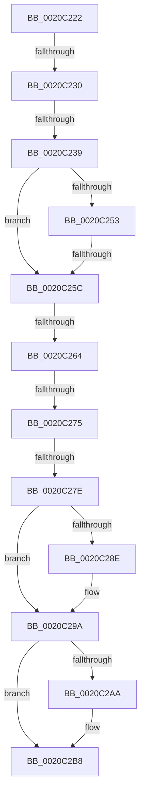

# sub_0020C222

- RVA: `0x0020C222`–`0x0020C2BF` (길이 `157` bytes)
- VA: `0x000000014020C222`
- 실행 섹션: `.text`
- PDB 이름 있음: `아니요`; PDB Function 태그: `아니요`
- unwind 정보 RVA: `0x0005D8AC`
- 디코드: `38`개 명령, `157/157` bytes 표시
- 미해석 바이트: `0` (있으면 어셈블리에 `.byte`로 보존)

> 이 문서는 커널 이미지의 기계어와 PDB 기호를 분석해 생성했습니다. 4번과 5번은 함수 원형과 자료형을 바이너리 사용 방식에서 추정한 C 해석이며 원본 소스 복구 결과는 아닙니다.

## 1. Dependencies

- 직접 호출 지점: **2**; 고유 호출 대상: **2**
- 직접 호출자로 확인된 함수: **0**
- RIP 상대 이미지 참조: **2**

### Outgoing calls
- `0x0020C295` → [KiLowerIrqlProcessIrqlFlags](../4F/KiLowerIrqlProcessIrqlFlags_function_004F5698.md) (function, `0x004F5698`)
- `0x0020C2B3` → [EtwTraceDequeueWork](../4B/EtwTraceDequeueWork_function_004BDBFC.md) (function, `0x004BDBFC`)

### Direct callers
- 이 함수 시작 RVA로 연결되는 직접 call은 확인되지 않았습니다. 간접 호출은 완전히 역산할 수 없습니다.

### Static image references
- `0x0020C27E` → RVA `0x00FC6D20` (`ALMOSTRO`; read)
- `0x0020C29E` → RVA `0x00FC6B04` (`ALMOSTRO`; read)

## 2. Other-region calls and transfers

- 다른 실행 섹션으로 향하는 call: **0**
- call이 아닌 외부 분기/꼬리 이동: **7**
  - `0x0020C22A` → [sub_0020BDAA + 0x22B](Unknown_function_0020BDAA.md) (`tail-transfer`)
  - `0x0020C233` → [sub_0020BDAA + 0x22B](Unknown_function_0020BDAA.md) (`tail-transfer`)
  - `0x0020C256` → [sub_0020BDAA + 0x283](Unknown_function_0020BDAA.md) (`tail-transfer`)
  - `0x0020C25E` → [sub_0020C2D4 + 0xE0](Unknown_function_0020C2D4.md) (`tail-transfer`)
  - `0x0020C26F` → [sub_0020C2D4 + 0x7E](Unknown_function_0020C2D4.md) (`tail-transfer`)
  - `0x0020C278` → [sub_0020C2D4 + 0x59E](Unknown_function_0020C2D4.md) (`tail-transfer`)
  - `0x0020C2BA` → [sub_0020BDAA + 0x3CA](Unknown_function_0020BDAA.md) (`tail-transfer`)

## 3. Assembly (complete function range)

```asm
0020C222  4C 8B 42 08                     mov r8, qword ptr [rdx + 8]
0020C226  48 39 50 08                     cmp qword ptr [rax + 8], rdx
0020C22A  0F 85 A5 FD FF FF               jne 0x14020bfd5
0020C230  49 39 10                        cmp qword ptr [r8], rdx
0020C233  0F 85 9C FD FF FF               jne 0x14020bfd5
0020C239  49 89 00                        mov qword ptr [r8], rax
0020C23C  4C 89 40 08                     mov qword ptr [rax + 8], r8
0020C240  8B C6                           mov eax, esi
0020C242  FF C6                           inc esi
0020C244  4C 89 0A                        mov qword ptr [rdx], r9
0020C247  49 89 14 C7                     mov qword ptr [r15 + rax*8], rdx
0020C24B  48 8B 11                        mov rdx, qword ptr [rcx]
0020C24E  48 3B D1                        cmp rdx, rcx
0020C251  74 09                           je 0x14020c25c
0020C253  41 3B F5                        cmp esi, r13d
0020C256  0F 82 D1 FD FF FF               jb 0x14020c02d
0020C25C  85 F6                           test esi, esi
0020C25E  0F 84 50 01 00 00               je 0x14020c3b4
0020C264  F0 41 81 26 7F FF FF FF         lock and dword ptr [r14], 0xffffff7f
0020C26C  83 FB 02                        cmp ebx, 2
0020C26F  0F 83 DD 00 00 00               jae 0x14020c352
0020C275  F6 C3 01                        test bl, 1
0020C278  0F 85 F4 05 00 00               jne 0x14020c872
0020C27E  83 3D 9B AA DB 00 00            cmp dword ptr [rip + 0xdbaa9b], 0
0020C285  0F B6 9F 86 01 00 00            movzx ebx, byte ptr [rdi + 0x186]
0020C28C  74 0C                           je 0x14020c29a
0020C28E  44 0F 20 C1                     mov rcx, cr8
0020C292  0F B6 D3                        movzx edx, bl
0020C295  E8 FE 93 2E 00                  call 0x1404f5698
0020C29A  44 0F 22 C3                     mov cr8, rbx
0020C29E  F7 05 5C A8 DB 00 00 00 00 01   test dword ptr [rip + 0xdba85c], 0x1000000
0020C2A8  74 0E                           je 0x14020c2b8
0020C2AA  44 8B C6                        mov r8d, esi
0020C2AD  49 8B D7                        mov rdx, r15
0020C2B0  48 8B CF                        mov rcx, rdi
0020C2B3  E8 44 19 2B 00                  call 0x1404bdbfc
0020C2B8  8B C6                           mov eax, esi
0020C2BA  E9 B5 FE FF FF                  jmp 0x14020c174
```

## 4. C-style interpretation (structured pseudocode)

```c
__int64 __fastcall sub_0020C222(__int64 a1, __int64 a2, __int64 a3, __int64 a4)
{
    __int64 result;
    __int64 v_rsi;

    *(unsigned __int64 *)(*(unsigned __int64 *)(a2 + 8)) = result;
    *(unsigned __int64 *)(result + 8) = *(unsigned __int64 *)(a2 + 8);
    v_rsi = (unsigned int)((v_rsi) + 1);
    *(unsigned __int64 *)(a2) = a4;
    *(unsigned __int64 *)(v_r15 + (unsigned int)((unsigned int)(v_rsi)) * 8) = a2;
    if ((*(unsigned __int64 *)(a1)) == a1) goto loc_0020C25C;
loc_0020C25C:
    result = (unsigned int)((unsigned int)(v_rsi));
    if ((*(unsigned int *)(v_rip + 14396059)) != 0) {
        a1 = v_cr8;
        a2 = (unsigned __int8)(*(unsigned __int8 *)(v_rdi + 390));
        result = KiLowerIrqlProcessIrqlFlags(a1, a2, *(unsigned __int64 *)(a2 + 8), a4);
    }
    if (((*(unsigned int *)(v_rip + 14395484)) & (0x1000000ULL)) != 0) {
        a3 = (unsigned int)(v_rsi);
        a2 = v_r15;
        a1 = v_rdi;
        result = EtwTraceDequeueWork(a1, a2, a3, a4);
    }
}
```

## 5. (Beta) C Style

```c
int64_t sub_0020C222(void *Arg1, void *Arg2, int64_t Arg3, int64_t Arg4)
{
    uint8_t *arg1 = (uint8_t *)Arg1;
    uint8_t *arg2 = (uint8_t *)Arg2;

    int64_t result;
    int64_t local_rsi;

    *(uint64_t *)(*(uint64_t *)(arg2 + 0x8)) = result;
    *(uint64_t *)(result + 0x8) = *(uint64_t *)(arg2 + 0x8);
    local_rsi = (uint32_t)((local_rsi) + 1);
    *(uint64_t *)(arg2) = Arg4;
    *(void **)(local_r15 + (uint32_t)((uint32_t)(local_rsi)) * 8) = Arg2;
    if ((*(uint64_t *)(arg1)) == Arg1) goto loc_0020C25C;
loc_0020C25C:
    result = (uint32_t)((uint32_t)(local_rsi));
    if ((*(uint32_t *)(v_rip + 0xDBAA9B)) != 0) {
        Arg1 = v_cr8;
        Arg2 = (uint8_t)(*(uint8_t *)(local_rdi + 0x186));
        result = KiLowerIrqlProcessIrqlFlags(Arg1, Arg2, *(uint64_t *)(arg2 + 0x8), Arg4);
    }
    if (((*(uint32_t *)(v_rip + 0xDBA85C)) & (0x1000000ULL)) != 0) {
        Arg3 = (uint32_t)(local_rsi);
        Arg2 = local_r15;
        Arg1 = local_rdi;
        result = EtwTraceDequeueWork(Arg1, Arg2, Arg3, Arg4);
    }
}
```

### 관측된 메모리 오프셋

구조체 형식이 확인되지 않은 접근은 인자 기준의 오프셋으로만 기록했습니다.

| 기준 인자 | 오프셋 표현 | 폭 (bit) | 접근 |
|---|---:|---:|---|
| `Arg1` | `+ 0x0` | `64` | `R` |
| `Arg2` | `+ 0x0` | `64` | `W` |
| `Arg2` | `+ 0x8` | `64` | `R` |

## 6. Execution-region graph

[열기: 2D/3D 그래프와 함수 탐색 컨트롤 패널](../../../control-panel.html?section=text&rva=0x0020C222&view=graph)

- 2D 그래프는 위에서 아래로 흐르고, 3D 그래프는 빈 공간을 드래그해 회전합니다. Shift+드래그는 이동, 휠은 확대·축소, 함수 노드 선택은 대상 보고서 이동입니다.

### Static fallback


