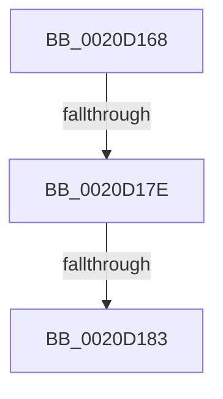

# sub_0020D168

- RVA: `0x0020D168`–`0x0020D18E` (길이 `38` bytes)
- VA: `0x000000014020D168`
- 실행 섹션: `.text`
- PDB 이름 있음: `아니요`; PDB Function 태그: `아니요`
- unwind 정보 RVA: `0x0005D928`
- 디코드: `9`개 명령, `38/38` bytes 표시
- 미해석 바이트: `0` (있으면 어셈블리에 `.byte`로 보존)

> 이 문서는 커널 이미지의 기계어와 PDB 기호를 분석해 생성했습니다. 4번과 5번은 함수 원형과 자료형을 바이너리 사용 방식에서 추정한 C 해석이며 원본 소스 복구 결과는 아닙니다.

## 1. Dependencies

- 직접 호출 지점: **1**; 고유 호출 대상: **1**
- 직접 호출자로 확인된 함수: **0**
- RIP 상대 이미지 참조: **0**

### Outgoing calls
- `0x0020D188` → [KeBugCheck](../4F/KeBugCheck_function_004FD640.md) (function, `0x004FD640`)

### Direct callers
- 이 함수 시작 RVA로 연결되는 직접 call은 확인되지 않았습니다. 간접 호출은 완전히 역산할 수 없습니다.

### Static image references
- 디코드된 RIP-relative 메모리 참조가 없습니다.

## 2. Other-region calls and transfers

- 다른 실행 섹션으로 향하는 call: **0**
- call이 아닌 외부 분기/꼬리 이동: **2**
  - `0x0020D17C` → [sub_0020D1D0](Unknown_function_0020D1D0.md) (`tail-transfer`)
  - `0x0020D181` → [sub_0020D1D0 + 0x7](Unknown_function_0020D1D0.md) (`tail-transfer`)

## 3. Assembly (complete function range)

```asm
0020D168  48 89 BC 24 D0 00 00 00         mov qword ptr [rsp + 0xd0], rdi
0020D170  65 48 8B 3C 25 88 01 00 00      mov rdi, qword ptr gs:[0x188]
0020D179  48 85 C0                        test rax, rax
0020D17C  75 52                           jne 0x14020d1d0
0020D17E  83 F9 03                        cmp ecx, 3
0020D181  76 54                           jbe 0x14020d1d7
0020D183  B9 0C 00 00 00                  mov ecx, 0xc
0020D188  E8 B3 04 2F 00                  call 0x1404fd640
0020D18D  CC                              int3
```

## 4. C-style interpretation (structured pseudocode)

```c
__int64 __fastcall sub_0020D168(int a1)
{
    __int64 result;
    unsigned __int64 v_stack_pD0;

    v_stack_pD0 = v_rdi;
    result = KeBugCheck(12, a2, a3, a4);
    return result;
}
```

## 5. (Beta) C Style

```c
int64_t sub_0020D168(int32_t Arg1)
{
    int64_t result;
    uint64_t v_stack_pD0;

    v_stack_pD0 = local_rdi;
    result = KeBugCheck(12, a2, a3, a4);
    return result;
}
```

## 6. Execution-region graph

[열기: 2D/3D 그래프와 함수 탐색 컨트롤 패널](../../../control-panel.html?section=text&rva=0x0020D168&view=graph)

- 2D 그래프는 위에서 아래로 흐르고, 3D 그래프는 빈 공간을 드래그해 회전합니다. Shift+드래그는 이동, 휠은 확대·축소, 함수 노드 선택은 대상 보고서 이동입니다.

### Static fallback


