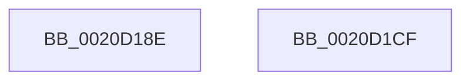

# sub_0020D18E

- RVA: `0x0020D18E`–`0x0020D1D0` (길이 `66` bytes)
- VA: `0x000000014020D18E`
- 실행 섹션: `.text`
- PDB 이름 있음: `아니요`; PDB Function 태그: `아니요`
- unwind 정보 RVA: `0x0005D93C`
- 디코드: `16`개 명령, `66/66` bytes 표시
- 미해석 바이트: `0` (있으면 어셈블리에 `.byte`로 보존)

> 이 문서는 커널 이미지의 기계어와 PDB 기호를 분석해 생성했습니다. 4번과 5번은 함수 원형과 자료형을 바이너리 사용 방식에서 추정한 C 해석이며 원본 소스 복구 결과는 아닙니다.

## 1. Dependencies

- 직접 호출 지점: **2**; 고유 호출 대상: **2**
- 직접 호출자로 확인된 함수: **0**
- RIP 상대 이미지 참조: **0**

### Outgoing calls
- `0x0020D1AC` → [KeWaitForSingleObject](KeWaitForSingleObject_function_0020E6B0.md) (function, `0x0020E6B0`)
- `0x0020D1BC` → [_security_check_cookie](../6A/_security_check_cookie_function_006AC640.md) (function, `0x006AC640`)

### Direct callers
- 이 함수 시작 RVA로 연결되는 직접 call은 확인되지 않았습니다. 간접 호출은 완전히 역산할 수 없습니다.

### Static image references
- 디코드된 RIP-relative 메모리 참조가 없습니다.

## 2. Other-region calls and transfers

- 다른 실행 섹션으로 향하는 call: **0**
- 별도 외부 분기/꼬리 이동을 확인하지 못했습니다.

## 3. Assembly (complete function range)

```asm
0020D18E  44 0F B6 8C 24 28 01 00 00      movzx r9d, byte ptr [rsp + 0x128]
0020D197  41 8B D2                        mov edx, r10d
0020D19A  44 0F B6 84 24 20 01 00 00      movzx r8d, byte ptr [rsp + 0x120]
0020D1A3  49 8B 0C 24                     mov rcx, qword ptr [r12]
0020D1A7  48 89 74 24 20                  mov qword ptr [rsp + 0x20], rsi
0020D1AC  E8 FF 14 00 00                  call 0x14020e6b0
0020D1B1  48 8B 8C 24 B0 00 00 00         mov rcx, qword ptr [rsp + 0xb0]
0020D1B9  48 33 CC                        xor rcx, rsp
0020D1BC  E8 7F F4 49 00                  call 0x1406ac640
0020D1C1  48 81 C4 D8 00 00 00            add rsp, 0xd8
0020D1C8  41 5D                           pop r13
0020D1CA  41 5C                           pop r12
0020D1CC  5E                              pop rsi
0020D1CD  5D                              pop rbp
0020D1CE  C3                              ret
0020D1CF  CC                              int3
```

## 4. C-style interpretation (structured pseudocode)

```c
__int64 __fastcall sub_0020D18E(__int64 a1, __int64 a2, __int64 a3, __int64 a4, __int64 a5, __int64 a6, __int64 a7, __int64 a8, __int64 a9, __int64 a10, __int64 a11, __int64 a12, __int64 a13, __int64 a14, __int64 a15, __int64 a16, __int64 a17, __int64 a18, __int64 a19, __int64 a20, __int64 a21, __int64 a22, __int64 a23, __int64 a24, __int64 a25, __int64 a26, __int64 a27, __int64 a28, __int64 a29, __int64 a30, __int64 a31, __int64 a32, __int64 a33, __int64 a34, __int64 a35, unsigned __int8 a36, unsigned __int8 a37)
{
    __int64 result;
    __int64 v_rsp;
    unsigned __int64 v_stack_p20;

    v_stack_p20 = v_rsi;
    result = KeWaitForSingleObject(*(unsigned __int64 *)(v_r12), (unsigned int)((unsigned int)(v_r10)), a36, a37);
    a1 = (a22) ^ (v_rsp);
    result = _security_check_cookie(a1, (unsigned int)((unsigned int)(v_r10)), a36, a37);
    v_rsp = (v_rsp) + (216);
    return result;
}
```

## 5. (Beta) C Style

```c
int64_t sub_0020D18E(int64_t Arg1, int64_t Arg2, int64_t Arg3, int64_t Arg4, uint64_t Arg5, uint64_t Arg6, uint64_t Arg7, uint64_t Arg8, uint64_t Arg9, uint64_t Arg10, uint64_t Arg11, uint64_t Arg12, uint64_t Arg13, uint64_t Arg14, uint64_t Arg15, uint64_t Arg16, uint64_t Arg17, uint64_t Arg18, uint64_t Arg19, uint64_t Arg20, uint64_t Arg21, int64_t Arg22, uint64_t Arg23, uint64_t Arg24, uint64_t Arg25, uint64_t Arg26, uint64_t Arg27, uint64_t Arg28, uint64_t Arg29, uint64_t Arg30, uint64_t Arg31, uint64_t Arg32, uint64_t Arg33, uint64_t Arg34, uint64_t Arg35, uint8_t Arg36, uint8_t Arg37)
{
    int64_t result;
    int64_t local_rsp;
    uint64_t v_stack_p20;

    v_stack_p20 = local_rsi;
    result = KeWaitForSingleObject(*(uint64_t *)(local_r12), (uint32_t)((uint32_t)(local_r10)), Arg36, Arg37);
    Arg1 = (Arg22) ^ (local_rsp);
    result = _security_check_cookie(Arg1, (uint32_t)((uint32_t)(local_r10)), Arg36, Arg37);
    local_rsp = (local_rsp) + (216);
    return result;
}
```

## 6. Execution-region graph

[열기: 2D/3D 그래프와 함수 탐색 컨트롤 패널](../../../control-panel.html?section=text&rva=0x0020D18E&view=graph)

- 2D 그래프는 위에서 아래로 흐르고, 3D 그래프는 빈 공간을 드래그해 회전합니다. Shift+드래그는 이동, 휠은 확대·축소, 함수 노드 선택은 대상 보고서 이동입니다.

### Static fallback


