# sub_0020D1EC

- RVA: `0x0020D1EC`–`0x0020D579` (길이 `909` bytes)
- VA: `0x000000014020D1EC`
- 실행 섹션: `.text`
- PDB 이름 있음: `아니요`; PDB Function 태그: `아니요`
- unwind 정보 RVA: `0x0005D964`
- 디코드: `194`개 명령, `909/909` bytes 표시
- 미해석 바이트: `0` (있으면 어셈블리에 `.byte`로 보존)

> 이 문서는 커널 이미지의 기계어와 PDB 기호를 분석해 생성했습니다. 4번과 5번은 함수 원형과 자료형을 바이너리 사용 방식에서 추정한 C 해석이며 원본 소스 복구 결과는 아닙니다.

## 1. Dependencies

- 직접 호출 지점: **7**; 고유 호출 대상: **7**
- 직접 호출자로 확인된 함수: **0**
- RIP 상대 이미지 참조: **4**

### Outgoing calls
- `0x0020D37C` → [KiPerformWaitDeferredWork](../22/KiPerformWaitDeferredWork_function_00220480.md) (function, `0x00220480`)
- `0x0020D39D` → [KiLowerIrqlProcessIrqlFlags](../4F/KiLowerIrqlProcessIrqlFlags_function_004F5698.md) (function, `0x004F5698`)
- `0x0020D521` → [KiRcuReportQuiescentState](KiRcuReportQuiescentState_function_0020AB8C.md) (function, `0x0020AB8C`)
- `0x0020D536` → [KiRcuFlushCompleted](KiRcuFlushCompleted_function_0020AD38.md) (function, `0x0020AD38`)
- `0x0020D548` → [KiRaiseIrqlProcessIrqlFlags](../4F/KiRaiseIrqlProcessIrqlFlags_function_004F56FC.md) (function, `0x004F56FC`)
- `0x0020D560` → [KiCheckVpBackingLongSpinWaitHypercall](../30/KiCheckVpBackingLongSpinWaitHypercall_function_0030F490.md) (function, `0x0030F490`)
- `0x0020D56F` → [HvlNotifyLongSpinWait](../30/HvlNotifyLongSpinWait_function_0030F460.md) (function, `0x0030F460`)

### Direct callers
- 이 함수 시작 RVA로 연결되는 직접 call은 확인되지 않았습니다. 간접 호출은 완전히 역산할 수 없습니다.

### Static image references
- `0x0020D230` → RVA `0x00FC6D20` (`ALMOSTRO`; read)
- `0x0020D31F` → RVA `0x00FC52AC` (`ALMOSTRO`; reference)
- `0x0020D502` → RVA `0x00F110C0` (`.data`; read)
- `0x0020D552` → RVA `0x00FC6AB8` (`ALMOSTRO`; read)

## 2. Other-region calls and transfers

- 다른 실행 섹션으로 향하는 call: **0**
- call이 아닌 외부 분기/꼬리 이동: **12**
  - `0x0020D222` → [sub_0020D5AD](Unknown_function_0020D5AD.md) (`tail-transfer`)
  - `0x0020D262` → [sub_0020D8DF + 0x32A](Unknown_function_0020D8DF.md) (`tail-transfer`)
  - `0x0020D26F` → [sub_0020D8DF + 0x43C](Unknown_function_0020D8DF.md) (`tail-transfer`)
  - `0x0020D33F` → [sub_0020D5AD + 0x8D](Unknown_function_0020D5AD.md) (`tail-transfer`)
  - `0x0020D387` → [sub_0020D8DF + 0x1E1](Unknown_function_0020D8DF.md) (`tail-transfer`)
  - `0x0020D3A8` → [sub_0020D5AD + 0x315](Unknown_function_0020D5AD.md) (`tail-transfer`)
  - `0x0020D3B1` → [sub_0020D8DF + 0x229](Unknown_function_0020D8DF.md) (`tail-transfer`)
  - `0x0020D449` → [sub_0020D5AD + 0x20](Unknown_function_0020D5AD.md) (`tail-transfer`)
  - `0x0020D452` → [sub_0020D8DF + 0x37](Unknown_function_0020D8DF.md) (`tail-transfer`)
  - `0x0020D463` → [sub_0020D5AD + 0xE8](Unknown_function_0020D5AD.md) (`tail-transfer`)
  - `0x0020D475` → [sub_0020D8DF + 0xBF](Unknown_function_0020D8DF.md) (`tail-transfer`)
  - `0x0020D4DA` → [sub_0020D8DF + 0x97](Unknown_function_0020D8DF.md) (`tail-transfer`)

## 3. Assembly (complete function range)

```asm
0020D1EC  48 89 9C 24 10 01 00 00         mov qword ptr [rsp + 0x110], rbx
0020D1F4  8B DD                           mov ebx, ebp
0020D1F6  48 89 AC 24 90 00 00 00         mov qword ptr [rsp + 0x90], rbp
0020D1FE  0F BA 77 74 02                  btr dword ptr [rdi + 0x74], 2
0020D203  4C 89 B4 24 C8 00 00 00         mov qword ptr [rsp + 0xc8], r14
0020D20B  0F 92 C0                        setb al
0020D20E  4C 89 BC 24 C0 00 00 00         mov qword ptr [rsp + 0xc0], r15
0020D216  89 5C 24 48                     mov dword ptr [rsp + 0x48], ebx
0020D21A  41 BF 02 00 00 00               mov r15d, 2
0020D220  84 C0                           test al, al
0020D222  0F 85 85 03 00 00               jne 0x14020d5ad
0020D228  45 0F 20 C6                     mov r14, cr8
0020D22C  45 0F 22 C7                     mov cr8, r15
0020D230  39 1D EA 9A DB 00               cmp dword ptr [rip + 0xdb9aea], ebx
0020D236  0F 85 04 03 00 00               jne 0x14020d540
0020D23C  4C 8D 8F 86 01 00 00            lea r9, [rdi + 0x186]
0020D243  45 88 31                        mov byte ptr [r9], r14b
0020D246  65 4C 8B 34 25 20 00 00 00      mov r14, qword ptr gs:[0x20]
0020D24F  4C 89 4C 24 68                  mov qword ptr [rsp + 0x68], r9
0020D254  41 80 7E 20 01                  cmp byte ptr [r14 + 0x20], 1
0020D259  77 2E                           ja 0x14020d289
0020D25B  49 39 AE F8 38 00 00            cmp qword ptr [r14 + 0x38f8], rbp
0020D262  0F 85 A1 09 00 00               jne 0x14020dc09
0020D268  41 38 AE E5 38 00 00            cmp byte ptr [r14 + 0x38e5], bpl
0020D26F  0F 85 A6 0A 00 00               jne 0x14020dd1b
0020D275  49 8B 96 E8 38 00 00            mov rdx, qword ptr [r14 + 0x38e8]
0020D27C  49 3B 96 F0 38 00 00            cmp rdx, qword ptr [r14 + 0x38f0]
0020D283  0F 85 75 02 00 00               jne 0x14020d4fe
0020D289  B9 01 00 00 00                  mov ecx, 1
0020D28E  49 B9 B0 03 00 00 80 F7 FF FF   movabs r9, 0xfffff780000003b0
0020D298  49 BB 08 00 00 00 80 F7 FF FF   movabs r11, 0xfffff78000000008
0020D2A2  48 85 F6                        test rsi, rsi
0020D2A5  74 1E                           je 0x14020d2c5
0020D2A7  39 6E 04                        cmp dword ptr [rsi + 4], ebp
0020D2AA  0F 8C F5 01 00 00               jl 0x14020d4a5
0020D2B0  48 8B 06                        mov rax, qword ptr [rsi]
0020D2B3  4C 8D BF 86 01 00 00            lea r15, [rdi + 0x186]
0020D2BA  48 89 44 24 78                  mov qword ptr [rsp + 0x78], rax
0020D2BF  89 4C 24 50                     mov dword ptr [rsp + 0x50], ecx
0020D2C3  EB 10                           jmp 0x14020d2d5
0020D2C5  89 6C 24 50                     mov dword ptr [rsp + 0x50], ebp
0020D2C9  4C 8D BF 86 01 00 00            lea r15, [rdi + 0x186]
0020D2D0  4C 89 7C 24 68                  mov qword ptr [rsp + 0x68], r15
0020D2D5  45 0F B6 37                     movzx r14d, byte ptr [r15]
0020D2D9  BB 02 00 00 00                  mov ebx, 2
0020D2DE  4C 0F BE A4 24 20 01 00 00      movsx r12, byte ptr [rsp + 0x120]
0020D2E7  48 89 AC 24 98 00 00 00         mov qword ptr [rsp + 0x98], rbp
0020D2EF  44 8D 6B FF                     lea r13d, [rbx - 1]
0020D2F3  0F B6 8C 24 28 01 00 00         movzx ecx, byte ptr [rsp + 0x128]
0020D2FB  83 67 74 EF                     and dword ptr [rdi + 0x74], 0xffffffef
0020D2FF  40 88 6F 70                     mov byte ptr [rdi + 0x70], bpl
0020D303  44 88 A7 87 01 00 00            mov byte ptr [rdi + 0x187], r12b
0020D30A  84 C9                           test cl, cl
0020D30C  74 04                           je 0x14020d312
0020D30E  83 4F 74 10                     or dword ptr [rdi + 0x74], 0x10
0020D312  8B F5                           mov esi, ebp
0020D314  F0 48 0F BA 6F 40 00            lock bts qword ptr [rdi + 0x40], 0
0020D31B  73 1B                           jae 0x14020d338
0020D31D  FF C6                           inc esi
0020D31F  85 35 87 7F DB 00               test dword ptr [rip + 0xdb7f87], esi
0020D325  0F 84 27 02 00 00               je 0x14020d552
0020D32B  F3 90                           pause
0020D32D  48 8B 47 40                     mov rax, qword ptr [rdi + 0x40]
0020D331  48 85 C0                        test rax, rax
0020D334  74 DE                           je 0x14020d314
0020D336  EB E5                           jmp 0x14020d31d
0020D338  40 38 AF C1 00 00 00            cmp byte ptr [rdi + 0xc1], bpl
0020D33F  0F 85 F5 02 00 00               jne 0x14020d63a
0020D345  8B 5C 24 48                     mov ebx, dword ptr [rsp + 0x48]
0020D349  40 38 AC 24 28 01 00 00         cmp byte ptr [rsp + 0x128], bpl
0020D351  0F 85 19 01 00 00               jne 0x14020d470
0020D357  F6 87 C2 00 00 00 02            test byte ptr [rdi + 0xc2], 2
0020D35E  74 5D                           je 0x14020d3bd
0020D360  41 80 FC 00                     cmp r12b, 0
0020D364  74 57                           je 0x14020d3bd
0020D366  BE C0 00 00 00                  mov esi, 0xc0
0020D36B  4C 8D 8C 24 98 00 00 00         lea r9, [rsp + 0x98]
0020D373  45 0F B6 C5                     movzx r8d, r13b
0020D377  8B D3                           mov edx, ebx
0020D379  48 8B CF                        mov rcx, rdi
0020D37C  E8 FF 30 01 00                  call 0x140220480
0020D381  48 89 6F 40                     mov qword ptr [rdi + 0x40], rbp
0020D385  85 C0                           test eax, eax
0020D387  0F 85 33 07 00 00               jne 0x14020dac0
0020D38D  39 2D 8D 99 DB 00               cmp dword ptr [rip + 0xdb998d], ebp
0020D393  74 0D                           je 0x14020d3a2
0020D395  44 0F 20 C1                     mov rcx, cr8
0020D399  41 0F B6 D6                     movzx edx, r14b
0020D39D  E8 F6 82 2E 00                  call 0x1404f5698
0020D3A2  45 0F 22 C6                     mov cr8, r14
0020D3A6  8B C6                           mov eax, esi
0020D3A8  E9 15 05 00 00                  jmp 0x14020d8c2
0020D3AD  40 38 6F 72                     cmp byte ptr [rdi + 0x72], bpl
0020D3B1  0F 85 51 07 00 00               jne 0x14020db08
0020D3B7  8B F5                           mov esi, ebp
0020D3B9  85 F6                           test esi, esi
0020D3BB  75 AE                           jne 0x14020d36b
0020D3BD  44 8B A4 24 80 00 00 00         mov r12d, dword ptr [rsp + 0x80]
0020D3C5  49 BD 20 03 00 00 80 F7 FF FF   movabs r13, 0xfffff78000000320
0020D3CF  4C 8B 74 24 70                  mov r14, qword ptr [rsp + 0x70]
0020D3D4  4C 8B C5                        mov r8, rbp
0020D3D7  C6 87 84 01 00 00 05            mov byte ptr [rdi + 0x184], 5
0020D3DE  44 8B FD                        mov r15d, ebp
0020D3E1  44 88 A7 83 02 00 00            mov byte ptr [rdi + 0x283], r12b
0020D3E8  49 83 C6 11                     add r14, 0x11
0020D3EC  41 8B 45 00                     mov eax, dword ptr [r13]
0020D3F0  44 8B 6C 24 40                  mov r13d, dword ptr [rsp + 0x40]
0020D3F5  4C 8B 64 24 58                  mov r12, qword ptr [rsp + 0x58]
0020D3FA  89 87 B4 01 00 00               mov dword ptr [rdi + 0x1b4], eax
0020D400  48 89 6F 40                     mov qword ptr [rdi + 0x40], rbp
0020D404  65 4C 8B 14 25 20 00 00 00      mov r10, qword ptr gs:[0x20]
0020D40D  4C 89 54 24 48                  mov qword ptr [rsp + 0x48], r10
0020D412  48 89 6C 24 60                  mov qword ptr [rsp + 0x60], rbp
0020D417  41 8B C7                        mov eax, r15d
0020D41A  49 8B 34 C4                     mov rsi, qword ptr [r12 + rax*8]
0020D41E  44 8B E5                        mov r12d, ebp
0020D421  41 C6 46 FF 01                  mov byte ptr [r14 - 1], 1
0020D426  41 C6 06 04                     mov byte ptr [r14], 4
0020D42A  66 45 89 7E 01                  mov word ptr [r14 + 1], r15w
0020D42F  49 89 7E 07                     mov qword ptr [r14 + 7], rdi
0020D433  49 89 76 0F                     mov qword ptr [r14 + 0xf], rsi
0020D437  F0 0F BA 2E 07                  lock bts dword ptr [rsi], 7
0020D43C  0F 82 8E 00 00 00               jb 0x14020d4d0
0020D442  0F B6 06                        movzx eax, byte ptr [rsi]
0020D445  24 7F                           and al, 0x7f
0020D447  3C 02                           cmp al, 2
0020D449  0F 84 7E 01 00 00               je 0x14020d5cd
0020D44F  39 6E 04                        cmp dword ptr [rsi + 4], ebp
0020D452  0F 8F BE 04 00 00               jg 0x14020d916
0020D458  48 8B 56 10                     mov rdx, qword ptr [rsi + 0x10]
0020D45C  48 8D 4E 08                     lea rcx, [rsi + 8]
0020D460  48 39 0A                        cmp qword ptr [rdx], rcx
0020D463  0F 84 2C 02 00 00               je 0x14020d695
0020D469  B9 03 00 00 00                  mov ecx, 3
0020D46E  CD 29                           int 0x29
0020D470  41 38 6C 3C 72                  cmp byte ptr [r12 + rdi + 0x72], bpl
0020D475  0F 85 23 05 00 00               jne 0x14020d99e
0020D47B  45 84 E4                        test r12b, r12b
0020D47E  0F 84 29 FF FF FF               je 0x14020d3ad
0020D484  48 8D 87 A8 00 00 00            lea rax, [rdi + 0xa8]
0020D48B  48 39 00                        cmp qword ptr [rax], rax
0020D48E  0F 84 19 FF FF FF               je 0x14020d3ad
0020D494  80 8F C2 00 00 00 02            or byte ptr [rdi + 0xc2], 2
0020D49B  BE C0 00 00 00                  mov esi, 0xc0
0020D4A0  E9 14 FF FF FF                  jmp 0x14020d3b9
0020D4A5  49 8B 01                        mov rax, qword ptr [r9]
0020D4A8  49 8B 0B                        mov rcx, qword ptr [r11]
0020D4AB  48 2B C8                        sub rcx, rax
0020D4AE  44 89 7C 24 50                  mov dword ptr [rsp + 0x50], r15d
0020D4B3  48 8B 87 F8 00 00 00            mov rax, qword ptr [rdi + 0xf8]
0020D4BA  48 03 06                        add rax, qword ptr [rsi]
0020D4BD  48 2B C8                        sub rcx, rax
0020D4C0  48 89 4C 24 78                  mov qword ptr [rsp + 0x78], rcx
0020D4C5  E9 FF FD FF FF                  jmp 0x14020d2c9
0020D4CA  66 0F 1F 44 00 00               nop word ptr [rax + rax]
0020D4D0  41 FF C4                        inc r12d
0020D4D3  44 85 25 D2 7D DB 00            test dword ptr [rip + 0xdb7dd2], r12d
0020D4DA  0F 84 96 04 00 00               je 0x14020d976
0020D4E0  F3 90                           pause
0020D4E2  8B 06                           mov eax, dword ptr [rsi]
0020D4E4  84 C0                           test al, al
0020D4E6  78 E8                           js 0x14020d4d0
0020D4E8  F0 0F BA 2E 07                  lock bts dword ptr [rsi], 7
0020D4ED  72 E1                           jb 0x14020d4d0
0020D4EF  4C 8B 44 24 60                  mov r8, qword ptr [rsp + 0x60]
0020D4F4  4C 8B 54 24 48                  mov r10, qword ptr [rsp + 0x48]
0020D4F9  E9 44 FF FF FF                  jmp 0x14020d442
0020D4FE  41 8B 4E 24                     mov ecx, dword ptr [r14 + 0x24]
0020D502  48 8D 05 B7 3B D0 00            lea rax, [rip + 0xd03bb7]
0020D509  48 C1 E1 05                     shl rcx, 5
0020D50D  48 03 C8                        add rcx, rax
0020D510  48 8B 41 08                     mov rax, qword ptr [rcx + 8]
0020D514  4C 8B 01                        mov r8, qword ptr [rcx]
0020D517  4C 85 40 38                     test qword ptr [rax + 0x38], r8
0020D51B  0F 85 68 FD FF FF               jne 0x14020d289
0020D521  E8 66 D6 FF FF                  call 0x14020ab8c
0020D526  85 C0                           test eax, eax
0020D528  0F 84 5B FD FF FF               je 0x14020d289
0020D52E  41 0F B6 8E E6 38 00 00         movzx ecx, byte ptr [r14 + 0x38e6]
0020D536  E8 FD D7 FF FF                  call 0x14020ad38
0020D53B  E9 49 FD FF FF                  jmp 0x14020d289
0020D540  41 0F B6 D7                     movzx edx, r15b
0020D544  41 0F B6 CE                     movzx ecx, r14b
0020D548  E8 AF 81 2E 00                  call 0x1404f56fc
0020D54D  E9 EA FC FF FF                  jmp 0x14020d23c
0020D552  8B 05 60 95 DB 00               mov eax, dword ptr [rip + 0xdb9560]
0020D558  A8 40                           test al, 0x40
0020D55A  0F 84 CB FD FF FF               je 0x14020d32b
0020D560  E8 2B 1F 10 00                  call 0x14030f490
0020D565  84 C0                           test al, al
0020D567  0F 84 BE FD FF FF               je 0x14020d32b
0020D56D  8B CE                           mov ecx, esi
0020D56F  E8 EC 1E 10 00                  call 0x14030f460
0020D574  E9 B4 FD FF FF                  jmp 0x14020d32d
```

## 4. C-style interpretation (structured pseudocode)

```c
__int64 __fastcall sub_0020D1EC(__int64 a1, __int64 a2, __int64 a3, __int64 a4, __int64 a5, __int64 a6, __int64 a7, unsigned int a8, unsigned int a9, __int64 a10, __int64 a11, __int64 a12, __int64 a13, __int64 a14, __int64 a15, unsigned int a16, __int64 a17, __int64 a18, __int64 a19, __int64 a20, __int64 a21, __int64 a22, __int64 a23, __int64 a24, __int64 a25, __int64 a26, __int64 a27, __int64 a28, __int64 a29, __int64 a30, __int64 a31, __int64 a32, __int64 a33, __int64 a34, __int64 a35, unsigned __int8 a36, unsigned __int8 a37)
{
    __int64 result;
    __int64 v_r12;
    __int64 v_r14;
    __int64 v_rsi;
    unsigned __int64 v_stack_p110;
    unsigned int v_stack_p48;
    unsigned int v_stack_p50;
    unsigned __int64 v_stack_p60;
    unsigned __int64 v_stack_p68;
    unsigned __int64 v_stack_p78;
    unsigned __int64 v_stack_p90;
    unsigned __int64 v_stack_p98;
    unsigned __int64 v_stack_pC0;
    unsigned __int64 v_stack_pC8;

    v_stack_p110 = v_rbx;
    v_stack_p90 = v_rbp;
    v_stack_pC8 = v_r14;
    result = (condition_is_below) ? 1 : 0;
    v_stack_pC0 = v_r15;
    v_stack_p48 = (unsigned int)((unsigned int)((unsigned int)(v_rbp)));
    if ((*(unsigned int *)(v_rip + 14392042)) != ((unsigned int)((unsigned int)((unsigned int)(v_rbp))))) goto loc_0020D540;
loc_0020D23C:
    *(unsigned __int8 *)(v_rdi + 390) = (unsigned __int8)(v_cr8);
    v_stack_p68 = v_rdi + 390;
    if ((*(unsigned __int8 *)(*(unsigned __int64 *)(gs_base + (0 + 32)) + 32)) > 1) goto loc_0020D289;
    if ((*(unsigned __int64 *)(*(unsigned __int64 *)(gs_base + (0 + 32)) + 14568)) != (*(unsigned __int64 *)(*(unsigned __int64 *)(gs_base + (0 + 32)) + 14576))) goto loc_0020D4FE;
loc_0020D289:
    if (v_rsi == 0) goto loc_0020D2C5;
    if ((*(unsigned int *)(v_rsi + 4)) < ((unsigned int)(v_rbp))) goto loc_0020D4A5;
    v_stack_p78 = *(unsigned __int64 *)(v_rsi);
    v_stack_p50 = 1;
    goto loc_0020D2D5;
loc_0020D2C5:
    v_stack_p50 = (unsigned int)(v_rbp);
loc_0020D2C9:
    v_stack_p68 = v_rdi + 390;
loc_0020D2D5:
    v_stack_p98 = v_rbp;
    *(unsigned __int8 *)(v_rdi + 112) = (unsigned __int8)(v_rbp);
    *(unsigned __int8 *)(v_rdi + 391) = (unsigned __int8)((__int8)(a36));
    if (a37 != 0) {
    }
loc_0020D314:
    if (condition_is_above_or_equal) goto loc_0020D338;
loc_0020D31D:
    v_rsi = (unsigned int)(((unsigned int)((unsigned int)(v_rbp))) + 1);
    if (((*(unsigned int *)(v_rip + 14385031)) & ((unsigned int)(v_rsi))) == 0) goto loc_0020D552;
loc_0020D32B:
loc_0020D32D:
    if (*(unsigned __int64 *)(v_rdi + 64) == 0) goto loc_0020D314;
    goto loc_0020D31D;
loc_0020D338:
    if (a37 != ((unsigned __int8)(v_rbp))) goto loc_0020D470;
    if (((*(unsigned __int8 *)(v_rdi + 194)) & (2)) == 0) goto loc_0020D3BD;
    if (((unsigned __int8)((__int8)(a36))) == 0) goto loc_0020D3BD;
loc_0020D36B:
    result = KiPerformWaitDeferredWork(v_rdi, (unsigned int)((unsigned int)((unsigned int)(a9))), (unsigned __int8)(2 - 1), a19);
    *(unsigned __int64 *)(v_rdi + 64) = v_rbp;
    if ((*(unsigned int *)(v_rip + 14391693)) != ((unsigned int)(v_rbp))) {
        a1 = 2;
        a2 = (unsigned __int8)(*(unsigned __int8 *)(v_rdi + 390));
        result = KiLowerIrqlProcessIrqlFlags(a1, a2, (unsigned __int8)(2 - 1), a19);
    }
loc_0020D3AD:
loc_0020D3B9:
    if ((unsigned int)((unsigned int)((unsigned int)(v_rbp))) != 0) goto loc_0020D36B;
loc_0020D3BD:
    *(unsigned __int8 *)(v_rdi + 388) = 5;
    *(unsigned __int8 *)(v_rdi + 643) = (unsigned __int8)((unsigned int)(a16));
    v_r14 = (a14) + (17);
    *(unsigned int *)(v_rdi + 436) = (unsigned int)((unsigned int)(*(unsigned int *)(2 - 1)));
    *(unsigned __int64 *)(v_rdi + 64) = v_rbp;
    v_stack_p48 = *(unsigned __int64 *)(gs_base + (0 + 32));
    v_stack_p60 = v_rbp;
    *(unsigned __int8 *)(v_r14 - 1) = 1;
    *(unsigned __int8 *)(v_r14) = 4;
    *(unsigned __int16 *)(v_r14 + 1) = (unsigned __int16)((unsigned int)((unsigned int)(v_rbp)));
    *(unsigned __int64 *)(v_r14 + 7) = v_rdi;
    *(unsigned __int64 *)(v_r14 + 15) = *(unsigned __int64 *)(a11 + (unsigned int)((unsigned int)((unsigned int)((unsigned int)(v_rbp)))) * 8);
    if (condition_is_below) goto loc_0020D4D0;
loc_0020D442:
    result = (unsigned __int8)((*(unsigned __int8 *)(*(unsigned __int64 *)(a11 + (unsigned int)((unsigned int)((unsigned int)((unsigned int)(v_rbp)))) * 8))) & (127));
loc_0020D470:
    if ((unsigned __int8)((unsigned int)((unsigned int)(v_rbp))) == 0) goto loc_0020D3AD;
    if ((*(unsigned __int64 *)(v_rdi + 168)) == (v_rdi + 168)) goto loc_0020D3AD;
    goto loc_0020D3B9;
loc_0020D4A5:
    a1 = (*(unsigned __int64 *)(v_r11)) - (*(unsigned __int64 *)(a19));
    v_stack_p50 = (unsigned int)((unsigned int)((unsigned int)(v_rbp)));
    result = (*(unsigned __int64 *)(v_rdi + 248)) + (*(unsigned __int64 *)(192));
    a1 = (a1) - (result);
    v_stack_p78 = a1;
    goto loc_0020D2C9;
loc_0020D4D0:
    v_r12 = (unsigned int)(((unsigned int)((unsigned int)(v_rbp))) + 1);
    if (sign_flag) goto loc_0020D4D0;
    if (condition_is_below) goto loc_0020D4D0;
    goto loc_0020D442;
loc_0020D4FE:
    a1 = ((unsigned int)(*(unsigned int *)(v_r14 + 36))) << (5);
    a1 = (a1) + (v_rip + 13646775);
    if (((*(unsigned __int64 *)(*(unsigned __int64 *)(a1 + 8) + 56)) & (*(unsigned __int64 *)(a1))) != 0) goto loc_0020D289;
    result = KiRcuReportQuiescentState(a1, *(unsigned __int64 *)(*(unsigned __int64 *)(a11 + (unsigned int)((unsigned int)((unsigned int)((unsigned int)(v_rbp)))) * 8) + 16), *(unsigned __int64 *)(a1), a19);
    if ((unsigned int)(result) == 0) goto loc_0020D289;
    result = KiRcuFlushCompleted(*(unsigned __int8 *)(v_r14 + 14566), *(unsigned __int64 *)(*(unsigned __int64 *)(a11 + (unsigned int)((unsigned int)((unsigned int)((unsigned int)(v_rbp)))) * 8) + 16), *(unsigned __int64 *)(a1), a19);
    goto loc_0020D289;
loc_0020D540:
    result = KiRaiseIrqlProcessIrqlFlags((unsigned __int8)(v_r14), (unsigned __int8)((unsigned int)((unsigned int)(v_rbp))), *(unsigned __int64 *)(a1), a19);
    goto loc_0020D23C;
loc_0020D552:
    if ((((unsigned __int8)((unsigned int)(*(unsigned int *)(v_rip + 14390624)))) & (64)) == 0) goto loc_0020D32B;
    result = KiCheckVpBackingLongSpinWaitHypercall((unsigned __int8)(v_r14), (unsigned __int8)((unsigned int)((unsigned int)(v_rbp))), *(unsigned __int64 *)(a1), a19);
    if ((unsigned __int8)(result) == 0) goto loc_0020D32B;
    result = HvlNotifyLongSpinWait(192, (unsigned __int8)((unsigned int)((unsigned int)(v_rbp))), *(unsigned __int64 *)(a1), a19);
    goto loc_0020D32D;
}
```

## 5. (Beta) C Style

```c
int64_t sub_0020D1EC(int64_t Arg1, int64_t Arg2, int64_t Arg3, int64_t Arg4, uint64_t Arg5, uint64_t Arg6, uint64_t Arg7, uint32_t Arg8, uint32_t Arg9, uint64_t Arg10, void *Arg11, int64_t Arg12, uint64_t Arg13, void *Arg14, uint64_t Arg15, uint32_t Arg16, uint64_t Arg17, uint64_t Arg18, int64_t Arg19, uint64_t Arg20, uint64_t Arg21, uint64_t Arg22, uint64_t Arg23, uint64_t Arg24, uint64_t Arg25, uint64_t Arg26, uint64_t Arg27, uint64_t Arg28, uint64_t Arg29, uint64_t Arg30, uint64_t Arg31, uint64_t Arg32, uint64_t Arg33, uint64_t Arg34, uint64_t Arg35, uint8_t Arg36, uint8_t Arg37)
{
    uint8_t *arg11 = (uint8_t *)Arg11;
    uint8_t *arg14 = (uint8_t *)Arg14;

    int64_t result;
    int64_t local_r12;
    int64_t local_r14;
    int64_t local_rsi;
    uint64_t v_stack_p110;
    uint32_t v_stack_p48;
    uint32_t v_stack_p50;
    uint64_t v_stack_p60;
    uint64_t v_stack_p68;
    uint64_t v_stack_p78;
    uint64_t v_stack_p90;
    uint64_t v_stack_p98;
    uint64_t v_stack_pC0;
    uint64_t v_stack_pC8;

    v_stack_p110 = local_rbx;
    v_stack_p90 = local_rbp;
    v_stack_pC8 = local_r14;
    result = (condition_is_below) ? 1 : 0;
    v_stack_pC0 = local_r15;
    v_stack_p48 = (uint32_t)((uint32_t)((uint32_t)(local_rbp)));
    if ((*(uint32_t *)(v_rip + 0xDB9AEA)) != ((uint32_t)((uint32_t)((uint32_t)(local_rbp))))) goto loc_0020D540;
loc_0020D23C:
    *(uint8_t *)(local_rdi + 0x186) = (uint8_t)(v_cr8);
    v_stack_p68 = local_rdi + 390;
    if ((*(uint8_t *)(*(uint64_t *)(gs_base + (0 + 0x20)) + 0x20)) > 1) goto loc_0020D289;
    if ((*(uint64_t *)(*(uint64_t *)(gs_base + (0 + 0x20)) + 0x38E8)) != (*(uint64_t *)(*(uint64_t *)(gs_base + (0 + 0x20)) + 0x38F0))) goto loc_0020D4FE;
loc_0020D289:
    if (local_rsi == 0) goto loc_0020D2C5;
    if ((*(uint32_t *)(local_rsi + 0x4)) < ((uint32_t)(local_rbp))) goto loc_0020D4A5;
    v_stack_p78 = *(uint64_t *)(local_rsi);
    v_stack_p50 = 1;
    goto loc_0020D2D5;
loc_0020D2C5:
    v_stack_p50 = (uint32_t)(local_rbp);
loc_0020D2C9:
    v_stack_p68 = local_rdi + 390;
loc_0020D2D5:
    v_stack_p98 = local_rbp;
    *(uint8_t *)(local_rdi + 0x70) = (uint8_t)(local_rbp);
    *(uint8_t *)(local_rdi + 0x187) = (uint8_t)((int8_t)(Arg36));
    if (Arg37 != 0) {
    }
loc_0020D314:
    if (condition_is_above_or_equal) goto loc_0020D338;
loc_0020D31D:
    local_rsi = (uint32_t)(((uint32_t)((uint32_t)(local_rbp))) + 1);
    if (((*(uint32_t *)(v_rip + 0xDB7F87)) & ((uint32_t)(local_rsi))) == 0) goto loc_0020D552;
loc_0020D32B:
loc_0020D32D:
    if (*(uint64_t *)(local_rdi + 0x40) == 0) goto loc_0020D314;
    goto loc_0020D31D;
loc_0020D338:
    if (Arg37 != ((uint8_t)(local_rbp))) goto loc_0020D470;
    if (((*(uint8_t *)(local_rdi + 0xC2)) & (2)) == 0) goto loc_0020D3BD;
    if (((uint8_t)((int8_t)(Arg36))) == 0) goto loc_0020D3BD;
loc_0020D36B:
    result = KiPerformWaitDeferredWork(local_rdi, (uint32_t)((uint32_t)((uint32_t)(Arg9))), (uint8_t)(2 - 1), Arg19);
    *(uint64_t *)(local_rdi + 0x40) = local_rbp;
    if ((*(uint32_t *)(v_rip + 0xDB998D)) != ((uint32_t)(local_rbp))) {
        Arg1 = 2;
        Arg2 = (uint8_t)(*(uint8_t *)(local_rdi + 0x186));
        result = KiLowerIrqlProcessIrqlFlags(Arg1, Arg2, (uint8_t)(2 - 1), Arg19);
    }
loc_0020D3AD:
loc_0020D3B9:
    if ((uint32_t)((uint32_t)((uint32_t)(local_rbp))) != 0) goto loc_0020D36B;
loc_0020D3BD:
    *(uint8_t *)(local_rdi + 0x184) = 5;
    *(uint8_t *)(local_rdi + 0x283) = (uint8_t)((uint32_t)(Arg16));
    local_r14 = (Arg14) + (17);
    *(uint32_t *)(local_rdi + 0x1B4) = (uint32_t)((uint32_t)(*(uint32_t *)(2 - 0x1)));
    *(uint64_t *)(local_rdi + 0x40) = local_rbp;
    v_stack_p48 = *(uint64_t *)(gs_base + (0 + 0x20));
    v_stack_p60 = local_rbp;
    *(uint8_t *)(local_r14 - 0x1) = 1;
    *(uint8_t *)(local_r14) = 4;
    *(uint16_t *)(local_r14 + 0x1) = (uint16_t)((uint32_t)((uint32_t)(local_rbp)));
    *(uint64_t *)(local_r14 + 0x7) = local_rdi;
    *(uint64_t *)(local_r14 + 0xF) = *(uint64_t *)(arg11 + (uint32_t)((uint32_t)((uint32_t)((uint32_t)(local_rbp)))) * 8);
    if (condition_is_below) goto loc_0020D4D0;
loc_0020D442:
    result = (uint8_t)((*(uint8_t *)(*(uint64_t *)(arg11 + (uint32_t)((uint32_t)((uint32_t)((uint32_t)(local_rbp)))) * 8))) & (127));
loc_0020D470:
    if ((uint8_t)((uint32_t)((uint32_t)(local_rbp))) == 0) goto loc_0020D3AD;
    if ((*(uint64_t *)(local_rdi + 0xA8)) == (local_rdi + 168)) goto loc_0020D3AD;
    goto loc_0020D3B9;
loc_0020D4A5:
    Arg1 = (*(uint64_t *)(local_r11)) - (*(uint64_t *)(Arg19));
    v_stack_p50 = (uint32_t)((uint32_t)((uint32_t)(local_rbp)));
    result = (*(uint64_t *)(local_rdi + 0xF8)) + (*(uint64_t *)(192));
    Arg1 = (Arg1) - (result);
    v_stack_p78 = Arg1;
    goto loc_0020D2C9;
loc_0020D4D0:
    local_r12 = (uint32_t)(((uint32_t)((uint32_t)(local_rbp))) + 1);
    if (sign_flag) goto loc_0020D4D0;
    if (condition_is_below) goto loc_0020D4D0;
    goto loc_0020D442;
loc_0020D4FE:
    Arg1 = ((uint32_t)(*(uint32_t *)(local_r14 + 0x24))) << (5);
    Arg1 = (Arg1) + (v_rip + 13646775);
    if (((*(uint64_t *)(*(uint64_t *)(Arg1 + 0x8) + 0x38)) & (*(uint64_t *)(Arg1))) != 0) goto loc_0020D289;
    result = KiRcuReportQuiescentState(Arg1, *(uint64_t *)(*(uint64_t *)(arg11 + (uint32_t)((uint32_t)((uint32_t)((uint32_t)(local_rbp)))) * 8) + 0x10), *(uint64_t *)(Arg1), Arg19);
    if ((uint32_t)(result) == 0) goto loc_0020D289;
    result = KiRcuFlushCompleted(*(uint8_t *)(local_r14 + 0x38E6), *(uint64_t *)(*(uint64_t *)(arg11 + (uint32_t)((uint32_t)((uint32_t)((uint32_t)(local_rbp)))) * 8) + 0x10), *(uint64_t *)(Arg1), Arg19);
    goto loc_0020D289;
loc_0020D540:
    result = KiRaiseIrqlProcessIrqlFlags((uint8_t)(local_r14), (uint8_t)((uint32_t)((uint32_t)(local_rbp))), *(uint64_t *)(Arg1), Arg19);
    goto loc_0020D23C;
loc_0020D552:
    if ((((uint8_t)((uint32_t)(*(uint32_t *)(v_rip + 0xDB9560)))) & (64)) == 0) goto loc_0020D32B;
    result = KiCheckVpBackingLongSpinWaitHypercall((uint8_t)(local_r14), (uint8_t)((uint32_t)((uint32_t)(local_rbp))), *(uint64_t *)(Arg1), Arg19);
    if ((uint8_t)(result) == 0) goto loc_0020D32B;
    result = HvlNotifyLongSpinWait(192, (uint8_t)((uint32_t)((uint32_t)(local_rbp))), *(uint64_t *)(Arg1), Arg19);
    goto loc_0020D32D;
}
```

### 관측된 메모리 오프셋

구조체 형식이 확인되지 않은 접근은 인자 기준의 오프셋으로만 기록했습니다.

| 기준 인자 | 오프셋 표현 | 폭 (bit) | 접근 |
|---|---:|---:|---|
| `Arg11` | `+ 0x0 + rax*8` | `64` | `R` |
| `Arg14` | `- 0x1` | `8` | `W` |
| `Arg14` | `+ 0x0` | `8` | `W` |
| `Arg14` | `+ 0x1` | `16` | `W` |
| `Arg14` | `+ 0x7` | `64` | `W` |
| `Arg14` | `+ 0xF` | `64` | `W` |

## 6. Execution-region graph

[열기: 2D/3D 그래프와 함수 탐색 컨트롤 패널](../../../control-panel.html?section=text&rva=0x0020D1EC&view=graph)

- 2D 그래프는 위에서 아래로 흐르고, 3D 그래프는 빈 공간을 드래그해 회전합니다. Shift+드래그는 이동, 휠은 확대·축소, 함수 노드 선택은 대상 보고서 이동입니다.

### Static fallback

```mermaid
flowchart TD
  bb_0020D1EC[BB_0020D1EC]
  bb_0020D228[BB_0020D228]
  bb_0020D23C[BB_0020D23C]
  bb_0020D25B[BB_0020D25B]
  bb_0020D268[BB_0020D268]
  bb_0020D275[BB_0020D275]
  bb_0020D289[BB_0020D289]
  bb_0020D2A7[BB_0020D2A7]
  bb_0020D2B0[BB_0020D2B0]
  bb_0020D2C5[BB_0020D2C5]
  bb_0020D2C9[BB_0020D2C9]
  bb_0020D2D5[BB_0020D2D5]
  bb_0020D30E[BB_0020D30E]
  bb_0020D312[BB_0020D312]
  bb_0020D314[BB_0020D314]
  bb_0020D31D[BB_0020D31D]
  bb_0020D32B[BB_0020D32B]
  bb_0020D32D[BB_0020D32D]
  bb_0020D336[BB_0020D336]
  bb_0020D338[BB_0020D338]
  bb_0020D345[BB_0020D345]
  bb_0020D357[BB_0020D357]
  bb_0020D360[BB_0020D360]
  bb_0020D366[BB_0020D366]
  bb_0020D36B[BB_0020D36B]
  bb_0020D38D[BB_0020D38D]
  bb_0020D395[BB_0020D395]
  bb_0020D3A2[BB_0020D3A2]
  bb_0020D3AD[BB_0020D3AD]
  bb_0020D3B7[BB_0020D3B7]
  bb_0020D3B9[BB_0020D3B9]
  bb_0020D3BD[BB_0020D3BD]
  bb_0020D442[BB_0020D442]
  bb_0020D44F[BB_0020D44F]
  bb_0020D458[BB_0020D458]
  bb_0020D469[BB_0020D469]
  bb_0020D470[BB_0020D470]
  bb_0020D47B[BB_0020D47B]
  bb_0020D484[BB_0020D484]
  bb_0020D494[BB_0020D494]
  bb_0020D4A5[BB_0020D4A5]
  bb_0020D4CA[BB_0020D4CA]
  bb_0020D4D0[BB_0020D4D0]
  bb_0020D4E0[BB_0020D4E0]
  bb_0020D4E8[BB_0020D4E8]
  bb_0020D4EF[BB_0020D4EF]
  bb_0020D4FE[BB_0020D4FE]
  bb_0020D521[BB_0020D521]
  bb_0020D52E[BB_0020D52E]
  bb_0020D540[BB_0020D540]
  bb_0020D552[BB_0020D552]
  bb_0020D560[BB_0020D560]
  bb_0020D56D[BB_0020D56D]
  bb_0020D1EC -->|fallthrough| bb_0020D228
  bb_0020D228 -->|branch| bb_0020D540
  bb_0020D228 -->|fallthrough| bb_0020D23C
  bb_0020D23C -->|branch| bb_0020D289
  bb_0020D23C -->|fallthrough| bb_0020D25B
  bb_0020D25B -->|fallthrough| bb_0020D268
  bb_0020D268 -->|fallthrough| bb_0020D275
  bb_0020D275 -->|branch| bb_0020D4FE
  bb_0020D275 -->|fallthrough| bb_0020D289
  bb_0020D289 -->|branch| bb_0020D2C5
  bb_0020D289 -->|fallthrough| bb_0020D2A7
  bb_0020D2A7 -->|branch| bb_0020D4A5
  bb_0020D2A7 -->|fallthrough| bb_0020D2B0
  bb_0020D2B0 -->|branch| bb_0020D2D5
  bb_0020D2C5 -->|flow| bb_0020D2C9
  bb_0020D2C9 -->|flow| bb_0020D2D5
  bb_0020D2D5 -->|branch| bb_0020D312
  bb_0020D2D5 -->|fallthrough| bb_0020D30E
  bb_0020D30E -->|flow| bb_0020D312
  bb_0020D312 -->|flow| bb_0020D314
  bb_0020D314 -->|branch| bb_0020D338
  bb_0020D314 -->|fallthrough| bb_0020D31D
  bb_0020D31D -->|branch| bb_0020D552
  bb_0020D31D -->|fallthrough| bb_0020D32B
  bb_0020D32B -->|flow| bb_0020D32D
  bb_0020D32D -->|branch| bb_0020D314
  bb_0020D32D -->|fallthrough| bb_0020D336
  bb_0020D336 -->|branch| bb_0020D31D
  bb_0020D338 -->|fallthrough| bb_0020D345
  bb_0020D345 -->|branch| bb_0020D470
  bb_0020D345 -->|fallthrough| bb_0020D357
  bb_0020D357 -->|branch| bb_0020D3BD
  bb_0020D357 -->|fallthrough| bb_0020D360
  bb_0020D360 -->|branch| bb_0020D3BD
  bb_0020D360 -->|fallthrough| bb_0020D366
  bb_0020D366 -->|flow| bb_0020D36B
  bb_0020D36B -->|fallthrough| bb_0020D38D
  bb_0020D38D -->|branch| bb_0020D3A2
  bb_0020D38D -->|fallthrough| bb_0020D395
  bb_0020D395 -->|flow| bb_0020D3A2
  bb_0020D3AD -->|fallthrough| bb_0020D3B7
  bb_0020D3B7 -->|flow| bb_0020D3B9
  bb_0020D3B9 -->|branch| bb_0020D36B
  bb_0020D3B9 -->|fallthrough| bb_0020D3BD
  bb_0020D3BD -->|branch| bb_0020D4D0
  bb_0020D3BD -->|fallthrough| bb_0020D442
  bb_0020D442 -->|fallthrough| bb_0020D44F
  bb_0020D44F -->|fallthrough| bb_0020D458
  bb_0020D458 -->|fallthrough| bb_0020D469
  bb_0020D469 -->|flow| bb_0020D470
  bb_0020D470 -->|fallthrough| bb_0020D47B
  bb_0020D47B -->|branch| bb_0020D3AD
  bb_0020D47B -->|fallthrough| bb_0020D484
  bb_0020D484 -->|branch| bb_0020D3AD
  bb_0020D484 -->|fallthrough| bb_0020D494
  bb_0020D494 -->|branch| bb_0020D3B9
  bb_0020D4A5 -->|branch| bb_0020D2C9
  bb_0020D4CA -->|flow| bb_0020D4D0
  bb_0020D4D0 -->|fallthrough| bb_0020D4E0
  bb_0020D4E0 -->|branch| bb_0020D4D0
  bb_0020D4E0 -->|fallthrough| bb_0020D4E8
  bb_0020D4E8 -->|branch| bb_0020D4D0
  bb_0020D4E8 -->|fallthrough| bb_0020D4EF
  bb_0020D4EF -->|branch| bb_0020D442
  bb_0020D4FE -->|branch| bb_0020D289
  bb_0020D4FE -->|fallthrough| bb_0020D521
  bb_0020D521 -->|branch| bb_0020D289
  bb_0020D521 -->|fallthrough| bb_0020D52E
  bb_0020D52E -->|branch| bb_0020D289
  bb_0020D540 -->|branch| bb_0020D23C
  bb_0020D552 -->|branch| bb_0020D32B
  bb_0020D552 -->|fallthrough| bb_0020D560
  bb_0020D560 -->|branch| bb_0020D32B
  bb_0020D560 -->|fallthrough| bb_0020D56D
  bb_0020D56D -->|branch| bb_0020D32D
```


