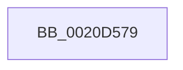

# sub_0020D579

- RVA: `0x0020D579`–`0x0020D5AD` (길이 `52` bytes)
- VA: `0x000000014020D579`
- 실행 섹션: `.text`
- PDB 이름 있음: `아니요`; PDB Function 태그: `아니요`
- unwind 정보 RVA: `0x0005D980`
- 디코드: `9`개 명령, `52/52` bytes 표시
- 미해석 바이트: `0` (있으면 어셈블리에 `.byte`로 보존)

> 이 문서는 커널 이미지의 기계어와 PDB 기호를 분석해 생성했습니다. 4번과 5번은 함수 원형과 자료형을 바이너리 사용 방식에서 추정한 C 해석이며 원본 소스 복구 결과는 아닙니다.

## 1. Dependencies

- 직접 호출 지점: **1**; 고유 호출 대상: **1**
- 직접 호출자로 확인된 함수: **0**
- RIP 상대 이미지 참조: **0**

### Outgoing calls
- `0x0020D59B` → [KiWaitForAllObjects](../3C/KiWaitForAllObjects_function_003C5800.md) (function, `0x003C5800`)

### Direct callers
- 이 함수 시작 RVA로 연결되는 직접 call은 확인되지 않았습니다. 간접 호출은 완전히 역산할 수 없습니다.

### Static image references
- 디코드된 RIP-relative 메모리 참조가 없습니다.

## 2. Other-region calls and transfers

- 다른 실행 섹션으로 향하는 call: **0**
- call이 아닌 외부 분기/꼬리 이동: **1**
  - `0x0020D5A8` → [sub_0020D18E + 0x23](Unknown_function_0020D18E.md) (`tail-transfer`)

## 3. Assembly (complete function range)

```asm
0020D579  44 0F B6 8C 24 20 01 00 00      movzx r9d, byte ptr [rsp + 0x120]
0020D582  45 8B C2                        mov r8d, r10d
0020D585  48 89 44 24 30                  mov qword ptr [rsp + 0x30], rax
0020D58A  0F B6 84 24 28 01 00 00         movzx eax, byte ptr [rsp + 0x128]
0020D592  48 89 74 24 28                  mov qword ptr [rsp + 0x28], rsi
0020D597  88 44 24 20                     mov byte ptr [rsp + 0x20], al
0020D59B  E8 60 82 1B 00                  call 0x1403c5800
0020D5A0  48 8B BC 24 D0 00 00 00         mov rdi, qword ptr [rsp + 0xd0]
0020D5A8  E9 04 FC FF FF                  jmp 0x14020d1b1
```

## 4. C-style interpretation (structured pseudocode)

```c
__int64 __fastcall sub_0020D579(__int64 a1, __int64 a2, __int64 a3, __int64 a4, __int64 a5, __int64 a6, __int64 a7, __int64 a8, __int64 a9, __int64 a10, __int64 a11, __int64 a12, __int64 a13, __int64 a14, __int64 a15, __int64 a16, __int64 a17, __int64 a18, __int64 a19, __int64 a20, __int64 a21, __int64 a22, __int64 a23, __int64 a24, __int64 a25, __int64 a26, __int64 a27, __int64 a28, __int64 a29, __int64 a30, __int64 a31, __int64 a32, __int64 a33, __int64 a34, __int64 a35, unsigned __int8 a36, unsigned __int8 a37)
{
    __int64 result;
    unsigned __int8 v_stack_p20;
    unsigned __int64 v_stack_p28;
    unsigned __int64 v_stack_p30;

    v_stack_p30 = result;
    v_stack_p28 = v_rsi;
    v_stack_p20 = a37;
    result = KiWaitForAllObjects(a1, a2, (unsigned int)((unsigned int)(v_r10)), a36);
}
```

## 5. (Beta) C Style

```c
int64_t sub_0020D579(int64_t Arg1, int64_t Arg2, int64_t Arg3, int64_t Arg4, uint64_t Arg5, uint64_t Arg6, uint64_t Arg7, uint64_t Arg8, uint64_t Arg9, uint64_t Arg10, uint64_t Arg11, uint64_t Arg12, uint64_t Arg13, uint64_t Arg14, uint64_t Arg15, uint64_t Arg16, uint64_t Arg17, uint64_t Arg18, uint64_t Arg19, uint64_t Arg20, uint64_t Arg21, uint64_t Arg22, uint64_t Arg23, uint64_t Arg24, uint64_t Arg25, int64_t Arg26, uint64_t Arg27, uint64_t Arg28, uint64_t Arg29, uint64_t Arg30, uint64_t Arg31, uint64_t Arg32, uint64_t Arg33, uint64_t Arg34, uint64_t Arg35, uint8_t Arg36, uint8_t Arg37)
{
    int64_t result;
    uint8_t v_stack_p20;
    uint64_t v_stack_p28;
    uint64_t v_stack_p30;

    v_stack_p30 = result;
    v_stack_p28 = local_rsi;
    v_stack_p20 = Arg37;
    result = KiWaitForAllObjects(Arg1, Arg2, (uint32_t)((uint32_t)(local_r10)), Arg36);
}
```

## 6. Execution-region graph

[열기: 2D/3D 그래프와 함수 탐색 컨트롤 패널](../../../control-panel.html?section=text&rva=0x0020D579&view=graph)

- 2D 그래프는 위에서 아래로 흐르고, 3D 그래프는 빈 공간을 드래그해 회전합니다. Shift+드래그는 이동, 휠은 확대·축소, 함수 노드 선택은 대상 보고서 이동입니다.

### Static fallback


