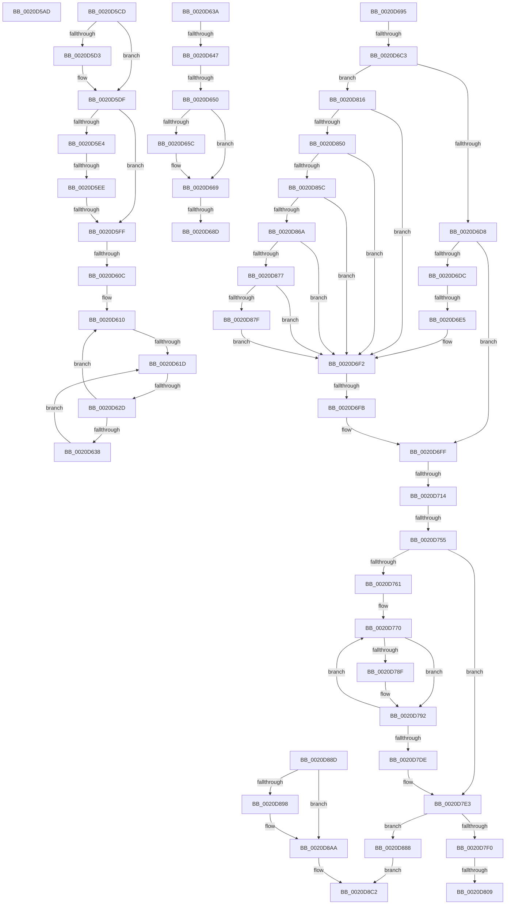

# sub_0020D5AD

- RVA: `0x0020D5AD`–`0x0020D8DF` (길이 `818` bytes)
- VA: `0x000000014020D5AD`
- 실행 섹션: `.text`
- PDB 이름 있음: `아니요`; PDB Function 태그: `아니요`
- unwind 정보 RVA: `0x0005D990`
- 디코드: `178`개 명령, `818/818` bytes 표시
- 미해석 바이트: `0` (있으면 어셈블리에 `.byte`로 보존)

> 이 문서는 커널 이미지의 기계어와 PDB 기호를 분석해 생성했습니다. 4번과 5번은 함수 원형과 자료형을 바이너리 사용 방식에서 추정한 C 해석이며 원본 소스 복구 결과는 아닙니다.

## 1. Dependencies

- 직접 호출 지점: **6**; 고유 호출 대상: **6**
- 직접 호출자로 확인된 함수: **0**
- RIP 상대 이미지 참조: **2**

### Outgoing calls
- `0x0020D664` → [KiLowerIrqlProcessIrqlFlags](../4F/KiLowerIrqlProcessIrqlFlags_function_004F5698.md) (function, `0x004F5698`)
- `0x0020D674` → [KiDeliverApc](../25/KiDeliverApc_function_00250F20.md) (function, `0x00250F20`)
- `0x0020D733` → [KiCommitThreadWait](KiCommitThreadWait_function_0020DFE0.md) (function, `0x0020DFE0`)
- `0x0020D7C3` → [KeAbPreAcquire](../21/KeAbPreAcquire_function_00210230.md) (function, `0x00210230`)
- `0x0020D7D1` → [KeAbPostReleaseEx](../26/KeAbPostReleaseEx_function_00262210.md) (function, `0x00262210`)
- `0x0020D8BD` → [KiSatisfyThreadWait](../35/KiSatisfyThreadWait_function_00352B40.md) (function, `0x00352B40`)

### Direct callers
- 이 함수 시작 RVA로 연결되는 직접 call은 확인되지 않았습니다. 간접 호출은 완전히 역산할 수 없습니다.

### Static image references
- `0x0020D620` → RVA `0x00FC52AC` (`ALMOSTRO`; reference)
- `0x0020D654` → RVA `0x00FC6D20` (`ALMOSTRO`; read)

## 2. Other-region calls and transfers

- 다른 실행 섹션으로 향하는 call: **0**
- call이 아닌 외부 분기/꼬리 이동: **18**
  - `0x0020D5C8` → [sub_0020D1EC + 0x5A](Unknown_function_0020D1EC.md) (`tail-transfer`)
  - `0x0020D5E8` → [sub_0020D1EC + 0x26C](Unknown_function_0020D1EC.md) (`tail-transfer`)
  - `0x0020D5F9` → [sub_0020D1EC + 0x26C](Unknown_function_0020D1EC.md) (`tail-transfer`)
  - `0x0020D606` → [sub_0020D8DF + 0x117](Unknown_function_0020D8DF.md) (`tail-transfer`)
  - `0x0020D617` → [sub_0020D8DF + 0xDB](Unknown_function_0020D8DF.md) (`tail-transfer`)
  - `0x0020D627` → [sub_0020D8DF + 0x1B9](Unknown_function_0020D8DF.md) (`tail-transfer`)
  - `0x0020D641` → [sub_0020D1EC + 0x159](Unknown_function_0020D1EC.md) (`tail-transfer`)
  - `0x0020D64A` → [sub_0020D1EC + 0x159](Unknown_function_0020D1EC.md) (`tail-transfer`)
  - `0x0020D687` → [sub_0020D8DF + 0xCE](Unknown_function_0020D8DF.md) (`tail-transfer`)
  - `0x0020D690` → [sub_0020D1EC + 0x107](Unknown_function_0020D1EC.md) (`tail-transfer`)
  - `0x0020D6BD` → [sub_0020D1EC + 0x22B](Unknown_function_0020D1EC.md) (`tail-transfer`)
  - `0x0020D6DF` → [sub_0020D8DF + 0x11](Unknown_function_0020D8DF.md) (`tail-transfer`)
  - `0x0020D6F5` → [sub_0020D8DF + 0x11](Unknown_function_0020D8DF.md) (`tail-transfer`)
  - `0x0020D70E` → [sub_0020D8DF + 0x237](Unknown_function_0020D8DF.md) (`tail-transfer`)
  - `0x0020D74F` → [sub_0020D8DF + 0x2A2](Unknown_function_0020D8DF.md) (`tail-transfer`)
  - `0x0020D803` → [sub_0020D8DF](Unknown_function_0020D8DF.md) (`tail-transfer`)
  - `0x0020D811` → [sub_0020D1EC + 0xE9](Unknown_function_0020D1EC.md) (`tail-transfer`)
  - `0x0020D8DA` → [sub_0020D579 + 0x27](Unknown_function_0020D579.md) (`tail-transfer`)

## 3. Assembly (complete function range)

```asm
0020D5AD  0F BA 77 74 10                  btr dword ptr [rdi + 0x74], 0x10
0020D5B2  4C 8D 8F 86 01 00 00            lea r9, [rdi + 0x186]
0020D5B9  0F 92 C3                        setb bl
0020D5BC  83 E3 01                        and ebx, 1
0020D5BF  03 DB                           add ebx, ebx
0020D5C1  83 CB 01                        or ebx, 1
0020D5C4  89 5C 24 48                     mov dword ptr [rsp + 0x48], ebx
0020D5C8  E9 79 FC FF FF                  jmp 0x14020d246
0020D5CD  F6 46 30 02                     test byte ptr [rsi + 0x30], 2
0020D5D1  74 0C                           je 0x14020d5df
0020D5D3  41 8B C7                        mov eax, r15d
0020D5D6  49 0F AB C0                     bts r8, rax
0020D5DA  4C 89 44 24 60                  mov qword ptr [rsp + 0x60], r8
0020D5DF  39 6E 04                        cmp dword ptr [rsi + 4], ebp
0020D5E2  7F 1B                           jg 0x14020d5ff
0020D5E4  48 3B 7E 28                     cmp rdi, qword ptr [rsi + 0x28]
0020D5E8  0F 85 6A FE FF FF               jne 0x14020d458
0020D5EE  41 0F B6 82 BA 38 00 00         movzx eax, byte ptr [r10 + 0x38ba]
0020D5F6  38 46 02                        cmp byte ptr [rsi + 2], al
0020D5F9  0F 85 59 FE FF FF               jne 0x14020d458
0020D5FF  81 7E 04 00 00 00 80            cmp dword ptr [rsi + 4], 0x80000000
0020D606  0F 84 EA 03 00 00               je 0x14020d9f6
0020D60C  44 8B F5                        mov r14d, ebp
0020D60F  90                              nop
0020D610  F0 48 0F BA 6F 40 00            lock bts qword ptr [rdi + 0x40], 0
0020D617  0F 83 9D 03 00 00               jae 0x14020d9ba
0020D61D  41 FF C6                        inc r14d
0020D620  44 85 35 85 7C DB 00            test dword ptr [rip + 0xdb7c85], r14d
0020D627  0F 84 6B 04 00 00               je 0x14020da98
0020D62D  F3 90                           pause
0020D62F  48 8B 47 40                     mov rax, qword ptr [rdi + 0x40]
0020D633  48 85 C0                        test rax, rax
0020D636  74 D8                           je 0x14020d610
0020D638  EB E3                           jmp 0x14020d61d
0020D63A  66 39 AF E6 01 00 00            cmp word ptr [rdi + 0x1e6], bp
0020D641  0F 85 FE FC FF FF               jne 0x14020d345
0020D647  45 3A F5                        cmp r14b, r13b
0020D64A  0F 83 F5 FC FF FF               jae 0x14020d345
0020D650  48 89 6F 40                     mov qword ptr [rdi + 0x40], rbp
0020D654  39 2D C6 96 DB 00               cmp dword ptr [rip + 0xdb96c6], ebp
0020D65A  74 0D                           je 0x14020d669
0020D65C  44 0F 20 C1                     mov rcx, cr8
0020D660  41 0F B6 D5                     movzx edx, r13b
0020D664  E8 2F 80 2E 00                  call 0x1404f5698
0020D669  45 0F 22 C5                     mov cr8, r13
0020D66D  45 33 C0                        xor r8d, r8d
0020D670  33 D2                           xor edx, edx
0020D672  33 C9                           xor ecx, ecx
0020D674  E8 A7 38 04 00                  call 0x140250f20
0020D679  44 0F 20 C1                     mov rcx, cr8
0020D67D  44 0F 22 C3                     mov cr8, rbx
0020D681  39 2D 99 96 DB 00               cmp dword ptr [rip + 0xdb9699], ebp
0020D687  0F 85 20 03 00 00               jne 0x14020d9ad
0020D68D  45 88 37                        mov byte ptr [r15], r14b
0020D690  E9 5E FC FF FF                  jmp 0x14020d2f3
0020D695  49 8D 46 EF                     lea rax, [r14 - 0x11]
0020D699  49 89 56 F7                     mov qword ptr [r14 - 9], rdx
0020D69D  48 89 08                        mov qword ptr [rax], rcx
0020D6A0  48 89 02                        mov qword ptr [rdx], rax
0020D6A3  48 89 41 08                     mov qword ptr [rcx + 8], rax
0020D6A7  F0 81 26 7F FF FF FF            lock and dword ptr [rsi], 0xffffff7f
0020D6AE  4C 8B 64 24 58                  mov r12, qword ptr [rsp + 0x58]
0020D6B3  41 FF C7                        inc r15d
0020D6B6  49 83 C6 30                     add r14, 0x30
0020D6BA  45 3B FD                        cmp r15d, r13d
0020D6BD  0F 82 54 FD FF FF               jb 0x14020d417
0020D6C3  4C 8B 54 24 78                  mov r10, qword ptr [rsp + 0x78]
0020D6C8  8B 4C 24 50                     mov ecx, dword ptr [rsp + 0x50]
0020D6CC  49 8B C2                        mov rax, r10
0020D6CF  83 F9 02                        cmp ecx, 2
0020D6D2  0F 84 3E 01 00 00               je 0x14020d816
0020D6D8  85 C9                           test ecx, ecx
0020D6DA  74 23                           je 0x14020d6ff
0020D6DC  4D 85 D2                        test r10, r10
0020D6DF  0F 84 0B 02 00 00               je 0x14020d8f0
0020D6E5  48 B9 14 00 00 00 80 F7 FF FF   movabs rcx, 0xfffff78000000014
0020D6EF  48 8B 09                        mov rcx, qword ptr [rcx]
0020D6F2  48 3B C8                        cmp rcx, rax
0020D6F5  0F 87 F5 01 00 00               ja 0x14020d8f0
0020D6FB  8B 4C 24 50                     mov ecx, dword ptr [rsp + 0x50]
0020D6FF  44 88 AF 4B 02 00 00            mov byte ptr [rdi + 0x24b], r13b
0020D706  8B F5                           mov esi, ebp
0020D708  4C 8B FD                        mov r15, rbp
0020D70B  4D 85 C0                        test r8, r8
0020D70E  0F 85 02 04 00 00               jne 0x14020db16
0020D714  48 8B 54 24 70                  mov rdx, qword ptr [rsp + 0x70]
0020D719  48 8D 84 24 90 00 00 00         lea rax, [rsp + 0x90]
0020D721  44 8B C1                        mov r8d, ecx
0020D724  48 89 44 24 28                  mov qword ptr [rsp + 0x28], rax
0020D729  4D 8B CA                        mov r9, r10
0020D72C  89 5C 24 20                     mov dword ptr [rsp + 0x20], ebx
0020D730  48 8B CF                        mov rcx, rdi
0020D733  E8 A8 08 00 00                  call 0x14020dfe0
0020D738  48 8B 8C 24 90 00 00 00         mov rcx, qword ptr [rsp + 0x90]
0020D740  4C 8B E8                        mov r13, rax
0020D743  48 89 44 24 60                  mov qword ptr [rsp + 0x60], rax
0020D748  89 6C 24 48                     mov dword ptr [rsp + 0x48], ebp
0020D74C  48 85 C9                        test rcx, rcx
0020D74F  0F 85 2C 04 00 00               jne 0x14020db81
0020D755  44 8B F5                        mov r14d, ebp
0020D758  4D 85 FF                        test r15, r15
0020D75B  0F 84 82 00 00 00               je 0x14020d7e3
0020D761  4C 8B 6C 24 58                  mov r13, qword ptr [rsp + 0x58]
0020D766  66 66 0F 1F 84 00 00 00 00 00   nop word ptr [rax + rax]
0020D770  49 0F BC C7                     bsf rax, r15
0020D774  44 8B E0                        mov r12d, eax
0020D777  89 84 24 8C 00 00 00            mov dword ptr [rsp + 0x8c], eax
0020D77E  4D 0F B3 E7                     btr r15, r12
0020D782  41 8B C6                        mov eax, r14d
0020D785  40 38 AC 04 A4 00 00 00         cmp byte ptr [rsp + rax + 0xa4], bpl
0020D78D  75 03                           jne 0x14020d792
0020D78F  41 FF C6                        inc r14d
0020D792  65 4C 8B 04 25 88 01 00 00      mov r8, qword ptr gs:[0x188]
0020D79B  41 8B C6                        mov eax, r14d
0020D79E  49 8B B0 70 04 00 00            mov rsi, qword ptr [r8 + 0x470]
0020D7A5  45 33 C0                        xor r8d, r8d
0020D7A8  0F B6 8C 04 A4 00 00 00         movzx ecx, byte ptr [rsp + rax + 0xa4]
0020D7B0  48 D1 E9                        shr rcx, 1
0020D7B3  48 6B D1 58                     imul rdx, rcx, 0x58
0020D7B7  4B 8B 4C E5 00                  mov rcx, qword ptr [r13 + r12*8]
0020D7BC  48 03 F2                        add rsi, rdx
0020D7BF  48 8D 56 10                     lea rdx, [rsi + 0x10]
0020D7C3  E8 68 2A 00 00                  call 0x140210230
0020D7C8  4B 8B 4C E5 00                  mov rcx, qword ptr [r13 + r12*8]
0020D7CD  48 8D 56 10                     lea rdx, [rsi + 0x10]
0020D7D1  E8 3A 4A 05 00                  call 0x140262210
0020D7D6  41 FF C6                        inc r14d
0020D7D9  4D 85 FF                        test r15, r15
0020D7DC  75 92                           jne 0x14020d770
0020D7DE  4C 8B 6C 24 60                  mov r13, qword ptr [rsp + 0x60]
0020D7E3  41 81 FD 00 01 00 00            cmp r13d, 0x100
0020D7EA  0F 85 98 00 00 00               jne 0x14020d888
0020D7F0  44 0F 20 C6                     mov rsi, cr8
0020D7F4  B8 02 00 00 00                  mov eax, 2
0020D7F9  44 0F 22 C0                     mov cr8, rax
0020D7FD  39 2D 1D 95 DB 00               cmp dword ptr [rip + 0xdb951d], ebp
0020D803  0F 85 D6 00 00 00               jne 0x14020d8df
0020D809  4C 8B 7C 24 68                  mov r15, qword ptr [rsp + 0x68]
0020D80E  41 88 37                        mov byte ptr [r15], sil
0020D811  E9 BF FA FF FF                  jmp 0x14020d2d5
0020D816  48 B8 B0 03 00 00 80 F7 FF FF   movabs rax, 0xfffff780000003b0
0020D820  48 B9 08 00 00 00 80 F7 FF FF   movabs rcx, 0xfffff78000000008
0020D82A  48 8B 00                        mov rax, qword ptr [rax]
0020D82D  48 8B 09                        mov rcx, qword ptr [rcx]
0020D830  48 2B 8F F8 00 00 00            sub rcx, qword ptr [rdi + 0xf8]
0020D837  8B 97 B8 03 00 00               mov edx, dword ptr [rdi + 0x3b8]
0020D83D  48 2B C8                        sub rcx, rax
0020D840  49 8B C2                        mov rax, r10
0020D843  40 38 AF 87 01 00 00            cmp byte ptr [rdi + 0x187], bpl
0020D84A  0F 84 A2 FE FF FF               je 0x14020d6f2
0020D850  39 AF E4 01 00 00               cmp dword ptr [rdi + 0x1e4], ebp
0020D856  0F 85 96 FE FF FF               jne 0x14020d6f2
0020D85C  4C 8B 4C 24 68                  mov r9, qword ptr [rsp + 0x68]
0020D861  41 38 29                        cmp byte ptr [r9], bpl
0020D864  0F 85 88 FE FF FF               jne 0x14020d6f2
0020D86A  40 38 AF C0 00 00 00            cmp byte ptr [rdi + 0xc0], bpl
0020D871  0F 85 7B FE FF FF               jne 0x14020d6f2
0020D877  85 D2                           test edx, edx
0020D879  0F 84 73 FE FF FF               je 0x14020d6f2
0020D87F  49 8D 04 12                     lea rax, [r10 + rdx]
0020D883  E9 6A FE FF FF                  jmp 0x14020d6f2
0020D888  41 8B C5                        mov eax, r13d
0020D88B  EB 35                           jmp 0x14020d8c2
0020D88D  F6 47 70 07                     test byte ptr [rdi + 0x70], 7
0020D891  4C 8B 54 24 48                  mov r10, qword ptr [rsp + 0x48]
0020D896  75 12                           jne 0x14020d8aa
0020D898  48 C7 87 C8 00 00 00 02 01 00 00  mov qword ptr [rdi + 0xc8], 0x102
0020D8A3  48 89 AF D0 03 00 00            mov qword ptr [rdi + 0x3d0], rbp
0020D8AA  4C 8B 4C 24 70                  mov r9, qword ptr [rsp + 0x70]
0020D8AF  44 8B C3                        mov r8d, ebx
0020D8B2  48 8B D7                        mov rdx, rdi
0020D8B5  44 89 7C 24 20                  mov dword ptr [rsp + 0x20], r15d
0020D8BA  49 8B CA                        mov rcx, r10
0020D8BD  E8 7E 52 14 00                  call 0x140352b40
0020D8C2  4C 8B B4 24 C8 00 00 00         mov r14, qword ptr [rsp + 0xc8]
0020D8CA  48 8B 9C 24 10 01 00 00         mov rbx, qword ptr [rsp + 0x110]
0020D8D2  4C 8B BC 24 C0 00 00 00         mov r15, qword ptr [rsp + 0xc0]
0020D8DA  E9 C1 FC FF FF                  jmp 0x14020d5a0
```

## 4. C-style interpretation (structured pseudocode)

```c
__int64 __fastcall sub_0020D5AD(__int64 a1, __int64 a2, __int64 a3)
{
    __int64 v_rbx;
    unsigned __int64 v_stack_p110;
    unsigned int v_stack_p20;
    unsigned __int64 v_stack_p28;
    unsigned int v_stack_p48;
    unsigned int v_stack_p50;
    unsigned __int64 v_stack_p58;
    unsigned __int64 v_stack_p60;
    unsigned __int64 v_stack_p68;
    unsigned __int64 v_stack_p70;
    unsigned __int64 v_stack_p78;
    unsigned int v_stack_p8C;
    unsigned __int64 v_stack_p90;
    unsigned __int64 v_stack_pC0;
    unsigned __int64 v_stack_pC8;

    v_rbx = (condition_is_below) ? 1 : 0;
    v_rbx = (unsigned int)((v_rbx) & (1));
    v_rbx = (unsigned int)((v_rbx) + ((unsigned int)(v_rbx)));
    v_rbx = (unsigned int)((v_rbx) | (1));
    v_stack_p48 = (unsigned int)(v_rbx);
}
```

## 5. (Beta) C Style

```c
int64_t sub_0020D5AD(int64_t Arg1, int64_t Arg2, int64_t Arg3)
{
    int64_t local_rbx;
    uint64_t v_stack_p110;
    uint32_t v_stack_p20;
    uint64_t v_stack_p28;
    uint32_t v_stack_p48;
    uint32_t v_stack_p50;
    uint64_t v_stack_p58;
    uint64_t v_stack_p60;
    uint64_t v_stack_p68;
    uint64_t v_stack_p70;
    uint64_t v_stack_p78;
    uint32_t v_stack_p8C;
    uint64_t v_stack_p90;
    uint64_t v_stack_pC0;
    uint64_t v_stack_pC8;

    local_rbx = (condition_is_below) ? 1 : 0;
    local_rbx = (uint32_t)((local_rbx) & (1));
    local_rbx = (uint32_t)((local_rbx) + ((uint32_t)(local_rbx)));
    local_rbx = (uint32_t)((local_rbx) | (1));
    v_stack_p48 = (uint32_t)(local_rbx);
}
```

## 6. Execution-region graph

[열기: 2D/3D 그래프와 함수 탐색 컨트롤 패널](../../../control-panel.html?section=text&rva=0x0020D5AD&view=graph)

- 2D 그래프는 위에서 아래로 흐르고, 3D 그래프는 빈 공간을 드래그해 회전합니다. Shift+드래그는 이동, 휠은 확대·축소, 함수 노드 선택은 대상 보고서 이동입니다.

### Static fallback


