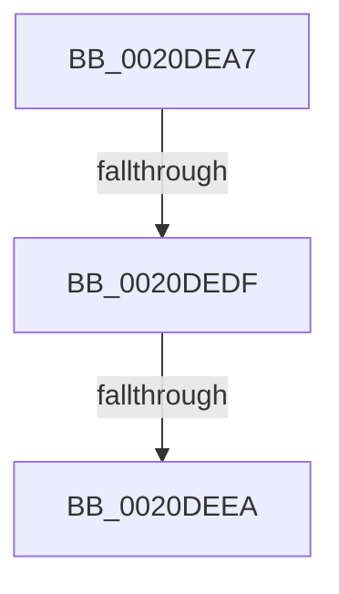

# sub_0020DEA7

- RVA: `0x0020DEA7`–`0x0020DEED` (길이 `70` bytes)
- VA: `0x000000014020DEA7`
- 실행 섹션: `.text`
- PDB 이름 있음: `아니요`; PDB Function 태그: `아니요`
- unwind 정보 RVA: `0x0005DA0C`
- 디코드: `15`개 명령, `70/70` bytes 표시
- 미해석 바이트: `0` (있으면 어셈블리에 `.byte`로 보존)

> 이 문서는 커널 이미지의 기계어와 PDB 기호를 분석해 생성했습니다. 4번과 5번은 함수 원형과 자료형을 바이너리 사용 방식에서 추정한 C 해석이며 원본 소스 복구 결과는 아닙니다.

## 1. Dependencies

- 직접 호출 지점: **1**; 고유 호출 대상: **1**
- 직접 호출자로 확인된 함수: **0**
- RIP 상대 이미지 참조: **1**

### Outgoing calls
- `0x0020DEBD` → [KeAbPreAcquire](../21/KeAbPreAcquire_function_00210230.md) (function, `0x00210230`)

### Direct callers
- 이 함수 시작 RVA로 연결되는 직접 call은 확인되지 않았습니다. 간접 호출은 완전히 역산할 수 없습니다.

### Static image references
- `0x0020DED2` → RVA `0x00FC6D20` (`ALMOSTRO`; read)

## 2. Other-region calls and transfers

- 다른 실행 섹션으로 향하는 call: **0**
- call이 아닌 외부 분기/꼬리 이동: **2**
  - `0x0020DED9` → [sub_0020DFBA](Unknown_function_0020DFBA.md) (`tail-transfer`)
  - `0x0020DEE4` → [sub_0020DF71](Unknown_function_0020DF71.md) (`tail-transfer`)

## 3. Assembly (complete function range)

```asm
0020DEA7  48 89 6C 24 60                  mov qword ptr [rsp + 0x60], rbp
0020DEAC  48 89 74 24 68                  mov qword ptr [rsp + 0x68], rsi
0020DEB1  4C 89 7C 24 30                  mov qword ptr [rsp + 0x30], r15
0020DEB6  48 8B 5B 30                     mov rbx, qword ptr [rbx + 0x30]
0020DEBA  48 8B CB                        mov rcx, rbx
0020DEBD  E8 6E 23 00 00                  call 0x140210230
0020DEC2  48 8B F0                        mov rsi, rax
0020DEC5  45 0F 20 C7                     mov r15, cr8
0020DEC9  BD 01 00 00 00                  mov ebp, 1
0020DECE  44 0F 22 C5                     mov cr8, rbp
0020DED2  83 3D 47 8E DB 00 00            cmp dword ptr [rip + 0xdb8e47], 0
0020DED9  0F 85 DB 00 00 00               jne 0x14020dfba
0020DEDF  F0 0F BA 33 00                  lock btr dword ptr [rbx], 0
0020DEE4  0F 82 87 00 00 00               jb 0x14020df71
0020DEEA  FF 43 10                        inc dword ptr [rbx + 0x10]
```

## 4. C-style interpretation (structured pseudocode)

```c
__int64 __fastcall sub_0020DEA7(void)
{
    __int64 result;
    unsigned __int64 v_stack_p30;
    unsigned __int64 v_stack_p60;
    unsigned __int64 v_stack_p68;

    v_stack_p60 = v_rbp;
    v_stack_p68 = v_rsi;
    v_stack_p30 = v_r15;
    result = KeAbPreAcquire(*(unsigned __int64 *)(v_rbx + 48), a2, a3, a4);
    return result;
}
```

## 5. (Beta) C Style

```c
void sub_0020DEA7(void)
{
    int64_t result;
    uint64_t v_stack_p30;
    uint64_t v_stack_p60;
    uint64_t v_stack_p68;

    v_stack_p60 = local_rbp;
    v_stack_p68 = local_rsi;
    v_stack_p30 = local_r15;
    result = KeAbPreAcquire(*(uint64_t *)(local_rbx + 0x30), a2, a3, a4);
    return result;
}
```

## 6. Execution-region graph

[열기: 2D/3D 그래프와 함수 탐색 컨트롤 패널](../../../control-panel.html?section=text&rva=0x0020DEA7&view=graph)

- 2D 그래프는 위에서 아래로 흐르고, 3D 그래프는 빈 공간을 드래그해 회전합니다. Shift+드래그는 이동, 휠은 확대·축소, 함수 노드 선택은 대상 보고서 이동입니다.

### Static fallback


