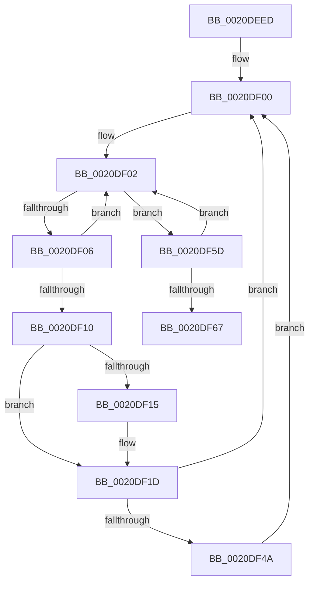

# sub_0020DEED

- RVA: `0x0020DEED`–`0x0020DF71` (길이 `132` bytes)
- VA: `0x000000014020DEED`
- 실행 섹션: `.text`
- PDB 이름 있음: `아니요`; PDB Function 태그: `아니요`
- unwind 정보 RVA: `0x0005DA28`
- 디코드: `37`개 명령, `132/132` bytes 표시
- 미해석 바이트: `0` (있으면 어셈블리에 `.byte`로 보존)

> 이 문서는 커널 이미지의 기계어와 PDB 기호를 분석해 생성했습니다. 4번과 5번은 함수 원형과 자료형을 바이너리 사용 방식에서 추정한 C 해석이며 원본 소스 복구 결과는 아닙니다.

## 1. Dependencies

- 직접 호출 지점: **3**; 고유 호출 대상: **3**
- 직접 호출자로 확인된 함수: **0**
- RIP 상대 이미지 참조: **0**

### Outgoing calls
- `0x0020DF18` → [KeAbPreWait](KeAbPreWait_function_0020E560.md) (function, `0x0020E560`)
- `0x0020DF34` → [KeWaitForSingleObject](KeWaitForSingleObject_function_0020E6B0.md) (function, `0x0020E6B0`)
- `0x0020DF53` → [KeAbPreAcquire](../21/KeAbPreAcquire_function_00210230.md) (function, `0x00210230`)

### Direct callers
- 이 함수 시작 RVA로 연결되는 직접 call은 확인되지 않았습니다. 간접 호출은 완전히 역산할 수 없습니다.

### Static image references
- 디코드된 RIP-relative 메모리 참조가 없습니다.

## 2. Other-region calls and transfers

- 다른 실행 섹션으로 향하는 call: **0**
- 별도 외부 분기/꼬리 이동을 확인하지 못했습니다.

## 3. Assembly (complete function range)

```asm
0020DEED  48 89 7C 24 40                  mov qword ptr [rsp + 0x40], rdi
0020DEF2  48 8B FE                        mov rdi, rsi
0020DEF5  4C 89 74 24 38                  mov qword ptr [rsp + 0x38], r14
0020DEFA  41 BE 04 00 00 00               mov r14d, 4
0020DF00  8B 03                           mov eax, dword ptr [rbx]
0020DF02  A8 01                           test al, 1
0020DF04  75 57                           jne 0x14020df5d
0020DF06  41 8D 0C 06                     lea ecx, [r14 + rax]
0020DF0A  F0 0F B1 0B                     lock cmpxchg dword ptr [rbx], ecx
0020DF0E  75 F2                           jne 0x14020df02
0020DF10  48 85 FF                        test rdi, rdi
0020DF13  74 08                           je 0x14020df1d
0020DF15  48 8B CF                        mov rcx, rdi
0020DF18  E8 43 06 00 00                  call 0x14020e560
0020DF1D  45 33 C9                        xor r9d, r9d
0020DF20  48 C7 44 24 20 00 00 00 00      mov qword ptr [rsp + 0x20], 0
0020DF29  48 8D 4B 18                     lea rcx, [rbx + 0x18]
0020DF2D  45 33 C0                        xor r8d, r8d
0020DF30  41 8D 51 22                     lea edx, [r9 + 0x22]
0020DF34  E8 77 07 00 00                  call 0x14020e6b0
0020DF39  0F 0D 0B                        prefetchw byte ptr [rbx]
0020DF3C  BD 03 00 00 00                  mov ebp, 3
0020DF41  44 8D 75 FF                     lea r14d, [rbp - 1]
0020DF45  48 85 FF                        test rdi, rdi
0020DF48  74 B6                           je 0x14020df00
0020DF4A  45 33 C0                        xor r8d, r8d
0020DF4D  48 8B D7                        mov rdx, rdi
0020DF50  48 8B CB                        mov rcx, rbx
0020DF53  E8 D8 22 00 00                  call 0x140210230
0020DF58  48 8B F8                        mov rdi, rax
0020DF5B  EB A3                           jmp 0x14020df00
0020DF5D  8B C8                           mov ecx, eax
0020DF5F  33 CD                           xor ecx, ebp
0020DF61  F0 0F B1 0B                     lock cmpxchg dword ptr [rbx], ecx
0020DF65  75 9B                           jne 0x14020df02
0020DF67  48 8B 7C 24 40                  mov rdi, qword ptr [rsp + 0x40]
0020DF6C  4C 8B 74 24 38                  mov r14, qword ptr [rsp + 0x38]
```

## 4. C-style interpretation (structured pseudocode)

```c
__int64 __fastcall sub_0020DEED(__int64 a1, __int64 a2, int a3, int a4, __int64 a5, __int64 a6, __int64 a7, __int64 a8)
{
    __int64 result;
    unsigned __int64 v_stack_p20;
    unsigned __int64 v_stack_p38;
    unsigned __int64 v_stack_p40;

    v_stack_p40 = v_rdi;
    v_stack_p38 = v_r14;
loc_0020DF00:
loc_0020DF02:
    if ((((unsigned __int8)((unsigned int)(*(unsigned int *)(v_rbx)))) & (1)) != 0) goto loc_0020DF5D;
    if ((((unsigned __int8)((unsigned int)(*(unsigned int *)(v_rbx)))) & (1)) != 0) goto loc_0020DF02;
    result = (unsigned int)(*(unsigned int *)(v_rbx));
    if (v_rsi != 0) {
        a1 = v_rsi;
        result = KeAbPreWait(a1, a2, a3, a4);
    }
    a4 = 0;
    v_stack_p20 = 0;
    a3 = 0;
    result = KeWaitForSingleObject(v_rbx + 24, a4 + 34, a3, a4);
    if (v_rsi == 0) goto loc_0020DF00;
    a3 = 0;
    result = KeAbPreAcquire(v_rbx, v_rsi, a3, a4);
    goto loc_0020DF00;
loc_0020DF5D:
    a1 = (unsigned int)(((unsigned int)((unsigned int)(result))) ^ (3));
    if (condition_is_not_equal) goto loc_0020DF02;
    return result;
}
```

## 5. (Beta) C Style

```c
int64_t sub_0020DEED(int64_t Arg1, int64_t Arg2, int32_t Arg3, int32_t Arg4, uint64_t Arg5, uint64_t Arg6, int64_t Arg7, int64_t Arg8)
{
    int64_t result;
    uint64_t v_stack_p20;
    uint64_t v_stack_p38;
    uint64_t v_stack_p40;

    v_stack_p40 = local_rdi;
    v_stack_p38 = local_r14;
loc_0020DF00:
loc_0020DF02:
    if ((((uint8_t)((uint32_t)(*(uint32_t *)(local_rbx)))) & (1)) != 0) goto loc_0020DF5D;
    if ((((uint8_t)((uint32_t)(*(uint32_t *)(local_rbx)))) & (1)) != 0) goto loc_0020DF02;
    result = (uint32_t)(*(uint32_t *)(local_rbx));
    if (local_rsi != 0) {
        Arg1 = local_rsi;
        result = KeAbPreWait(Arg1, Arg2, Arg3, Arg4);
    }
    Arg4 = 0;
    v_stack_p20 = 0;
    Arg3 = 0;
    result = KeWaitForSingleObject(local_rbx + 24, Arg4 + 34, Arg3, Arg4);
    if (local_rsi == 0) goto loc_0020DF00;
    Arg3 = 0;
    result = KeAbPreAcquire(local_rbx, local_rsi, Arg3, Arg4);
    goto loc_0020DF00;
loc_0020DF5D:
    Arg1 = (uint32_t)(((uint32_t)((uint32_t)(result))) ^ (3));
    if (condition_is_not_equal) goto loc_0020DF02;
    return result;
}
```

## 6. Execution-region graph

[열기: 2D/3D 그래프와 함수 탐색 컨트롤 패널](../../../control-panel.html?section=text&rva=0x0020DEED&view=graph)

- 2D 그래프는 위에서 아래로 흐르고, 3D 그래프는 빈 공간을 드래그해 회전합니다. Shift+드래그는 이동, 휠은 확대·축소, 함수 노드 선택은 대상 보고서 이동입니다.

### Static fallback


