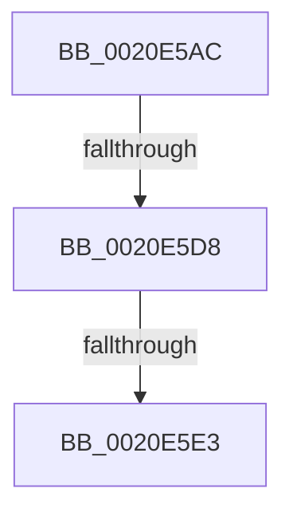

# sub_0020E5AC

- RVA: `0x0020E5AC`–`0x0020E5E6` (길이 `58` bytes)
- VA: `0x000000014020E5AC`
- 실행 섹션: `.text`
- PDB 이름 있음: `아니요`; PDB Function 태그: `아니요`
- unwind 정보 RVA: `0x0005DAE0`
- 디코드: `13`개 명령, `58/58` bytes 표시
- 미해석 바이트: `0` (있으면 어셈블리에 `.byte`로 보존)

> 이 문서는 커널 이미지의 기계어와 PDB 기호를 분석해 생성했습니다. 4번과 5번은 함수 원형과 자료형을 바이너리 사용 방식에서 추정한 C 해석이며 원본 소스 복구 결과는 아닙니다.

## 1. Dependencies

- 직접 호출 지점: **1**; 고유 호출 대상: **1**
- 직접 호출자로 확인된 함수: **0**
- RIP 상대 이미지 참조: **1**

### Outgoing calls
- `0x0020E5B6` → [KeAbPreAcquire](../21/KeAbPreAcquire_function_00210230.md) (function, `0x00210230`)

### Direct callers
- 이 함수 시작 RVA로 연결되는 직접 call은 확인되지 않았습니다. 간접 호출은 완전히 역산할 수 없습니다.

### Static image references
- `0x0020E5CB` → RVA `0x00FC6D20` (`ALMOSTRO`; read)

## 2. Other-region calls and transfers

- 다른 실행 섹션으로 향하는 call: **0**
- call이 아닌 외부 분기/꼬리 이동: **2**
  - `0x0020E5D2` → [sub_0020E696](Unknown_function_0020E696.md) (`tail-transfer`)
  - `0x0020E5DD` → [sub_0020E66A](Unknown_function_0020E66A.md) (`tail-transfer`)

## 3. Assembly (complete function range)

```asm
0020E5AC  48 89 6C 24 50                  mov qword ptr [rsp + 0x50], rbp
0020E5B1  33 D2                           xor edx, edx
0020E5B3  48 8B D9                        mov rbx, rcx
0020E5B6  E8 75 1C 00 00                  call 0x140210230
0020E5BB  48 8B F0                        mov rsi, rax
0020E5BE  45 0F 20 C6                     mov r14, cr8
0020E5C2  BD 01 00 00 00                  mov ebp, 1
0020E5C7  44 0F 22 C5                     mov cr8, rbp
0020E5CB  83 3D 4E 87 DB 00 00            cmp dword ptr [rip + 0xdb874e], 0
0020E5D2  0F 85 BE 00 00 00               jne 0x14020e696
0020E5D8  F0 0F BA 33 00                  lock btr dword ptr [rbx], 0
0020E5DD  0F 82 87 00 00 00               jb 0x14020e66a
0020E5E3  FF 43 10                        inc dword ptr [rbx + 0x10]
```

## 4. C-style interpretation (structured pseudocode)

```c
__int64 __fastcall sub_0020E5AC(__int64 a1, int a2)
{
    __int64 result;
    unsigned __int64 v_stack_p50;

    v_stack_p50 = v_rbp;
    a2 = 0;
    result = KeAbPreAcquire(a1, a2, a3, a4);
    return result;
}
```

## 5. (Beta) C Style

```c
int64_t sub_0020E5AC(void *Arg1, int32_t Arg2)
{
    uint8_t *arg1 = (uint8_t *)Arg1;

    int64_t result;
    uint64_t v_stack_p50;

    v_stack_p50 = local_rbp;
    Arg2 = 0;
    result = KeAbPreAcquire(Arg1, Arg2, a3, a4);
    return result;
}
```

### 관측된 메모리 오프셋

구조체 형식이 확인되지 않은 접근은 인자 기준의 오프셋으로만 기록했습니다.

| 기준 인자 | 오프셋 표현 | 폭 (bit) | 접근 |
|---|---:|---:|---|
| `Arg1` | `+ 0x0` | `32` | `R/W` |
| `Arg1` | `+ 0x10` | `32` | `R/W` |

## 6. Execution-region graph

[열기: 2D/3D 그래프와 함수 탐색 컨트롤 패널](../../../control-panel.html?section=text&rva=0x0020E5AC&view=graph)

- 2D 그래프는 위에서 아래로 흐르고, 3D 그래프는 빈 공간을 드래그해 회전합니다. Shift+드래그는 이동, 휠은 확대·축소, 함수 노드 선택은 대상 보고서 이동입니다.

### Static fallback


