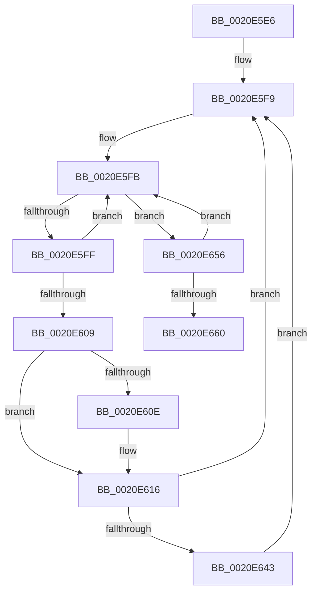

# sub_0020E5E6

- RVA: `0x0020E5E6`–`0x0020E66A` (길이 `132` bytes)
- VA: `0x000000014020E5E6`
- 실행 섹션: `.text`
- PDB 이름 있음: `아니요`; PDB Function 태그: `아니요`
- unwind 정보 RVA: `0x0005DAF4`
- 디코드: `37`개 명령, `132/132` bytes 표시
- 미해석 바이트: `0` (있으면 어셈블리에 `.byte`로 보존)

> 이 문서는 커널 이미지의 기계어와 PDB 기호를 분석해 생성했습니다. 4번과 5번은 함수 원형과 자료형을 바이너리 사용 방식에서 추정한 C 해석이며 원본 소스 복구 결과는 아닙니다.

## 1. Dependencies

- 직접 호출 지점: **3**; 고유 호출 대상: **3**
- 직접 호출자로 확인된 함수: **0**
- RIP 상대 이미지 참조: **0**

### Outgoing calls
- `0x0020E611` → [KeAbPreWait](KeAbPreWait_function_0020E560.md) (function, `0x0020E560`)
- `0x0020E62D` → [KeWaitForSingleObject](KeWaitForSingleObject_function_0020E6B0.md) (function, `0x0020E6B0`)
- `0x0020E64C` → [KeAbPreAcquire](../21/KeAbPreAcquire_function_00210230.md) (function, `0x00210230`)

### Direct callers
- 이 함수 시작 RVA로 연결되는 직접 call은 확인되지 않았습니다. 간접 호출은 완전히 역산할 수 없습니다.

### Static image references
- 디코드된 RIP-relative 메모리 참조가 없습니다.

## 2. Other-region calls and transfers

- 다른 실행 섹션으로 향하는 call: **0**
- 별도 외부 분기/꼬리 이동을 확인하지 못했습니다.

## 3. Assembly (complete function range)

```asm
0020E5E6  48 89 7C 24 58                  mov qword ptr [rsp + 0x58], rdi
0020E5EB  48 8B FE                        mov rdi, rsi
0020E5EE  4C 89 7C 24 60                  mov qword ptr [rsp + 0x60], r15
0020E5F3  41 BF 04 00 00 00               mov r15d, 4
0020E5F9  8B 03                           mov eax, dword ptr [rbx]
0020E5FB  A8 01                           test al, 1
0020E5FD  75 57                           jne 0x14020e656
0020E5FF  41 8D 0C 07                     lea ecx, [r15 + rax]
0020E603  F0 0F B1 0B                     lock cmpxchg dword ptr [rbx], ecx
0020E607  75 F2                           jne 0x14020e5fb
0020E609  48 85 FF                        test rdi, rdi
0020E60C  74 08                           je 0x14020e616
0020E60E  48 8B CF                        mov rcx, rdi
0020E611  E8 4A FF FF FF                  call 0x14020e560
0020E616  45 33 C9                        xor r9d, r9d
0020E619  48 C7 44 24 20 00 00 00 00      mov qword ptr [rsp + 0x20], 0
0020E622  48 8D 4B 18                     lea rcx, [rbx + 0x18]
0020E626  45 33 C0                        xor r8d, r8d
0020E629  41 8D 51 22                     lea edx, [r9 + 0x22]
0020E62D  E8 7E 00 00 00                  call 0x14020e6b0
0020E632  0F 0D 0B                        prefetchw byte ptr [rbx]
0020E635  BD 03 00 00 00                  mov ebp, 3
0020E63A  44 8D 7D FF                     lea r15d, [rbp - 1]
0020E63E  48 85 FF                        test rdi, rdi
0020E641  74 B6                           je 0x14020e5f9
0020E643  45 33 C0                        xor r8d, r8d
0020E646  48 8B D7                        mov rdx, rdi
0020E649  48 8B CB                        mov rcx, rbx
0020E64C  E8 DF 1B 00 00                  call 0x140210230
0020E651  48 8B F8                        mov rdi, rax
0020E654  EB A3                           jmp 0x14020e5f9
0020E656  8B C8                           mov ecx, eax
0020E658  33 CD                           xor ecx, ebp
0020E65A  F0 0F B1 0B                     lock cmpxchg dword ptr [rbx], ecx
0020E65E  75 9B                           jne 0x14020e5fb
0020E660  48 8B 7C 24 58                  mov rdi, qword ptr [rsp + 0x58]
0020E665  4C 8B 7C 24 60                  mov r15, qword ptr [rsp + 0x60]
```

## 4. C-style interpretation (structured pseudocode)

```c
__int64 __fastcall sub_0020E5E6(__int64 a1, __int64 a2, int a3, int a4, __int64 a5, __int64 a6, __int64 a7, __int64 a8, __int64 a9, __int64 a10, __int64 a11, __int64 a12)
{
    __int64 result;
    unsigned __int64 v_stack_p20;
    unsigned __int64 v_stack_p58;
    unsigned __int64 v_stack_p60;

    v_stack_p58 = v_rdi;
    v_stack_p60 = v_r15;
loc_0020E5F9:
loc_0020E5FB:
    if ((((unsigned __int8)((unsigned int)(*(unsigned int *)(v_rbx)))) & (1)) != 0) goto loc_0020E656;
    if ((((unsigned __int8)((unsigned int)(*(unsigned int *)(v_rbx)))) & (1)) != 0) goto loc_0020E5FB;
    result = (unsigned int)(*(unsigned int *)(v_rbx));
    if (v_rsi != 0) {
        a1 = v_rsi;
        result = KeAbPreWait(a1, a2, a3, a4);
    }
    a4 = 0;
    v_stack_p20 = 0;
    a3 = 0;
    result = KeWaitForSingleObject(v_rbx + 24, a4 + 34, a3, a4);
    if (v_rsi == 0) goto loc_0020E5F9;
    a3 = 0;
    result = KeAbPreAcquire(v_rbx, v_rsi, a3, a4);
    goto loc_0020E5F9;
loc_0020E656:
    a1 = (unsigned int)(((unsigned int)((unsigned int)(result))) ^ (3));
    if (condition_is_not_equal) goto loc_0020E5FB;
    return result;
}
```

## 5. (Beta) C Style

```c
int64_t sub_0020E5E6(int64_t Arg1, int64_t Arg2, int32_t Arg3, int32_t Arg4, uint64_t Arg5, uint64_t Arg6, uint64_t Arg7, uint64_t Arg8, uint64_t Arg9, uint64_t Arg10, int64_t Arg11, int64_t Arg12)
{
    int64_t result;
    uint64_t v_stack_p20;
    uint64_t v_stack_p58;
    uint64_t v_stack_p60;

    v_stack_p58 = local_rdi;
    v_stack_p60 = local_r15;
loc_0020E5F9:
loc_0020E5FB:
    if ((((uint8_t)((uint32_t)(*(uint32_t *)(local_rbx)))) & (1)) != 0) goto loc_0020E656;
    if ((((uint8_t)((uint32_t)(*(uint32_t *)(local_rbx)))) & (1)) != 0) goto loc_0020E5FB;
    result = (uint32_t)(*(uint32_t *)(local_rbx));
    if (local_rsi != 0) {
        Arg1 = local_rsi;
        result = KeAbPreWait(Arg1, Arg2, Arg3, Arg4);
    }
    Arg4 = 0;
    v_stack_p20 = 0;
    Arg3 = 0;
    result = KeWaitForSingleObject(local_rbx + 24, Arg4 + 34, Arg3, Arg4);
    if (local_rsi == 0) goto loc_0020E5F9;
    Arg3 = 0;
    result = KeAbPreAcquire(local_rbx, local_rsi, Arg3, Arg4);
    goto loc_0020E5F9;
loc_0020E656:
    Arg1 = (uint32_t)(((uint32_t)((uint32_t)(result))) ^ (3));
    if (condition_is_not_equal) goto loc_0020E5FB;
    return result;
}
```

## 6. Execution-region graph

[열기: 2D/3D 그래프와 함수 탐색 컨트롤 패널](../../../control-panel.html?section=text&rva=0x0020E5E6&view=graph)

- 2D 그래프는 위에서 아래로 흐르고, 3D 그래프는 빈 공간을 드래그해 회전합니다. Shift+드래그는 이동, 휠은 확대·축소, 함수 노드 선택은 대상 보고서 이동입니다.

### Static fallback


