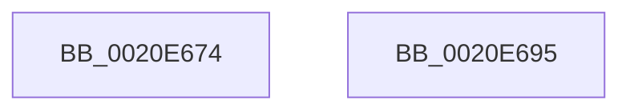

# sub_0020E674

- RVA: `0x0020E674`–`0x0020E696` (길이 `34` bytes)
- VA: `0x000000014020E674`
- 실행 섹션: `.text`
- PDB 이름 있음: `아니요`; PDB Function 태그: `아니요`
- unwind 정보 RVA: `0x0005DB1C`
- 디코드: `11`개 명령, `34/34` bytes 표시
- 미해석 바이트: `0` (있으면 어셈블리에 `.byte`로 보존)

> 이 문서는 커널 이미지의 기계어와 PDB 기호를 분석해 생성했습니다. 4번과 5번은 함수 원형과 자료형을 바이너리 사용 방식에서 추정한 C 해석이며 원본 소스 복구 결과는 아닙니다.

## 1. Dependencies

- 직접 호출 지점: **0**; 고유 호출 대상: **0**
- 직접 호출자로 확인된 함수: **0**
- RIP 상대 이미지 참조: **0**

### Outgoing calls
- 직접 디코드된 call 명령이 없습니다.

### Direct callers
- 이 함수 시작 RVA로 연결되는 직접 call은 확인되지 않았습니다. 간접 호출은 완전히 역산할 수 없습니다.

### Static image references
- 디코드된 RIP-relative 메모리 참조가 없습니다.

## 2. Other-region calls and transfers

- 다른 실행 섹션으로 향하는 call: **0**
- 별도 외부 분기/꼬리 이동을 확인하지 못했습니다.

## 3. Assembly (complete function range)

```asm
0020E674  C6 46 0A 01                     mov byte ptr [rsi + 0xa], 1
0020E678  65 48 8B 04 25 88 01 00 00      mov rax, qword ptr gs:[0x188]
0020E681  48 89 43 08                     mov qword ptr [rbx + 8], rax
0020E685  41 0F B6 C6                     movzx eax, r14b
0020E689  89 43 30                        mov dword ptr [rbx + 0x30], eax
0020E68C  48 83 C4 30                     add rsp, 0x30
0020E690  41 5E                           pop r14
0020E692  5E                              pop rsi
0020E693  5B                              pop rbx
0020E694  C3                              ret
0020E695  CC                              int3
```

## 4. C-style interpretation (structured pseudocode)

```c
__int64 __fastcall sub_0020E674(void)
{
    __int64 v_rsp;

    *(unsigned __int8 *)(v_rsi + 10) = 1;
    *(unsigned __int64 *)(v_rbx + 8) = *(unsigned __int64 *)(gs_base + (0 + 392));
    *(unsigned int *)(v_rbx + 48) = (unsigned int)((unsigned __int8)(v_r14));
    v_rsp = (v_rsp) + (48);
    return (unsigned __int8)(v_r14);
}
```

## 5. (Beta) C Style

```c
void sub_0020E674(void)
{
    int64_t local_rsp;

    *(uint8_t *)(local_rsi + 0xA) = 1;
    *(uint64_t *)(local_rbx + 0x8) = *(uint64_t *)(gs_base + (0 + 0x188));
    *(uint32_t *)(local_rbx + 0x30) = (uint32_t)((uint8_t)(local_r14));
    local_rsp = (local_rsp) + (48);
    return (uint8_t)(local_r14);
}
```

## 6. Execution-region graph

[열기: 2D/3D 그래프와 함수 탐색 컨트롤 패널](../../../control-panel.html?section=text&rva=0x0020E674&view=graph)

- 2D 그래프는 위에서 아래로 흐르고, 3D 그래프는 빈 공간을 드래그해 회전합니다. Shift+드래그는 이동, 휠은 확대·축소, 함수 노드 선택은 대상 보고서 이동입니다.

### Static fallback


