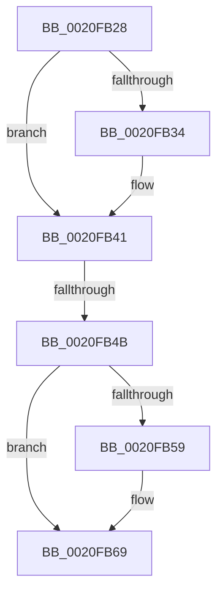

# sub_0020FB28

- RVA: `0x0020FB28`–`0x0020FB76` (길이 `78` bytes)
- VA: `0x000000014020FB28`
- 실행 섹션: `.text`
- PDB 이름 있음: `아니요`; PDB Function 태그: `아니요`
- unwind 정보 RVA: `0x0005DBC0`
- 디코드: `24`개 명령, `78/78` bytes 표시
- 미해석 바이트: `0` (있으면 어셈블리에 `.byte`로 보존)

> 이 문서는 커널 이미지의 기계어와 PDB 기호를 분석해 생성했습니다. 4번과 5번은 함수 원형과 자료형을 바이너리 사용 방식에서 추정한 C 해석이며 원본 소스 복구 결과는 아닙니다.

## 1. Dependencies

- 직접 호출 지점: **2**; 고유 호출 대상: **2**
- 직접 호출자로 확인된 함수: **0**
- RIP 상대 이미지 참조: **0**

### Outgoing calls
- `0x0020FB39` → [KeAbPreAcquire](../21/KeAbPreAcquire_function_00210230.md) (function, `0x00210230`)
- `0x0020FB64` → [ExfAcquirePushLockSharedEx](../21/ExfAcquirePushLockSharedEx_function_0021044C.md) (function, `0x0021044C`)

### Direct callers
- 이 함수 시작 RVA로 연결되는 직접 call은 확인되지 않았습니다. 간접 호출은 완전히 역산할 수 없습니다.

### Static image references
- 디코드된 RIP-relative 메모리 참조가 없습니다.

## 2. Other-region calls and transfers

- 다른 실행 섹션으로 향하는 call: **0**
- call이 아닌 외부 분기/꼬리 이동: **2**
  - `0x0020FB49` → [sub_0020FB95](Unknown_function_0020FB95.md) (`tail-transfer`)
  - `0x0020FB74` → [sub_0020FB76 + 0x4](Unknown_function_0020FB76.md) (`tail-transfer`)

## 3. Assembly (complete function range)

```asm
0020FB28  48 89 6C 24 50                  mov qword ptr [rsp + 0x50], rbp
0020FB2D  8B EE                           mov ebp, esi
0020FB2F  83 E5 02                        and ebp, 2
0020FB32  75 0D                           jne 0x14020fb41
0020FB34  45 33 C0                        xor r8d, r8d
0020FB37  33 D2                           xor edx, edx
0020FB39  E8 F2 06 00 00                  call 0x140210230
0020FB3E  48 8B F8                        mov rdi, rax
0020FB41  44 8B 4B 08                     mov r9d, dword ptr [rbx + 8]
0020FB45  41 F6 C1 01                     test r9b, 1
0020FB49  75 4A                           jne 0x14020fb95
0020FB4B  B9 11 00 00 00                  mov ecx, 0x11
0020FB50  33 C0                           xor eax, eax
0020FB52  F0 48 0F B1 0B                  lock cmpxchg qword ptr [rbx], rcx
0020FB57  74 10                           je 0x14020fb69
0020FB59  4C 8B CB                        mov r9, rbx
0020FB5C  4C 8B C7                        mov r8, rdi
0020FB5F  8B D6                           mov edx, esi
0020FB61  48 8B CB                        mov rcx, rbx
0020FB64  E8 E3 08 00 00                  call 0x14021044c
0020FB69  48 83 CB 01                     or rbx, 1
0020FB6D  85 ED                           test ebp, ebp
0020FB6F  48 8B 6C 24 50                  mov rbp, qword ptr [rsp + 0x50]
0020FB74  75 04                           jne 0x14020fb7a
```

## 4. C-style interpretation (structured pseudocode)

```c
__int64 __fastcall sub_0020FB28(__int64 a1, int a2, int a3, __int64 a4, __int64 a5, __int64 a6, __int64 a7, __int64 a8, __int64 a9, __int64 a10)
{
    __int64 result;
    __int64 v_rbp;
    __int64 v_rbx;
    __int64 v_rdi;
    unsigned __int64 v_stack_p50;

    v_stack_p50 = v_rbp;
    v_rbp = (unsigned int)(((unsigned int)((unsigned int)(v_rsi))) & (2));
    if (!(condition_is_not_equal)) {
        a3 = 0;
        a2 = 0;
        result = KeAbPreAcquire(a1, a2, a3, a4);
        v_rdi = result;
    }
    result = 0;
    if (!(condition_is_equal)) {
        a4 = v_rbx;
        a3 = v_rdi;
        a2 = (unsigned int)(v_rsi);
        a1 = v_rbx;
        result = ExfAcquirePushLockSharedEx(a1, a2, a3, a4);
    }
    v_rbx = (v_rbx) | (1);
}
```

## 5. (Beta) C Style

```c
int64_t sub_0020FB28(int64_t Arg1, int32_t Arg2, int32_t Arg3, int64_t Arg4, uint64_t Arg5, uint64_t Arg6, uint64_t Arg7, uint64_t Arg8, uint64_t Arg9, int64_t Arg10)
{
    int64_t result;
    int64_t local_rbp;
    int64_t local_rbx;
    int64_t local_rdi;
    uint64_t v_stack_p50;

    v_stack_p50 = local_rbp;
    local_rbp = (uint32_t)(((uint32_t)((uint32_t)(local_rsi))) & (2));
    if (!(condition_is_not_equal)) {
        Arg3 = 0;
        Arg2 = 0;
        result = KeAbPreAcquire(Arg1, Arg2, Arg3, Arg4);
        local_rdi = result;
    }
    result = 0;
    if (!(condition_is_equal)) {
        Arg4 = local_rbx;
        Arg3 = local_rdi;
        Arg2 = (uint32_t)(local_rsi);
        Arg1 = local_rbx;
        result = ExfAcquirePushLockSharedEx(Arg1, Arg2, Arg3, Arg4);
    }
    local_rbx = (local_rbx) | (1);
}
```

## 6. Execution-region graph

[열기: 2D/3D 그래프와 함수 탐색 컨트롤 패널](../../../control-panel.html?section=text&rva=0x0020FB28&view=graph)

- 2D 그래프는 위에서 아래로 흐르고, 3D 그래프는 빈 공간을 드래그해 회전합니다. Shift+드래그는 이동, 휠은 확대·축소, 함수 노드 선택은 대상 보고서 이동입니다.

### Static fallback


