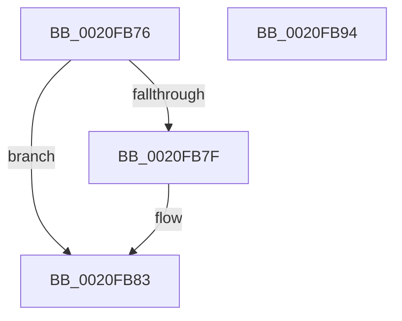

# sub_0020FB76

- RVA: `0x0020FB76`–`0x0020FB95` (길이 `31` bytes)
- VA: `0x000000014020FB76`
- 실행 섹션: `.text`
- PDB 이름 있음: `아니요`; PDB Function 태그: `아니요`
- unwind 정보 RVA: `0x0005DBD4`
- 디코드: `12`개 명령, `31/31` bytes 표시
- 미해석 바이트: `0` (있으면 어셈블리에 `.byte`로 보존)

> 이 문서는 커널 이미지의 기계어와 PDB 기호를 분석해 생성했습니다. 4번과 5번은 함수 원형과 자료형을 바이너리 사용 방식에서 추정한 C 해석이며 원본 소스 복구 결과는 아닙니다.

## 1. Dependencies

- 직접 호출 지점: **0**; 고유 호출 대상: **0**
- 직접 호출자로 확인된 함수: **0**
- RIP 상대 이미지 참조: **0**

### Outgoing calls
- 직접 디코드된 call 명령이 없습니다.

### Direct callers
- 이 함수 시작 RVA로 연결되는 직접 call은 확인되지 않았습니다. 간접 호출은 완전히 역산할 수 없습니다.

### Static image references
- 디코드된 RIP-relative 메모리 참조가 없습니다.

## 2. Other-region calls and transfers

- 다른 실행 섹션으로 향하는 call: **0**
- 별도 외부 분기/꼬리 이동을 확인하지 못했습니다.

## 3. Assembly (complete function range)

```asm
0020FB76  48 83 CB 02                     or rbx, 2
0020FB7A  48 85 FF                        test rdi, rdi
0020FB7D  74 04                           je 0x14020fb83
0020FB7F  C6 47 0A 01                     mov byte ptr [rdi + 0xa], 1
0020FB83  48 8B C3                        mov rax, rbx
0020FB86  48 8B 5C 24 68                  mov rbx, qword ptr [rsp + 0x68]
0020FB8B  48 83 C4 30                     add rsp, 0x30
0020FB8F  41 5E                           pop r14
0020FB91  5F                              pop rdi
0020FB92  5E                              pop rsi
0020FB93  C3                              ret
0020FB94  CC                              int3
```

## 4. C-style interpretation (structured pseudocode)

```c
__int64 __fastcall sub_0020FB76(__int64 a1, __int64 a2, __int64 a3, __int64 a4, __int64 a5, __int64 a6, __int64 a7, __int64 a8, __int64 a9, __int64 a10, __int64 a11, __int64 a12, __int64 a13)
{
    __int64 v_rbx;
    __int64 v_rsp;

    v_rbx = (v_rbx) | (2);
    if (v_rdi != 0) {
        *(unsigned __int8 *)(v_rdi + 10) = 1;
    }
    v_rsp = (v_rsp) + (48);
    return v_rbx;
}
```

## 5. (Beta) C Style

```c
int64_t sub_0020FB76(int64_t Arg1, int64_t Arg2, int64_t Arg3, int64_t Arg4, uint64_t Arg5, uint64_t Arg6, uint64_t Arg7, uint64_t Arg8, uint64_t Arg9, uint64_t Arg10, uint64_t Arg11, uint64_t Arg12, int64_t Arg13)
{
    int64_t local_rbx;
    int64_t local_rsp;

    local_rbx = (local_rbx) | (2);
    if (local_rdi != 0) {
        *(uint8_t *)(local_rdi + 0xA) = 1;
    }
    local_rsp = (local_rsp) + (48);
    return local_rbx;
}
```

## 6. Execution-region graph

[열기: 2D/3D 그래프와 함수 탐색 컨트롤 패널](../../../control-panel.html?section=text&rva=0x0020FB76&view=graph)

- 2D 그래프는 위에서 아래로 흐르고, 3D 그래프는 빈 공간을 드래그해 회전합니다. Shift+드래그는 이동, 휠은 확대·축소, 함수 노드 선택은 대상 보고서 이동입니다.

### Static fallback


