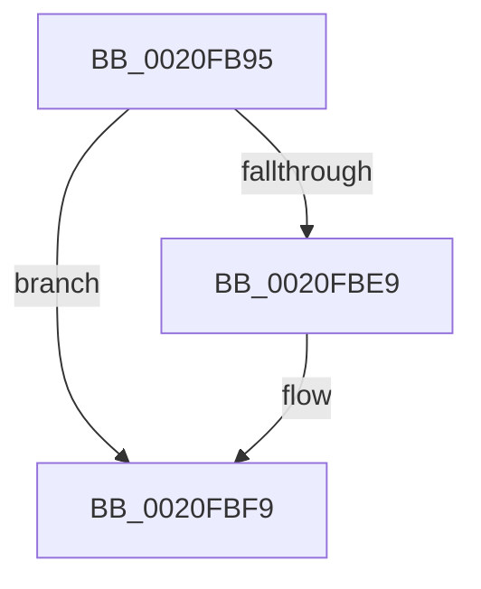

# sub_0020FB95

- RVA: `0x0020FB95`–`0x0020FC01` (길이 `108` bytes)
- VA: `0x000000014020FB95`
- 실행 섹션: `.text`
- PDB 이름 있음: `아니요`; PDB Function 태그: `아니요`
- unwind 정보 RVA: `0x0005DBE8`
- 디코드: `27`개 명령, `108/108` bytes 표시
- 미해석 바이트: `0` (있으면 어셈블리에 `.byte`로 보존)

> 이 문서는 커널 이미지의 기계어와 PDB 기호를 분석해 생성했습니다. 4번과 5번은 함수 원형과 자료형을 바이너리 사용 방식에서 추정한 C 해석이며 원본 소스 복구 결과는 아닙니다.

## 1. Dependencies

- 직접 호출 지점: **1**; 고유 호출 대상: **1**
- 직접 호출자로 확인된 함수: **0**
- RIP 상대 이미지 참조: **0**

### Outgoing calls
- `0x0020FBF4` → [ExfAcquirePushLockSharedEx](../21/ExfAcquirePushLockSharedEx_function_0021044C.md) (function, `0x0021044C`)

### Direct callers
- 이 함수 시작 RVA로 연결되는 직접 call은 확인되지 않았습니다. 간접 호출은 완전히 역산할 수 없습니다.

### Static image references
- 디코드된 RIP-relative 메모리 참조가 없습니다.

## 2. Other-region calls and transfers

- 다른 실행 섹션으로 향하는 call: **0**
- call이 아닌 외부 분기/꼬리 이동: **1**
  - `0x0020FBFC` → [sub_0020FB28 + 0x45](Unknown_function_0020FB28.md) (`tail-transfer`)

## 3. Assembly (complete function range)

```asm
0020FB95  65 4C 8B 04 25 20 00 00 00      mov r8, qword ptr gs:[0x20]
0020FB9E  41 8B C1                        mov eax, r9d
0020FBA1  C1 E8 0D                        shr eax, 0xd
0020FBA4  BA 01 00 00 00                  mov edx, 1
0020FBA9  25 FF FF 03 00                  and eax, 0x3ffff
0020FBAE  49 C1 E9 04                     shr r9, 4
0020FBB2  0F BD C8                        bsr ecx, eax
0020FBB5  41 81 E1 FF 01 00 00            and r9d, 0x1ff
0020FBBC  D3 E2                           shl edx, cl
0020FBBE  33 D0                           xor edx, eax
0020FBC0  89 4C 24 58                     mov dword ptr [rsp + 0x58], ecx
0020FBC4  49 8B 80 B0 8B 00 00            mov rax, qword ptr [r8 + 0x8bb0]
0020FBCB  83 C1 FE                        add ecx, -2
0020FBCE  48 8B 04 C8                     mov rax, qword ptr [rax + rcx*8]
0020FBD2  B9 11 00 00 00                  mov ecx, 0x11
0020FBD7  48 8B 44 D0 08                  mov rax, qword ptr [rax + rdx*8 + 8]
0020FBDC  4E 8D 34 C8                     lea r14, [rax + r9*8]
0020FBE0  33 C0                           xor eax, eax
0020FBE2  F0 49 0F B1 0E                  lock cmpxchg qword ptr [r14], rcx
0020FBE7  74 10                           je 0x14020fbf9
0020FBE9  4C 8B CB                        mov r9, rbx
0020FBEC  4C 8B C7                        mov r8, rdi
0020FBEF  8B D6                           mov edx, esi
0020FBF1  49 8B CE                        mov rcx, r14
0020FBF4  E8 53 08 00 00                  call 0x14021044c
0020FBF9  49 8B DE                        mov rbx, r14
0020FBFC  E9 6C FF FF FF                  jmp 0x14020fb6d
```

## 4. C-style interpretation (structured pseudocode)

```c
__int64 __fastcall sub_0020FB95(__int64 a1, __int64 a2, __int64 a3, __int64 a4)
{
    __int64 result;
    unsigned int v_stack_p58;

    result = (unsigned int)(((unsigned int)((unsigned int)(a4))) >> (13));
    result = (unsigned int)((result) & (0x3FFFFULL));
    a4 = (a4) >> (4);
    a4 = (unsigned int)((a4) & (511));
    a2 = (unsigned int)((1) << ((unsigned __int8)(a1)));
    a2 = (unsigned int)((a2) ^ ((unsigned int)(result)));
    v_stack_p58 = (unsigned int)(a1);
    a1 = (unsigned int)((a1) + (-2));
    result = 0;
    if (!(condition_is_equal)) {
        a4 = v_rbx;
        a3 = v_rdi;
        a2 = (unsigned int)(v_rsi);
        a1 = *(unsigned __int64 *)(*(unsigned __int64 *)(*(unsigned __int64 *)(*(unsigned __int64 *)(gs_base + (0 + 32)) + 35760) + a1 * 8) + a2 * 8 + 8) + a4 * 8;
        result = ExfAcquirePushLockSharedEx(a1, a2, a3, a4);
    }
}
```

## 5. (Beta) C Style

```c
int64_t sub_0020FB95(int64_t Arg1, int64_t Arg2, int64_t Arg3, int64_t Arg4)
{
    int64_t result;
    uint32_t v_stack_p58;

    result = (uint32_t)(((uint32_t)((uint32_t)(Arg4))) >> (13));
    result = (uint32_t)((result) & (0x3FFFFULL));
    Arg4 = (Arg4) >> (4);
    Arg4 = (uint32_t)((Arg4) & (511));
    Arg2 = (uint32_t)((1) << ((uint8_t)(Arg1)));
    Arg2 = (uint32_t)((Arg2) ^ ((uint32_t)(result)));
    v_stack_p58 = (uint32_t)(Arg1);
    Arg1 = (uint32_t)((Arg1) + (-2));
    result = 0;
    if (!(condition_is_equal)) {
        Arg4 = local_rbx;
        Arg3 = local_rdi;
        Arg2 = (uint32_t)(local_rsi);
        Arg1 = *(uint64_t *)(*(uint64_t *)(*(uint64_t *)(*(uint64_t *)(gs_base + (0 + 0x20)) + 0x8BB0) + Arg1 * 8) + Arg2 * 8 + 0x8) + Arg4 * 8;
        result = ExfAcquirePushLockSharedEx(Arg1, Arg2, Arg3, Arg4);
    }
}
```

## 6. Execution-region graph

[열기: 2D/3D 그래프와 함수 탐색 컨트롤 패널](../../../control-panel.html?section=text&rva=0x0020FB95&view=graph)

- 2D 그래프는 위에서 아래로 흐르고, 3D 그래프는 빈 공간을 드래그해 회전합니다. Shift+드래그는 이동, 휠은 확대·축소, 함수 노드 선택은 대상 보고서 이동입니다.

### Static fallback


