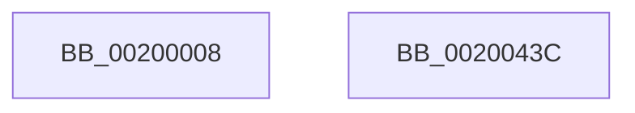

# _tlgWriteTemplate&lt;long __cdecl(_tlgProvider_t const * __ptr64,void const * __ptr64,_GUID const * __ptr64,_GUID const * __ptr64,unsigned int,_EVENT_DATA_DESCRIPTOR * __ptr64),&amp;_tlgWriteTransfer_EtwWriteTransfer,_GUID const * __ptr64,_GUID const * __ptr64&gt;::Write&lt;_tlgWrapperByVal&lt;8&gt;,_tlgWrapperByVal&lt;4&gt;,_tlgWrapperByVal&lt;4&gt;,_tlgWrapperByVal&lt;1&gt;,_tlgWrapperByRef&lt;16&gt;,_tlgWrapperBinary,_tlgWrapperByVal&lt;8&gt;,_tlgWrapperByVal&lt;1&gt;,_tlgWrapperBinary,_tlgWrapperByVal&lt;8&gt;,_tlgWrapperByVal&lt;1&gt;,_tlgWrapperBinary,_tlgWrapperByVal&lt;8&gt;,_tlgWrapperByVal&lt;1&gt;,_tlgWrapperBinary,_tlgWrapperByVal&lt;8&gt;,_tlgWrapperByVal&lt;1&gt;,_tlgWrapperBinary,_tlgWrapperByVal&lt;8&gt;,_tlgWrapperByVal&lt;1&gt;,_tlgWrapperBinary,_tlgWrapperByVal&lt;8&gt;,_tlgWrapperByVal&lt;1&gt;,_tlgWrapperBinary,_tlgWrapperByVal&lt;8&gt;,_tlgWrapperByVal&lt;1&gt;,_tlgWrapperBinary,_tlgWrapperByVal&lt;8&gt;,_tlgWrapperByVal&lt;1&gt;,_tlgWrapperBinary,_tlgWrapperByVal&lt;4&gt;,_tlgWrapperByVal&lt;1&gt; &gt;

- RVA: `0x00200008`–`0x0020043D` (길이 `1,077` bytes)
- VA: `0x0000000140200008`
- 실행 섹션: `.text`
- PDB 이름 있음: `예`; PDB Function 태그: `아니요`
- unwind 정보 RVA: `0x000BE76C`
- 디코드: `174`개 명령, `1,077/1,077` bytes 표시
- 미해석 바이트: `0` (있으면 어셈블리에 `.byte`로 보존)

> 이 문서는 커널 이미지의 기계어와 PDB 기호를 분석해 생성했습니다. 4번과 5번은 함수 원형과 자료형을 바이너리 사용 방식에서 추정한 C 해석이며 원본 소스 복구 결과는 아닙니다.

## 1. Dependencies

- 직접 호출 지점: **2**; 고유 호출 대상: **2**
- 직접 호출자로 확인된 함수: **1**
- RIP 상대 이미지 참조: **2**

### Outgoing calls
- `0x00200417` → [tlgWriteTransfer_EtwWriteTransfer](../42/tlgWriteTransfer_EtwWriteTransfer_function_004260E0.md) (function, `0x004260E0`)
- `0x00200426` → [_security_check_cookie](../6A/_security_check_cookie_function_006AC640.md) (function, `0x006AC640`)

### Direct callers
- [sub_00B3EDC0](../../page/B3/Unknown_function_00B3EDC0.md) at `0x00B3F08C`

### Static image references
- `0x0020001D` → RVA `0x00E0A740` (`.data`; read)
- `0x00200397` → RVA `0x00E0A580` (`.data`; read)

## 2. Other-region calls and transfers

- 다른 실행 섹션으로 향하는 call: **0**
- 별도 외부 분기/꼬리 이동을 확인하지 못했습니다.

## 3. Assembly (complete function range)

```asm
00200008  48 89 5C 24 08                  mov qword ptr [rsp + 8], rbx
0020000D  55                              push rbp
0020000E  48 8D AC 24 10 FE FF FF         lea rbp, [rsp - 0x1f0]
00200016  48 81 EC F0 02 00 00            sub rsp, 0x2f0
0020001D  48 8B 05 1C A7 C0 00            mov rax, qword ptr [rip + 0xc0a71c]
00200024  48 33 C4                        xor rax, rsp
00200027  48 89 85 E0 01 00 00            mov qword ptr [rbp + 0x1e0], rax
0020002E  48 8B 8D 08 03 00 00            mov rcx, qword ptr [rbp + 0x308]
00200035  33 DB                           xor ebx, ebx
00200037  48 8B 85 18 03 00 00            mov rax, qword ptr [rbp + 0x318]
0020003E  48 89 85 D0 01 00 00            mov qword ptr [rbp + 0x1d0], rax
00200045  48 8B 85 10 03 00 00            mov rax, qword ptr [rbp + 0x310]
0020004C  48 89 85 C0 01 00 00            mov qword ptr [rbp + 0x1c0], rax
00200053  48 8D 85 B8 01 00 00            lea rax, [rbp + 0x1b8]
0020005A  48 89 85 A0 01 00 00            mov qword ptr [rbp + 0x1a0], rax
00200061  48 8B 01                        mov rax, qword ptr [rcx]
00200064  48 89 85 B0 01 00 00            mov qword ptr [rbp + 0x1b0], rax
0020006B  0F B7 41 08                     movzx eax, word ptr [rcx + 8]
0020006F  48 8B 8D F0 02 00 00            mov rcx, qword ptr [rbp + 0x2f0]
00200076  89 85 B8 01 00 00               mov dword ptr [rbp + 0x1b8], eax
0020007C  48 8B 85 00 03 00 00            mov rax, qword ptr [rbp + 0x300]
00200083  48 89 85 90 01 00 00            mov qword ptr [rbp + 0x190], rax
0020008A  48 8B 85 F8 02 00 00            mov rax, qword ptr [rbp + 0x2f8]
00200091  48 89 85 80 01 00 00            mov qword ptr [rbp + 0x180], rax
00200098  48 8D 85 78 01 00 00            lea rax, [rbp + 0x178]
0020009F  48 89 85 60 01 00 00            mov qword ptr [rbp + 0x160], rax
002000A6  48 8B 01                        mov rax, qword ptr [rcx]
002000A9  48 89 85 70 01 00 00            mov qword ptr [rbp + 0x170], rax
002000B0  0F B7 41 08                     movzx eax, word ptr [rcx + 8]
002000B4  48 8B 8D D8 02 00 00            mov rcx, qword ptr [rbp + 0x2d8]
002000BB  89 85 78 01 00 00               mov dword ptr [rbp + 0x178], eax
002000C1  48 8B 85 E8 02 00 00            mov rax, qword ptr [rbp + 0x2e8]
002000C8  48 89 85 50 01 00 00            mov qword ptr [rbp + 0x150], rax
002000CF  48 8B 85 E0 02 00 00            mov rax, qword ptr [rbp + 0x2e0]
002000D6  48 89 85 40 01 00 00            mov qword ptr [rbp + 0x140], rax
002000DD  48 8D 85 38 01 00 00            lea rax, [rbp + 0x138]
002000E4  48 89 85 20 01 00 00            mov qword ptr [rbp + 0x120], rax
002000EB  48 8B 01                        mov rax, qword ptr [rcx]
002000EE  48 89 85 30 01 00 00            mov qword ptr [rbp + 0x130], rax
002000F5  0F B7 41 08                     movzx eax, word ptr [rcx + 8]
002000F9  48 8B 8D C0 02 00 00            mov rcx, qword ptr [rbp + 0x2c0]
00200100  89 85 38 01 00 00               mov dword ptr [rbp + 0x138], eax
00200106  48 8B 85 D0 02 00 00            mov rax, qword ptr [rbp + 0x2d0]
0020010D  48 89 85 10 01 00 00            mov qword ptr [rbp + 0x110], rax
00200114  48 8B 85 C8 02 00 00            mov rax, qword ptr [rbp + 0x2c8]
0020011B  48 89 85 00 01 00 00            mov qword ptr [rbp + 0x100], rax
00200122  48 8D 85 F8 00 00 00            lea rax, [rbp + 0xf8]
00200129  48 89 85 E0 00 00 00            mov qword ptr [rbp + 0xe0], rax
00200130  48 8B 01                        mov rax, qword ptr [rcx]
00200133  48 89 85 F0 00 00 00            mov qword ptr [rbp + 0xf0], rax
0020013A  0F B7 41 08                     movzx eax, word ptr [rcx + 8]
0020013E  48 8B 8D A8 02 00 00            mov rcx, qword ptr [rbp + 0x2a8]
00200145  89 85 F8 00 00 00               mov dword ptr [rbp + 0xf8], eax
0020014B  48 8B 85 B8 02 00 00            mov rax, qword ptr [rbp + 0x2b8]
00200152  48 89 85 D0 00 00 00            mov qword ptr [rbp + 0xd0], rax
00200159  48 8B 85 B0 02 00 00            mov rax, qword ptr [rbp + 0x2b0]
00200160  48 89 85 C0 00 00 00            mov qword ptr [rbp + 0xc0], rax
00200167  48 8D 85 B8 00 00 00            lea rax, [rbp + 0xb8]
0020016E  48 89 85 A0 00 00 00            mov qword ptr [rbp + 0xa0], rax
00200175  48 8B 01                        mov rax, qword ptr [rcx]
00200178  48 89 85 B0 00 00 00            mov qword ptr [rbp + 0xb0], rax
0020017F  0F B7 41 08                     movzx eax, word ptr [rcx + 8]
00200183  89 85 B8 00 00 00               mov dword ptr [rbp + 0xb8], eax
00200189  48 8B 85 A0 02 00 00            mov rax, qword ptr [rbp + 0x2a0]
00200190  48 89 85 90 00 00 00            mov qword ptr [rbp + 0x90], rax
00200197  48 8B 85 98 02 00 00            mov rax, qword ptr [rbp + 0x298]
0020019E  48 89 85 80 00 00 00            mov qword ptr [rbp + 0x80], rax
002001A5  48 C7 85 D8 01 00 00 01 00 00 00  mov qword ptr [rbp + 0x1d8], 1
002001B0  48 C7 85 C8 01 00 00 04 00 00 00  mov qword ptr [rbp + 0x1c8], 4
002001BB  48 C7 85 A8 01 00 00 02 00 00 00  mov qword ptr [rbp + 0x1a8], 2
002001C6  89 9D BC 01 00 00               mov dword ptr [rbp + 0x1bc], ebx
002001CC  48 C7 85 98 01 00 00 01 00 00 00  mov qword ptr [rbp + 0x198], 1
002001D7  48 C7 85 88 01 00 00 08 00 00 00  mov qword ptr [rbp + 0x188], 8
002001E2  48 C7 85 68 01 00 00 02 00 00 00  mov qword ptr [rbp + 0x168], 2
002001ED  89 9D 7C 01 00 00               mov dword ptr [rbp + 0x17c], ebx
002001F3  48 C7 85 58 01 00 00 01 00 00 00  mov qword ptr [rbp + 0x158], 1
002001FE  48 C7 85 48 01 00 00 08 00 00 00  mov qword ptr [rbp + 0x148], 8
00200209  48 C7 85 28 01 00 00 02 00 00 00  mov qword ptr [rbp + 0x128], 2
00200214  89 9D 3C 01 00 00               mov dword ptr [rbp + 0x13c], ebx
0020021A  48 C7 85 18 01 00 00 01 00 00 00  mov qword ptr [rbp + 0x118], 1
00200225  48 C7 85 08 01 00 00 08 00 00 00  mov qword ptr [rbp + 0x108], 8
00200230  48 C7 85 E8 00 00 00 02 00 00 00  mov qword ptr [rbp + 0xe8], 2
0020023B  89 9D FC 00 00 00               mov dword ptr [rbp + 0xfc], ebx
00200241  48 C7 85 D8 00 00 00 01 00 00 00  mov qword ptr [rbp + 0xd8], 1
0020024C  48 C7 85 C8 00 00 00 08 00 00 00  mov qword ptr [rbp + 0xc8], 8
00200257  48 C7 85 A8 00 00 00 02 00 00 00  mov qword ptr [rbp + 0xa8], 2
00200262  89 9D BC 00 00 00               mov dword ptr [rbp + 0xbc], ebx
00200268  48 C7 85 98 00 00 00 01 00 00 00  mov qword ptr [rbp + 0x98], 1
00200273  48 8B 8D 90 02 00 00            mov rcx, qword ptr [rbp + 0x290]
0020027A  48 8D 45 78                     lea rax, [rbp + 0x78]
0020027E  48 89 45 60                     mov qword ptr [rbp + 0x60], rax
00200282  45 33 C9                        xor r9d, r9d
00200285  45 33 C0                        xor r8d, r8d
00200288  48 C7 85 88 00 00 00 08 00 00 00  mov qword ptr [rbp + 0x88], 8
00200293  48 C7 45 68 02 00 00 00         mov qword ptr [rbp + 0x68], 2
0020029B  48 8B 01                        mov rax, qword ptr [rcx]
0020029E  48 89 45 70                     mov qword ptr [rbp + 0x70], rax
002002A2  0F B7 41 08                     movzx eax, word ptr [rcx + 8]
002002A6  48 8B 8D 78 02 00 00            mov rcx, qword ptr [rbp + 0x278]
002002AD  89 45 78                        mov dword ptr [rbp + 0x78], eax
002002B0  48 8B 85 88 02 00 00            mov rax, qword ptr [rbp + 0x288]
002002B7  48 89 45 50                     mov qword ptr [rbp + 0x50], rax
002002BB  48 8B 85 80 02 00 00            mov rax, qword ptr [rbp + 0x280]
002002C2  48 89 45 40                     mov qword ptr [rbp + 0x40], rax
002002C6  48 8D 45 38                     lea rax, [rbp + 0x38]
002002CA  48 89 45 20                     mov qword ptr [rbp + 0x20], rax
002002CE  48 8B 01                        mov rax, qword ptr [rcx]
002002D1  48 89 45 30                     mov qword ptr [rbp + 0x30], rax
002002D5  0F B7 41 08                     movzx eax, word ptr [rcx + 8]
002002D9  48 8B 8D 60 02 00 00            mov rcx, qword ptr [rbp + 0x260]
002002E0  89 45 38                        mov dword ptr [rbp + 0x38], eax
002002E3  48 8B 85 70 02 00 00            mov rax, qword ptr [rbp + 0x270]
002002EA  48 89 45 10                     mov qword ptr [rbp + 0x10], rax
002002EE  48 8B 85 68 02 00 00            mov rax, qword ptr [rbp + 0x268]
002002F5  48 89 45 00                     mov qword ptr [rbp], rax
002002F9  48 8D 45 F8                     lea rax, [rbp - 8]
002002FD  48 89 45 E0                     mov qword ptr [rbp - 0x20], rax
00200301  48 8B 01                        mov rax, qword ptr [rcx]
00200304  48 89 45 F0                     mov qword ptr [rbp - 0x10], rax
00200308  0F B7 41 08                     movzx eax, word ptr [rcx + 8]
0020030C  48 8B 8D 48 02 00 00            mov rcx, qword ptr [rbp + 0x248]
00200313  89 45 F8                        mov dword ptr [rbp - 8], eax
00200316  48 8B 85 58 02 00 00            mov rax, qword ptr [rbp + 0x258]
0020031D  48 89 45 D0                     mov qword ptr [rbp - 0x30], rax
00200321  48 8B 85 50 02 00 00            mov rax, qword ptr [rbp + 0x250]
00200328  48 89 45 C0                     mov qword ptr [rbp - 0x40], rax
0020032C  48 8D 45 B8                     lea rax, [rbp - 0x48]
00200330  48 89 45 A0                     mov qword ptr [rbp - 0x60], rax
00200334  48 8B 01                        mov rax, qword ptr [rcx]
00200337  48 89 45 B0                     mov qword ptr [rbp - 0x50], rax
0020033B  0F B7 41 08                     movzx eax, word ptr [rcx + 8]
0020033F  89 45 B8                        mov dword ptr [rbp - 0x48], eax
00200342  48 8B 85 40 02 00 00            mov rax, qword ptr [rbp + 0x240]
00200349  89 5D 7C                        mov dword ptr [rbp + 0x7c], ebx
0020034C  48 C7 45 58 01 00 00 00         mov qword ptr [rbp + 0x58], 1
00200354  48 C7 45 48 08 00 00 00         mov qword ptr [rbp + 0x48], 8
0020035C  48 8B 08                        mov rcx, qword ptr [rax]
0020035F  48 8B 85 38 02 00 00            mov rax, qword ptr [rbp + 0x238]
00200366  48 89 45 80                     mov qword ptr [rbp - 0x80], rax
0020036A  48 8B 85 30 02 00 00            mov rax, qword ptr [rbp + 0x230]
00200371  48 89 44 24 70                  mov qword ptr [rsp + 0x70], rax
00200376  48 8B 85 28 02 00 00            mov rax, qword ptr [rbp + 0x228]
0020037D  48 89 44 24 60                  mov qword ptr [rsp + 0x60], rax
00200382  48 8B 85 20 02 00 00            mov rax, qword ptr [rbp + 0x220]
00200389  48 89 44 24 50                  mov qword ptr [rsp + 0x50], rax
0020038E  48 8D 44 24 30                  lea rax, [rsp + 0x30]
00200393  48 89 4D 90                     mov qword ptr [rbp - 0x70], rcx
00200397  48 8D 0D E2 A1 C0 00            lea rcx, [rip + 0xc0a1e2]
0020039E  48 89 44 24 28                  mov qword ptr [rsp + 0x28], rax
002003A3  C7 44 24 20 2B 00 00 00         mov dword ptr [rsp + 0x20], 0x2b
002003AB  48 C7 45 28 02 00 00 00         mov qword ptr [rbp + 0x28], 2
002003B3  89 5D 3C                        mov dword ptr [rbp + 0x3c], ebx
002003B6  48 C7 45 18 01 00 00 00         mov qword ptr [rbp + 0x18], 1
002003BE  48 C7 45 08 08 00 00 00         mov qword ptr [rbp + 8], 8
002003C6  48 C7 45 E8 02 00 00 00         mov qword ptr [rbp - 0x18], 2
002003CE  89 5D FC                        mov dword ptr [rbp - 4], ebx
002003D1  48 C7 45 D8 01 00 00 00         mov qword ptr [rbp - 0x28], 1
002003D9  48 C7 45 C8 08 00 00 00         mov qword ptr [rbp - 0x38], 8
002003E1  48 C7 45 A8 02 00 00 00         mov qword ptr [rbp - 0x58], 2
002003E9  89 5D BC                        mov dword ptr [rbp - 0x44], ebx
002003EC  48 C7 45 98 10 00 00 00         mov qword ptr [rbp - 0x68], 0x10
002003F4  48 C7 45 88 01 00 00 00         mov qword ptr [rbp - 0x78], 1
002003FC  48 C7 44 24 78 04 00 00 00      mov qword ptr [rsp + 0x78], 4
00200405  48 C7 44 24 68 04 00 00 00      mov qword ptr [rsp + 0x68], 4
0020040E  48 C7 44 24 58 08 00 00 00      mov qword ptr [rsp + 0x58], 8
00200417  E8 C4 5C 22 00                  call 0x1404260e0
0020041C  48 8B 8D E0 01 00 00            mov rcx, qword ptr [rbp + 0x1e0]
00200423  48 33 CC                        xor rcx, rsp
00200426  E8 15 C2 4A 00                  call 0x1406ac640
0020042B  48 8B 9C 24 00 03 00 00         mov rbx, qword ptr [rsp + 0x300]
00200433  48 81 C4 F0 02 00 00            add rsp, 0x2f0
0020043A  5D                              pop rbp
0020043B  C3                              ret
0020043C  CC                              int3
```

## 4. C-style interpretation (structured pseudocode)

```c
__int64 __fastcall _tlgWriteTemplate_long___cdecl__tlgProvider_t_const_____ptr64_void_const_____ptr64__GUID_const_____p(__int64 a1, __int64 a2, int a3, int a4, __int64 a5, __int64 a6, __int64 a7, __int64 a8, __int64 a9, __int64 a10, __int64 a11, __int64 a12, __int64 a13, __int64 a14, __int64 a15, __int64 a16, __int64 a17, __int64 a18, __int64 a19, __int64 a20, __int64 a21, __int64 a22, __int64 a23, __int64 a24, __int64 a25, __int64 a26, __int64 a27, __int64 a28, __int64 a29, __int64 a30, __int64 a31, __int64 a32, __int64 a33, __int64 a34, __int64 a35, __int64 a36)
{
    __int64 result;
    __int64 v_rbx;
    __int64 v_rsp;
    unsigned __int64 v_stack_m100;
    unsigned __int64 v_stack_m108;
    unsigned __int64 v_stack_m110;
    unsigned __int64 v_stack_m118;
    unsigned __int64 v_stack_m120;
    unsigned __int64 v_stack_m128;
    unsigned __int64 v_stack_m130;
    unsigned __int64 v_stack_m138;
    unsigned int v_stack_m13C;
    unsigned __int64 v_stack_m140;
    unsigned __int64 v_stack_m148;
    unsigned __int64 v_stack_m150;
    unsigned __int64 v_stack_m158;
    unsigned __int64 v_stack_m160;
    unsigned __int64 v_stack_m168;
    unsigned __int64 v_stack_m170;
    unsigned __int64 v_stack_m178;
    unsigned int v_stack_m17C;
    unsigned __int64 v_stack_m18;
    unsigned __int64 v_stack_m180;
    unsigned __int64 v_stack_m188;
    unsigned __int64 v_stack_m190;
    unsigned __int64 v_stack_m198;
    unsigned __int64 v_stack_m1A0;
    unsigned __int64 v_stack_m1A8;
    unsigned __int64 v_stack_m1B0;
    unsigned __int64 v_stack_m1B8;
    unsigned int v_stack_m1BC;
    unsigned __int64 v_stack_m1C0;
    unsigned __int64 v_stack_m1C8;
    unsigned __int64 v_stack_m1D0;
    unsigned __int64 v_stack_m1D8;
    unsigned __int64 v_stack_m1E0;
    unsigned __int64 v_stack_m1E8;
    unsigned __int64 v_stack_m1F0;
    unsigned __int64 v_stack_m1F8;
    unsigned int v_stack_m1FC;
    unsigned __int64 v_stack_m20;
    unsigned __int64 v_stack_m200;
    unsigned __int64 v_stack_m208;
    unsigned __int64 v_stack_m210;
    unsigned __int64 v_stack_m218;
    unsigned __int64 v_stack_m220;
    unsigned __int64 v_stack_m228;
    unsigned __int64 v_stack_m230;
    unsigned __int64 v_stack_m238;
    unsigned int v_stack_m23C;
    unsigned __int64 v_stack_m240;
    unsigned __int64 v_stack_m248;
    unsigned __int64 v_stack_m250;
    unsigned __int64 v_stack_m258;
    unsigned __int64 v_stack_m260;
    unsigned __int64 v_stack_m268;
    unsigned __int64 v_stack_m270;
    unsigned __int64 v_stack_m278;
    unsigned __int64 v_stack_m28;
    unsigned __int64 v_stack_m280;
    unsigned __int64 v_stack_m288;
    unsigned __int64 v_stack_m290;
    unsigned __int64 v_stack_m298;
    unsigned __int64 v_stack_m2A0;
    unsigned __int64 v_stack_m2A8;
    unsigned __int64 v_stack_m2C8;
    unsigned __int64 v_stack_m2D0;
    unsigned int v_stack_m2D8;
    unsigned __int64 v_stack_m30;
    unsigned __int64 v_stack_m38;
    unsigned int v_stack_m3C;
    unsigned __int64 v_stack_m40;
    unsigned __int64 v_stack_m48;
    unsigned __int64 v_stack_m50;
    unsigned __int64 v_stack_m58;
    unsigned __int64 v_stack_m60;
    unsigned __int64 v_stack_m68;
    unsigned __int64 v_stack_m70;
    unsigned __int64 v_stack_m78;
    unsigned int v_stack_m7C;
    unsigned __int64 v_stack_m80;
    unsigned __int64 v_stack_m88;
    unsigned __int64 v_stack_m90;
    unsigned __int64 v_stack_m98;
    unsigned __int64 v_stack_mA0;
    unsigned __int64 v_stack_mA8;
    unsigned __int64 v_stack_mB0;
    unsigned __int64 v_stack_mB8;
    unsigned int v_stack_mBC;
    unsigned __int64 v_stack_mC0;
    unsigned __int64 v_stack_mC8;
    unsigned __int64 v_stack_mD0;
    unsigned __int64 v_stack_mD8;
    unsigned __int64 v_stack_mE0;
    unsigned __int64 v_stack_mE8;
    unsigned __int64 v_stack_mF0;
    unsigned __int64 v_stack_mF8;
    unsigned int v_stack_mFC;
    unsigned __int64 v_stack_p8;

    v_stack_p8 = v_rbx;
    v_rsp = (v_rsp) - (752);
    result = (*(unsigned __int64 *)(v_rip + 12625692)) ^ (v_rsp);
    v_stack_m18 = result;
    v_rbx = 0;
    v_stack_m28 = a36;
    v_stack_m38 = a35;
    v_stack_m58 = v_stack_m40;
    v_stack_m48 = *(unsigned __int64 *)(a34);
    v_stack_m40 = (unsigned int)(*(unsigned __int16 *)(a34 + 8));
    v_stack_m68 = a33;
    v_stack_m78 = a32;
    v_stack_m98 = v_stack_m80;
    v_stack_m88 = *(unsigned __int64 *)(a31);
    v_stack_m80 = (unsigned int)(*(unsigned __int16 *)(a31 + 8));
    v_stack_mA8 = a30;
    v_stack_mB8 = a29;
    v_stack_mD8 = v_stack_mC0;
    v_stack_mC8 = *(unsigned __int64 *)(a28);
    v_stack_mC0 = (unsigned int)(*(unsigned __int16 *)(a28 + 8));
    v_stack_mE8 = a27;
    v_stack_mF8 = a26;
    v_stack_m118 = v_stack_m100;
    v_stack_m108 = *(unsigned __int64 *)(a25);
    v_stack_m100 = (unsigned int)(*(unsigned __int16 *)(a25 + 8));
    v_stack_m128 = a24;
    v_stack_m138 = a23;
    v_stack_m158 = v_stack_m140;
    v_stack_m148 = *(unsigned __int64 *)(a22);
    v_stack_m140 = (unsigned int)(*(unsigned __int16 *)(a22 + 8));
    v_stack_m168 = a21;
    v_stack_m178 = a20;
    v_stack_m20 = 1;
    v_stack_m30 = 4;
    v_stack_m50 = 2;
    v_stack_m3C = 0;
    v_stack_m60 = 1;
    v_stack_m70 = 8;
    v_stack_m90 = 2;
    v_stack_m7C = 0;
    v_stack_mA0 = 1;
    v_stack_mB0 = 8;
    v_stack_mD0 = 2;
    v_stack_mBC = 0;
    v_stack_mE0 = 1;
    v_stack_mF0 = 8;
    v_stack_m110 = 2;
    v_stack_mFC = 0;
    v_stack_m120 = 1;
    v_stack_m130 = 8;
    v_stack_m150 = 2;
    v_stack_m13C = 0;
    v_stack_m160 = 1;
    v_stack_m198 = v_stack_m180;
    a4 = 0;
    a3 = 0;
    v_stack_m170 = 8;
    v_stack_m190 = 2;
    v_stack_m188 = *(unsigned __int64 *)(a19);
    v_stack_m180 = (unsigned int)(*(unsigned __int16 *)(a19 + 8));
    v_stack_m1A8 = a18;
    v_stack_m1B8 = a17;
    v_stack_m1D8 = v_stack_m1C0;
    v_stack_m1C8 = *(unsigned __int64 *)(a16);
    v_stack_m1C0 = (unsigned int)(*(unsigned __int16 *)(a16 + 8));
    v_stack_m1E8 = a15;
    v_stack_m1F8 = a14;
    v_stack_m218 = v_stack_m200;
    v_stack_m208 = *(unsigned __int64 *)(a13);
    v_stack_m200 = (unsigned int)(*(unsigned __int16 *)(a13 + 8));
    v_stack_m228 = a12;
    v_stack_m238 = a11;
    v_stack_m258 = v_stack_m240;
    v_stack_m248 = *(unsigned __int64 *)(a10);
    v_stack_m240 = (unsigned int)(*(unsigned __int16 *)(a10 + 8));
    v_stack_m17C = 0;
    v_stack_m1A0 = 1;
    v_stack_m1B0 = 8;
    v_stack_m278 = a8;
    v_stack_m288 = a7;
    v_stack_m298 = a6;
    v_stack_m2A8 = a5;
    v_stack_m268 = *(unsigned __int64 *)(a9);
    v_stack_m2D0 = v_stack_m2C8;
    v_stack_m2D8 = 43;
    v_stack_m1D0 = 2;
    v_stack_m1BC = 0;
    v_stack_m1E0 = 1;
    v_stack_m1F0 = 8;
    v_stack_m210 = 2;
    v_stack_m1FC = 0;
    v_stack_m220 = 1;
    v_stack_m230 = 8;
    v_stack_m250 = 2;
    v_stack_m23C = 0;
    v_stack_m260 = 16;
    v_stack_m270 = 1;
    v_stack_m280 = 4;
    v_stack_m290 = 4;
    v_stack_m2A0 = 8;
    result = tlgWriteTransfer_EtwWriteTransfer(v_rip + 12624354, a2, a3, a4);
    a1 = (v_stack_m18) ^ (v_rsp);
    result = _security_check_cookie(a1, a2, a3, a4);
    v_rsp = (v_rsp) + (752);
    return result;
}
```

## 5. (Beta) C Style

```c
int64_t _tlgWriteTemplate_long___cdecl__tlgProvider_t_const_____ptr64_void_const_____ptr64__GUID_const_____p(int64_t Arg1, int64_t Arg2, int32_t Arg3, int32_t Arg4, int64_t Arg5, int64_t Arg6, int64_t Arg7, int64_t Arg8, void *Arg9, void *Arg10, int64_t Arg11, int64_t Arg12, void *Arg13, int64_t Arg14, int64_t Arg15, void *Arg16, int64_t Arg17, int64_t Arg18, void *Arg19, int64_t Arg20, int64_t Arg21, void *Arg22, int64_t Arg23, int64_t Arg24, void *Arg25, int64_t Arg26, int64_t Arg27, void *Arg28, int64_t Arg29, int64_t Arg30, void *Arg31, int64_t Arg32, int64_t Arg33, void *Arg34, int64_t Arg35, int64_t Arg36)
{
    uint8_t *arg9 = (uint8_t *)Arg9;
    uint8_t *arg10 = (uint8_t *)Arg10;
    uint8_t *arg13 = (uint8_t *)Arg13;
    uint8_t *arg16 = (uint8_t *)Arg16;
    uint8_t *arg19 = (uint8_t *)Arg19;
    uint8_t *arg22 = (uint8_t *)Arg22;
    uint8_t *arg25 = (uint8_t *)Arg25;
    uint8_t *arg28 = (uint8_t *)Arg28;
    uint8_t *arg31 = (uint8_t *)Arg31;
    uint8_t *arg34 = (uint8_t *)Arg34;

    int64_t result;
    int64_t local_rbx;
    int64_t local_rsp;
    uint64_t v_stack_m100;
    uint64_t v_stack_m108;
    uint64_t v_stack_m110;
    uint64_t v_stack_m118;
    uint64_t v_stack_m120;
    uint64_t v_stack_m128;
    uint64_t v_stack_m130;
    uint64_t v_stack_m138;
    uint32_t v_stack_m13C;
    uint64_t v_stack_m140;
    uint64_t v_stack_m148;
    uint64_t v_stack_m150;
    uint64_t v_stack_m158;
    uint64_t v_stack_m160;
    uint64_t v_stack_m168;
    uint64_t v_stack_m170;
    uint64_t v_stack_m178;
    uint32_t v_stack_m17C;
    uint64_t v_stack_m18;
    uint64_t v_stack_m180;
    uint64_t v_stack_m188;
    uint64_t v_stack_m190;
    uint64_t v_stack_m198;
    uint64_t v_stack_m1A0;
    uint64_t v_stack_m1A8;
    uint64_t v_stack_m1B0;
    uint64_t v_stack_m1B8;
    uint32_t v_stack_m1BC;
    uint64_t v_stack_m1C0;
    uint64_t v_stack_m1C8;
    uint64_t v_stack_m1D0;
    uint64_t v_stack_m1D8;
    uint64_t v_stack_m1E0;
    uint64_t v_stack_m1E8;
    uint64_t v_stack_m1F0;
    uint64_t v_stack_m1F8;
    uint32_t v_stack_m1FC;
    uint64_t v_stack_m20;
    uint64_t v_stack_m200;
    uint64_t v_stack_m208;
    uint64_t v_stack_m210;
    uint64_t v_stack_m218;
    uint64_t v_stack_m220;
    uint64_t v_stack_m228;
    uint64_t v_stack_m230;
    uint64_t v_stack_m238;
    uint32_t v_stack_m23C;
    uint64_t v_stack_m240;
    uint64_t v_stack_m248;
    uint64_t v_stack_m250;
    uint64_t v_stack_m258;
    uint64_t v_stack_m260;
    uint64_t v_stack_m268;
    uint64_t v_stack_m270;
    uint64_t v_stack_m278;
    uint64_t v_stack_m28;
    uint64_t v_stack_m280;
    uint64_t v_stack_m288;
    uint64_t v_stack_m290;
    uint64_t v_stack_m298;
    uint64_t v_stack_m2A0;
    uint64_t v_stack_m2A8;
    uint64_t v_stack_m2C8;
    uint64_t v_stack_m2D0;
    uint32_t v_stack_m2D8;
    uint64_t v_stack_m30;
    uint64_t v_stack_m38;
    uint32_t v_stack_m3C;
    uint64_t v_stack_m40;
    uint64_t v_stack_m48;
    uint64_t v_stack_m50;
    uint64_t v_stack_m58;
    uint64_t v_stack_m60;
    uint64_t v_stack_m68;
    uint64_t v_stack_m70;
    uint64_t v_stack_m78;
    uint32_t v_stack_m7C;
    uint64_t v_stack_m80;
    uint64_t v_stack_m88;
    uint64_t v_stack_m90;
    uint64_t v_stack_m98;
    uint64_t v_stack_mA0;
    uint64_t v_stack_mA8;
    uint64_t v_stack_mB0;
    uint64_t v_stack_mB8;
    uint32_t v_stack_mBC;
    uint64_t v_stack_mC0;
    uint64_t v_stack_mC8;
    uint64_t v_stack_mD0;
    uint64_t v_stack_mD8;
    uint64_t v_stack_mE0;
    uint64_t v_stack_mE8;
    uint64_t v_stack_mF0;
    uint64_t v_stack_mF8;
    uint32_t v_stack_mFC;
    uint64_t v_stack_p8;

    v_stack_p8 = local_rbx;
    local_rsp = (local_rsp) - (752);
    result = (*(uint64_t *)(v_rip + 0xC0A71C)) ^ (local_rsp);
    v_stack_m18 = result;
    local_rbx = 0;
    v_stack_m28 = Arg36;
    v_stack_m38 = Arg35;
    v_stack_m58 = v_stack_m40;
    v_stack_m48 = *(uint64_t *)(arg34);
    v_stack_m40 = (uint32_t)(*(uint16_t *)(arg34 + 0x8));
    v_stack_m68 = Arg33;
    v_stack_m78 = Arg32;
    v_stack_m98 = v_stack_m80;
    v_stack_m88 = *(uint64_t *)(arg31);
    v_stack_m80 = (uint32_t)(*(uint16_t *)(arg31 + 0x8));
    v_stack_mA8 = Arg30;
    v_stack_mB8 = Arg29;
    v_stack_mD8 = v_stack_mC0;
    v_stack_mC8 = *(uint64_t *)(arg28);
    v_stack_mC0 = (uint32_t)(*(uint16_t *)(arg28 + 0x8));
    v_stack_mE8 = Arg27;
    v_stack_mF8 = Arg26;
    v_stack_m118 = v_stack_m100;
    v_stack_m108 = *(uint64_t *)(arg25);
    v_stack_m100 = (uint32_t)(*(uint16_t *)(arg25 + 0x8));
    v_stack_m128 = Arg24;
    v_stack_m138 = Arg23;
    v_stack_m158 = v_stack_m140;
    v_stack_m148 = *(uint64_t *)(arg22);
    v_stack_m140 = (uint32_t)(*(uint16_t *)(arg22 + 0x8));
    v_stack_m168 = Arg21;
    v_stack_m178 = Arg20;
    v_stack_m20 = 1;
    v_stack_m30 = 4;
    v_stack_m50 = 2;
    v_stack_m3C = 0;
    v_stack_m60 = 1;
    v_stack_m70 = 8;
    v_stack_m90 = 2;
    v_stack_m7C = 0;
    v_stack_mA0 = 1;
    v_stack_mB0 = 8;
    v_stack_mD0 = 2;
    v_stack_mBC = 0;
    v_stack_mE0 = 1;
    v_stack_mF0 = 8;
    v_stack_m110 = 2;
    v_stack_mFC = 0;
    v_stack_m120 = 1;
    v_stack_m130 = 8;
    v_stack_m150 = 2;
    v_stack_m13C = 0;
    v_stack_m160 = 1;
    v_stack_m198 = v_stack_m180;
    Arg4 = 0;
    Arg3 = 0;
    v_stack_m170 = 8;
    v_stack_m190 = 2;
    v_stack_m188 = *(uint64_t *)(arg19);
    v_stack_m180 = (uint32_t)(*(uint16_t *)(arg19 + 0x8));
    v_stack_m1A8 = Arg18;
    v_stack_m1B8 = Arg17;
    v_stack_m1D8 = v_stack_m1C0;
    v_stack_m1C8 = *(uint64_t *)(arg16);
    v_stack_m1C0 = (uint32_t)(*(uint16_t *)(arg16 + 0x8));
    v_stack_m1E8 = Arg15;
    v_stack_m1F8 = Arg14;
    v_stack_m218 = v_stack_m200;
    v_stack_m208 = *(uint64_t *)(arg13);
    v_stack_m200 = (uint32_t)(*(uint16_t *)(arg13 + 0x8));
    v_stack_m228 = Arg12;
    v_stack_m238 = Arg11;
    v_stack_m258 = v_stack_m240;
    v_stack_m248 = *(uint64_t *)(arg10);
    v_stack_m240 = (uint32_t)(*(uint16_t *)(arg10 + 0x8));
    v_stack_m17C = 0;
    v_stack_m1A0 = 1;
    v_stack_m1B0 = 8;
    v_stack_m278 = Arg8;
    v_stack_m288 = Arg7;
    v_stack_m298 = Arg6;
    v_stack_m2A8 = Arg5;
    v_stack_m268 = *(uint64_t *)(arg9);
    v_stack_m2D0 = v_stack_m2C8;
    v_stack_m2D8 = 43;
    v_stack_m1D0 = 2;
    v_stack_m1BC = 0;
    v_stack_m1E0 = 1;
    v_stack_m1F0 = 8;
    v_stack_m210 = 2;
    v_stack_m1FC = 0;
    v_stack_m220 = 1;
    v_stack_m230 = 8;
    v_stack_m250 = 2;
    v_stack_m23C = 0;
    v_stack_m260 = 16;
    v_stack_m270 = 1;
    v_stack_m280 = 4;
    v_stack_m290 = 4;
    v_stack_m2A0 = 8;
    result = tlgWriteTransfer_EtwWriteTransfer(v_rip + 12624354, Arg2, Arg3, Arg4);
    Arg1 = (v_stack_m18) ^ (local_rsp);
    result = _security_check_cookie(Arg1, Arg2, Arg3, Arg4);
    local_rsp = (local_rsp) + (752);
    return result;
}
```

### 관측된 메모리 오프셋

구조체 형식이 확인되지 않은 접근은 인자 기준의 오프셋으로만 기록했습니다.

| 기준 인자 | 오프셋 표현 | 폭 (bit) | 접근 |
|---|---:|---:|---|
| `Arg9` | `+ 0x0` | `64` | `R` |
| `Arg10` | `+ 0x0` | `64` | `R` |
| `Arg10` | `+ 0x8` | `16` | `R` |
| `Arg13` | `+ 0x0` | `64` | `R` |
| `Arg13` | `+ 0x8` | `16` | `R` |
| `Arg16` | `+ 0x0` | `64` | `R` |
| `Arg16` | `+ 0x8` | `16` | `R` |
| `Arg19` | `+ 0x0` | `64` | `R` |
| `Arg19` | `+ 0x8` | `16` | `R` |
| `Arg22` | `+ 0x0` | `64` | `R` |
| `Arg22` | `+ 0x8` | `16` | `R` |
| `Arg25` | `+ 0x0` | `64` | `R` |
| `Arg25` | `+ 0x8` | `16` | `R` |
| `Arg28` | `+ 0x0` | `64` | `R` |
| `Arg28` | `+ 0x8` | `16` | `R` |
| `Arg31` | `+ 0x0` | `64` | `R` |
| `Arg31` | `+ 0x8` | `16` | `R` |
| `Arg34` | `+ 0x0` | `64` | `R` |
| `Arg34` | `+ 0x8` | `16` | `R` |

## 6. Execution-region graph

[열기: 2D/3D 그래프와 함수 탐색 컨트롤 패널](../../../control-panel.html?section=text&rva=0x00200008&view=graph)

- 2D 그래프는 위에서 아래로 흐르고, 3D 그래프는 빈 공간을 드래그해 회전합니다. Shift+드래그는 이동, 휠은 확대·축소, 함수 노드 선택은 대상 보고서 이동입니다.

### Static fallback


