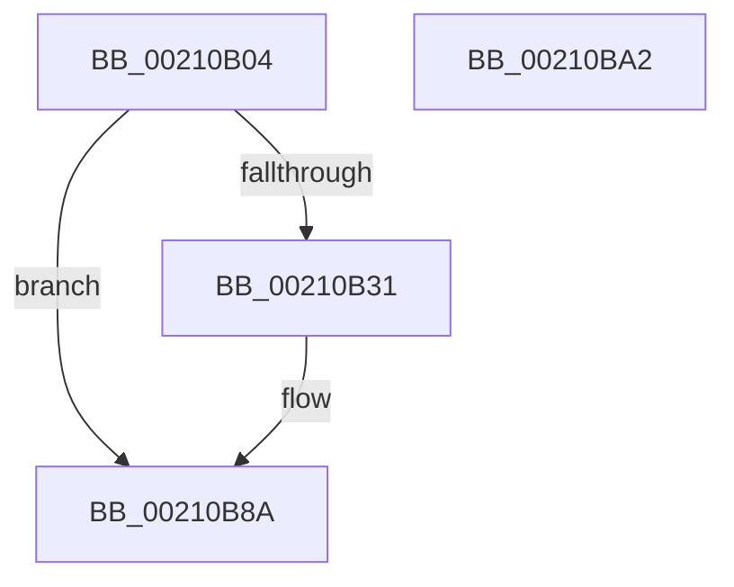

# EtwTraceAutoBoostEntryExhaustion

- RVA: `0x00210B04`–`0x00210BA3` (길이 `159` bytes)
- VA: `0x0000000140210B04`
- 실행 섹션: `.text`
- PDB 이름 있음: `예`; PDB Function 태그: `아니요`
- unwind 정보 RVA: `0x0005DD4C`
- 디코드: `35`개 명령, `159/159` bytes 표시
- 미해석 바이트: `0` (있으면 어셈블리에 `.byte`로 보존)

> 이 문서는 커널 이미지의 기계어와 PDB 기호를 분석해 생성했습니다. 4번과 5번은 함수 원형과 자료형을 바이너리 사용 방식에서 추정한 C 해석이며 원본 소스 복구 결과는 아닙니다.

## 1. Dependencies

- 직접 호출 지점: **3**; 고유 호출 대상: **3**
- 직접 호출자로 확인된 함수: **1**
- RIP 상대 이미지 참조: **1**

### Outgoing calls
- `0x00210B28` → [Feature_Servicing_AutoBoostEtwEventingFixes__private_IsEnabledNoReportingNoInline](../4F/Feature_Servicing_AutoBoostEtwEventingFixes__private_IsEnabledNoReportingNoInline_function_004F6A14.md) (function, `0x004F6A14`)
- `0x00210B85` → [EtwTraceSiloKernelEvent](../22/EtwTraceSiloKernelEvent_function_002242A0.md) (function, `0x002242A0`)
- `0x00210B92` → [_security_check_cookie](../6A/_security_check_cookie_function_006AC640.md) (function, `0x006AC640`)

### Direct callers
- [sub_00210246](Unknown_function_00210246.md) at `0x002102B4`

### Static image references
- `0x00210B0E` → RVA `0x00E0A740` (`.data`; read)

## 2. Other-region calls and transfers

- 다른 실행 섹션으로 향하는 call: **0**
- 별도 외부 분기/꼬리 이동을 확인하지 못했습니다.

## 3. Assembly (complete function range)

```asm
00210B04  48 89 5C 24 10                  mov qword ptr [rsp + 0x10], rbx
00210B09  57                              push rdi
00210B0A  48 83 EC 60                     sub rsp, 0x60
00210B0E  48 8B 05 2B 9C BF 00            mov rax, qword ptr [rip + 0xbf9c2b]
00210B15  48 33 C4                        xor rax, rsp
00210B18  48 89 44 24 50                  mov qword ptr [rsp + 0x50], rax
00210B1D  83 64 24 3C 00                  and dword ptr [rsp + 0x3c], 0
00210B22  48 8B FA                        mov rdi, rdx
00210B25  48 8B D9                        mov rbx, rcx
00210B28  E8 E7 5E 2E 00                  call 0x1404f6a14
00210B2D  85 C0                           test eax, eax
00210B2F  75 59                           jne 0x140210b8a
00210B31  8B 83 10 05 00 00               mov eax, dword ptr [rbx + 0x510]
00210B37  48 8D 54 24 40                  lea rdx, [rsp + 0x40]
00210B3C  48 8B 8B 20 02 00 00            mov rcx, qword ptr [rbx + 0x220]
00210B43  41 B9 00 10 00 A0               mov r9d, 0xa0001000
00210B49  83 64 24 4C 00                  and dword ptr [rsp + 0x4c], 0
00210B4E  41 B8 01 00 00 00               mov r8d, 1
00210B54  89 44 24 38                     mov dword ptr [rsp + 0x38], eax
00210B58  48 8D 44 24 30                  lea rax, [rsp + 0x30]
00210B5D  48 89 44 24 40                  mov qword ptr [rsp + 0x40], rax
00210B62  48 89 7C 24 30                  mov qword ptr [rsp + 0x30], rdi
00210B67  C7 44 24 48 10 00 00 00         mov dword ptr [rsp + 0x48], 0x10
00210B6F  48 8B 89 F0 05 00 00            mov rcx, qword ptr [rcx + 0x5f0]
00210B76  C7 44 24 28 02 1A 60 00         mov dword ptr [rsp + 0x28], 0x601a02
00210B7E  66 C7 44 24 20 44 05            mov word ptr [rsp + 0x20], 0x544
00210B85  E8 16 37 01 00                  call 0x1402242a0
00210B8A  48 8B 4C 24 50                  mov rcx, qword ptr [rsp + 0x50]
00210B8F  48 33 CC                        xor rcx, rsp
00210B92  E8 A9 BA 49 00                  call 0x1406ac640
00210B97  48 8B 5C 24 78                  mov rbx, qword ptr [rsp + 0x78]
00210B9C  48 83 C4 60                     add rsp, 0x60
00210BA0  5F                              pop rdi
00210BA1  C3                              ret
00210BA2  CC                              int3
```

## 4. C-style interpretation (structured pseudocode)

```c
__int64 __fastcall EtwTraceAutoBoostEntryExhaustion(__int64 a1, __int64 a2)
{
    __int64 result;
    __int64 v_rsp;
    unsigned __int64 v_stack_m18;
    unsigned int v_stack_m1C;
    unsigned int v_stack_m20;
    unsigned __int64 v_stack_m28;
    unsigned int v_stack_m2C;
    unsigned int v_stack_m30;
    unsigned __int64 v_stack_m38;
    unsigned int v_stack_m40;
    unsigned __int16 v_stack_m48;
    unsigned __int64 v_stack_p10;

    v_stack_p10 = v_rbx;
    v_rsp = (v_rsp) - (96);
    result = (*(unsigned __int64 *)(v_rip + 12557355)) ^ (v_rsp);
    v_stack_m18 = result;
    result = Feature_Servicing_AutoBoostEtwEventingFixes__private_IsEnabledNoReportingNoInline(a1, a2, a3, a4);
    if ((unsigned int)(result) == 0) {
        result = *(unsigned int *)(a1 + 1296);
        a2 = v_stack_m28;
        a1 = *(unsigned __int64 *)(a1 + 544);
        a4 = 0xA0001000ULL;
        a3 = 1;
        v_stack_m30 = (unsigned int)(result);
        result = v_stack_m38;
        v_stack_m28 = result;
        v_stack_m38 = a2;
        v_stack_m20 = 16;
        a1 = *(unsigned __int64 *)(a1 + 1520);
        v_stack_m40 = 0x601A02ULL;
        v_stack_m48 = 0x544ULL;
        result = EtwTraceSiloKernelEvent(a1, a2, a3, a4);
    }
    a1 = (v_stack_m18) ^ (v_rsp);
    result = _security_check_cookie(a1, a2, a3, a4);
    v_rsp = (v_rsp) + (96);
    return result;
}
```

## 5. (Beta) C Style

```c
int64_t EtwTraceAutoBoostEntryExhaustion(void *Arg1, int64_t Arg2)
{
    uint8_t *arg1 = (uint8_t *)Arg1;

    int64_t result;
    int64_t local_rsp;
    uint64_t v_stack_m18;
    uint32_t v_stack_m1C;
    uint32_t v_stack_m20;
    uint64_t v_stack_m28;
    uint32_t v_stack_m2C;
    uint32_t v_stack_m30;
    uint64_t v_stack_m38;
    uint32_t v_stack_m40;
    uint16_t v_stack_m48;
    uint64_t v_stack_p10;

    v_stack_p10 = local_rbx;
    local_rsp = (local_rsp) - (96);
    result = (*(uint64_t *)(v_rip + 0xBF9C2B)) ^ (local_rsp);
    v_stack_m18 = result;
    result = Feature_Servicing_AutoBoostEtwEventingFixes__private_IsEnabledNoReportingNoInline(Arg1, Arg2, a3, a4);
    if ((uint32_t)(result) == 0) {
        result = *(uint32_t *)(arg1 + 0x510);
        Arg2 = v_stack_m28;
        Arg1 = *(uint64_t *)(arg1 + 0x220);
        a4 = 0xA0001000ULL;
        a3 = 1;
        v_stack_m30 = (uint32_t)(result);
        result = v_stack_m38;
        v_stack_m28 = result;
        v_stack_m38 = Arg2;
        v_stack_m20 = 16;
        Arg1 = *(uint64_t *)(arg1 + 0x5F0);
        v_stack_m40 = 0x601A02ULL;
        v_stack_m48 = 0x544ULL;
        result = EtwTraceSiloKernelEvent(Arg1, Arg2, a3, a4);
    }
    Arg1 = (v_stack_m18) ^ (local_rsp);
    result = _security_check_cookie(Arg1, Arg2, a3, a4);
    local_rsp = (local_rsp) + (96);
    return result;
}
```

### 관측된 메모리 오프셋

구조체 형식이 확인되지 않은 접근은 인자 기준의 오프셋으로만 기록했습니다.

| 기준 인자 | 오프셋 표현 | 폭 (bit) | 접근 |
|---|---:|---:|---|
| `Arg1` | `+ 0x220` | `64` | `R` |
| `Arg1` | `+ 0x510` | `32` | `R` |

## 6. Execution-region graph

[열기: 2D/3D 그래프와 함수 탐색 컨트롤 패널](../../../control-panel.html?section=text&rva=0x00210B04&view=graph)

- 2D 그래프는 위에서 아래로 흐르고, 3D 그래프는 빈 공간을 드래그해 회전합니다. Shift+드래그는 이동, 휠은 확대·축소, 함수 노드 선택은 대상 보고서 이동입니다.

### Static fallback


