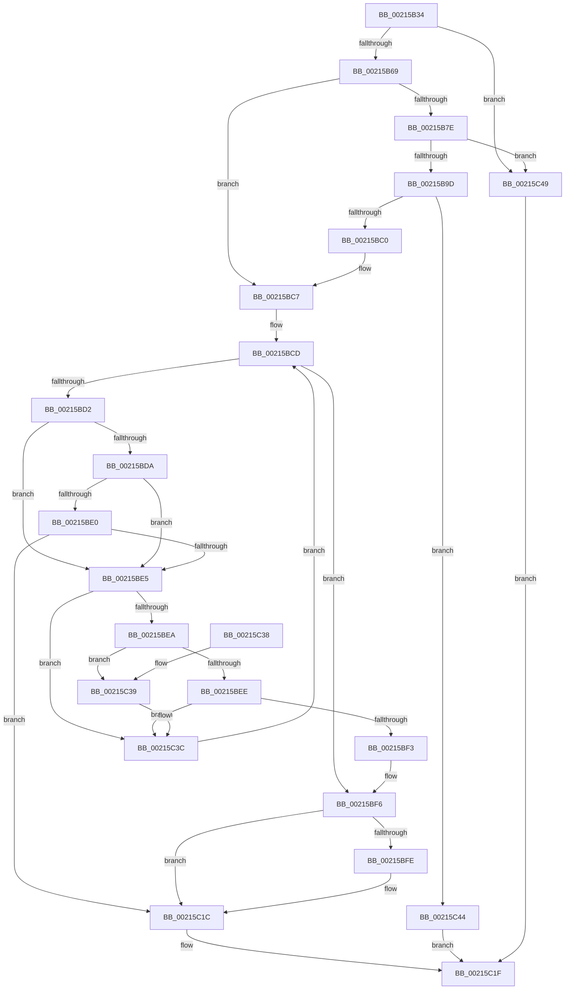

# EtwpGetTrackingLockSlotForThread

- RVA: `0x00215B34`–`0x00215C4D` (길이 `281` bytes)
- VA: `0x0000000140215B34`
- 실행 섹션: `.text`
- PDB 이름 있음: `예`; PDB Function 태그: `아니요`
- unwind 정보 RVA: `0x0005E1DC`
- 디코드: `82`개 명령, `281/281` bytes 표시
- 미해석 바이트: `0` (있으면 어셈블리에 `.byte`로 보존)

> 이 문서는 커널 이미지의 기계어와 PDB 기호를 분석해 생성했습니다. 4번과 5번은 함수 원형과 자료형을 바이너리 사용 방식에서 추정한 C 해석이며 원본 소스 복구 결과는 아닙니다.

## 1. Dependencies

- 직접 호출 지점: **2**; 고유 호출 대상: **2**
- 직접 호출자로 확인된 함수: **5**
- RIP 상대 이미지 참조: **1**

### Outgoing calls
- `0x00215B8C` → [ExAllocatePool2](../../poolcode/B8/ExAllocatePool2_function_00B820F0.md) (function, `0x00B820F0`)
- `0x00215BC2` → [ExFreePoolWithTag](../../poolcode/B8/ExFreePoolWithTag_function_00B82870.md) (function, `0x00B82870`)

### Direct callers
- [sub_00214E58](Unknown_function_00214E58.md) at `0x0021505C`
- [sub_00215166](Unknown_function_00215166.md) at `0x0021522E`
- [sub_00215166](Unknown_function_00215166.md) at `0x00215371`
- [sub_00215166](Unknown_function_00215166.md) at `0x002155EA`
- [PerfLogExecutiveResourceAcquire](../47/PerfLogExecutiveResourceAcquire_function_004795E8.md) at `0x00479660`
- [PerfLogExecutiveResourceWait](../4B/PerfLogExecutiveResourceWait_function_004B9E90.md) at `0x004B9F06`
- [PerfLogExecutiveResourceSetOwnerPointer](../65/PerfLogExecutiveResourceSetOwnerPointer_function_00652690.md) at `0x00652748`

### Static image references
- `0x00215B73` → RVA `0x00E68468` (`.data`; read)

## 2. Other-region calls and transfers

- 다른 실행 섹션으로 향하는 call: **2**
  - `0x00215B8C` → [ExAllocatePool2](../../poolcode/B8/ExAllocatePool2_function_00B820F0.md) (`.text` → `POOLCODE`)
  - `0x00215BC2` → [ExFreePoolWithTag](../../poolcode/B8/ExFreePoolWithTag_function_00B82870.md) (`.text` → `POOLCODE`)
- 별도 외부 분기/꼬리 이동을 확인하지 못했습니다.

## 3. Assembly (complete function range)

```asm
00215B34  48 89 5C 24 08                  mov qword ptr [rsp + 8], rbx
00215B39  48 89 6C 24 10                  mov qword ptr [rsp + 0x10], rbp
00215B3E  48 89 74 24 18                  mov qword ptr [rsp + 0x18], rsi
00215B43  57                              push rdi
00215B44  41 56                           push r14
00215B46  41 57                           push r15
00215B48  48 83 EC 20                     sub rsp, 0x20
00215B4C  65 48 8B 3C 25 88 01 00 00      mov rdi, qword ptr gs:[0x188]
00215B55  44 8B F2                        mov r14d, edx
00215B58  48 8B E9                        mov rbp, rcx
00215B5B  8B 87 A0 05 00 00               mov eax, dword ptr [rdi + 0x5a0]
00215B61  A8 01                           test al, 1
00215B63  0F 85 E0 00 00 00               jne 0x140215c49
00215B69  48 8B 9F 20 06 00 00            mov rbx, qword ptr [rdi + 0x620]
00215B70  45 33 FF                        xor r15d, r15d
00215B73  8B 35 EF 28 C5 00               mov esi, dword ptr [rip + 0xc528ef]
00215B79  48 85 DB                        test rbx, rbx
00215B7C  75 49                           jne 0x140215bc7
00215B7E  BA 00 02 00 00                  mov edx, 0x200
00215B83  8D 4B 48                        lea ecx, [rbx + 0x48]
00215B86  41 B8 52 65 54 72               mov r8d, 0x72546552
00215B8C  E8 5F C5 96 00                  call 0x140b820f0
00215B91  48 8B C8                        mov rcx, rax
00215B94  48 85 C0                        test rax, rax
00215B97  0F 84 AC 00 00 00               je 0x140215c49
00215B9D  48 89 68 10                     mov qword ptr [rax + 0x10], rbp
00215BA1  44 89 70 1C                     mov dword ptr [rax + 0x1c], r14d
00215BA5  44 89 78 20                     mov dword ptr [rax + 0x20], r15d
00215BA9  89 70 28                        mov dword ptr [rax + 0x28], esi
00215BAC  33 C0                           xor eax, eax
00215BAE  F0 48 0F B1 8F 20 06 00 00      lock cmpxchg qword ptr [rdi + 0x620], rcx
00215BB7  48 8B D8                        mov rbx, rax
00215BBA  0F 84 84 00 00 00               je 0x140215c44
00215BC0  33 D2                           xor edx, edx
00215BC2  E8 A9 CC 96 00                  call 0x140b82870
00215BC7  49 8B C7                        mov rax, r15
00215BCA  41 8B CF                        mov ecx, r15d
00215BCD  83 F9 08                        cmp ecx, 8
00215BD0  73 24                           jae 0x140215bf6
00215BD2  8B 53 1C                        mov edx, dword ptr [rbx + 0x1c]
00215BD5  41 3B D6                        cmp edx, r14d
00215BD8  75 0B                           jne 0x140215be5
00215BDA  48 39 6B 10                     cmp qword ptr [rbx + 0x10], rbp
00215BDE  75 05                           jne 0x140215be5
00215BE0  39 73 28                        cmp dword ptr [rbx + 0x28], esi
00215BE3  74 37                           je 0x140215c1c
00215BE5  48 85 C0                        test rax, rax
00215BE8  75 52                           jne 0x140215c3c
00215BEA  85 D2                           test edx, edx
00215BEC  74 4B                           je 0x140215c39
00215BEE  39 73 28                        cmp dword ptr [rbx + 0x28], esi
00215BF1  7D 49                           jge 0x140215c3c
00215BF3  48 8B C3                        mov rax, rbx
00215BF6  48 8B D8                        mov rbx, rax
00215BF9  48 85 C0                        test rax, rax
00215BFC  74 1E                           je 0x140215c1c
00215BFE  48 89 68 10                     mov qword ptr [rax + 0x10], rbp
00215C02  44 89 70 1C                     mov dword ptr [rax + 0x1c], r14d
00215C06  4C 89 78 20                     mov qword ptr [rax + 0x20], r15
00215C0A  4C 89 38                        mov qword ptr [rax], r15
00215C0D  4C 89 78 08                     mov qword ptr [rax + 8], r15
00215C11  44 89 78 18                     mov dword ptr [rax + 0x18], r15d
00215C15  89 70 28                        mov dword ptr [rax + 0x28], esi
00215C18  44 89 78 2C                     mov dword ptr [rax + 0x2c], r15d
00215C1C  48 8B C3                        mov rax, rbx
00215C1F  48 8B 5C 24 40                  mov rbx, qword ptr [rsp + 0x40]
00215C24  48 8B 6C 24 48                  mov rbp, qword ptr [rsp + 0x48]
00215C29  48 8B 74 24 50                  mov rsi, qword ptr [rsp + 0x50]
00215C2E  48 83 C4 20                     add rsp, 0x20
00215C32  41 5F                           pop r15
00215C34  41 5E                           pop r14
00215C36  5F                              pop rdi
00215C37  C3                              ret
00215C38  CC                              int3
00215C39  48 8B C3                        mov rax, rbx
00215C3C  48 83 C3 40                     add rbx, 0x40
00215C40  FF C1                           inc ecx
00215C42  EB 89                           jmp 0x140215bcd
00215C44  48 8B C1                        mov rax, rcx
00215C47  EB D6                           jmp 0x140215c1f
00215C49  33 C0                           xor eax, eax
00215C4B  EB D2                           jmp 0x140215c1f
```

## 4. C-style interpretation (structured pseudocode)

```c
__int64 __fastcall EtwpGetTrackingLockSlotForThread(__int64 a1, int a2)
{
    __int64 result;
    __int64 v_r15;
    __int64 v_rbx;
    __int64 v_rsp;
    unsigned __int64 v_stack_p10;
    unsigned __int64 v_stack_p18;
    unsigned __int64 v_stack_p8;

    v_stack_p8 = v_rbx;
    v_stack_p10 = v_rbp;
    v_stack_p18 = v_rsi;
    v_rsp = (v_rsp) - (32);
    if ((((unsigned __int8)((unsigned int)(*(unsigned int *)(*(unsigned __int64 *)(gs_base + (0 + 392)) + 1440)))) & (1)) != 0) goto loc_00215C49;
    v_r15 = 0;
    if (*(unsigned __int64 *)(*(unsigned __int64 *)(gs_base + (0 + 392)) + 1568) != 0) goto loc_00215BC7;
    result = ExAllocatePool2(*(unsigned __int64 *)(*(unsigned __int64 *)(gs_base + (0 + 392)) + 1568) + 72, 512, (unsigned int)(0x72546552ULL), a4);
    if (result == 0) goto loc_00215C49;
    *(unsigned __int64 *)(result + 16) = a1;
    *(unsigned int *)(result + 28) = (unsigned int)((unsigned int)(a2));
    *(unsigned int *)(result + 32) = 0;
    *(unsigned int *)(result + 40) = (unsigned int)((unsigned int)(*(unsigned int *)(v_rip + 12921071)));
    result = 0;
    if (condition_is_equal) goto loc_00215C44;
    a2 = 0;
    result = ExFreePoolWithTag(result, a2, (unsigned int)(0x72546552ULL), a4);
loc_00215BC7:
loc_00215BCD:
    if (0 >= 8) goto loc_00215BF6;
    if (((unsigned int)((unsigned int)(*(unsigned int *)(0 + 28)))) != ((unsigned int)((unsigned int)(a2)))) goto loc_00215BE5;
    if ((*(unsigned __int64 *)(0 + 16)) != a1) goto loc_00215BE5;
    if ((*(unsigned int *)(0 + 40)) == ((unsigned int)((unsigned int)(*(unsigned int *)(v_rip + 12921071))))) goto loc_00215C1C;
loc_00215BE5:
    if (0 != 0) goto loc_00215C3C;
    if ((unsigned int)((unsigned int)(*(unsigned int *)(0 + 28))) == 0) goto loc_00215C39;
    if ((*(unsigned int *)(0 + 40)) >= ((unsigned int)((unsigned int)(*(unsigned int *)(v_rip + 12921071))))) goto loc_00215C3C;
loc_00215BF6:
    if (0 != 0) {
        *(unsigned __int64 *)(0 + 16) = a1;
        *(unsigned int *)(0 + 28) = (unsigned int)((unsigned int)(a2));
        *(unsigned __int64 *)(0 + 32) = 0;
        *(unsigned __int64 *)(0) = 0;
        *(unsigned __int64 *)(0 + 8) = 0;
        *(unsigned int *)(0 + 24) = 0;
        *(unsigned int *)(0 + 40) = (unsigned int)((unsigned int)(*(unsigned int *)(v_rip + 12921071)));
        *(unsigned int *)(0 + 44) = 0;
    }
loc_00215C1F:
    v_rsp = (v_rsp) + (32);
    return 0;
loc_00215C39:
loc_00215C3C:
    v_rbx = (v_stack_p8) + (64);
    a1 = (unsigned int)((0) + 1);
    goto loc_00215BCD;
loc_00215C44:
    goto loc_00215C1F;
loc_00215C49:
    result = 0;
    goto loc_00215C1F;
}
```

## 5. (Beta) C Style

```c
int64_t EtwpGetTrackingLockSlotForThread(int64_t Arg1, int32_t Arg2)
{
    int64_t result;
    int64_t local_r15;
    int64_t local_rbx;
    int64_t local_rsp;
    uint64_t v_stack_p10;
    uint64_t v_stack_p18;
    uint64_t v_stack_p8;

    v_stack_p8 = local_rbx;
    v_stack_p10 = local_rbp;
    v_stack_p18 = local_rsi;
    local_rsp = (local_rsp) - (32);
    if ((((uint8_t)((uint32_t)(*(uint32_t *)(*(uint64_t *)(gs_base + (0 + 0x188)) + 0x5A0)))) & (1)) != 0) goto loc_00215C49;
    local_r15 = 0;
    if (*(uint64_t *)(*(uint64_t *)(gs_base + (0 + 0x188)) + 0x620) != 0) goto loc_00215BC7;
    result = ExAllocatePool2(*(uint64_t *)(*(uint64_t *)(gs_base + (0 + 0x188)) + 0x620) + 72, 512, (uint32_t)(0x72546552ULL), a4);
    if (result == 0) goto loc_00215C49;
    *(uint64_t *)(result + 0x10) = Arg1;
    *(uint32_t *)(result + 0x1C) = (uint32_t)((uint32_t)(Arg2));
    *(uint32_t *)(result + 0x20) = 0;
    *(uint32_t *)(result + 0x28) = (uint32_t)((uint32_t)(*(uint32_t *)(v_rip + 0xC528EF)));
    result = 0;
    if (condition_is_equal) goto loc_00215C44;
    Arg2 = 0;
    result = ExFreePoolWithTag(result, Arg2, (uint32_t)(0x72546552ULL), a4);
loc_00215BC7:
loc_00215BCD:
    if (0 >= 8) goto loc_00215BF6;
    if (((uint32_t)((uint32_t)(*(uint32_t *)(0 + 0x1C)))) != ((uint32_t)((uint32_t)(Arg2)))) goto loc_00215BE5;
    if ((*(uint64_t *)(0 + 0x10)) != Arg1) goto loc_00215BE5;
    if ((*(uint32_t *)(0 + 0x28)) == ((uint32_t)((uint32_t)(*(uint32_t *)(v_rip + 0xC528EF))))) goto loc_00215C1C;
loc_00215BE5:
    if (0 != 0) goto loc_00215C3C;
    if ((uint32_t)((uint32_t)(*(uint32_t *)(0 + 0x1C))) == 0) goto loc_00215C39;
    if ((*(uint32_t *)(0 + 0x28)) >= ((uint32_t)((uint32_t)(*(uint32_t *)(v_rip + 0xC528EF))))) goto loc_00215C3C;
loc_00215BF6:
    if (0 != 0) {
        *(uint64_t *)(0 + 0x10) = Arg1;
        *(uint32_t *)(0 + 0x1C) = (uint32_t)((uint32_t)(Arg2));
        *(uint64_t *)(0 + 0x20) = 0;
        *(uint64_t *)(0) = 0;
        *(uint64_t *)(0 + 0x8) = 0;
        *(uint32_t *)(0 + 0x18) = 0;
        *(uint32_t *)(0 + 0x28) = (uint32_t)((uint32_t)(*(uint32_t *)(v_rip + 0xC528EF)));
        *(uint32_t *)(0 + 0x2C) = 0;
    }
loc_00215C1F:
    local_rsp = (local_rsp) + (32);
    return 0;
loc_00215C39:
loc_00215C3C:
    local_rbx = (v_stack_p8) + (64);
    Arg1 = (uint32_t)((0) + 1);
    goto loc_00215BCD;
loc_00215C44:
    goto loc_00215C1F;
loc_00215C49:
    result = 0;
    goto loc_00215C1F;
}
```

## 6. Execution-region graph

[열기: 2D/3D 그래프와 함수 탐색 컨트롤 패널](../../../control-panel.html?section=text&rva=0x00215B34&view=graph)

- 2D 그래프는 위에서 아래로 흐르고, 3D 그래프는 빈 공간을 드래그해 회전합니다. Shift+드래그는 이동, 휠은 확대·축소, 함수 노드 선택은 대상 보고서 이동입니다.

### Static fallback


