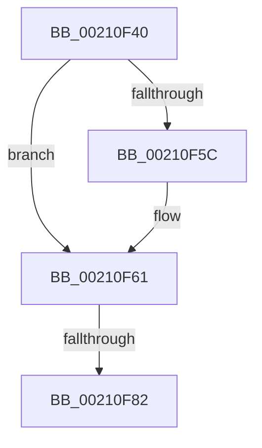

# ExAcquireFastResourceShared

- RVA: `0x00210F40`–`0x00210F9D` (길이 `93` bytes)
- VA: `0x0000000140210F40`
- 실행 섹션: `.text`
- PDB 이름 있음: `예`; PDB Function 태그: `아니요`
- unwind 정보 RVA: `0x0005DE08`
- 디코드: `30`개 명령, `93/93` bytes 표시
- 미해석 바이트: `0` (있으면 어셈블리에 `.byte`로 보존)

> 이 문서는 커널 이미지의 기계어와 PDB 기호를 분석해 생성했습니다. 4번과 5번은 함수 원형과 자료형을 바이너리 사용 방식에서 추정한 C 해석이며 원본 소스 복구 결과는 아닙니다.

## 1. Dependencies

- 직접 호출 지점: **1**; 고유 호출 대상: **1**
- 직접 호출자로 확인된 함수: **7**
- RIP 상대 이미지 참조: **0**

### Outgoing calls
- `0x00210F97` → [KeBugCheckEx](../4F/KeBugCheckEx_function_004FD660.md) (function, `0x004FD660`)

### Direct callers
- [sub_00213555](Unknown_function_00213555.md) at `0x00213566`
- [sub_00213798](Unknown_function_00213798.md) at `0x002137A9`
- [ExEnterPriorityRegionAndAcquireResourceShared](ExEnterPriorityRegionAndAcquireResourceShared_function_00213870.md) at `0x00213919`
- [sub_00213CA6](Unknown_function_00213CA6.md) at `0x00213CD5`
- [sub_00213CA6](Unknown_function_00213CA6.md) at `0x00213D0E`
- [sub_0025F912](../25/Unknown_function_0025F912.md) at `0x0025F94A`
- [SepCanTokenMatchAllPackageSid](../2F/SepCanTokenMatchAllPackageSid_function_002FFE90.md) at `0x002FFFCF`
- [DifExAcquireFastResourceSharedWrapper](../61/DifExAcquireFastResourceSharedWrapper_function_0061DA60.md) at `0x0061DB45`

### Static image references
- 디코드된 RIP-relative 메모리 참조가 없습니다.

## 2. Other-region calls and transfers

- 다른 실행 섹션으로 향하는 call: **0**
- call이 아닌 외부 분기/꼬리 이동: **1**
  - `0x00210F80` → [sub_00210F9D](Unknown_function_00210F9D.md) (`tail-transfer`)

## 3. Assembly (complete function range)

```asm
00210F40  40 53                           push rbx
00210F42  56                              push rsi
00210F43  57                              push rdi
00210F44  41 55                           push r13
00210F46  41 57                           push r15
00210F48  48 83 EC 30                     sub rsp, 0x30
00210F4C  48 8B DA                        mov rbx, rdx
00210F4F  48 8B F1                        mov rsi, rcx
00210F52  BF 02 00 00 00                  mov edi, 2
00210F57  45 84 C0                        test r8b, r8b
00210F5A  74 05                           je 0x140210f61
00210F5C  BF 0A 00 00 00                  mov edi, 0xa
00210F61  0F B7 51 1A                     movzx edx, word ptr [rcx + 0x1a]
00210F65  44 8B EF                        mov r13d, edi
00210F68  41 83 E5 10                     and r13d, 0x10
00210F6C  4C 89 64 24 70                  mov qword ptr [rsp + 0x70], r12
00210F71  44 8B FF                        mov r15d, edi
00210F74  41 83 E7 08                     and r15d, 8
00210F78  0F 94 C0                        sete al
00210F7B  FE C0                           inc al
00210F7D  F6 C2 01                        test dl, 1
00210F80  75 1B                           jne 0x140210f9d
00210F82  33 FF                           xor edi, edi
00210F84  45 33 C9                        xor r9d, r9d
00210F87  4C 8B C6                        mov r8, rsi
00210F8A  48 89 7C 24 20                  mov qword ptr [rsp + 0x20], rdi
00210F8F  B9 C6 01 00 00                  mov ecx, 0x1c6
00210F94  8D 57 03                        lea edx, [rdi + 3]
00210F97  E8 C4 C6 2E 00                  call 0x1404fd660
00210F9C  CC                              int3
```

## 4. C-style interpretation (structured pseudocode)

```c
__int64 __fastcall ExAcquireFastResourceShared(__int64 a1, __int64 a2, unsigned __int8 a3, int a4)
{
    __int64 result;
    __int64 v_r13;
    __int64 v_r15;
    __int64 v_rdi;
    __int64 v_rsp;
    unsigned __int64 v_stack_m38;
    unsigned __int64 v_stack_p18;

    v_rsp = (v_rsp) - (48);
    v_rdi = 2;
    if (a3 != 0) {
        v_rdi = 10;
    }
    v_r13 = (unsigned int)(((unsigned int)((unsigned int)(v_rdi))) & (16));
    v_stack_p18 = v_r12;
    v_r15 = (unsigned int)(((unsigned int)((unsigned int)(v_rdi))) & (8));
    result = (condition_is_equal) ? 1 : 0;
    result = (unsigned __int8)((result) + 1);
    v_rdi = 0;
    a4 = 0;
    v_stack_m38 = 0;
    result = KeBugCheckEx(454, v_rdi + 3, a1, a4);
    return result;
}
```

## 5. (Beta) C Style

```c
int64_t ExAcquireFastResourceShared(void *Arg1, int64_t Arg2, uint8_t Arg3, int32_t Arg4)
{
    uint8_t *arg1 = (uint8_t *)Arg1;

    int64_t result;
    int64_t local_r13;
    int64_t local_r15;
    int64_t local_rdi;
    int64_t local_rsp;
    uint64_t v_stack_m38;
    uint64_t v_stack_p18;

    local_rsp = (local_rsp) - (48);
    local_rdi = 2;
    if (Arg3 != 0) {
        local_rdi = 10;
    }
    local_r13 = (uint32_t)(((uint32_t)((uint32_t)(local_rdi))) & (16));
    v_stack_p18 = local_r12;
    local_r15 = (uint32_t)(((uint32_t)((uint32_t)(local_rdi))) & (8));
    result = (condition_is_equal) ? 1 : 0;
    result = (uint8_t)((result) + 1);
    local_rdi = 0;
    Arg4 = 0;
    v_stack_m38 = 0;
    result = KeBugCheckEx(454, local_rdi + 3, Arg1, Arg4);
    return result;
}
```

### 관측된 메모리 오프셋

구조체 형식이 확인되지 않은 접근은 인자 기준의 오프셋으로만 기록했습니다.

| 기준 인자 | 오프셋 표현 | 폭 (bit) | 접근 |
|---|---:|---:|---|
| `Arg1` | `+ 0x1A` | `16` | `R` |

## 6. Execution-region graph

[열기: 2D/3D 그래프와 함수 탐색 컨트롤 패널](../../../control-panel.html?section=text&rva=0x00210F40&view=graph)

- 2D 그래프는 위에서 아래로 흐르고, 3D 그래프는 빈 공간을 드래그해 회전합니다. Shift+드래그는 이동, 휠은 확대·축소, 함수 노드 선택은 대상 보고서 이동입니다.

### Static fallback


