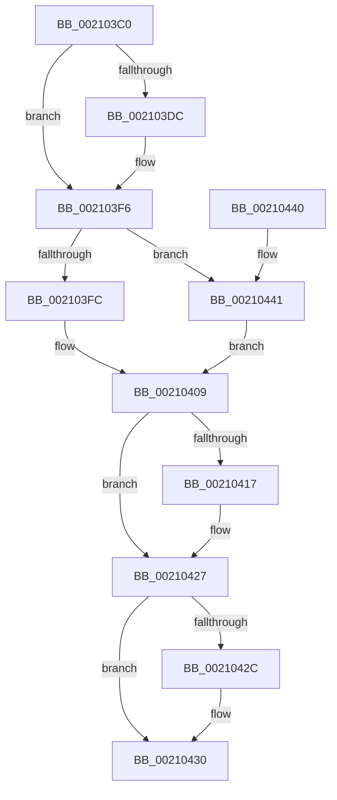

# ExAcquirePushLockSharedEx

- RVA: `0x002103C0`–`0x00210445` (길이 `133` bytes)
- VA: `0x00000001402103C0`
- 실행 섹션: `.text`
- PDB 이름 있음: `예`; PDB Function 태그: `아니요`
- unwind 정보 RVA: `0x0005DCAC`
- 디코드: `42`개 명령, `133/133` bytes 표시
- 미해석 바이트: `0` (있으면 어셈블리에 `.byte`로 보존)

> 이 문서는 커널 이미지의 기계어와 PDB 기호를 분석해 생성했습니다. 4번과 5번은 함수 원형과 자료형을 바이너리 사용 방식에서 추정한 C 해석이며 원본 소스 복구 결과는 아닙니다.

## 1. Dependencies

- 직접 호출 지점: **3**; 고유 호출 대상: **3**
- 직접 호출자로 확인된 함수: **0**
- RIP 상대 이미지 참조: **0**

### Outgoing calls
- `0x002103F0` → [KeBugCheckEx](../4F/KeBugCheckEx_function_004FD660.md) (function, `0x004FD660`)
- `0x00210401` → [KeAbPreAcquire](KeAbPreAcquire_function_00210230.md) (function, `0x00210230`)
- `0x00210422` → [ExfAcquirePushLockSharedEx](ExfAcquirePushLockSharedEx_function_0021044C.md) (function, `0x0021044C`)

### Direct callers
- 이 함수 시작 RVA로 연결되는 직접 call은 확인되지 않았습니다. 간접 호출은 완전히 역산할 수 없습니다.

### Static image references
- 디코드된 RIP-relative 메모리 참조가 없습니다.

## 2. Other-region calls and transfers

- 다른 실행 섹션으로 향하는 call: **0**
- 별도 외부 분기/꼬리 이동을 확인하지 못했습니다.

## 3. Assembly (complete function range)

```asm
002103C0  48 89 5C 24 08                  mov qword ptr [rsp + 8], rbx
002103C5  48 89 74 24 10                  mov qword ptr [rsp + 0x10], rsi
002103CA  57                              push rdi
002103CB  48 83 EC 30                     sub rsp, 0x30
002103CF  8B FA                           mov edi, edx
002103D1  48 8B F1                        mov rsi, rcx
002103D4  F7 C2 F8 FF FF FF               test edx, 0xfffffff8
002103DA  74 1A                           je 0x1402103f6
002103DC  33 DB                           xor ebx, ebx
002103DE  4C 8B C1                        mov r8, rcx
002103E1  B9 52 01 00 00                  mov ecx, 0x152
002103E6  48 89 5C 24 20                  mov qword ptr [rsp + 0x20], rbx
002103EB  8B D7                           mov edx, edi
002103ED  45 33 C9                        xor r9d, r9d
002103F0  E8 6B D2 2E 00                  call 0x1404fd660
002103F5  CC                              int3
002103F6  40 F6 C7 02                     test dil, 2
002103FA  75 45                           jne 0x140210441
002103FC  45 33 C0                        xor r8d, r8d
002103FF  33 D2                           xor edx, edx
00210401  E8 2A FE FF FF                  call 0x140210230
00210406  48 8B D8                        mov rbx, rax
00210409  B9 11 00 00 00                  mov ecx, 0x11
0021040E  33 C0                           xor eax, eax
00210410  F0 48 0F B1 0E                  lock cmpxchg qword ptr [rsi], rcx
00210415  74 10                           je 0x140210427
00210417  4C 8B CE                        mov r9, rsi
0021041A  4C 8B C3                        mov r8, rbx
0021041D  8B D7                           mov edx, edi
0021041F  48 8B CE                        mov rcx, rsi
00210422  E8 25 00 00 00                  call 0x14021044c
00210427  48 85 DB                        test rbx, rbx
0021042A  74 04                           je 0x140210430
0021042C  C6 43 0A 01                     mov byte ptr [rbx + 0xa], 1
00210430  48 8B 5C 24 40                  mov rbx, qword ptr [rsp + 0x40]
00210435  48 8B 74 24 48                  mov rsi, qword ptr [rsp + 0x48]
0021043A  48 83 C4 30                     add rsp, 0x30
0021043E  5F                              pop rdi
0021043F  C3                              ret
00210440  CC                              int3
00210441  33 DB                           xor ebx, ebx
00210443  EB C4                           jmp 0x140210409
```

## 4. C-style interpretation (structured pseudocode)

```c
__int64 __fastcall ExAcquirePushLockSharedEx(__int64 a1, int a2, __int64 a3, int a4)
{
    __int64 result;
    __int64 v_rbx;
    __int64 v_rsp;
    unsigned __int64 v_stack_m18;
    unsigned __int64 v_stack_p10;
    unsigned __int64 v_stack_p8;

    v_stack_p8 = v_rbx;
    v_stack_p10 = v_rsi;
    v_rsp = (v_rsp) - (48);
    if (((a2) & (0xFFFFFFF8ULL)) != 0) {
        v_rbx = 0;
        a3 = a1;
        a1 = 338;
        v_stack_m18 = 0;
        a2 = (unsigned int)((unsigned int)(a2));
        a4 = 0;
        result = KeBugCheckEx(a1, a2, a3, a4);
    }
    if ((((unsigned __int8)((unsigned int)(a2))) & (2)) != 0) goto loc_00210441;
    a3 = 0;
    a2 = 0;
    result = KeAbPreAcquire(a1, a2, a3, a4);
loc_00210409:
    result = 0;
    if (!(condition_is_equal)) {
        a4 = a1;
        a3 = 0;
        a2 = (unsigned int)((unsigned int)(a2));
        a1 = a1;
        result = ExfAcquirePushLockSharedEx(a1, a2, a3, a4);
    }
    if (result != 0) {
        *(unsigned __int8 *)(result + 10) = 1;
    }
    v_rsp = (v_rsp) + (48);
    return result;
loc_00210441:
    v_rbx = 0;
    goto loc_00210409;
}
```

## 5. (Beta) C Style

```c
int64_t ExAcquirePushLockSharedEx(void *Arg1, int32_t Arg2, int64_t Arg3, int32_t Arg4)
{
    uint8_t *arg1 = (uint8_t *)Arg1;

    int64_t result;
    int64_t local_rbx;
    int64_t local_rsp;
    uint64_t v_stack_m18;
    uint64_t v_stack_p10;
    uint64_t v_stack_p8;

    v_stack_p8 = local_rbx;
    v_stack_p10 = local_rsi;
    local_rsp = (local_rsp) - (48);
    if (((Arg2) & (0xFFFFFFF8ULL)) != 0) {
        local_rbx = 0;
        Arg3 = Arg1;
        Arg1 = 338;
        v_stack_m18 = 0;
        Arg2 = (uint32_t)((uint32_t)(Arg2));
        Arg4 = 0;
        result = KeBugCheckEx(Arg1, Arg2, Arg3, Arg4);
    }
    if ((((uint8_t)((uint32_t)(Arg2))) & (2)) != 0) goto loc_00210441;
    Arg3 = 0;
    Arg2 = 0;
    result = KeAbPreAcquire(Arg1, Arg2, Arg3, Arg4);
loc_00210409:
    result = 0;
    if (!(condition_is_equal)) {
        Arg4 = Arg1;
        Arg3 = 0;
        Arg2 = (uint32_t)((uint32_t)(Arg2));
        Arg1 = Arg1;
        result = ExfAcquirePushLockSharedEx(Arg1, Arg2, Arg3, Arg4);
    }
    if (result != 0) {
        *(uint8_t *)(result + 0xA) = 1;
    }
    local_rsp = (local_rsp) + (48);
    return result;
loc_00210441:
    local_rbx = 0;
    goto loc_00210409;
}
```

### 관측된 메모리 오프셋

구조체 형식이 확인되지 않은 접근은 인자 기준의 오프셋으로만 기록했습니다.

| 기준 인자 | 오프셋 표현 | 폭 (bit) | 접근 |
|---|---:|---:|---|
| `Arg1` | `+ 0x0` | `64` | `R` |

## 6. Execution-region graph

[열기: 2D/3D 그래프와 함수 탐색 컨트롤 패널](../../../control-panel.html?section=text&rva=0x002103C0&view=graph)

- 2D 그래프는 위에서 아래로 흐르고, 3D 그래프는 빈 공간을 드래그해 회전합니다. Shift+드래그는 이동, 휠은 확대·축소, 함수 노드 선택은 대상 보고서 이동입니다.

### Static fallback


