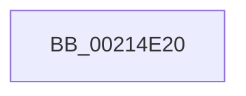

# ExAcquireResourceExclusiveLite

- RVA: `0x00214E20`–`0x00214E58` (길이 `56` bytes)
- VA: `0x0000000140214E20`
- 실행 섹션: `.text`
- PDB 이름 있음: `예`; PDB Function 태그: `아니요`
- unwind 정보 RVA: `0x0005E148`
- 디코드: `18`개 명령, `56/56` bytes 표시
- 미해석 바이트: `0` (있으면 어셈블리에 `.byte`로 보존)

> 이 문서는 커널 이미지의 기계어와 PDB 기호를 분석해 생성했습니다. 4번과 5번은 함수 원형과 자료형을 바이너리 사용 방식에서 추정한 C 해석이며 원본 소스 복구 결과는 아닙니다.

## 1. Dependencies

- 직접 호출 지점: **0**; 고유 호출 대상: **0**
- 직접 호출자로 확인된 함수: **181**
- RIP 상대 이미지 참조: **0**

### Outgoing calls
- 직접 디코드된 call 명령이 없습니다.

### Direct callers
- [ExEnterCriticalRegionAndAcquireResourceExclusive](ExEnterCriticalRegionAndAcquireResourceExclusive_function_00214DE0.md) at `0x00214DF7`
- [SepRmCallLsa](../22/SepRmCallLsa_function_00223630.md) at `0x002236CE`
- [SepQueueWorkItem](../22/SepQueueWorkItem_function_00225844.md) at `0x00225923`
- [FsRtlAcquireFileForModWriteEx](../29/FsRtlAcquireFileForModWriteEx_function_00299E5C.md) at `0x0029A11C`
- [MiAcquireLoadLock](../2A/MiAcquireLoadLock_function_002A3950.md) at `0x002A39BC`
- [CcPinFileData](../33/CcPinFileData_function_0033FB40.md) at `0x00340708`
- [CcPinFileData](../33/CcPinFileData_function_0033FB40.md) at `0x0034072F`
- [CcPinFileData](../33/CcPinFileData_function_0033FB40.md) at `0x003407EF`
- [SepInternalSetSecurityAttributesToken](../3A/SepInternalSetSecurityAttributesToken_function_003A9474.md) at `0x003A9500`
- [CcAcquireByteRangeForWrite](../40/CcAcquireByteRangeForWrite_function_00401E74.md) at `0x0040272A`
- [SepDesktopAppxSubProcessToken](../45/SepDesktopAppxSubProcessToken_function_0045BD90.md) at `0x0045C054`
- [PnpUnregisterPlugPlayNotification](../47/PnpUnregisterPlugPlayNotification_function_0047AFAC.md) at `0x0047B01A`
- [CcUnpinRepinnedBcb](../49/CcUnpinRepinnedBcb_function_0049F560.md) at `0x0049F5D2`
- [SeTokenSetRedirectionTrustPolicy](../4A/SeTokenSetRedirectionTrustPolicy_function_004A221C.md) at `0x004A2242`
- [PfResourceExclusiveAcquire](../4A/PfResourceExclusiveAcquire_function_004A8F90.md) at `0x004A8FA7`
- [SeTokenSetNoChildProcessRestricted](../4C/SeTokenSetNoChildProcessRestricted_function_004C4504.md) at `0x004C4533`
- [PiDmaGuardQueueRemoveEntry](../4C/PiDmaGuardQueueRemoveEntry_function_004C822C.md) at `0x004C824F`
- [IoCaptureLiveDump](../4E/IoCaptureLiveDump_function_004E085C.md) at `0x004E096D`
- [SepCreateAppContainerToken](../4F/SepCreateAppContainerToken_function_004F43AC.md) at `0x004F4848`
- [IoConfigureCrashDump](../59/IoConfigureCrashDump_function_00591CB4.md) at `0x00591DD0`
- [IoConfigureCrashDump](../59/IoConfigureCrashDump_function_00591CB4.md) at `0x00591E3B`
- [IoUpdateDumpPhysicalRanges](../59/IoUpdateDumpPhysicalRanges_function_0059343C.md) at `0x0059346E`
- [IoSetDeferredLiveDumpFileHandle](../59/IoSetDeferredLiveDumpFileHandle_function_00598C30.md) at `0x00598C5F`
- [PiDrvDbUnloadNodeWaitWorkerCallback](../5A/PiDrvDbUnloadNodeWaitWorkerCallback_function_005AA910.md) at `0x005AA94C`
- [RtlpAllocateHeap](../5E/RtlpAllocateHeap_function_005E8B1C.md) at `0x005E8CB3`
- [RtlpFreeHeap](../5E/RtlpFreeHeap_function_005EABC0.md) at `0x005EAC4E`
- [RtlpSetupExtendedBlock](../5E/RtlpSetupExtendedBlock_function_005EB940.md) at `0x005EB989`
- [SeSetTokenTamperProtection](../60/SeSetTokenTamperProtection_function_00609644.md) at `0x0060992C`
- [SeSetSecurityAttributesTokenEx](../60/SeSetSecurityAttributesTokenEx_function_00609C00.md) at `0x00609CA0`
- [DifExAcquireResourceExclusiveLiteWrapper](../61/DifExAcquireResourceExclusiveLiteWrapper_function_0061DBE0.md) at `0x0061DCB4`
- [ExEnterPriorityRegionAndAcquireResourceExclusive](../65/ExEnterPriorityRegionAndAcquireResourceExclusive_function_00658D40.md) at `0x00658D73`
- [TtmpAcquireSessionLock](../../page/70/TtmpAcquireSessionLock_function_00700408.md) at `0x00700426`
- [PopAdaptiveGetSystemInitiatedRebootTargetState](../../page/70/PopAdaptiveGetSystemInitiatedRebootTargetState_function_00701398.md) at `0x007013E5`
- [FsRtlPrepareMdlWriteDev](../../page/71/FsRtlPrepareMdlWriteDev_function_00713BB0.md) at `0x00713CAA`
- [FsRtlPrepareMdlWriteDev](../../page/71/FsRtlPrepareMdlWriteDev_function_00713BB0.md) at `0x00713D2B`
- [FsRtlPrepareMdlWriteDev](../../page/71/FsRtlPrepareMdlWriteDev_function_00713BB0.md) at `0x00713E01`
- [FsRtlPrepareMdlWriteDev](../../page/71/FsRtlPrepareMdlWriteDev_function_00713BB0.md) at `0x00713EC1`
- [FsRtlPrepareMdlWriteDev](../../page/71/FsRtlPrepareMdlWriteDev_function_00713BB0.md) at `0x00713F0C`
- [FsRtlDedupChangeUninit](../../page/71/FsRtlDedupChangeUninit_function_00715D40.md) at `0x00715D61`
- [FsRtlpDedupChangeRegisterVolume](../../page/71/FsRtlpDedupChangeRegisterVolume_function_00715F70.md) at `0x00715F9E`
- [FsRtlpHeatRegisterVolume](../../page/71/FsRtlpHeatRegisterVolume_function_0071696C.md) at `0x00716992`
- [FsRtlpHeatUnregisterVolume](../../page/71/FsRtlpHeatUnregisterVolume_function_00716B10.md) at `0x00716B22`
- [IoInitializeCrashDump](../../page/71/IoInitializeCrashDump_function_00719D88.md) at `0x00719DC9`
- [IopBootLogToFile](../../page/71/IopBootLogToFile_function_0071AD54.md) at `0x0071ADC1`
- [IopCopyBootLogRegistryToFile](../../page/71/IopCopyBootLogRegistryToFile_function_0071B19C.md) at `0x0071B225`
- [IopInitializeBootLogging](../../page/71/IopInitializeBootLogging_function_0071B748.md) at `0x0071B7B4`
- [IoEnumerateRegisteredFiltersList](../../page/71/IoEnumerateRegisteredFiltersList_function_0071D450.md) at `0x0071D48D`
- [IoEnumerateRegisteredFiltersList](../../page/71/IoEnumerateRegisteredFiltersList_function_0071D450.md) at `0x0071D4AF`
- [IoRegisterFileSystem](../../page/71/IoRegisterFileSystem_function_0071D6C0.md) at `0x0071D701`
- [IoRegisterFsRegistrationChangeMountAware](../../page/71/IoRegisterFsRegistrationChangeMountAware_function_0071D890.md) at `0x0071D933`
- [IoRegisterFsRegistrationChangeMountAware](../../page/71/IoRegisterFsRegistrationChangeMountAware_function_0071D890.md) at `0x0071D951`
- [IoRegisterFsRegistrationChangeMountAware](../../page/71/IoRegisterFsRegistrationChangeMountAware_function_0071D890.md) at `0x0071DA1C`
- [IoUnregisterFileSystem](../../page/71/IoUnregisterFileSystem_function_0071E110.md) at `0x0071E13C`
- [IoUnregisterFsRegistrationChange](../../page/71/IoUnregisterFsRegistrationChange_function_0071E1D0.md) at `0x0071E1FA`
- [IoReportDetectedDevice](../../page/72/IoReportDetectedDevice_function_00725CD0.md) at `0x00725EA8`
- [IoReportRootDevice](../../page/72/IoReportRootDevice_function_00726780.md) at `0x0072687F`
- [PiGetDeviceRegistryProperty](../../page/72/PiGetDeviceRegistryProperty_function_007280A8.md) at `0x00728133`
- [PnpNotifyHwProfileChange](../../page/72/PnpNotifyHwProfileChange_function_00729B04.md) at `0x00729B9A`
- [PnpNotifyHwProfileChange](../../page/72/PnpNotifyHwProfileChange_function_00729B04.md) at `0x00729C98`
- [PnpNotifyTargetDeviceChangeNotifyEntry](../../page/72/PnpNotifyTargetDeviceChangeNotifyEntry_function_00729D54.md) at `0x00729DB0`
- [PpReleaseBootDDB](../../page/72/PpReleaseBootDDB_function_0072E324.md) at `0x0072E344`
- [PpDevCfgProcessDevices](../../page/73/PpDevCfgProcessDevices_function_007373C0.md) at `0x007374B7`
- [PiCMDeleteDeviceWorker](../../page/73/PiCMDeleteDeviceWorker_function_0073B420.md) at `0x0073B520`
- [PiCMDeleteDeviceWorker](../../page/73/PiCMDeleteDeviceWorker_function_0073B420.md) at `0x0073B5E1`
- [PiCMGenerateDeviceInstance](../../page/73/PiCMGenerateDeviceInstance_function_0073B69C.md) at `0x0073B881`
- [PipKsrNotifyDrivers](../../page/73/PipKsrNotifyDrivers_function_0073E48C.md) at `0x0073E513`
- [PiInitializeDevice](../../page/73/PiInitializeDevice_function_0073EC5C.md) at `0x0073ECBF`
- [PiDmaGuardQueueInsertEntry](../../page/74/PiDmaGuardQueueInsertEntry_function_007445F0.md) at `0x00744656`
- [TtmiResetInactivityTimer](../../page/77/TtmiResetInactivityTimer_function_0077CCF0.md) at `0x0077CD01`
- [TtmpWnfInactivityTimeoutCallback](../../page/77/TtmpWnfInactivityTimeoutCallback_function_0077D990.md) at `0x0077D9CE`
- [TtmpAcquireQueueLock](../../page/77/TtmpAcquireQueueLock_function_0077DF48.md) at `0x0077DF63`
- [PspSetIoPriorityLimitJobTree](../../page/78/PspSetIoPriorityLimitJobTree_function_007854C4.md) at `0x007854E3`
- [PspSetJobMemoryPartition](../../page/78/PspSetJobMemoryPartition_function_00785574.md) at `0x007855E4`
- [PspSetJobMemoryPartition](../../page/78/PspSetJobMemoryPartition_function_00785574.md) at `0x0078567F`
- [PspSetPagePriorityLimitJobTree](../../page/78/PspSetPagePriorityLimitJobTree_function_00785C10.md) at `0x00785C2A`
- [RtlZeroHeap](../../page/79/RtlZeroHeap_function_00790AD0.md) at `0x00790B36`
- [SeSetPrivateNameSpaceToken](../../page/79/SeSetPrivateNameSpaceToken_function_0079CED8.md) at `0x0079CF05`
- [SepSetServerSiloToken](../../page/79/SepSetServerSiloToken_function_0079D2A8.md) at `0x0079D2D5`
- [SepGetMandatoryAccessControlList](../../page/79/SepGetMandatoryAccessControlList_function_0079D5EC.md) at `0x0079D752`
- [SeExchangePrimaryToken](../../page/7A/SeExchangePrimaryToken_function_007A07BC.md) at `0x007A0841`
- [SeExchangePrimaryToken](../../page/7A/SeExchangePrimaryToken_function_007A07BC.md) at `0x007A0AEA`
- [SepAddTokenLogonSession](../../page/7A/SepAddTokenLogonSession_function_007A14E0.md) at `0x007A1527`
- [SepDeleteUnreferencedLogonSessionsInSilo](../../page/7A/SepDeleteUnreferencedLogonSessionsInSilo_function_007A15D8.md) at `0x007A1631`
- [SepDeleteUnreferencedLogonSessionsInSilo](../../page/7A/SepDeleteUnreferencedLogonSessionsInSilo_function_007A15D8.md) at `0x007A1693`
- [SepMakeLogonSessionsSiblings](../../page/7A/SepMakeLogonSessionsSiblings_function_007A1774.md) at `0x007A17E9`
- [SepMakeLogonSessionsSiblings](../../page/7A/SepMakeLogonSessionsSiblings_function_007A1774.md) at `0x007A1819`
- [SepMakeLogonSessionsSiblings](../../page/7A/SepMakeLogonSessionsSiblings_function_007A1774.md) at `0x007A1834`
- [SepRemoveTokenLogonSession](../../page/7A/SepRemoveTokenLogonSession_function_007A19C8.md) at `0x007A1A1D`
- [SepRmGlobalSaclSetWrkr](../../page/7A/SepRmGlobalSaclSetWrkr_function_007A2B60.md) at `0x007A2BE1`
- [WmiAcquireSmbiosLockExclusive](../../page/7B/WmiAcquireSmbiosLockExclusive_function_007B27E4.md) at `0x007B2802`
- [ExpRegisterFirmwareTableInformationHandler](../../page/7C/ExpRegisterFirmwareTableInformationHandler_function_007C504C.md) at `0x007C50A0`
- [NtFlushInstallUILanguage](../../page/7D/NtFlushInstallUILanguage_function_007D4200.md) at `0x007D42A1`
- [NtMapCMFModule](../../page/7D/NtMapCMFModule_function_007D4310.md) at `0x007D447E`
- [NtMapCMFModule](../../page/7D/NtMapCMFModule_function_007D4310.md) at `0x007D48D7`
- [PnpCtxCloseMachine](../../page/82/PnpCtxCloseMachine_function_00828B10.md) at `0x00828B3E`
- [DrvDbSetDriverDatabaseMappedProperty](../../page/83/DrvDbSetDriverDatabaseMappedProperty_function_00834014.md) at `0x00834233`
- [DrvDbSetDriverDatabaseMappedProperty](../../page/83/DrvDbSetDriverDatabaseMappedProperty_function_00834014.md) at `0x00834583`
- [LockRMLog](../../page/84/LockRMLog_function_00842B88.md) at `0x00842BA6`
- [CmpLockRegistryExclusive](../../page/84/CmpLockRegistryExclusive_function_0084F9B4.md) at `0x0084FA1B`
- [IopGetSetSecurityObject](../../page/87/IopGetSetSecurityObject_function_00873A80.md) at `0x00873E88`
- [PspLockJobsAndProcessExclusive](../../page/87/PspLockJobsAndProcessExclusive_function_0087D45C.md) at `0x0087D4DA`
- [PspGetMemoryPartitionFromJobList](../../page/87/PspGetMemoryPartitionFromJobList_function_0087D988.md) at `0x0087D9E6`
- [PspLockJobChain](../../page/87/PspLockJobChain_function_0087DAD0.md) at `0x0087DB1E`
- [PspLockJobChain](../../page/87/PspLockJobChain_function_0087DAD0.md) at `0x0087DB59`
- [PspLockJobChain](../../page/87/PspLockJobChain_function_0087DAD0.md) at `0x0087DB6D`
- [PspLockJobChain](../../page/87/PspLockJobChain_function_0087DAD0.md) at `0x0087DB97`
- [PspApplyWorkingSetLimitsToProcess](../../page/87/PspApplyWorkingSetLimitsToProcess_function_0087DE9C.md) at `0x0087DF09`
- [PiDqObjectManagerServiceActionQueue](../../page/8D/PiDqObjectManagerServiceActionQueue_function_008DD640.md) at `0x008DD6C0`
- [PiPnpRtlOperationListAcquireExclusiveLock](../../page/8E/PiPnpRtlOperationListAcquireExclusiveLock_function_008E065C.md) at `0x008E067A`
- [IopGetDeviceInterfaces](../../page/8F/IopGetDeviceInterfaces_function_008F0120.md) at `0x008F0210`
- [IoGetDeviceInterfaceAlias](../../page/8F/IoGetDeviceInterfaceAlias_function_008F5570.md) at `0x008F570F`
- [PiPnpRtlSetObjectProperty](../../page/8F/PiPnpRtlSetObjectProperty_function_008F62A0.md) at `0x008F661B`
- [PiSwLock](../../page/8F/PiSwLock_function_008F7D50.md) at `0x008F7D6E`
- [PiPnpRtlObjectEventWorker](../../page/8F/PiPnpRtlObjectEventWorker_function_008F8630.md) at `0x008F8961`
- [PipProcessDevNodeTree](../../page/8F/PipProcessDevNodeTree_function_008F9068.md) at `0x008F94A4`
- [PopAdaptiveGetBootIsUnattended](../../page/91/PopAdaptiveGetBootIsUnattended_function_00911EC8.md) at `0x00911F06`
- [PopIsLockConsoleTimeoutActive](../../page/91/PopIsLockConsoleTimeoutActive_function_0091238C.md) at `0x009123C2`
- [PopSetDisplayStatus](../../page/91/PopSetDisplayStatus_function_009129E0.md) at `0x00912A31`
- [PopAdaptiveGetBootTargetSystemState](../../page/91/PopAdaptiveGetBootTargetSystemState_function_00912AC8.md) at `0x00912B0B`
- [PopUserPresenceHostStateChange](../../page/91/PopUserPresenceHostStateChange_function_00912DB8.md) at `0x00912DEE`
- [PopAdaptiveGetBootIsSystemInitiated](../../page/91/PopAdaptiveGetBootIsSystemInitiated_function_0091375C.md) at `0x0091379A`
- [PopAdaptiveGetSessionState](../../page/91/PopAdaptiveGetSessionState_function_00913894.md) at `0x009138D9`
- [PspLockRootJobExclusive](../../page/91/PspLockRootJobExclusive_function_00917D0C.md) at `0x00917D57`
- [PspAllocateAndQueryNotificationChannel](../../page/91/PspAllocateAndQueryNotificationChannel_function_00917EE4.md) at `0x00917F8C`
- [PspCallJobHierarchyCallbacks](../../page/91/PspCallJobHierarchyCallbacks_function_00918A34.md) at `0x00918AAA`
- [PspEnforceLimitsJobPostCallback](../../page/91/PspEnforceLimitsJobPostCallback_function_00919720.md) at `0x00919987`
- [PspEnforceLimitsJobPostCallback](../../page/91/PspEnforceLimitsJobPostCallback_function_00919720.md) at `0x009199A0`
- [PspEnforceLimitsJobPostCallback](../../page/91/PspEnforceLimitsJobPostCallback_function_00919720.md) at `0x00919A6B`
- [PspLockJobExclusive](../../page/91/PspLockJobExclusive_function_0091A4B8.md) at `0x0091A4CF`
- [DrvDbReleaseDatabaseNodeBaseKey](../../page/93/DrvDbReleaseDatabaseNodeBaseKey_function_00930D44.md) at `0x00930D7D`
- [DrvDbAcquireDatabaseNodeBaseKey](../../page/93/DrvDbAcquireDatabaseNodeBaseKey_function_00930DE0.md) at `0x00930E28`
- [sub_0093107C](../../page/93/Unknown_function_0093107C.md) at `0x00931130`
- [sub_0093107C](../../page/93/Unknown_function_0093107C.md) at `0x0093121F`
- [sub_009312D7](../../page/93/Unknown_function_009312D7.md) at `0x009312F5`
- [PiDrvDbNodeActionCallback](../../page/93/PiDrvDbNodeActionCallback_function_00931980.md) at `0x009319E4`
- [PiDrvDbLoadNode](../../page/93/PiDrvDbLoadNode_function_00931AB0.md) at `0x00931AEE`
- [IopDoDeferredSetInterfaceState](../../page/94/IopDoDeferredSetInterfaceState_function_0094EF68.md) at `0x0094EF8F`
- [IopRegisterDeviceInterface](../../page/95/IopRegisterDeviceInterface_function_009501B0.md) at `0x009502EB`
- [IoSetDeviceInterfaceState](../../page/95/IoSetDeviceInterfaceState_function_00950740.md) at `0x0095076A`
- [PiDmObjectManagerAcquireExclusiveLock](../../page/95/PiDmObjectManagerAcquireExclusiveLock_function_00951334.md) at `0x0095134B`
- [IoRegisterPlugPlayNotification](../../page/95/IoRegisterPlugPlayNotification_function_009535A0.md) at `0x009538C2`
- [PnpNotifyDeviceClassChange](../../page/95/PnpNotifyDeviceClassChange_function_0095441C.md) at `0x00954534`
- [PnpNotifyTargetDeviceChange](../../page/95/PnpNotifyTargetDeviceChange_function_00954790.md) at `0x0095489E`
- [PiPnpRtlSetDeviceRegProperty](../../page/96/PiPnpRtlSetDeviceRegProperty_function_0096360C.md) at `0x009636C4`
- [PnpDeleteDeviceInterfaces](../../page/97/PnpDeleteDeviceInterfaces_function_0097A08C.md) at `0x0097A0D4`
- [_CmGetDeviceSoftwareKeyPath](../../page/99/_CmGetDeviceSoftwareKeyPath_function_00991090.md) at `0x0099122E`
- [IopLoadDriver](../../page/99/IopLoadDriver_function_00997B54.md) at `0x00997D87`
- [PpCheckInDriverDatabase](../../page/99/PpCheckInDriverDatabase_function_0099A9E4.md) at `0x0099AA48`
- [PspSetQuotaLimits](../../page/9B/PspSetQuotaLimits_function_009BA8A8.md) at `0x009BAB59`
- [NtAdjustGroupsToken](../../page/9C/NtAdjustGroupsToken_function_009C6640.md) at `0x009C67C8`
- [NtAdjustPrivilegesToken](../../page/9C/NtAdjustPrivilegesToken_function_009C86C0.md) at `0x009C8863`
- [FsRtlAcquireFileForCcFlushEx](../../page/9D/FsRtlAcquireFileForCcFlushEx_function_009D72F0.md) at `0x009D7572`
- [FsRtlAcquireFileExclusiveCommon](../../page/9D/FsRtlAcquireFileExclusiveCommon_function_009D8E50.md) at `0x009D9098`
- [NtGetMUIRegistryInfo](../../page/9E/NtGetMUIRegistryInfo_function_009EC780.md) at `0x009EC885`
- [PspSetJobIoRateControl](../../page/9F/PspSetJobIoRateControl_function_009F78EC.md) at `0x009F79B4`
- [PspLockJobConditionally](../../page/9F/PspLockJobConditionally_function_009F7C20.md) at `0x009F7C3E`
- [NtSetInformationJobObject](../../page/9F/NtSetInformationJobObject_function_009F84C0.md) at `0x009F8895`
- [NtSetInformationJobObject](../../page/9F/NtSetInformationJobObject_function_009F84C0.md) at `0x009F8961`
- [NtSetInformationJobObject](../../page/9F/NtSetInformationJobObject_function_009F84C0.md) at `0x009F8A91`
- [NtSetInformationJobObject](../../page/9F/NtSetInformationJobObject_function_009F84C0.md) at `0x009F902D`
- [NtSetInformationJobObject](../../page/9F/NtSetInformationJobObject_function_009F84C0.md) at `0x009F984C`
- [NtSetInformationJobObject](../../page/9F/NtSetInformationJobObject_function_009F84C0.md) at `0x009F9AA8`
- [NtSetInformationJobObject](../../page/9F/NtSetInformationJobObject_function_009F84C0.md) at `0x009F9BA5`
- [NtSetInformationJobObject](../../page/9F/NtSetInformationJobObject_function_009F84C0.md) at `0x009F9D75`
- [NtSetInformationJobObject](../../page/9F/NtSetInformationJobObject_function_009F84C0.md) at `0x009FA140`
- [NtSetInformationJobObject](../../page/9F/NtSetInformationJobObject_function_009F84C0.md) at `0x009FA1EE`
- [NtSetInformationJobObject](../../page/9F/NtSetInformationJobObject_function_009F84C0.md) at `0x009FA612`
- [NtSetInformationJobObject](../../page/9F/NtSetInformationJobObject_function_009F84C0.md) at `0x009FAB3E`
- [NtSetInformationJobObject](../../page/9F/NtSetInformationJobObject_function_009F84C0.md) at `0x009FAF4A`
- [PspFreezeJobTree](../../page/9F/PspFreezeJobTree_function_009FB074.md) at `0x009FB0D3`
- [PspSetEnergyTrackingStateJobTree](../../page/9F/PspSetEnergyTrackingStateJobTree_function_009FE5AC.md) at `0x009FE5E5`
- [NtCreateTimer](../../page/9F/NtCreateTimer_function_009FF010.md) at `0x009FF1B2`
- [PnpChainDereferenceComplete](../../page/A0/PnpChainDereferenceComplete_function_00A047F4.md) at `0x00A04822`
- [PnpProcessQueryRemoveAndEject](../../page/A0/PnpProcessQueryRemoveAndEject_function_00A05170.md) at `0x00A05200`
- [PnpQueuePendingSurpriseRemoval](../../page/A0/PnpQueuePendingSurpriseRemoval_function_00A05FAC.md) at `0x00A05FF9`
- [PnpUnlinkDeviceRemovalRelations](../../page/A0/PnpUnlinkDeviceRemovalRelations_function_00A063D8.md) at `0x00A06440`
- [PnpUnlinkDeviceRemovalRelations](../../page/A0/PnpUnlinkDeviceRemovalRelations_function_00A063D8.md) at `0x00A064FE`
- [PnpAcquireDependencyRelationsLock](../../page/A0/PnpAcquireDependencyRelationsLock_function_00A06788.md) at `0x00A067BC`
- [PpDeviceRegistration](../../page/A0/PpDeviceRegistration_function_00A079D4.md) at `0x00A07A51`
- [PnpDisableDeviceInterfaces](../../page/A0/PnpDisableDeviceInterfaces_function_00A0885C.md) at `0x00A088A4`
- [PnpDelayedRemoveWorker](../../page/A0/PnpDelayedRemoveWorker_function_00A08AE0.md) at `0x00A08B1F`
- [PnpDelayedRemoveWorker](../../page/A0/PnpDelayedRemoveWorker_function_00A08AE0.md) at `0x00A08B4B`
- [PpDevNodeLockTree](../../page/A1/PpDevNodeLockTree_function_00A19310.md) at `0x00A19365`
- [PpDevNodeLockTree](../../page/A1/PpDevNodeLockTree_function_00A19310.md) at `0x00A193A9`
- [PpDevNodeLockTree](../../page/A1/PpDevNodeLockTree_function_00A19310.md) at `0x00A193BE`
- [PpDevNodeLockTree](../../page/A1/PpDevNodeLockTree_function_00A19310.md) at `0x00A193CC`
- [PpDevNodeLockTree](../../page/A1/PpDevNodeLockTree_function_00A19310.md) at `0x00A193DF`
- [PiProcessNewDeviceNode](../../page/A2/PiProcessNewDeviceNode_function_00A28F20.md) at `0x00A29E24`
- [SepCreateLogonSessionTrack](../../page/A2/SepCreateLogonSessionTrack_function_00A2CD3C.md) at `0x00A2CDF6`
- [PopAcquireAdaptiveLock](../../page/A3/PopAcquireAdaptiveLock_function_00A3B0E8.md) at `0x00A3B122`
- [SepReferenceLogonSessionSilo](../../page/A3/SepReferenceLogonSessionSilo_function_00A3B784.md) at `0x00A3B7E4`
- [PspSendProcessNotificationToJobChain](../../page/A4/PspSendProcessNotificationToJobChain_function_00A45ADC.md) at `0x00A45B7D`
- [FsRtlCopyWrite](../../page/A4/FsRtlCopyWrite_function_00A48210.md) at `0x00A4830A`
- [FsRtlCopyWrite](../../page/A4/FsRtlCopyWrite_function_00A48210.md) at `0x00A4859E`
- [FsRtlCopyWrite](../../page/A4/FsRtlCopyWrite_function_00A48210.md) at `0x00A485EE`
- [FsRtlCopyWrite](../../page/A4/FsRtlCopyWrite_function_00A48210.md) at `0x00A48651`
- [FsRtlCopyWrite](../../page/A4/FsRtlCopyWrite_function_00A48210.md) at `0x00A48677`
- [SeSetMandatoryPolicyToken](../../page/A5/SeSetMandatoryPolicyToken_function_00A5EDCC.md) at `0x00A5EDFB`
- [SepUpdateLogonSessionTrack](../../page/A6/SepUpdateLogonSessionTrack_function_00A60AA4.md) at `0x00A60AF1`
- [PspSetBackgroundJobTree](../../page/A6/PspSetBackgroundJobTree_function_00A6FCF0.md) at `0x00A6FD1D`
- [IopSetDeviceSecurityDescriptor](../../page/A7/IopSetDeviceSecurityDescriptor_function_00A7199C.md) at `0x00A71AD7`
- [IopGetRootDevices](../../page/A7/IopGetRootDevices_function_00A7A4BC.md) at `0x00A7A540`
- [AdtpBuildAccessesString](../../page/A8/AdtpBuildAccessesString_function_00A8898C.md) at `0x00A88B53`
- [IopBootLog](../../page/A9/IopBootLog_function_00A90998.md) at `0x00A90A3C`
- [PnpSurpriseFailUnsafeDmaDevices](../../page/A9/PnpSurpriseFailUnsafeDmaDevices_function_00A95B90.md) at `0x00A95BD9`
- [SepDeleteLogonSessionTrack](../../page/AA/SepDeleteLogonSessionTrack_function_00AA04E0.md) at `0x00AA053E`
- [DrvDbOpenDriverDatabaseRegKey](../../page/AA/DrvDbOpenDriverDatabaseRegKey_function_00AA0FB8.md) at `0x00AA105D`
- [SeSetVirtualizationToken](../../page/AA/SeSetVirtualizationToken_function_00AA28B4.md) at `0x00AA28DA`
- [PiDrvDbUnloadNodeWorkerCallback](../../page/AA/PiDrvDbUnloadNodeWorkerCallback_function_00AAE570.md) at `0x00AAE59E`
- [NtCreateLowBoxToken](../../page/AB/NtCreateLowBoxToken_function_00AB9880.md) at `0x00ABA0AD`
- [PiDmaGuardQueueFlush](../../page/AB/PiDmaGuardQueueFlush_function_00ABA480.md) at `0x00ABA4A3`
- [SeMarkLogonSessionForTerminationNotificationEx](../../page/AB/SeMarkLogonSessionForTerminationNotificationEx_function_00ABFD10.md) at `0x00ABFD68`
- [IoOpenDeviceInterfaceRegistryKey](../../page/AC/IoOpenDeviceInterfaceRegistryKey_function_00AC5C60.md) at `0x00AC5CD5`
- [PiCMCreateDevice](../../page/AC/PiCMCreateDevice_function_00ACB824.md) at `0x00ACBA96`
- [PiCMCreateDevice](../../page/AC/PiCMCreateDevice_function_00ACB824.md) at `0x00ACBBEC`
- [SepBlockAccessForLogonSession](../../page/AD/SepBlockAccessForLogonSession_function_00AD4848.md) at `0x00AD489B`
- [PnpGetDeviceInstanceRegistryValue](../../page/AD/PnpGetDeviceInstanceRegistryValue_function_00AD5A90.md) at `0x00AD5AEC`
- [PiCMUnregisterDeviceInterface](../../page/AD/PiCMUnregisterDeviceInterface_function_00AD9758.md) at `0x00AD989B`
- [NtSetInformationToken](../../page/AF/NtSetInformationToken_function_00AF0530.md) at `0x00AF079F`
- [NtSetInformationToken](../../page/AF/NtSetInformationToken_function_00AF0530.md) at `0x00AF09CE`
- [NtSetInformationToken](../../page/AF/NtSetInformationToken_function_00AF0530.md) at `0x00AF0B37`
- [NtSetInformationToken](../../page/AF/NtSetInformationToken_function_00AF0530.md) at `0x00AF0D51`
- [NtSetInformationToken](../../page/AF/NtSetInformationToken_function_00AF0530.md) at `0x00AF0E24`
- [NtSetInformationToken](../../page/AF/NtSetInformationToken_function_00AF0530.md) at `0x00AF0F24`
- [NtSetInformationToken](../../page/AF/NtSetInformationToken_function_00AF0530.md) at `0x00AF1004`
- [NtSetInformationToken](../../page/AF/NtSetInformationToken_function_00AF0530.md) at `0x00AF108F`
- [NtSetInformationToken](../../page/AF/NtSetInformationToken_function_00AF0530.md) at `0x00AF12E7`
- [NtSetInformationToken](../../page/AF/NtSetInformationToken_function_00AF0530.md) at `0x00AF13D1`
- [NtSetInformationToken](../../page/AF/NtSetInformationToken_function_00AF0530.md) at `0x00AF1470`
- [NtSetInformationToken](../../page/AF/NtSetInformationToken_function_00AF0530.md) at `0x00AF15C8`
- [NtSetInformationToken](../../page/AF/NtSetInformationToken_function_00AF0530.md) at `0x00AF16E4`
- [NtSetInformationToken](../../page/AF/NtSetInformationToken_function_00AF0530.md) at `0x00AF186B`
- [NtSetInformationToken](../../page/AF/NtSetInformationToken_function_00AF0530.md) at `0x00AF19CE`
- [SeSetSessionIdToken](../../page/AF/SeSetSessionIdToken_function_00AF1F0C.md) at `0x00AF1F5D`
- [SepDeReferenceLogonSession](../../page/AF/SepDeReferenceLogonSession_function_00AF25EC.md) at `0x00AF2652`
- [sub_00B1EBE0](../../page/B1/Unknown_function_00B1EBE0.md) at `0x00B1ED08`
- [sub_00B1EBE0](../../page/B1/Unknown_function_00B1EBE0.md) at `0x00B1ED9F`
- [sub_00B26560](../../page/B2/Unknown_function_00B26560.md) at `0x00B265E2`
- [sub_00B266CA](../../page/B2/Unknown_function_00B266CA.md) at `0x00B26731`
- [sub_00B3F12C](../../page/B3/Unknown_function_00B3F12C.md) at `0x00B3F19E`
- [sub_00B3F12C](../../page/B3/Unknown_function_00B3F12C.md) at `0x00B3F1F8`
- [IoShutdownSystem](../../pagelk/B6/IoShutdownSystem_function_00B63B8C.md) at `0x00B63D26`
- [PopAcquirePolicyLock](../../pagelk/B7/PopAcquirePolicyLock_function_00B783C0.md) at `0x00B783EE`
- [IopInitCrashDumpRegCallback](../../init/C2/IopInitCrashDumpRegCallback_function_00C2CC80.md) at `0x00C2CD7C`
- [PipResetMatchingFilteredDevices](../../init/C3/PipResetMatchingFilteredDevices_function_00C32260.md) at `0x00C322C5`

### Static image references
- 디코드된 RIP-relative 메모리 참조가 없습니다.

## 2. Other-region calls and transfers

- 다른 실행 섹션으로 향하는 call: **0**
- call이 아닌 외부 분기/꼬리 이동: **1**
  - `0x00214E52` → [sub_0021514C](Unknown_function_0021514C.md) (`tail-transfer`)

## 3. Assembly (complete function range)

```asm
00214E20  4C 8B DC                        mov r11, rsp
00214E23  55                              push rbp
00214E24  53                              push rbx
00214E25  41 54                           push r12
00214E27  41 57                           push r15
00214E29  49 8D 6B A1                     lea rbp, [r11 - 0x5f]
00214E2D  48 81 EC E8 00 00 00            sub rsp, 0xe8
00214E34  84 D2                           test dl, dl
00214E36  48 8B D9                        mov rbx, rcx
00214E39  0F B7 49 1A                     movzx ecx, word ptr [rcx + 0x1a]
00214E3D  44 0F B6 E2                     movzx r12d, dl
00214E41  41 0F 94 C0                     sete r8b
00214E45  0F B6 C1                        movzx eax, cl
00214E48  41 FE C0                        inc r8b
00214E4B  24 41                           and al, 0x41
00214E4D  45 33 FF                        xor r15d, r15d
00214E50  3C 01                           cmp al, 1
00214E52  0F 84 F4 02 00 00               je 0x14021514c
```

## 4. C-style interpretation (structured pseudocode)

```c
__int64 __fastcall ExAcquireResourceExclusiveLite(__int64 a1, unsigned __int8 a2)
{
    __int64 result;
    __int64 v_r15;
    __int64 v_rsp;

    v_rsp = (v_rsp) - (232);
    a3 = (a2 == 0) ? 1 : 0;
    a3 = (unsigned __int8)((a3) + 1);
    result = (unsigned __int8)(((unsigned __int8)(*(unsigned __int16 *)(a1 + 26))) & (65));
    v_r15 = 0;
}
```

## 5. (Beta) C Style

```c
int64_t ExAcquireResourceExclusiveLite(void *Arg1, uint8_t Arg2)
{
    uint8_t *arg1 = (uint8_t *)Arg1;

    int64_t result;
    int64_t local_r15;
    int64_t local_rsp;

    local_rsp = (local_rsp) - (232);
    a3 = (Arg2 == 0) ? 1 : 0;
    a3 = (uint8_t)((a3) + 1);
    result = (uint8_t)(((uint8_t)(*(uint16_t *)(arg1 + 0x1A))) & (65));
    local_r15 = 0;
}
```

### 관측된 메모리 오프셋

구조체 형식이 확인되지 않은 접근은 인자 기준의 오프셋으로만 기록했습니다.

| 기준 인자 | 오프셋 표현 | 폭 (bit) | 접근 |
|---|---:|---:|---|
| `Arg1` | `+ 0x1A` | `16` | `R` |

## 6. Execution-region graph

[열기: 2D/3D 그래프와 함수 탐색 컨트롤 패널](../../../control-panel.html?section=text&rva=0x00214E20&view=graph)

- 2D 그래프는 위에서 아래로 흐르고, 3D 그래프는 빈 공간을 드래그해 회전합니다. Shift+드래그는 이동, 휠은 확대·축소, 함수 노드 선택은 대상 보고서 이동입니다.

### Static fallback


