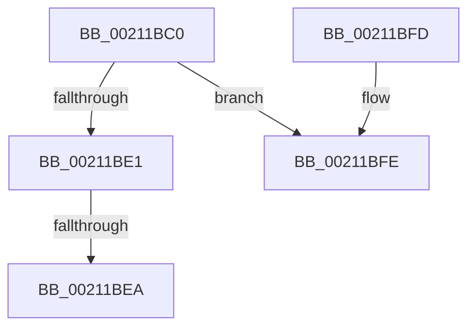

# ExAcquireResourceSharedLite

- RVA: `0x00211BC0`–`0x00211C19` (길이 `89` bytes)
- VA: `0x0000000140211BC0`
- 실행 섹션: `.text`
- PDB 이름 있음: `예`; PDB Function 태그: `아니요`
- unwind 정보 RVA: `0x0005DE7C`
- 디코드: `31`개 명령, `89/89` bytes 표시
- 미해석 바이트: `0` (있으면 어셈블리에 `.byte`로 보존)

> 이 문서는 커널 이미지의 기계어와 PDB 기호를 분석해 생성했습니다. 4번과 5번은 함수 원형과 자료형을 바이너리 사용 방식에서 추정한 C 해석이며 원본 소스 복구 결과는 아닙니다.

## 1. Dependencies

- 직접 호출 지점: **2**; 고유 호출 대상: **2**
- 직접 호출자로 확인된 함수: **142**
- RIP 상대 이미지 참조: **0**

### Outgoing calls
- `0x00211BF1` → [ExpAcquireResourceSharedLite](ExpAcquireResourceSharedLite_function_00212040.md) (function, `0x00212040`)
- `0x00211C13` → [KeBugCheckEx](../4F/KeBugCheckEx_function_004FD660.md) (function, `0x004FD660`)

### Direct callers
- [sub_00213C43](Unknown_function_00213C43.md) at `0x00213C5B`
- [sub_00213C43](Unknown_function_00213C43.md) at `0x00213C77`
- [MiAcquireLoadLock](../2A/MiAcquireLoadLock_function_002A3950.md) at `0x002A3986`
- [SepGetProcUniqueLuidAndIndexFromTokenEx](../30/SepGetProcUniqueLuidAndIndexFromTokenEx_function_00300B40.md) at `0x00300B9E`
- [sub_00302042](../30/Unknown_function_00302042.md) at `0x00302083`
- [IopCreateSecurityCheck](../3A/IopCreateSecurityCheck_function_003A5DA0.md) at `0x003A5DF6`
- [sub_003A7AB1](../3A/Unknown_function_003A7AB1.md) at `0x003A7AE1`
- [SepTrustLevelCheck](../3E/SepTrustLevelCheck_function_003ED7E0.md) at `0x003ED9F4`
- [SeAccessCheckByType](../44/SeAccessCheckByType_function_00440BC8.md) at `0x004416DD`
- [SeAccessCheckByType](../44/SeAccessCheckByType_function_00440BC8.md) at `0x004425FD`
- [SeTokenGetNoChildProcessRestricted](../45/SeTokenGetNoChildProcessRestricted_function_004584DC.md) at `0x00458518`
- [SepRmAcquireGlobalSaclReadLock](../46/SepRmAcquireGlobalSaclReadLock_function_0046B608.md) at `0x0046B626`
- [IoCheckRedirectionTrustLevel](../48/IoCheckRedirectionTrustLevel_function_00485BB0.md) at `0x00485C45`
- [SeTokenGetRedirectionTrustPolicy](../49/SeTokenGetRedirectionTrustPolicy_function_00498C30.md) at `0x00498C65`
- [SepCreateAppContainerToken](../4F/SepCreateAppContainerToken_function_004F43AC.md) at `0x004F4700`
- [SepCreateAppContainerToken](../4F/SepCreateAppContainerToken_function_004F43AC.md) at `0x004F4774`
- [SepCreateAppContainerToken](../4F/SepCreateAppContainerToken_function_004F43AC.md) at `0x004F48CF`
- [FsRtlpDedupChangeEventsControlCallbackV2](../58/FsRtlpDedupChangeEventsControlCallbackV2_function_00582C00.md) at `0x00582CCA`
- [FsRtlpTieringHeatEventsControlCallbackV2](../58/FsRtlpTieringHeatEventsControlCallbackV2_function_00583110.md) at `0x005831D7`
- [IoFillTriageDumpBuffer](../59/IoFillTriageDumpBuffer_function_005921CC.md) at `0x0059246F`
- [SeGetProcessAntiTamperIdentity](../60/SeGetProcessAntiTamperIdentity_function_00606740.md) at `0x00606788`
- [SeGetProcessAntiTamperUIPolicy](../60/SeGetProcessAntiTamperUIPolicy_function_00606800.md) at `0x0060685C`
- [SepMandatoryAccessCheck](../60/SepMandatoryAccessCheck_function_00608480.md) at `0x00608513`
- [SeTokenIsNoChildProcessRestrictionEnforced](../60/SeTokenIsNoChildProcessRestrictionEnforced_function_00609A38.md) at `0x00609A5C`
- [DifExAcquireResourceSharedLiteWrapper](../61/DifExAcquireResourceSharedLiteWrapper_function_0061DD50.md) at `0x0061DE24`
- [sub_006EEE7E](../6E/Unknown_function_006EEE7E.md) at `0x006EEEE3`
- [FsRtlMdlReadDev](../../page/71/FsRtlMdlReadDev_function_00713980.md) at `0x00713A06`
- [FsRtlPrepareMdlWriteDev](../../page/71/FsRtlPrepareMdlWriteDev_function_00713BB0.md) at `0x00713C9B`
- [PnpShutdownDevices](../../page/72/PnpShutdownDevices_function_00723F20.md) at `0x00724019`
- [PsSwapProcessWorkingSet](../../page/78/PsSwapProcessWorkingSet_function_00781C24.md) at `0x00781C84`
- [SeSetSessionIdTokenWithLinked](../../page/79/SeSetSessionIdTokenWithLinked_function_0079CF90.md) at `0x0079D00E`
- [SepGetMandatoryAccessControlList](../../page/79/SepGetMandatoryAccessControlList_function_0079D5EC.md) at `0x0079D6DB`
- [SepIdAssignableAsGroup](../../page/7A/SepIdAssignableAsGroup_function_007A01A0.md) at `0x007A01E3`
- [NtMapCMFModule](../../page/7D/NtMapCMFModule_function_007D4310.md) at `0x007D4604`
- [ObpCreateHandle](../../page/86/ObpCreateHandle_function_0086B950.md) at `0x0086BB45`
- [ObpCreateHandle](../../page/86/ObpCreateHandle_function_0086B950.md) at `0x0086BB6C`
- [ObpCreateHandle](../../page/86/ObpCreateHandle_function_0086B950.md) at `0x0086C6D9`
- [ObpCreateHandle](../../page/86/ObpCreateHandle_function_0086B950.md) at `0x0086C6F5`
- [ObpCreateHandle](../../page/86/ObpCreateHandle_function_0086B950.md) at `0x0086CB3C`
- [ObpGrantAccess](../../page/86/ObpGrantAccess_function_0086F250.md) at `0x0086F35C`
- [ObpGrantAccess](../../page/86/ObpGrantAccess_function_0086F250.md) at `0x0086F383`
- [sub_0086FA65](../../page/86/Unknown_function_0086FA65.md) at `0x0086FB4D`
- [sub_0086FA65](../../page/86/Unknown_function_0086FA65.md) at `0x0086FB74`
- [CmpCheckOpenAccessOnKeyBody](../../page/87/CmpCheckOpenAccessOnKeyBody_function_00870000.md) at `0x0087024D`
- [CmpCheckOpenAccessOnKeyBody](../../page/87/CmpCheckOpenAccessOnKeyBody_function_00870000.md) at `0x00870274`
- [ObCheckObjectAccess](../../page/87/ObCheckObjectAccess_function_00872260.md) at `0x00872354`
- [ObCheckObjectAccess](../../page/87/ObCheckObjectAccess_function_00872260.md) at `0x0087237B`
- [IopGetSetSecurityObject](../../page/87/IopGetSetSecurityObject_function_00873A80.md) at `0x00873D99`
- [IopGetSetSecurityObject](../../page/87/IopGetSetSecurityObject_function_00873A80.md) at `0x00873F00`
- [AlpcpExposeTokenAttribute](../../page/89/AlpcpExposeTokenAttribute_function_00891390.md) at `0x008915A2`
- [IopParseDevice](../../page/89/IopParseDevice_function_0089E510.md) at `0x0089EA95`
- [IopParseDevice](../../page/89/IopParseDevice_function_0089E510.md) at `0x008A002E`
- [IopParseDevice](../../page/89/IopParseDevice_function_0089E510.md) at `0x008A034A`
- [EtwQueryProcessTelemetryInfo](../../page/8A/EtwQueryProcessTelemetryInfo_function_008A51A0.md) at `0x008A5290`
- [SeQueryInformationToken](../../page/8B/SeQueryInformationToken_function_008B5090.md) at `0x008B513C`
- [SeQueryInformationToken](../../page/8B/SeQueryInformationToken_function_008B5090.md) at `0x008B51C9`
- [SeQueryInformationToken](../../page/8B/SeQueryInformationToken_function_008B5090.md) at `0x008B524B`
- [SeQueryInformationToken](../../page/8B/SeQueryInformationToken_function_008B5090.md) at `0x008B52BA`
- [SeQueryInformationToken](../../page/8B/SeQueryInformationToken_function_008B5090.md) at `0x008B53A1`
- [SeQueryInformationToken](../../page/8B/SeQueryInformationToken_function_008B5090.md) at `0x008B543E`
- [SeQueryInformationToken](../../page/8B/SeQueryInformationToken_function_008B5090.md) at `0x008B5532`
- [SeQueryInformationToken](../../page/8B/SeQueryInformationToken_function_008B5090.md) at `0x008B56D0`
- [SeQueryInformationToken](../../page/8B/SeQueryInformationToken_function_008B5090.md) at `0x008B574B`
- [SeQueryInformationToken](../../page/8B/SeQueryInformationToken_function_008B5090.md) at `0x008B58AD`
- [SeQueryInformationToken](../../page/8B/SeQueryInformationToken_function_008B5090.md) at `0x008B5922`
- [SeQueryInformationToken](../../page/8B/SeQueryInformationToken_function_008B5090.md) at `0x008B5B5B`
- [SeQueryInformationToken](../../page/8B/SeQueryInformationToken_function_008B5090.md) at `0x008B5C54`
- [SeQueryInformationToken](../../page/8B/SeQueryInformationToken_function_008B5090.md) at `0x008B5C98`
- [SeQueryInformationToken](../../page/8B/SeQueryInformationToken_function_008B5090.md) at `0x008B5D1C`
- [SeQueryInformationToken](../../page/8B/SeQueryInformationToken_function_008B5090.md) at `0x008B5DDE`
- [SeQueryInformationToken](../../page/8B/SeQueryInformationToken_function_008B5090.md) at `0x008B5F29`
- [SeQueryInformationToken](../../page/8B/SeQueryInformationToken_function_008B5090.md) at `0x008B5FBE`
- [SeQueryInformationToken](../../page/8B/SeQueryInformationToken_function_008B5090.md) at `0x008B608F`
- [SeQueryInformationToken](../../page/8B/SeQueryInformationToken_function_008B5090.md) at `0x008B6160`
- [SeQueryInformationToken](../../page/8B/SeQueryInformationToken_function_008B5090.md) at `0x008B61FC`
- [SeQueryInformationToken](../../page/8B/SeQueryInformationToken_function_008B5090.md) at `0x008B62A6`
- [NtDuplicateToken](../../page/8B/NtDuplicateToken_function_008B6DF0.md) at `0x008B70E2`
- [SepDuplicateToken](../../page/8B/SepDuplicateToken_function_008B87EC.md) at `0x008B8A81`
- [sub_008BBC01](../../page/8B/Unknown_function_008BBC01.md) at `0x008BBD21`
- [SeLockSubjectContext](../../page/8C/SeLockSubjectContext_function_008C64C0.md) at `0x008C64E4`
- [SeLockSubjectContext](../../page/8C/SeLockSubjectContext_function_008C64C0.md) at `0x008C6509`
- [NtSetInformationThread](../../page/8C/NtSetInformationThread_function_008C9F60.md) at `0x008CB1EC`
- [PiDqObjectManagerEnumerateAndRegisterQuery](../../page/8D/PiDqObjectManagerEnumerateAndRegisterQuery_function_008DCF74.md) at `0x008DD22F`
- [PiDmGetObject](../../page/8D/PiDmGetObject_function_008DFAE0.md) at `0x008DFB32`
- [PiPnpRtlGetCurrentOperation](../../page/8E/PiPnpRtlGetCurrentOperation_function_008E0460.md) at `0x008E049A`
- [sub_008E06CC](../../page/8E/Unknown_function_008E06CC.md) at `0x008E06FF`
- [PiPnpRtlDisableRemoveOperationDispatch](../../page/8E/PiPnpRtlDisableRemoveOperationDispatch_function_008E0AAC.md) at `0x008E0ACA`
- [sub_008E2AB2](../../page/8E/Unknown_function_008E2AB2.md) at `0x008E2AE1`
- [PiDmEnumObjectsWithCallback](../../page/8E/PiDmEnumObjectsWithCallback_function_008E3920.md) at `0x008E3A7D`
- [sub_008E41B3](../../page/8E/Unknown_function_008E41B3.md) at `0x008E4254`
- [sub_008E4A5E](../../page/8E/Unknown_function_008E4A5E.md) at `0x008E4A98`
- [IopDeviceInterfaceFilterCallback](../../page/8E/IopDeviceInterfaceFilterCallback_function_008E5410.md) at `0x008E548D`
- [PiPnpRtlApplyMandatoryFilters](../../page/8E/PiPnpRtlApplyMandatoryFilters_function_008E5C80.md) at `0x008E5CD8`
- [PiPnpRtlApplyMandatoryDeviceFilters](../../page/8E/PiPnpRtlApplyMandatoryDeviceFilters_function_008E5E90.md) at `0x008E5EFA`
- [PiCMMandatoryFilterCallback](../../page/8E/PiCMMandatoryFilterCallback_function_008E6490.md) at `0x008E64F1`
- [sub_008E6883](../../page/8E/Unknown_function_008E6883.md) at `0x008E68B2`
- [PiCMValidateDeviceInstance](../../page/8E/PiCMValidateDeviceInstance_function_008E799C.md) at `0x008E7AD9`
- [PiGetRelatedDevice](../../page/8E/PiGetRelatedDevice_function_008E846C.md) at `0x008E84B4`
- [PiGetRelatedDevice](../../page/8E/PiGetRelatedDevice_function_008E846C.md) at `0x008E85DD`
- [PipProcessDevNodeTree](../../page/8F/PipProcessDevNodeTree_function_008F9068.md) at `0x008F94B2`
- [PiControlGetPropertyData](../../page/8F/PiControlGetPropertyData_function_008FA330.md) at `0x008FA3BD`
- [PpHotSwapGetDevnodeRemovalPolicy](../../page/8F/PpHotSwapGetDevnodeRemovalPolicy_function_008FB1B4.md) at `0x008FB1F6`
- [PiUpdateDevicePanel](../../page/8F/PiUpdateDevicePanel_function_008FBD4C.md) at `0x008FBD8A`
- [PnpStartedDeviceNodeDependencyCheck](../../page/8F/PnpStartedDeviceNodeDependencyCheck_function_008FCF58.md) at `0x008FCF7B`
- [PnpStartedDeviceNodeDependencyCheck](../../page/8F/PnpStartedDeviceNodeDependencyCheck_function_008FCF58.md) at `0x008FCF89`
- [PiCreateDeviceInstanceKey](../../page/8F/PiCreateDeviceInstanceKey_function_008FFA0C.md) at `0x008FFA4B`
- [IoGetLegacyVetoList](../../page/91/IoGetLegacyVetoList_function_00911300.md) at `0x00911380`
- [PopFilterCapabilities](../../page/91/PopFilterCapabilities_function_0091141C.md) at `0x009114D5`
- [SeQueryServerSiloToken](../../page/91/SeQueryServerSiloToken_function_00912F30.md) at `0x00912F5C`
- [PspQueryJobHierarchyAccountingInformation](../../page/91/PspQueryJobHierarchyAccountingInformation_function_0091864C.md) at `0x009186CC`
- [PspLockRootJobShared](../../page/91/PspLockRootJobShared_function_00918990.md) at `0x009189C4`
- [PspLockRootJobShared](../../page/91/PspLockRootJobShared_function_00918990.md) at `0x00918A13`
- [PspEnforceLimitsJobPostCallback](../../page/91/PspEnforceLimitsJobPostCallback_function_00919720.md) at `0x00919778`
- [PspLockJobShared](../../page/91/PspLockJobShared_function_0091A490.md) at `0x0091A4A7`
- [ExpGetProcessInformation](../../page/91/ExpGetProcessInformation_function_0091A878.md) at `0x0091B710`
- [RtlpNewSecurityObject](../../page/92/RtlpNewSecurityObject_function_0092AB50.md) at `0x0092ACF8`
- [RtlpNewSecurityObject](../../page/92/RtlpNewSecurityObject_function_0092AB50.md) at `0x0092AD1E`
- [PiDmObjectManagerAcquireSharedLock](../../page/95/PiDmObjectManagerAcquireSharedLock_function_009511A0.md) at `0x009511B7`
- [NtQuerySecurityAttributesToken](../../page/97/NtQuerySecurityAttributesToken_function_00972C80.md) at `0x00972E3E`
- [SeQueryUserSidToken](../../page/99/SeQueryUserSidToken_function_00990950.md) at `0x00990991`
- [IoOpenDeviceRegistryKey](../../page/99/IoOpenDeviceRegistryKey_function_00999250.md) at `0x009992D7`
- [IopInvalidateVolumesForDevice](../../page/9A/IopInvalidateVolumesForDevice_function_009A5E74.md) at `0x009A5F9C`
- [sub_009A8DF3](../../page/9A/Unknown_function_009A8DF3.md) at `0x009A8E30`
- [SepFilterToken](../../page/9C/SepFilterToken_function_009C6B80.md) at `0x009C6F1D`
- [SepFilterToken](../../page/9C/SepFilterToken_function_009C6B80.md) at `0x009C7745`
- [PspChargeJobWakeCounter](../../page/9D/PspChargeJobWakeCounter_function_009D5D20.md) at `0x009D5DB0`
- [PspChargeJobWakeCounter](../../page/9D/PspChargeJobWakeCounter_function_009D5D20.md) at `0x009D5DEA`
- [PspChargeJobWakeCounter](../../page/9D/PspChargeJobWakeCounter_function_009D5D20.md) at `0x009D6057`
- [FsRtlAcquireFileForCcFlushEx](../../page/9D/FsRtlAcquireFileForCcFlushEx_function_009D72F0.md) at `0x009D7511`
- [FsRtlAcquireFileForCcFlushEx](../../page/9D/FsRtlAcquireFileForCcFlushEx_function_009D72F0.md) at `0x009D752F`
- [SeGetTokenControlInformation](../../page/9E/SeGetTokenControlInformation_function_009E47E0.md) at `0x009E481D`
- [SeQuerySessionIdTokenEx](../../page/9E/SeQuerySessionIdTokenEx_function_009E7680.md) at `0x009E76B5`
- [PspInsertThread](../../page/9F/PspInsertThread_function_009F0314.md) at `0x009F04E0`
- [PspSetProcessPriorityClass](../../page/9F/PspSetProcessPriorityClass_function_009F61E4.md) at `0x009F6236`
- [SeQuerySecurityAttributesToken](../../page/9F/SeQuerySecurityAttributesToken_function_009F6410.md) at `0x009F6459`
- [PspGetNextChildJob](../../page/9F/PspGetNextChildJob_function_009F66A4.md) at `0x009F66E8`
- [SeQuerySessionIdToken](../../page/A0/SeQuerySessionIdToken_function_00A04490.md) at `0x00A044B7`
- [PnpGetDeviceDependencyList](../../page/A0/PnpGetDeviceDependencyList_function_00A05090.md) at `0x00A050EF`
- [PnpGetDeviceDependencyList](../../page/A0/PnpGetDeviceDependencyList_function_00A05090.md) at `0x00A050FD`
- [PnpProcessQueryRemoveAndEject](../../page/A0/PnpProcessQueryRemoveAndEject_function_00A05170.md) at `0x00A0520E`
- [PnpNewDeviceNodeDependencyCheck](../../page/A0/PnpNewDeviceNodeDependencyCheck_function_00A062A0.md) at `0x00A062FA`
- [PnpNewDeviceNodeDependencyCheck](../../page/A0/PnpNewDeviceNodeDependencyCheck_function_00A062A0.md) at `0x00A06308`
- [PnpNewDeviceNodeDependencyCheck](../../page/A0/PnpNewDeviceNodeDependencyCheck_function_00A062A0.md) at `0x00A06343`
- [PnpNewDeviceNodeDependencyCheck](../../page/A0/PnpNewDeviceNodeDependencyCheck_function_00A062A0.md) at `0x00A06351`
- [PnpAcquireDependencyRelationsLock](../../page/A0/PnpAcquireDependencyRelationsLock_function_00A06788.md) at `0x00A067AA`
- [PnpAcquireDependencyRelationsLock](../../page/A0/PnpAcquireDependencyRelationsLock_function_00A06788.md) at `0x00A067C8`
- [IopSortRelationListForRemove](../../page/A0/IopSortRelationListForRemove_function_00A06C30.md) at `0x00A06C71`
- [IopSortRelationListForRemove](../../page/A0/IopSortRelationListForRemove_function_00A06C30.md) at `0x00A06C7F`
- [PnpCheckForActiveDependencies](../../page/A0/PnpCheckForActiveDependencies_function_00A06DA4.md) at `0x00A06DE4`
- [PnpCheckForActiveDependencies](../../page/A0/PnpCheckForActiveDependencies_function_00A06DA4.md) at `0x00A06DF2`
- [PnpProcessDependencyRelations](../../page/A0/PnpProcessDependencyRelations_function_00A07548.md) at `0x00A0758D`
- [PnpProcessDependencyRelations](../../page/A0/PnpProcessDependencyRelations_function_00A07548.md) at `0x00A0759B`
- [IopReleaseDeviceResources](../../page/A0/IopReleaseDeviceResources_function_00A0867C.md) at `0x00A087BF`
- [PnpDelayedRemoveWorker](../../page/A0/PnpDelayedRemoveWorker_function_00A08AE0.md) at `0x00A08B2D`
- [PiPnpRtlOperationListAcquireSharedLock](../../page/A0/PiPnpRtlOperationListAcquireSharedLock_function_00A0FA68.md) at `0x00A0FA86`
- [PpDevNodeLockTree](../../page/A1/PpDevNodeLockTree_function_00A19310.md) at `0x00A1933F`
- [SepAccessCheckAndAuditAlarm](../../page/A1/SepAccessCheckAndAuditAlarm_function_00A1AF4C.md) at `0x00A1CEEC`
- [AlpcpQuerySidToken](../../page/A2/AlpcpQuerySidToken_function_00A20FE0.md) at `0x00A21031`
- [AlpcpCheckConnectionSecurity](../../page/A2/AlpcpCheckConnectionSecurity_function_00A227A0.md) at `0x00A22987`
- [IopQueryInterfaceRecurseUp](../../page/A2/IopQueryInterfaceRecurseUp_function_00A283C8.md) at `0x00A2840C`
- [PiProcessNewDeviceNode](../../page/A2/PiProcessNewDeviceNode_function_00A28F20.md) at `0x00A29848`
- [PiProcessNewDeviceNode](../../page/A2/PiProcessNewDeviceNode_function_00A28F20.md) at `0x00A29942`
- [PiProcessNewDeviceNode](../../page/A2/PiProcessNewDeviceNode_function_00A28F20.md) at `0x00A29DE3`
- [PiProcessNewDeviceNode](../../page/A2/PiProcessNewDeviceNode_function_00A28F20.md) at `0x00A29E5F`
- [PiProcessNewDeviceNode](../../page/A2/PiProcessNewDeviceNode_function_00A28F20.md) at `0x00A2A2AB`
- [FsRtlCopyRead](../../page/A3/FsRtlCopyRead_function_00A305D0.md) at `0x00A30664`
- [FsRtlCopyRead](../../page/A3/FsRtlCopyRead_function_00A305D0.md) at `0x00A307E6`
- [IopMountVolume](../../page/A3/IopMountVolume_function_00A329D0.md) at `0x00A32AEE`
- [IopMountVolume](../../page/A3/IopMountVolume_function_00A329D0.md) at `0x00A32C9C`
- [SepValidOwnerSubjectContext](../../page/A3/SepValidOwnerSubjectContext_function_00A37568.md) at `0x00A375D3`
- [ExpGetSystemFirmwareTableInformation](../../page/A3/ExpGetSystemFirmwareTableInformation_function_00A38A2C.md) at `0x00A38A94`
- [SeIsTokenAssignableToProcess](../../page/A3/SeIsTokenAssignableToProcess_function_00A3B2C0.md) at `0x00A3B340`
- [SeIsTokenAssignableToProcess](../../page/A3/SeIsTokenAssignableToProcess_function_00A3B2C0.md) at `0x00A3B38F`
- [FsRtlCopyWrite](../../page/A4/FsRtlCopyWrite_function_00A48210.md) at `0x00A4856C`
- [PiQueryDeviceRelations](../../page/A4/PiQueryDeviceRelations_function_00A4BE8C.md) at `0x00A4BF01`
- [WmipAcquireSmbiosLockShared](../../page/A4/WmipAcquireSmbiosLockShared_function_00A4F224.md) at `0x00A4F242`
- [PnpDiagRundownRegisterCallback](../../page/A5/PnpDiagRundownRegisterCallback_function_00A516A0.md) at `0x00A51736`
- [PnpDiagRundownRegisterCallback](../../page/A5/PnpDiagRundownRegisterCallback_function_00A516A0.md) at `0x00A51776`
- [PnpDiagRundownRegisterCallback](../../page/A5/PnpDiagRundownRegisterCallback_function_00A516A0.md) at `0x00A517B9`
- [PipForDeviceNodeSubtree](../../page/A5/PipForDeviceNodeSubtree_function_00A51920.md) at `0x00A51951`
- [SepGetLogonSessionAccountInfo](../../page/A5/SepGetLogonSessionAccountInfo_function_00A56F18.md) at `0x00A56F7C`
- [PiGetDeviceDepth](../../page/A5/PiGetDeviceDepth_function_00A5EBA0.md) at `0x00A5EBD7`
- [PspSetProcessAffinitySafe](../../page/A6/PspSetProcessAffinitySafe_function_00A60904.md) at `0x00A609C2`
- [PipMakeGloballyUniqueId](../../page/A6/PipMakeGloballyUniqueId_function_00A6F428.md) at `0x00A6F4A2`
- [IopSetDeviceSecurityDescriptor](../../page/A7/IopSetDeviceSecurityDescriptor_function_00A7199C.md) at `0x00A719F0`
- [PspValidateJobAffinityState](../../page/A8/PspValidateJobAffinityState_function_00A85298.md) at `0x00A852BA`
- [PipGenerateContainerID](../../page/A8/PipGenerateContainerID_function_00A87694.md) at `0x00A8779A`
- [PnpSurpriseFailUnsafeDmaDevices](../../page/A9/PnpSurpriseFailUnsafeDmaDevices_function_00A95B90.md) at `0x00A95BE7`
- [PiQueryPowerRelations](../../page/AA/PiQueryPowerRelations_function_00AA3F9C.md) at `0x00AA44BA`
- [PiQueryPowerDependencyRelations](../../page/AA/PiQueryPowerDependencyRelations_function_00AA4524.md) at `0x00AA455E`
- [PiQueryPowerDependencyRelations](../../page/AA/PiQueryPowerDependencyRelations_function_00AA4524.md) at `0x00AA456C`
- [IopWriteAllocatedResourcesToRegistry](../../page/AA/IopWriteAllocatedResourcesToRegistry_function_00AA54E4.md) at `0x00AA5523`
- [PnpDriverLoadingFailed](../../page/AB/PnpDriverLoadingFailed_function_00AB8928.md) at `0x00AB8B05`
- [PnpDriverLoadingFailed](../../page/AB/PnpDriverLoadingFailed_function_00AB8928.md) at `0x00AB8BBB`
- [IoLockUnlockPnpDeviceTree](../../page/AB/IoLockUnlockPnpDeviceTree_function_00AB953C.md) at `0x00AB955E`
- [NtCreateLowBoxToken](../../page/AB/NtCreateLowBoxToken_function_00AB9880.md) at `0x00AB9F41`
- [NtCreateLowBoxToken](../../page/AB/NtCreateLowBoxToken_function_00AB9880.md) at `0x00AB9FC5`
- [NtQueryInformationToken](../../page/AE/NtQueryInformationToken_function_00AECDD0.md) at `0x00AECF94`
- [NtQueryInformationToken](../../page/AE/NtQueryInformationToken_function_00AECDD0.md) at `0x00AED092`
- [NtQueryInformationToken](../../page/AE/NtQueryInformationToken_function_00AECDD0.md) at `0x00AED1AA`
- [NtQueryInformationToken](../../page/AE/NtQueryInformationToken_function_00AECDD0.md) at `0x00AED2B2`
- [NtQueryInformationToken](../../page/AE/NtQueryInformationToken_function_00AECDD0.md) at `0x00AED41E`
- [NtQueryInformationToken](../../page/AE/NtQueryInformationToken_function_00AECDD0.md) at `0x00AED863`
- [NtQueryInformationToken](../../page/AE/NtQueryInformationToken_function_00AECDD0.md) at `0x00AED9D8`
- [NtQueryInformationToken](../../page/AE/NtQueryInformationToken_function_00AECDD0.md) at `0x00AEDB76`
- [NtQueryInformationToken](../../page/AE/NtQueryInformationToken_function_00AECDD0.md) at `0x00AEE151`
- [NtQueryInformationToken](../../page/AE/NtQueryInformationToken_function_00AECDD0.md) at `0x00AEE2C1`
- [NtQueryInformationToken](../../page/AE/NtQueryInformationToken_function_00AECDD0.md) at `0x00AEE7B9`
- [NtQueryInformationToken](../../page/AE/NtQueryInformationToken_function_00AECDD0.md) at `0x00AEE832`
- [NtQueryInformationToken](../../page/AE/NtQueryInformationToken_function_00AECDD0.md) at `0x00AEEB7E`
- [NtQueryInformationToken](../../page/AE/NtQueryInformationToken_function_00AECDD0.md) at `0x00AEEE32`
- [NtQueryInformationToken](../../page/AE/NtQueryInformationToken_function_00AECDD0.md) at `0x00AEEEDB`
- [NtQueryInformationToken](../../page/AE/NtQueryInformationToken_function_00AECDD0.md) at `0x00AEF065`
- [NtQueryInformationToken](../../page/AE/NtQueryInformationToken_function_00AECDD0.md) at `0x00AEF1C7`
- [NtQueryInformationToken](../../page/AE/NtQueryInformationToken_function_00AECDD0.md) at `0x00AEF410`
- [NtQueryInformationToken](../../page/AE/NtQueryInformationToken_function_00AECDD0.md) at `0x00AEF54B`
- [NtQueryInformationToken](../../page/AE/NtQueryInformationToken_function_00AECDD0.md) at `0x00AEF691`
- [NtQueryInformationToken](../../page/AE/NtQueryInformationToken_function_00AECDD0.md) at `0x00AEF81A`
- [NtQueryInformationToken](../../page/AE/NtQueryInformationToken_function_00AECDD0.md) at `0x00AEF9EA`
- [NtQueryInformationToken](../../page/AE/NtQueryInformationToken_function_00AECDD0.md) at `0x00AEFAEF`
- [NtQueryInformationToken](../../page/AE/NtQueryInformationToken_function_00AECDD0.md) at `0x00AEFC21`
- [NtQueryInformationToken](../../page/AE/NtQueryInformationToken_function_00AECDD0.md) at `0x00AEFCFA`
- [NtQueryInformationToken](../../page/AE/NtQueryInformationToken_function_00AECDD0.md) at `0x00AEFE6E`
- [NtQueryInformationToken](../../page/AE/NtQueryInformationToken_function_00AECDD0.md) at `0x00AEFFF0`
- [NtQueryInformationToken](../../page/AE/NtQueryInformationToken_function_00AECDD0.md) at `0x00AF0190`
- [NtQueryInformationToken](../../page/AE/NtQueryInformationToken_function_00AECDD0.md) at `0x00AF02C9`
- [NtSetInformationToken](../../page/AF/NtSetInformationToken_function_00AF0530.md) at `0x00AF0FCA`
- [NtSetInformationToken](../../page/AF/NtSetInformationToken_function_00AF0530.md) at `0x00AF1B28`
- [SepDeReferenceLogonSession](../../page/AF/SepDeReferenceLogonSession_function_00AF25EC.md) at `0x00AF26E9`
- [sub_00B1F622](../../page/B1/Unknown_function_00B1F622.md) at `0x00B1F6CF`
- [sub_00B1F622](../../page/B1/Unknown_function_00B1F622.md) at `0x00B1F932`
- [sub_00B1FD92](../../page/B1/Unknown_function_00B1FD92.md) at `0x00B1FDCC`
- [sub_00B1FEC0](../../page/B1/Unknown_function_00B1FEC0.md) at `0x00B1FEED`
- [sub_00B39BB0](../../page/B3/Unknown_function_00B39BB0.md) at `0x00B39C07`
- [CmpLockRegistry](../../pagecmrc/BC/CmpLockRegistry_function_00BC9B34.md) at `0x00BC9BA2`
- [ExpPrmInitialization](../../init/C5/ExpPrmInitialization_function_00C517F8.md) at `0x00C51829`
- [VslRegisterBootDrivers](../../init/C7/VslRegisterBootDrivers_function_00C7453C.md) at `0x00C745AF`

### Static image references
- 디코드된 RIP-relative 메모리 참조가 없습니다.

## 2. Other-region calls and transfers

- 다른 실행 섹션으로 향하는 call: **0**
- call이 아닌 외부 분기/꼬리 이동: **1**
  - `0x00211BE4` → [sub_00211FA9](Unknown_function_00211FA9.md) (`tail-transfer`)

## 3. Assembly (complete function range)

```asm
00211BC0  40 53                           push rbx
00211BC2  57                              push rdi
00211BC3  48 83 EC 58                     sub rsp, 0x58
00211BC7  84 D2                           test dl, dl
00211BC9  0F B6 FA                        movzx edi, dl
00211BCC  48 8B D9                        mov rbx, rcx
00211BCF  0F B7 49 1A                     movzx ecx, word ptr [rcx + 0x1a]
00211BD3  0F 94 C2                        sete dl
00211BD6  0F B6 C1                        movzx eax, cl
00211BD9  FE C2                           inc dl
00211BDB  24 41                           and al, 0x41
00211BDD  3C 01                           cmp al, 1
00211BDF  74 1D                           je 0x140211bfe
00211BE1  F6 C1 01                        test cl, 1
00211BE4  0F 85 BF 03 00 00               jne 0x140211fa9
00211BEA  40 0F B6 D7                     movzx edx, dil
00211BEE  48 8B CB                        mov rcx, rbx
00211BF1  E8 4A 04 00 00                  call 0x140212040
00211BF6  48 83 C4 58                     add rsp, 0x58
00211BFA  5F                              pop rdi
00211BFB  5B                              pop rbx
00211BFC  C3                              ret
00211BFD  CC                              int3
00211BFE  33 FF                           xor edi, edi
00211C00  45 33 C9                        xor r9d, r9d
00211C03  4C 8B C3                        mov r8, rbx
00211C06  48 89 7C 24 20                  mov qword ptr [rsp + 0x20], rdi
00211C0B  B9 C6 01 00 00                  mov ecx, 0x1c6
00211C10  8D 57 0F                        lea edx, [rdi + 0xf]
00211C13  E8 48 BA 2E 00                  call 0x1404fd660
00211C18  CC                              int3
```

## 4. C-style interpretation (structured pseudocode)

```c
__int64 __fastcall ExAcquireResourceSharedLite(__int64 a1, unsigned __int8 a2, __int64 a3, int a4)
{
    __int64 result;
    __int64 v_rdi;
    __int64 v_rsp;
    unsigned __int64 v_stack_p20;

    v_rsp = (v_rsp) - (88);
    a2 = (a2 == 0) ? 1 : 0;
    a2 = (unsigned __int8)((a2) + 1);
    result = (unsigned __int8)(((unsigned __int8)(*(unsigned __int16 *)(a1 + 26))) & (65));
    if (((unsigned __int8)(result)) == 1) goto loc_00211BFE;
    result = ExpAcquireResourceSharedLite(a1, a2, a3, a4);
    v_rsp = (v_rsp) + (88);
    return result;
loc_00211BFE:
    v_rdi = 0;
    a4 = 0;
    v_stack_p20 = 0;
    result = KeBugCheckEx(454, v_rdi + 15, a1, a4);
    return result;
}
```

## 5. (Beta) C Style

```c
int64_t ExAcquireResourceSharedLite(void *Arg1, uint8_t Arg2, int64_t Arg3, int32_t Arg4)
{
    uint8_t *arg1 = (uint8_t *)Arg1;

    int64_t result;
    int64_t local_rdi;
    int64_t local_rsp;
    uint64_t v_stack_p20;

    local_rsp = (local_rsp) - (88);
    Arg2 = (Arg2 == 0) ? 1 : 0;
    Arg2 = (uint8_t)((Arg2) + 1);
    result = (uint8_t)(((uint8_t)(*(uint16_t *)(arg1 + 0x1A))) & (65));
    if (((uint8_t)(result)) == 1) goto loc_00211BFE;
    result = ExpAcquireResourceSharedLite(Arg1, Arg2, Arg3, Arg4);
    local_rsp = (local_rsp) + (88);
    return result;
loc_00211BFE:
    local_rdi = 0;
    Arg4 = 0;
    v_stack_p20 = 0;
    result = KeBugCheckEx(454, local_rdi + 15, Arg1, Arg4);
    return result;
}
```

### 관측된 메모리 오프셋

구조체 형식이 확인되지 않은 접근은 인자 기준의 오프셋으로만 기록했습니다.

| 기준 인자 | 오프셋 표현 | 폭 (bit) | 접근 |
|---|---:|---:|---|
| `Arg1` | `+ 0x1A` | `16` | `R` |

## 6. Execution-region graph

[열기: 2D/3D 그래프와 함수 탐색 컨트롤 패널](../../../control-panel.html?section=text&rva=0x00211BC0&view=graph)

- 2D 그래프는 위에서 아래로 흐르고, 3D 그래프는 빈 공간을 드래그해 회전합니다. Shift+드래그는 이동, 휠은 확대·축소, 함수 노드 선택은 대상 보고서 이동입니다.

### Static fallback


