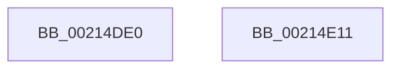

# ExEnterCriticalRegionAndAcquireResourceExclusive

- RVA: `0x00214DE0`–`0x00214E12` (길이 `50` bytes)
- VA: `0x0000000140214DE0`
- 실행 섹션: `.text`
- PDB 이름 있음: `예`; PDB Function 태그: `아니요`
- unwind 정보 RVA: `0x0005C788`
- 디코드: `11`개 명령, `50/50` bytes 표시
- 미해석 바이트: `0` (있으면 어셈블리에 `.byte`로 보존)

> 이 문서는 커널 이미지의 기계어와 PDB 기호를 분석해 생성했습니다. 4번과 5번은 함수 원형과 자료형을 바이너리 사용 방식에서 추정한 C 해석이며 원본 소스 복구 결과는 아닙니다.

## 1. Dependencies

- 직접 호출 지점: **1**; 고유 호출 대상: **1**
- 직접 호출자로 확인된 함수: **1**
- RIP 상대 이미지 참조: **0**

### Outgoing calls
- `0x00214DF7` → [ExAcquireResourceExclusiveLite](ExAcquireResourceExclusiveLite_function_00214E20.md) (function, `0x00214E20`)

### Direct callers
- [DifExEnterCriticalRegionAndAcquireResourceExclusiveWrapper](../61/DifExEnterCriticalRegionAndAcquireResourceExclusiveWrapper_function_0061FCF0.md) at `0x0061FDBD`

### Static image references
- 디코드된 RIP-relative 메모리 참조가 없습니다.

## 2. Other-region calls and transfers

- 다른 실행 섹션으로 향하는 call: **0**
- 별도 외부 분기/꼬리 이동을 확인하지 못했습니다.

## 3. Assembly (complete function range)

```asm
00214DE0  48 83 EC 28                     sub rsp, 0x28
00214DE4  65 48 8B 04 25 88 01 00 00      mov rax, qword ptr gs:[0x188]
00214DED  B2 01                           mov dl, 1
00214DEF  66 FF 88 E4 01 00 00            dec word ptr [rax + 0x1e4]
00214DF6  90                              nop
00214DF7  E8 24 00 00 00                  call 0x140214e20
00214DFC  65 48 8B 04 25 88 01 00 00      mov rax, qword ptr gs:[0x188]
00214E05  48 8B 80 C8 01 00 00            mov rax, qword ptr [rax + 0x1c8]
00214E0C  48 83 C4 28                     add rsp, 0x28
00214E10  C3                              ret
00214E11  CC                              int3
```

## 4. C-style interpretation (structured pseudocode)

```c
__int64 __fastcall ExEnterCriticalRegionAndAcquireResourceExclusive(void)
{
    __int64 result;
    __int64 v_rsp;

    v_rsp = (v_rsp) - (40);
    result = ExAcquireResourceExclusiveLite(a1, 1, a3, a4);
    v_rsp = (v_rsp) + (40);
    return *(unsigned __int64 *)(*(unsigned __int64 *)(gs_base + (0 + 392)) + 456);
}
```

## 5. (Beta) C Style

```c
void ExEnterCriticalRegionAndAcquireResourceExclusive(void)
{
    int64_t result;
    int64_t local_rsp;

    local_rsp = (local_rsp) - (40);
    result = ExAcquireResourceExclusiveLite(a1, 1, a3, a4);
    local_rsp = (local_rsp) + (40);
    return *(uint64_t *)(*(uint64_t *)(gs_base + (0 + 0x188)) + 0x1C8);
}
```

## 6. Execution-region graph

[열기: 2D/3D 그래프와 함수 탐색 컨트롤 패널](../../../control-panel.html?section=text&rva=0x00214DE0&view=graph)

- 2D 그래프는 위에서 아래로 흐르고, 3D 그래프는 빈 공간을 드래그해 회전합니다. Shift+드래그는 이동, 휠은 확대·축소, 함수 노드 선택은 대상 보고서 이동입니다.

### Static fallback


