# ExEnterPriorityRegionAndAcquireResourceShared

- RVA: `0x00213870`–`0x00213B48` (길이 `728` bytes)
- VA: `0x0000000140213870`
- 실행 섹션: `.text`
- PDB 이름 있음: `예`; PDB Function 태그: `아니요`
- unwind 정보 RVA: `0x0005E048`
- 디코드: `175`개 명령, `728/728` bytes 표시
- 미해석 바이트: `0` (있으면 어셈블리에 `.byte`로 보존)

> 이 문서는 커널 이미지의 기계어와 PDB 기호를 분석해 생성했습니다. 4번과 5번은 함수 원형과 자료형을 바이너리 사용 방식에서 추정한 C 해석이며 원본 소스 복구 결과는 아닙니다.

## 1. Dependencies

- 직접 호출 지점: **18**; 고유 호출 대상: **14**
- 직접 호출자로 확인된 함수: **1**
- RIP 상대 이미지 참조: **4**

### Outgoing calls
- `0x002138E2` → [ExpAcquireResourceSharedLite](ExpAcquireResourceSharedLite_function_00212040.md) (function, `0x00212040`)
- `0x00213908` → [ExpAllocateOwnerEntryForLegacyShim](ExpAllocateOwnerEntryForLegacyShim_function_00213B50.md) (function, `0x00213B50`)
- `0x00213919` → [ExAcquireFastResourceShared](ExAcquireFastResourceShared_function_00210F40.md) (function, `0x00210F40`)
- `0x00213925` → [ExIsFastResourceHeldExclusive](ExIsFastResourceHeldExclusive_function_00213450.md) (function, `0x00213450`)
- `0x00213933` → [ExFreePoolWithTag](../../poolcode/B8/ExFreePoolWithTag_function_00B82870.md) (function, `0x00B82870`)
- `0x00213952` → [KeBugCheckEx](../4F/KeBugCheckEx_function_004FD660.md) (function, `0x004FD660`)
- `0x00213966` → [ExAllocatePool2](../../poolcode/B8/ExAllocatePool2_function_00B820F0.md) (function, `0x00B820F0`)
- `0x00213981` → [RtlCaptureStackBackTrace](../2F/RtlCaptureStackBackTrace_function_002F9FF0.md) (function, `0x002F9FF0`)
- `0x002139A2` → [KeAcquireSpinLockRaiseToDpc](../20/KeAcquireSpinLockRaiseToDpc_function_00208470.md) (function, `0x00208470`)
- `0x00213A07` → [KiLowerIrqlProcessIrqlFlags](../4F/KiLowerIrqlProcessIrqlFlags_function_004F5698.md) (function, `0x004F5698`)
- `0x00213A2B` → [KiReleaseSpinLockInstrumented](../39/KiReleaseSpinLockInstrumented_function_00392EF0.md) (function, `0x00392EF0`)
- `0x00213A71` → [KiAbThreadInsertList](KiAbThreadInsertList_function_0021F0E0.md) (function, `0x0021F0E0`)
- `0x00213A7D` → [KiAbQueueAutoBoostDpc](../20/KiAbQueueAutoBoostDpc_function_002074D0.md) (function, `0x002074D0`)
- `0x00213A92` → [KiLowerIrqlProcessIrqlFlags](../4F/KiLowerIrqlProcessIrqlFlags_function_004F5698.md) (function, `0x004F5698`)
- `0x00213AA9` → [KiRaiseIrqlProcessIrqlFlags](../4F/KiRaiseIrqlProcessIrqlFlags_function_004F56FC.md) (function, `0x004F56FC`)
- `0x00213ADA` → [KeBugCheckEx](../4F/KeBugCheckEx_function_004FD660.md) (function, `0x004FD660`)
- `0x00213B01` → [KeBugCheckEx](../4F/KeBugCheckEx_function_004FD660.md) (function, `0x004FD660`)
- `0x00213B42` → [KeBugCheckEx](../4F/KeBugCheckEx_function_004FD660.md) (function, `0x004FD660`)

### Direct callers
- [DifExEnterPriorityRegionAndAcquireResourceSharedWrapper](../62/DifExEnterPriorityRegionAndAcquireResourceSharedWrapper_function_006202B0.md) at `0x0062037D`

### Static image references
- `0x00213894` → RVA `0x00FC6F88` (`ALMOSTRO`; read)
- `0x002139E4` → RVA `0x00FC6B06` (`ALMOSTRO`; read)
- `0x002139F6` → RVA `0x00FC6D20` (`ALMOSTRO`; read)
- `0x00213A15` → RVA `0x00F0DE58` (`.data`; read)

## 2. Other-region calls and transfers

- 다른 실행 섹션으로 향하는 call: **2**
  - `0x00213933` → [ExFreePoolWithTag](../../poolcode/B8/ExFreePoolWithTag_function_00B82870.md) (`.text` → `POOLCODE`)
  - `0x00213966` → [ExAllocatePool2](../../poolcode/B8/ExAllocatePool2_function_00B820F0.md) (`.text` → `POOLCODE`)
- 별도 외부 분기/꼬리 이동을 확인하지 못했습니다.

## 3. Assembly (complete function range)

```asm
00213870  48 89 5C 24 08                  mov qword ptr [rsp + 8], rbx
00213875  48 89 6C 24 10                  mov qword ptr [rsp + 0x10], rbp
0021387A  48 89 74 24 18                  mov qword ptr [rsp + 0x18], rsi
0021387F  57                              push rdi
00213880  41 56                           push r14
00213882  41 57                           push r15
00213884  48 83 EC 30                     sub rsp, 0x30
00213888  65 48 8B 3C 25 88 01 00 00      mov rdi, qword ptr gs:[0x188]
00213891  48 8B F1                        mov rsi, rcx
00213894  83 3D ED 36 DB 00 00            cmp dword ptr [rip + 0xdb36ed], 0
0021389B  0F 85 B7 00 00 00               jne 0x140213958
002138A1  BB 01 00 00 00                  mov ebx, 1
002138A6  F0 0F C1 9F E0 05 00 00         lock xadd dword ptr [rdi + 0x5e0], ebx
002138AE  FF C3                           inc ebx
002138B0  83 FB 01                        cmp ebx, 1
002138B3  0F 84 79 01 00 00               je 0x140213a32
002138B9  66 FF 8F E4 01 00 00            dec word ptr [rdi + 0x1e4]
002138C0  90                              nop
002138C1  0F B7 4E 1A                     movzx ecx, word ptr [rsi + 0x1a]
002138C5  0F B6 C1                        movzx eax, cl
002138C8  24 41                           and al, 0x41
002138CA  3C 01                           cmp al, 1
002138CC  74 6C                           je 0x14021393a
002138CE  F6 C1 01                        test cl, 1
002138D1  0F 85 D9 01 00 00               jne 0x140213ab0
002138D7  F6 46 1A 01                     test byte ptr [rsi + 0x1a], 1
002138DB  75 2B                           jne 0x140213908
002138DD  B2 01                           mov dl, 1
002138DF  48 8B CE                        mov rcx, rsi
002138E2  E8 59 E7 FF FF                  call 0x140212040
002138E7  48 8B 87 C8 01 00 00            mov rax, qword ptr [rdi + 0x1c8]
002138EE  48 8B 5C 24 50                  mov rbx, qword ptr [rsp + 0x50]
002138F3  48 8B 6C 24 58                  mov rbp, qword ptr [rsp + 0x58]
002138F8  48 8B 74 24 60                  mov rsi, qword ptr [rsp + 0x60]
002138FD  48 83 C4 30                     add rsp, 0x30
00213901  41 5F                           pop r15
00213903  41 5E                           pop r14
00213905  5F                              pop rdi
00213906  C3                              ret
00213907  CC                              int3
00213908  E8 43 02 00 00                  call 0x140213b50
0021390D  41 B0 01                        mov r8b, 1
00213910  48 8B D0                        mov rdx, rax
00213913  48 8B CE                        mov rcx, rsi
00213916  48 8B D8                        mov rbx, rax
00213919  E8 22 D6 FF FF                  call 0x140210f40
0021391E  84 C0                           test al, al
00213920  74 0C                           je 0x14021392e
00213922  48 8B CE                        mov rcx, rsi
00213925  E8 26 FB FF FF                  call 0x140213450
0021392A  84 C0                           test al, al
0021392C  74 B9                           je 0x1402138e7
0021392E  33 D2                           xor edx, edx
00213930  48 8B CB                        mov rcx, rbx
00213933  E8 38 EF 96 00                  call 0x140b82870
00213938  EB AD                           jmp 0x1402138e7
0021393A  45 33 C9                        xor r9d, r9d
0021393D  48 C7 44 24 20 00 00 00 00      mov qword ptr [rsp + 0x20], 0
00213946  4C 8B C6                        mov r8, rsi
00213949  B9 C6 01 00 00                  mov ecx, 0x1c6
0021394E  41 8D 51 0F                     lea edx, [r9 + 0xf]
00213952  E8 09 9D 2E 00                  call 0x1404fd660
00213957  CC                              int3
00213958  BA 70 00 00 00                  mov edx, 0x70
0021395D  41 B8 42 6F 6F 73               mov r8d, 0x736f6f42
00213963  8D 4A D0                        lea ecx, [rdx - 0x30]
00213966  E8 85 E7 96 00                  call 0x140b820f0
0021396B  4C 8B F8                        mov r15, rax
0021396E  48 85 C0                        test rax, rax
00213971  74 28                           je 0x14021399b
00213973  45 33 C9                        xor r9d, r9d
00213976  4C 8D 40 10                     lea r8, [rax + 0x10]
0021397A  41 8D 51 0A                     lea edx, [r9 + 0xa]
0021397E  8D 4A F7                        lea ecx, [rdx - 9]
00213981  E8 6A 66 0E 00                  call 0x1402f9ff0
00213986  65 48 8B 04 25 88 01 00 00      mov rax, qword ptr gs:[0x188]
0021398F  49 89 47 60                     mov qword ptr [r15 + 0x60], rax
00213993  49 C7 47 68 00 00 00 00         mov qword ptr [r15 + 0x68], 0
0021399B  48 8D 8F 10 06 00 00            lea rcx, [rdi + 0x610]
002139A2  E8 C9 4A FF FF                  call 0x140208470
002139A7  44 0F B6 F0                     movzx r14d, al
002139AB  BB 01 00 00 00                  mov ebx, 1
002139B0  F0 0F C1 9F E0 05 00 00         lock xadd dword ptr [rdi + 0x5e0], ebx
002139B8  FF C3                           inc ebx
002139BA  4D 85 FF                        test r15, r15
002139BD  74 25                           je 0x1402139e4
002139BF  48 8D 87 F0 05 00 00            lea rax, [rdi + 0x5f0]
002139C6  48 8B 48 08                     mov rcx, qword ptr [rax + 8]
002139CA  48 39 01                        cmp qword ptr [rcx], rax
002139CD  74 07                           je 0x1402139d6
002139CF  B9 03 00 00 00                  mov ecx, 3
002139D4  CD 29                           int 0x29
002139D6  49 89 07                        mov qword ptr [r15], rax
002139D9  49 89 4F 08                     mov qword ptr [r15 + 8], rcx
002139DD  4C 89 39                        mov qword ptr [rcx], r15
002139E0  4C 89 78 08                     mov qword ptr [rax + 8], r15
002139E4  F6 05 1B 31 DB 00 01            test byte ptr [rip + 0xdb311b], 1
002139EB  75 28                           jne 0x140213a15
002139ED  F0 48 83 A7 10 06 00 00 00      lock and qword ptr [rdi + 0x610], 0
002139F6  83 3D 23 33 DB 00 00            cmp dword ptr [rip + 0xdb3323], 0
002139FD  74 0D                           je 0x140213a0c
002139FF  44 0F 20 C1                     mov rcx, cr8
00213A03  41 0F B6 D6                     movzx edx, r14b
00213A07  E8 8C 1C 2E 00                  call 0x1404f5698
00213A0C  45 0F 22 C6                     mov cr8, r14
00213A10  E9 9B FE FF FF                  jmp 0x1402138b0
00213A15  8B 05 3D A4 CF 00               mov eax, dword ptr [rip + 0xcfa43d]
00213A1B  85 C0                           test eax, eax
00213A1D  75 CE                           jne 0x1402139ed
00213A1F  48 8B 54 24 48                  mov rdx, qword ptr [rsp + 0x48]
00213A24  48 8D 8F 10 06 00 00            lea rcx, [rdi + 0x610]
00213A2B  E8 C0 F4 17 00                  call 0x140392ef0
00213A30  EB C4                           jmp 0x1402139f6
00213A32  0F B6 87 18 03 00 00            movzx eax, byte ptr [rdi + 0x318]
00213A39  84 C0                           test al, al
00213A3B  0F 84 78 FE FF FF               je 0x1402138b9
00213A41  44 0F 20 C3                     mov rbx, cr8
00213A45  B8 02 00 00 00                  mov eax, 2
00213A4A  44 0F 22 C0                     mov cr8, rax
00213A4E  83 3D CB 32 DB 00 00            cmp dword ptr [rip + 0xdb32cb], 0
00213A55  75 4C                           jne 0x140213aa3
00213A57  65 48 8B 2C 25 20 00 00 00      mov rbp, qword ptr gs:[0x20]
00213A60  4C 8D 87 28 03 00 00            lea r8, [rdi + 0x328]
00213A67  48 8B CF                        mov rcx, rdi
00213A6A  48 8D 95 78 91 00 00            lea rdx, [rbp + 0x9178]
00213A71  E8 6A B6 00 00                  call 0x14021f0e0
00213A76  85 C0                           test eax, eax
00213A78  74 08                           je 0x140213a82
00213A7A  48 8B CD                        mov rcx, rbp
00213A7D  E8 4E 3A FF FF                  call 0x1402074d0
00213A82  83 3D 97 32 DB 00 00            cmp dword ptr [rip + 0xdb3297], 0
00213A89  74 0C                           je 0x140213a97
00213A8B  44 0F 20 C1                     mov rcx, cr8
00213A8F  0F B6 D3                        movzx edx, bl
00213A92  E8 01 1C 2E 00                  call 0x1404f5698
00213A97  0F B6 C3                        movzx eax, bl
00213A9A  44 0F 22 C0                     mov cr8, rax
00213A9E  E9 16 FE FF FF                  jmp 0x1402138b9
00213AA3  0F B6 D0                        movzx edx, al
00213AA6  0F B6 CB                        movzx ecx, bl
00213AA9  E8 4E 1C 2E 00                  call 0x1404f56fc
00213AAE  EB A7                           jmp 0x140213a57
00213AB0  44 0F 20 C1                     mov rcx, cr8
00213AB4  65 48 8B 14 25 88 01 00 00      mov rdx, qword ptr gs:[0x188]
00213ABD  80 F9 01                        cmp cl, 1
00213AC0  76 1E                           jbe 0x140213ae0
00213AC2  33 D2                           xor edx, edx
00213AC4  44 0F B6 C1                     movzx r8d, cl
00213AC8  B9 C6 01 00 00                  mov ecx, 0x1c6
00213ACD  48 C7 44 24 20 00 00 00 00      mov qword ptr [rsp + 0x20], 0
00213AD6  44 8D 4A 01                     lea r9d, [rdx + 1]
00213ADA  E8 81 9B 2E 00                  call 0x1404fd660
00213ADF  CC                              int3
00213AE0  F6 82 C0 00 00 00 02            test byte ptr [rdx + 0xc0], 2
00213AE7  74 1E                           je 0x140213b07
00213AE9  45 33 C9                        xor r9d, r9d
00213AEC  48 C7 44 24 20 00 00 00 00      mov qword ptr [rsp + 0x20], 0
00213AF5  45 33 C0                        xor r8d, r8d
00213AF8  B9 C6 01 00 00                  mov ecx, 0x1c6
00213AFD  41 8D 51 06                     lea edx, [r9 + 6]
00213B01  E8 5A 9B 2E 00                  call 0x1404fd660
00213B06  CC                              int3
00213B07  80 F9 01                        cmp cl, 1
00213B0A  0F 83 C7 FD FF FF               jae 0x1402138d7
00213B10  F7 42 74 00 04 00 00            test dword ptr [rdx + 0x74], 0x400
00213B17  0F 85 BA FD FF FF               jne 0x1402138d7
00213B1D  83 BA E4 01 00 00 00            cmp dword ptr [rdx + 0x1e4], 0
00213B24  0F 85 AD FD FF FF               jne 0x1402138d7
00213B2A  45 33 C9                        xor r9d, r9d
00213B2D  48 C7 44 24 20 00 00 00 00      mov qword ptr [rsp + 0x20], 0
00213B36  45 33 C0                        xor r8d, r8d
00213B39  B9 C6 01 00 00                  mov ecx, 0x1c6
00213B3E  41 8D 51 07                     lea edx, [r9 + 7]
00213B42  E8 19 9B 2E 00                  call 0x1404fd660
00213B47  CC                              int3
```

## 4. C-style interpretation (structured pseudocode)

```c
__int64 __fastcall ExEnterPriorityRegionAndAcquireResourceShared(__int64 a1, __int64 a2, __int64 a3, int a4)
{
    __int64 result;
    __int64 v_rbx;
    __int64 v_rsp;
    unsigned __int64 v_stack_p10;
    unsigned __int64 v_stack_p18;
    unsigned __int64 v_stack_p20;
    unsigned __int64 v_stack_p48;
    unsigned __int64 v_stack_p8;

    v_stack_p8 = v_rbx;
    v_stack_p10 = v_rbp;
    v_stack_p18 = v_rsi;
    v_rsp = (v_rsp) - (48);
    if ((*(unsigned int *)(v_rip + 14366445)) != 0) goto loc_00213958;
    v_rbx = (unsigned int)((1) + 1);
loc_002138B0:
    if (((unsigned int)(v_rbx)) == 1) goto loc_00213A32;
loc_002138B9:
    result = (unsigned __int8)(((unsigned __int8)(*(unsigned __int16 *)(a1 + 26))) & (65));
    if (((unsigned __int8)(result)) == 1) goto loc_0021393A;
    if ((((unsigned __int8)(*(unsigned __int16 *)(a1 + 26))) & (1)) != 0) goto loc_00213AB0;
loc_002138D7:
    if (((*(unsigned __int8 *)(a1 + 26)) & (1)) != 0) goto loc_00213908;
    result = ExpAcquireResourceSharedLite(a1, 1, a3, a4);
loc_002138E7:
    v_rsp = (v_rsp) + (48);
    return *(unsigned __int64 *)(*(unsigned __int64 *)(gs_base + (0 + 392)) + 456);
loc_00213908:
    result = ExpAllocateOwnerEntryForLegacyShim(a1, 1, a3, a4);
    result = ExAcquireFastResourceShared(v_stack_p18, result, 1, a4);
    if ((unsigned __int8)(result) == 0) goto loc_0021392E;
    result = ExIsFastResourceHeldExclusive(v_stack_p18, result, 1, a4);
    if ((unsigned __int8)(result) == 0) goto loc_002138E7;
loc_0021392E:
    a2 = 0;
    result = ExFreePoolWithTag(result, a2, 1, a4);
    goto loc_002138E7;
loc_0021393A:
    a4 = 0;
    v_stack_p20 = 0;
    result = KeBugCheckEx(454, a4 + 15, v_stack_p18, a4);
loc_00213958:
    result = ExAllocatePool2(112 - 48, 112, (unsigned int)(0x736F6F42ULL), a4);
    if (result != 0) {
        a4 = 0;
        a3 = result + 16;
        a2 = a4 + 10;
        a1 = a2 - 9;
        result = RtlCaptureStackBackTrace(a1, a2, a3, a4);
        result = *(unsigned __int64 *)(gs_base + (0 + 392));
        *(unsigned __int64 *)(result + 96) = result;
        *(unsigned __int64 *)(result + 104) = 0;
    }
    result = KeAcquireSpinLockRaiseToDpc(*(unsigned __int64 *)(gs_base + (0 + 392)) + 1552, a2, a3, a4);
    v_rbx = (unsigned int)((1) + 1);
    if (result == 0) goto loc_002139E4;
    if ((*(unsigned __int64 *)(*(unsigned __int64 *)(*(unsigned __int64 *)(gs_base + (0 + 392)) + 1520 + 8))) != (*(unsigned __int64 *)(gs_base + (0 + 392)) + 1520)) {
        a1 = 3;
    }
    *(unsigned __int64 *)(result) = *(unsigned __int64 *)(gs_base + (0 + 392)) + 1520;
    *(unsigned __int64 *)(result + 8) = a1;
    *(unsigned __int64 *)(a1) = result;
    *(unsigned __int64 *)(*(unsigned __int64 *)(gs_base + (0 + 392)) + 1520 + 8) = result;
loc_002139E4:
    if (((*(unsigned __int8 *)(v_rip + 14364955)) & (1)) != 0) goto loc_00213A15;
loc_002139ED:
loc_002139F6:
    result = *(unsigned __int64 *)(gs_base + (0 + 392)) + 1520;
    if ((*(unsigned int *)(v_rip + 14365475)) != 0) {
        a1 = v_cr8;
        a2 = (unsigned __int8)((unsigned __int8)(result));
        result = KiLowerIrqlProcessIrqlFlags(a1, a2, a3, a4);
    }
    goto loc_002138B0;
loc_00213A15:
    if ((unsigned int)((unsigned int)(*(unsigned int *)(v_rip + 13607997))) != 0) goto loc_002139ED;
    result = KiReleaseSpinLockInstrumented(*(unsigned __int64 *)(gs_base + (0 + 392)) + 1552, v_stack_p48, a3, a4);
    goto loc_002139F6;
loc_00213A32:
    if ((unsigned __int8)(*(unsigned __int8 *)(*(unsigned __int64 *)(gs_base + (0 + 392)) + 792)) == 0) goto loc_002138B9;
    if ((*(unsigned int *)(v_rip + 14365387)) != 0) goto loc_00213AA3;
loc_00213A57:
    result = KiAbThreadInsertList(*(unsigned __int64 *)(gs_base + (0 + 392)), *(unsigned __int64 *)(gs_base + (0 + 32)) + 37240, *(unsigned __int64 *)(gs_base + (0 + 392)) + 808, a4);
    if ((unsigned int)(result) != 0) {
        a1 = *(unsigned __int64 *)(gs_base + (0 + 32));
        result = KiAbQueueAutoBoostDpc(a1, *(unsigned __int64 *)(gs_base + (0 + 32)) + 37240, *(unsigned __int64 *)(gs_base + (0 + 392)) + 808, a4);
    }
    if ((*(unsigned int *)(v_rip + 14365335)) != 0) {
        a1 = 2;
        a2 = (unsigned __int8)((unsigned __int8)(result));
        result = KiLowerIrqlProcessIrqlFlags(a1, a2, *(unsigned __int64 *)(gs_base + (0 + 392)) + 808, a4);
    }
    goto loc_002138B9;
loc_00213AA3:
    result = KiRaiseIrqlProcessIrqlFlags((unsigned __int8)((unsigned __int8)(result)), (unsigned __int8)((unsigned __int8)((unsigned __int8)(result))), *(unsigned __int64 *)(gs_base + (0 + 392)) + 808, a4);
    goto loc_00213A57;
loc_00213AB0:
    if (((unsigned __int8)((unsigned __int8)((unsigned __int8)(result)))) >= = 1) {
        a2 = 0;
        a3 = (unsigned __int8)((unsigned __int8)((unsigned __int8)(result)));
        a1 = 454;
        v_stack_p20 = 0;
        a4 = a2 + 1;
        result = KeBugCheckEx(a1, a2, a3, a4);
    }
    if (((*(unsigned __int8 *)(a2 + 192)) & (2)) != 0) {
        a4 = 0;
        v_stack_p20 = 0;
        a3 = 0;
        a1 = 454;
        a2 = a4 + 6;
        result = KeBugCheckEx(a1, a2, a3, a4);
    }
    if (((unsigned __int8)(a1)) >= 1) goto loc_002138D7;
    if (((*(unsigned int *)(a2 + 116)) & (0x400ULL)) != 0) goto loc_002138D7;
    if ((*(unsigned int *)(a2 + 484)) != 0) goto loc_002138D7;
    a4 = 0;
    v_stack_p20 = 0;
    a3 = 0;
    result = KeBugCheckEx(454, a4 + 7, a3, a4);
    return result;
}
```

## 5. (Beta) C Style

```c
int64_t ExEnterPriorityRegionAndAcquireResourceShared(void *Arg1, int64_t Arg2, int64_t Arg3, int32_t Arg4)
{
    uint8_t *arg1 = (uint8_t *)Arg1;

    int64_t result;
    int64_t local_rbx;
    int64_t local_rsp;
    uint64_t v_stack_p10;
    uint64_t v_stack_p18;
    uint64_t v_stack_p20;
    uint64_t v_stack_p48;
    uint64_t v_stack_p8;

    v_stack_p8 = local_rbx;
    v_stack_p10 = local_rbp;
    v_stack_p18 = local_rsi;
    local_rsp = (local_rsp) - (48);
    if ((*(uint32_t *)(v_rip + 0xDB36ED)) != 0) goto loc_00213958;
    local_rbx = (uint32_t)((1) + 1);
loc_002138B0:
    if (((uint32_t)(local_rbx)) == 1) goto loc_00213A32;
loc_002138B9:
    result = (uint8_t)(((uint8_t)(*(uint16_t *)(arg1 + 0x1A))) & (65));
    if (((uint8_t)(result)) == 1) goto loc_0021393A;
    if ((((uint8_t)(*(uint16_t *)(arg1 + 0x1A))) & (1)) != 0) goto loc_00213AB0;
loc_002138D7:
    if (((*(uint8_t *)(arg1 + 0x1A)) & (1)) != 0) goto loc_00213908;
    result = ExpAcquireResourceSharedLite(Arg1, 1, Arg3, Arg4);
loc_002138E7:
    local_rsp = (local_rsp) + (48);
    return *(uint64_t *)(*(uint64_t *)(gs_base + (0 + 0x188)) + 0x1C8);
loc_00213908:
    result = ExpAllocateOwnerEntryForLegacyShim(Arg1, 1, Arg3, Arg4);
    result = ExAcquireFastResourceShared(v_stack_p18, result, 1, Arg4);
    if ((uint8_t)(result) == 0) goto loc_0021392E;
    result = ExIsFastResourceHeldExclusive(v_stack_p18, result, 1, Arg4);
    if ((uint8_t)(result) == 0) goto loc_002138E7;
loc_0021392E:
    Arg2 = 0;
    result = ExFreePoolWithTag(result, Arg2, 1, Arg4);
    goto loc_002138E7;
loc_0021393A:
    Arg4 = 0;
    v_stack_p20 = 0;
    result = KeBugCheckEx(454, Arg4 + 15, v_stack_p18, Arg4);
loc_00213958:
    result = ExAllocatePool2(112 - 48, 112, (uint32_t)(0x736F6F42ULL), Arg4);
    if (result != 0) {
        Arg4 = 0;
        Arg3 = result + 16;
        Arg2 = Arg4 + 10;
        Arg1 = Arg2 - 9;
        result = RtlCaptureStackBackTrace(Arg1, Arg2, Arg3, Arg4);
        result = *(uint64_t *)(gs_base + (0 + 0x188));
        *(uint64_t *)(result + 0x60) = result;
        *(uint64_t *)(result + 0x68) = 0;
    }
    result = KeAcquireSpinLockRaiseToDpc(*(uint64_t *)(gs_base + (0 + 0x188)) + 1552, Arg2, Arg3, Arg4);
    local_rbx = (uint32_t)((1) + 1);
    if (result == 0) goto loc_002139E4;
    if ((*(uint64_t *)(*(uint64_t *)(*(uint64_t *)(gs_base + (0 + 0x188)) + 0x5F0 + 0x8))) != (*(uint64_t *)(gs_base + (0 + 0x188)) + 1520)) {
        Arg1 = 3;
    }
    *(uint64_t *)(result) = *(uint64_t *)(gs_base + (0 + 0x188)) + 1520;
    *(void **)(result + 0x8) = Arg1;
    *(uint64_t *)(arg1) = result;
    *(uint64_t *)(*(uint64_t *)(gs_base + (0 + 0x188)) + 0x5F0 + 0x8) = result;
loc_002139E4:
    if (((*(uint8_t *)(v_rip + 0xDB311B)) & (1)) != 0) goto loc_00213A15;
loc_002139ED:
loc_002139F6:
    result = *(uint64_t *)(gs_base + (0 + 0x188)) + 1520;
    if ((*(uint32_t *)(v_rip + 0xDB3323)) != 0) {
        Arg1 = v_cr8;
        Arg2 = (uint8_t)((uint8_t)(result));
        result = KiLowerIrqlProcessIrqlFlags(Arg1, Arg2, Arg3, Arg4);
    }
    goto loc_002138B0;
loc_00213A15:
    if ((uint32_t)((uint32_t)(*(uint32_t *)(v_rip + 0xCFA43D))) != 0) goto loc_002139ED;
    result = KiReleaseSpinLockInstrumented(*(uint64_t *)(gs_base + (0 + 0x188)) + 1552, v_stack_p48, Arg3, Arg4);
    goto loc_002139F6;
loc_00213A32:
    if ((uint8_t)(*(uint8_t *)(*(uint64_t *)(gs_base + (0 + 0x188)) + 0x318)) == 0) goto loc_002138B9;
    if ((*(uint32_t *)(v_rip + 0xDB32CB)) != 0) goto loc_00213AA3;
loc_00213A57:
    result = KiAbThreadInsertList(*(uint64_t *)(gs_base + (0 + 0x188)), *(uint64_t *)(gs_base + (0 + 0x20)) + 37240, *(uint64_t *)(gs_base + (0 + 0x188)) + 808, Arg4);
    if ((uint32_t)(result) != 0) {
        Arg1 = *(uint64_t *)(gs_base + (0 + 0x20));
        result = KiAbQueueAutoBoostDpc(Arg1, *(uint64_t *)(gs_base + (0 + 0x20)) + 37240, *(uint64_t *)(gs_base + (0 + 0x188)) + 808, Arg4);
    }
    if ((*(uint32_t *)(v_rip + 0xDB3297)) != 0) {
        Arg1 = 2;
        Arg2 = (uint8_t)((uint8_t)(result));
        result = KiLowerIrqlProcessIrqlFlags(Arg1, Arg2, *(uint64_t *)(gs_base + (0 + 0x188)) + 808, Arg4);
    }
    goto loc_002138B9;
loc_00213AA3:
    result = KiRaiseIrqlProcessIrqlFlags((uint8_t)((uint8_t)(result)), (uint8_t)((uint8_t)((uint8_t)(result))), *(uint64_t *)(gs_base + (0 + 0x188)) + 808, Arg4);
    goto loc_00213A57;
loc_00213AB0:
    if (((uint8_t)((uint8_t)((uint8_t)(result)))) >= = 1) {
        Arg2 = 0;
        Arg3 = (uint8_t)((uint8_t)((uint8_t)(result)));
        Arg1 = 454;
        v_stack_p20 = 0;
        Arg4 = Arg2 + 1;
        result = KeBugCheckEx(Arg1, Arg2, Arg3, Arg4);
    }
    if (((*(uint8_t *)(Arg2 + 0xC0)) & (2)) != 0) {
        Arg4 = 0;
        v_stack_p20 = 0;
        Arg3 = 0;
        Arg1 = 454;
        Arg2 = Arg4 + 6;
        result = KeBugCheckEx(Arg1, Arg2, Arg3, Arg4);
    }
    if (((uint8_t)(Arg1)) >= 1) goto loc_002138D7;
    if (((*(uint32_t *)(Arg2 + 0x74)) & (0x400ULL)) != 0) goto loc_002138D7;
    if ((*(uint32_t *)(Arg2 + 0x1E4)) != 0) goto loc_002138D7;
    Arg4 = 0;
    v_stack_p20 = 0;
    Arg3 = 0;
    result = KeBugCheckEx(454, Arg4 + 7, Arg3, Arg4);
    return result;
}
```

### 관측된 메모리 오프셋

구조체 형식이 확인되지 않은 접근은 인자 기준의 오프셋으로만 기록했습니다.

| 기준 인자 | 오프셋 표현 | 폭 (bit) | 접근 |
|---|---:|---:|---|
| `Arg1` | `+ 0x1A` | `8` | `R` |
| `Arg1` | `+ 0x1A` | `16` | `R` |

## 6. Execution-region graph

[열기: 2D/3D 그래프와 함수 탐색 컨트롤 패널](../../../control-panel.html?section=text&rva=0x00213870&view=graph)

- 2D 그래프는 위에서 아래로 흐르고, 3D 그래프는 빈 공간을 드래그해 회전합니다. Shift+드래그는 이동, 휠은 확대·축소, 함수 노드 선택은 대상 보고서 이동입니다.

### Static fallback

```mermaid
flowchart TD
  bb_00213870[BB_00213870]
  bb_002138A1[BB_002138A1]
  bb_002138B0[BB_002138B0]
  bb_002138B9[BB_002138B9]
  bb_002138CE[BB_002138CE]
  bb_002138D7[BB_002138D7]
  bb_002138DD[BB_002138DD]
  bb_002138E7[BB_002138E7]
  bb_00213907[BB_00213907]
  bb_00213908[BB_00213908]
  bb_00213922[BB_00213922]
  bb_0021392E[BB_0021392E]
  bb_0021393A[BB_0021393A]
  bb_00213958[BB_00213958]
  bb_00213973[BB_00213973]
  bb_0021399B[BB_0021399B]
  bb_002139BF[BB_002139BF]
  bb_002139CF[BB_002139CF]
  bb_002139D6[BB_002139D6]
  bb_002139E4[BB_002139E4]
  bb_002139ED[BB_002139ED]
  bb_002139F6[BB_002139F6]
  bb_002139FF[BB_002139FF]
  bb_00213A0C[BB_00213A0C]
  bb_00213A15[BB_00213A15]
  bb_00213A1F[BB_00213A1F]
  bb_00213A32[BB_00213A32]
  bb_00213A41[BB_00213A41]
  bb_00213A57[BB_00213A57]
  bb_00213A7A[BB_00213A7A]
  bb_00213A82[BB_00213A82]
  bb_00213A8B[BB_00213A8B]
  bb_00213A97[BB_00213A97]
  bb_00213AA3[BB_00213AA3]
  bb_00213AB0[BB_00213AB0]
  bb_00213AC2[BB_00213AC2]
  bb_00213AE0[BB_00213AE0]
  bb_00213AE9[BB_00213AE9]
  bb_00213B07[BB_00213B07]
  bb_00213B10[BB_00213B10]
  bb_00213B1D[BB_00213B1D]
  bb_00213B2A[BB_00213B2A]
  bb_00213870 -->|branch| bb_00213958
  bb_00213870 -->|fallthrough| bb_002138A1
  bb_002138A1 -->|flow| bb_002138B0
  bb_002138B0 -->|branch| bb_00213A32
  bb_002138B0 -->|fallthrough| bb_002138B9
  bb_002138B9 -->|branch| bb_0021393A
  bb_002138B9 -->|fallthrough| bb_002138CE
  bb_002138CE -->|branch| bb_00213AB0
  bb_002138CE -->|fallthrough| bb_002138D7
  bb_002138D7 -->|branch| bb_00213908
  bb_002138D7 -->|fallthrough| bb_002138DD
  bb_002138DD -->|flow| bb_002138E7
  bb_00213907 -->|flow| bb_00213908
  bb_00213908 -->|branch| bb_0021392E
  bb_00213908 -->|fallthrough| bb_00213922
  bb_00213922 -->|branch| bb_002138E7
  bb_00213922 -->|fallthrough| bb_0021392E
  bb_0021392E -->|branch| bb_002138E7
  bb_0021393A -->|flow| bb_00213958
  bb_00213958 -->|branch| bb_0021399B
  bb_00213958 -->|fallthrough| bb_00213973
  bb_00213973 -->|flow| bb_0021399B
  bb_0021399B -->|branch| bb_002139E4
  bb_0021399B -->|fallthrough| bb_002139BF
  bb_002139BF -->|branch| bb_002139D6
  bb_002139BF -->|fallthrough| bb_002139CF
  bb_002139CF -->|flow| bb_002139D6
  bb_002139D6 -->|flow| bb_002139E4
  bb_002139E4 -->|branch| bb_00213A15
  bb_002139E4 -->|fallthrough| bb_002139ED
  bb_002139ED -->|flow| bb_002139F6
  bb_002139F6 -->|branch| bb_00213A0C
  bb_002139F6 -->|fallthrough| bb_002139FF
  bb_002139FF -->|flow| bb_00213A0C
  bb_00213A0C -->|branch| bb_002138B0
  bb_00213A15 -->|branch| bb_002139ED
  bb_00213A15 -->|fallthrough| bb_00213A1F
  bb_00213A1F -->|branch| bb_002139F6
  bb_00213A32 -->|branch| bb_002138B9
  bb_00213A32 -->|fallthrough| bb_00213A41
  bb_00213A41 -->|branch| bb_00213AA3
  bb_00213A41 -->|fallthrough| bb_00213A57
  bb_00213A57 -->|branch| bb_00213A82
  bb_00213A57 -->|fallthrough| bb_00213A7A
  bb_00213A7A -->|flow| bb_00213A82
  bb_00213A82 -->|branch| bb_00213A97
  bb_00213A82 -->|fallthrough| bb_00213A8B
  bb_00213A8B -->|flow| bb_00213A97
  bb_00213A97 -->|branch| bb_002138B9
  bb_00213AA3 -->|branch| bb_00213A57
  bb_00213AB0 -->|branch| bb_00213AE0
  bb_00213AB0 -->|fallthrough| bb_00213AC2
  bb_00213AC2 -->|flow| bb_00213AE0
  bb_00213AE0 -->|branch| bb_00213B07
  bb_00213AE0 -->|fallthrough| bb_00213AE9
  bb_00213AE9 -->|flow| bb_00213B07
  bb_00213B07 -->|branch| bb_002138D7
  bb_00213B07 -->|fallthrough| bb_00213B10
  bb_00213B10 -->|branch| bb_002138D7
  bb_00213B10 -->|fallthrough| bb_00213B1D
  bb_00213B1D -->|branch| bb_002138D7
  bb_00213B1D -->|fallthrough| bb_00213B2A
```


