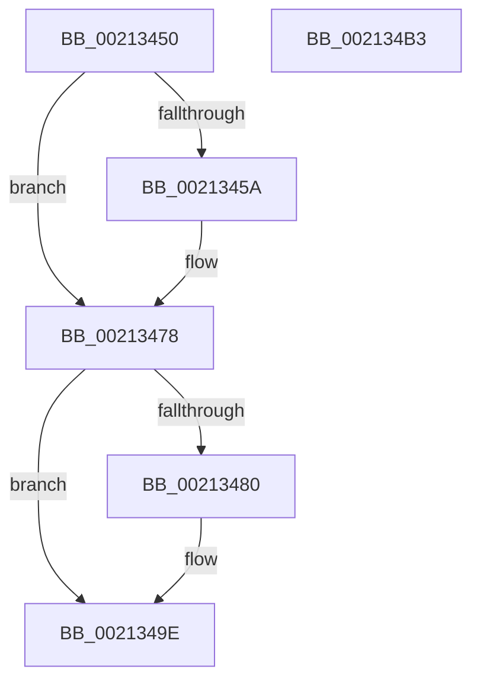

# ExIsFastResourceHeldExclusive

- RVA: `0x00213450`–`0x002134B4` (길이 `100` bytes)
- VA: `0x0000000140213450`
- 실행 섹션: `.text`
- PDB 이름 있음: `예`; PDB Function 태그: `아니요`
- unwind 정보 RVA: `0x0005D2F4`
- 디코드: `26`개 명령, `100/100` bytes 표시
- 미해석 바이트: `0` (있으면 어셈블리에 `.byte`로 보존)

> 이 문서는 커널 이미지의 기계어와 PDB 기호를 분석해 생성했습니다. 4번과 5번은 함수 원형과 자료형을 바이너리 사용 방식에서 추정한 C 해석이며 원본 소스 복구 결과는 아닙니다.

## 1. Dependencies

- 직접 호출 지점: **2**; 고유 호출 대상: **1**
- 직접 호출자로 확인된 함수: **9**
- RIP 상대 이미지 참조: **0**

### Outgoing calls
- `0x00213472` → [KeBugCheckEx](../4F/KeBugCheckEx_function_004FD660.md) (function, `0x004FD660`)
- `0x00213498` → [KeBugCheckEx](../4F/KeBugCheckEx_function_004FD660.md) (function, `0x004FD660`)

### Direct callers
- [sub_00211C19](Unknown_function_00211C19.md) at `0x00211CA7`
- [sub_00213555](Unknown_function_00213555.md) at `0x00213572`
- [sub_00213798](Unknown_function_00213798.md) at `0x002137B5`
- [ExEnterPriorityRegionAndAcquireResourceShared](ExEnterPriorityRegionAndAcquireResourceShared_function_00213870.md) at `0x00213925`
- [sub_00213CA6](Unknown_function_00213CA6.md) at `0x00213CE1`
- [sub_00213CA6](Unknown_function_00213CA6.md) at `0x00213D1A`
- [sub_0025F912](../25/Unknown_function_0025F912.md) at `0x0025F956`
- [SepCanTokenMatchAllPackageSid](../2F/SepCanTokenMatchAllPackageSid_function_002FFE90.md) at `0x002FFFDB`
- [ExpFastResourceLegacyAcquireSharedStarveExclusive](../3B/ExpFastResourceLegacyAcquireSharedStarveExclusive_function_003BDC18.md) at `0x003BDC4B`
- [DifExIsFastResourceHeldExclusiveWrapper](../62/DifExIsFastResourceHeldExclusiveWrapper_function_006213A0.md) at `0x0062146D`

### Static image references
- 디코드된 RIP-relative 메모리 참조가 없습니다.

## 2. Other-region calls and transfers

- 다른 실행 섹션으로 향하는 call: **0**
- 별도 외부 분기/꼬리 이동을 확인하지 못했습니다.

## 3. Assembly (complete function range)

```asm
00213450  48 83 EC 38                     sub rsp, 0x38
00213454  F6 41 1A 01                     test byte ptr [rcx + 0x1a], 1
00213458  75 1E                           jne 0x140213478
0021345A  45 33 C9                        xor r9d, r9d
0021345D  48 C7 44 24 20 00 00 00 00      mov qword ptr [rsp + 0x20], 0
00213466  4C 8B C1                        mov r8, rcx
00213469  B9 C6 01 00 00                  mov ecx, 0x1c6
0021346E  41 8D 51 03                     lea edx, [r9 + 3]
00213472  E8 E9 A1 2E 00                  call 0x1404fd660
00213477  CC                              int3
00213478  44 0F 20 C0                     mov rax, cr8
0021347C  3C 02                           cmp al, 2
0021347E  76 1E                           jbe 0x14021349e
00213480  33 D2                           xor edx, edx
00213482  44 0F B6 C0                     movzx r8d, al
00213486  B9 C6 01 00 00                  mov ecx, 0x1c6
0021348B  48 C7 44 24 20 00 00 00 00      mov qword ptr [rsp + 0x20], 0
00213494  44 8D 4A 02                     lea r9d, [rdx + 2]
00213498  E8 C3 A1 2E 00                  call 0x1404fd660
0021349D  CC                              int3
0021349E  65 48 8B 04 25 88 01 00 00      mov rax, qword ptr gs:[0x188]
002134A7  48 39 41 50                     cmp qword ptr [rcx + 0x50], rax
002134AB  0F 94 C0                        sete al
002134AE  48 83 C4 38                     add rsp, 0x38
002134B2  C3                              ret
002134B3  CC                              int3
```

## 4. C-style interpretation (structured pseudocode)

```c
__int64 __fastcall ExIsFastResourceHeldExclusive(__int64 a1, __int64 a2, __int64 a3, int a4)
{
    __int64 result;
    __int64 v_rsp;
    unsigned __int64 v_stack_m18;

    v_rsp = (v_rsp) - (56);
    if (((*(unsigned __int8 *)(a1 + 26)) & (1)) == 0) {
        a4 = 0;
        v_stack_m18 = 0;
        a3 = a1;
        a1 = 454;
        a2 = a4 + 3;
        result = KeBugCheckEx(a1, a2, a3, a4);
    }
    result = v_cr8;
    if (((unsigned __int8)(v_cr8)) >= = 2) {
        a2 = 0;
        a3 = (unsigned __int8)(v_cr8);
        a1 = 454;
        v_stack_m18 = 0;
        a4 = a2 + 2;
        result = KeBugCheckEx(a1, a2, a3, a4);
    }
    result = ((*(unsigned __int64 *)(a1 + 80)) == (*(unsigned __int64 *)(gs_base + (0 + 392)))) ? 1 : 0;
    v_rsp = (v_rsp) + (56);
    return result;
}
```

## 5. (Beta) C Style

```c
int64_t ExIsFastResourceHeldExclusive(void *Arg1, int64_t Arg2, int64_t Arg3, int32_t Arg4)
{
    uint8_t *arg1 = (uint8_t *)Arg1;

    int64_t result;
    int64_t local_rsp;
    uint64_t v_stack_m18;

    local_rsp = (local_rsp) - (56);
    if (((*(uint8_t *)(arg1 + 0x1A)) & (1)) == 0) {
        Arg4 = 0;
        v_stack_m18 = 0;
        Arg3 = Arg1;
        Arg1 = 454;
        Arg2 = Arg4 + 3;
        result = KeBugCheckEx(Arg1, Arg2, Arg3, Arg4);
    }
    result = v_cr8;
    if (((uint8_t)(v_cr8)) >= = 2) {
        Arg2 = 0;
        Arg3 = (uint8_t)(v_cr8);
        Arg1 = 454;
        v_stack_m18 = 0;
        Arg4 = Arg2 + 2;
        result = KeBugCheckEx(Arg1, Arg2, Arg3, Arg4);
    }
    result = ((*(uint64_t *)(arg1 + 0x50)) == (*(uint64_t *)(gs_base + (0 + 0x188)))) ? 1 : 0;
    local_rsp = (local_rsp) + (56);
    return result;
}
```

### 관측된 메모리 오프셋

구조체 형식이 확인되지 않은 접근은 인자 기준의 오프셋으로만 기록했습니다.

| 기준 인자 | 오프셋 표현 | 폭 (bit) | 접근 |
|---|---:|---:|---|
| `Arg1` | `+ 0x1A` | `8` | `R` |

## 6. Execution-region graph

[열기: 2D/3D 그래프와 함수 탐색 컨트롤 패널](../../../control-panel.html?section=text&rva=0x00213450&view=graph)

- 2D 그래프는 위에서 아래로 흐르고, 3D 그래프는 빈 공간을 드래그해 회전합니다. Shift+드래그는 이동, 휠은 확대·축소, 함수 노드 선택은 대상 보고서 이동입니다.

### Static fallback


