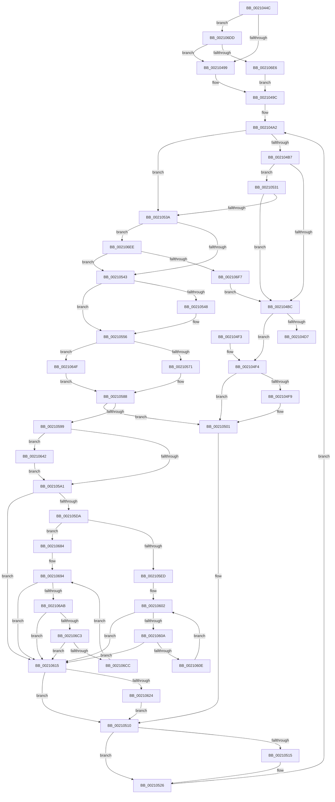

# ExfAcquirePushLockSharedEx

- RVA: `0x0021044C`–`0x002106FC` (길이 `688` bytes)
- VA: `0x000000014021044C`
- 실행 섹션: `.text`
- PDB 이름 있음: `예`; PDB Function 태그: `아니요`
- unwind 정보 RVA: `0x0005DCC0`
- 디코드: `185`개 명령, `688/688` bytes 표시
- 미해석 바이트: `0` (있으면 어셈블리에 `.byte`로 보존)

> 이 문서는 커널 이미지의 기계어와 PDB 기호를 분석해 생성했습니다. 4번과 5번은 함수 원형과 자료형을 바이너리 사용 방식에서 추정한 C 해석이며 원본 소스 복구 결과는 아닙니다.

## 1. Dependencies

- 직접 호출 지점: **7**; 고유 호출 대상: **6**
- 직접 호출자로 확인된 함수: **285**
- RIP 상대 이미지 참조: **2**

### Outgoing calls
- `0x0021047D` → [memset](../6C/memset_function_006C6C40.md) (function, `0x006C6C40`)
- `0x002104FC` → [KeAbPreWait](../20/KeAbPreWait_function_0020E560.md) (function, `0x0020E560`)
- `0x00210505` → [RtlBackoff](../20/RtlBackoff_function_00208620.md) (function, `0x00208620`)
- `0x0021051E` → [KeAbPreAcquire](KeAbPreAcquire_function_00210230.md) (function, `0x00210230`)
- `0x0021054B` → [KeAbPreWait](../20/KeAbPreWait_function_0020E560.md) (function, `0x0020E560`)
- `0x00210638` → [KeWaitForSingleObject](../20/KeWaitForSingleObject_function_0020E6B0.md) (function, `0x0020E6B0`)
- `0x00210645` → [ExpOptimizePushLockList](../45/ExpOptimizePushLockList_function_004574DC.md) (function, `0x004574DC`)

### Direct callers
- [ExAcquireCacheAwarePushLockSharedEx](../20/ExAcquireCacheAwarePushLockSharedEx_function_0020FA40.md) at `0x0020FAAC`
- [sub_0020FB28](../20/Unknown_function_0020FB28.md) at `0x0020FB64`
- [sub_0020FB95](../20/Unknown_function_0020FB95.md) at `0x0020FBF4`
- [sub_00210015](Unknown_function_00210015.md) at `0x0021004A`
- [ExAcquirePushLockSharedEx](ExAcquirePushLockSharedEx_function_002103C0.md) at `0x00210422`
- [CcFlushCacheOneRange](../23/CcFlushCacheOneRange_function_00236A30.md) at `0x00236B23`
- [FsRtlAcquireAutoExpandPushLockShared](../26/FsRtlAcquireAutoExpandPushLockShared_function_002642D0.md) at `0x00264323`
- [FsRtlAcquireAutoExpandPushLockShared](../26/FsRtlAcquireAutoExpandPushLockShared_function_002642D0.md) at `0x002643AC`
- [MiLockLoaderEntry](../2A/MiLockLoaderEntry_function_002A3EE0.md) at `0x002A3F43`
- [LOCK_ADDRESS_SPACE_SHARED](../2A/LOCK_ADDRESS_SPACE_SHARED_function_002A8B3C.md) at `0x002A8B86`
- [PopPepWork](../2B/PopPepWork_function_002BCBC0.md) at `0x002BCC3E`
- [PopAcquireRwLockShared](../2D/PopAcquireRwLockShared_function_002D9A40.md) at `0x002D9A84`
- [PoGetIdleTimes](../2D/PoGetIdleTimes_function_002DF570.md) at `0x002DF673`
- [sub_002E087E](../2E/Unknown_function_002E087E.md) at `0x002E0965`
- [MiTrimSharedPageFromViews](../2E/MiTrimSharedPageFromViews_function_002E16F8.md) at `0x002E18BC`
- [ExpSaAllocatorFree](../2E/ExpSaAllocatorFree_function_002E2E00.md) at `0x002E2E61`
- [RtlpCSparseBitmapPageCommit](../2F/RtlpCSparseBitmapPageCommit_function_002F0B98.md) at `0x002F0D95`
- [InsertEventEntryInLookUpTable](../2F/InsertEventEntryInLookUpTable_function_002F1424.md) at `0x002F1623`
- [RtlpLookupDynamicUserFunctionTable](../2F/RtlpLookupDynamicUserFunctionTable_function_002F333C.md) at `0x002F33B9`
- [MiLockVadShared](../31/MiLockVadShared_function_00316DE0.md) at `0x00316E27`
- [CcGetVirtualAddress](../34/CcGetVirtualAddress_function_00340C9C.md) at `0x00340D8D`
- [SmpKeyedStoreReference](../34/SmpKeyedStoreReference_function_003499CC.md) at `0x00349A20`
- [sub_0034A18B](../34/Unknown_function_0034A18B.md) at `0x0034A1C9`
- [StLockAcquireShared](../34/StLockAcquireShared_function_0034C728.md) at `0x0034C76C`
- [MiWalkEntireImage](../36/MiWalkEntireImage_function_00365D70.md) at `0x00366988`
- [SepRmReferenceCapTable](../3A/SepRmReferenceCapTable_function_003A537C.md) at `0x003A53D0`
- [ExpSaAllocatorAllocate](../3B/ExpSaAllocatorAllocate_function_003B402C.md) at `0x003B407F`
- [MiLockDynamicMemoryShared](../3B/MiLockDynamicMemoryShared_function_003B8AA8.md) at `0x003B8AEA`
- [PspLockThreadSecurityShared](../3C/PspLockThreadSecurityShared_function_003C4720.md) at `0x003C477A`
- [PspLockProcessThreadListShared](../3E/PspLockProcessThreadListShared_function_003ECBA0.md) at `0x003ECBE2`
- [PspLockProcessShared](../40/PspLockProcessShared_function_004016D0.md) at `0x00401712`
- [ExfAcquireCacheAwarePushLockSharedEx](../41/ExfAcquireCacheAwarePushLockSharedEx_function_00418DE0.md) at `0x00418E06`
- [PspLockProcessListShared](../41/PspLockProcessListShared_function_0041BAB0.md) at `0x0041BAF7`
- [PopFxStopDeviceAccounting](../42/PopFxStopDeviceAccounting_function_004261D8.md) at `0x0042628E`
- [PopDiagTraceFxRundown](../43/PopDiagTraceFxRundown_function_0043A028.md) at `0x0043A092`
- [PopDiagTraceFxRundown](../43/PopDiagTraceFxRundown_function_0043A028.md) at `0x0043A140`
- [PopFxPauseDeviceAccounting](../43/PopFxPauseDeviceAccounting_function_0043D0C8.md) at `0x0043D123`
- [PopFxResumeDeviceAccounting](../43/PopFxResumeDeviceAccounting_function_0043D4D8.md) at `0x0043D539`
- [ExfAcquirePushLockShared](../44/ExfAcquirePushLockShared_function_004483B0.md) at `0x004483BC`
- [MI_LOCK_RELOCATIONS_SHARED](../44/MI_LOCK_RELOCATIONS_SHARED_function_0044A848.md) at `0x0044A887`
- [CcSlowReferenceSharedCacheMapFileObject](../45/CcSlowReferenceSharedCacheMapFileObject_function_00458C10.md) at `0x00458C58`
- [PopPepIdleTimeoutRoutine](../45/PopPepIdleTimeoutRoutine_function_00458E10.md) at `0x00458E7E`
- [RtlpHpAcquireLockShared](../46/RtlpHpAcquireLockShared_function_0046205C.md) at `0x004620A4`
- [PopFxResidentTimeoutRoutine](../46/PopFxResidentTimeoutRoutine_function_00462650.md) at `0x004626AD`
- [PoFxSystemLatencyNotify](../46/PoFxSystemLatencyNotify_function_0046A15C.md) at `0x0046A1BC`
- [MiFinishResume](../47/MiFinishResume_function_0047F9C0.md) at `0x0047FA1F`
- [MiSendParkedCoreUpdateToAllChildPartitions](../47/MiSendParkedCoreUpdateToAllChildPartitions_function_0047FAC0.md) at `0x0047FB26`
- [FsRtlAcquirePushLockShared](../48/FsRtlAcquirePushLockShared_function_0048B034.md) at `0x0048B078`
- [MmCheckProcessShadow](../49/MmCheckProcessShadow_function_004931C0.md) at `0x00493228`
- [PoFxPrepareDevice](../49/PoFxPrepareDevice_function_00499F0C.md) at `0x00499FDA`
- [ExpAcquirePoolListLockShared](../49/ExpAcquirePoolListLockShared_function_0049C5D8.md) at `0x0049C628`
- [PspLockQuotaListShared](../49/PspLockQuotaListShared_function_0049F3E4.md) at `0x0049F422`
- [PopFxActivateDevicesForSx](../4A/PopFxActivateDevicesForSx_function_004A0CAC.md) at `0x004A0D08`
- [PopFxStartDeviceAccounting](../4A/PopFxStartDeviceAccounting_function_004A384C.md) at `0x004A38BC`
- [PspLockProcessSharedUnsafe](../4A/PspLockProcessSharedUnsafe_function_004AD874.md) at `0x004AD8AE`
- [ExpLockCallbackListShared](../4B/ExpLockCallbackListShared_function_004B1460.md) at `0x004B14A7`
- [PopFxIdleDevicesFromSx](../4B/PopFxIdleDevicesFromSx_function_004B2FB4.md) at `0x004B3010`
- [PoFxStartDevicePowerManagement](../4B/PoFxStartDevicePowerManagement_function_004B5740.md) at `0x004B57D0`
- [sub_004BA83C](../4B/Unknown_function_004BA83C.md) at `0x004BA8B5`
- [PopFxFindAcpiDeviceByUniqueId](../4C/PopFxFindAcpiDeviceByUniqueId_function_004C5C30.md) at `0x004C5CA1`
- [PopFxFindAndReferenceAcpiDevice](../4C/PopFxFindAndReferenceAcpiDevice_function_004C76E0.md) at `0x004C7744`
- [PopFxLowPowerEpochCallback](../4C/PopFxLowPowerEpochCallback_function_004CBC10.md) at `0x004CBCB0`
- [CcGetNumberOfMappedPages](../4C/CcGetNumberOfMappedPages_function_004CCB50.md) at `0x004CCBAE`
- [PopFxRegisterDeviceWithPep](../4C/PopFxRegisterDeviceWithPep_function_004CF794.md) at `0x004CF824`
- [SmHwAcceleratorPartitionMgrFreeDescriptor](../4D/SmHwAcceleratorPartitionMgrFreeDescriptor_function_004D7918.md) at `0x004D7980`
- [PspAcquirePushLockShared](../4F/PspAcquirePushLockShared_function_004F6134.md) at `0x004F6184`
- [IommuProcessPageRequestQueue](../56/IommuProcessPageRequestQueue_function_00565BA0.md) at `0x00565C3F`
- [KeQueryDpcWatchdogConfiguration](../5B/KeQueryDpcWatchdogConfiguration_function_005B5800.md) at `0x005B58AF`
- [KiAvailableCpusPartitionWorkItemCallback](../5B/KiAvailableCpusPartitionWorkItemCallback_function_005B9990.md) at `0x005B99EA`
- [PopFxDisableBasicAccountingWorker](../5D/PopFxDisableBasicAccountingWorker_function_005D28D0.md) at `0x005D2930`
- [PopPepIterateDeviceList](../5D/PopPepIterateDeviceList_function_005DCC84.md) at `0x005DCCFD`
- [PopPepPlatformStateRegistered](../5D/PopPepPlatformStateRegistered_function_005DCDB8.md) at `0x005DCE30`
- [PopPepPlatformStateRegistered](../5D/PopPepPlatformStateRegistered_function_005DCDB8.md) at `0x005DCF47`
- [PopFxAcpiPrepareDevice](../5D/PopFxAcpiPrepareDevice_function_005DD5F4.md) at `0x005DD67B`
- [PspLookupSyscallProviderById](../5E/PspLookupSyscallProviderById_function_005E237C.md) at `0x005E23D8`
- [PspSetProcessTimerDelayForWin32](../5E/PspSetProcessTimerDelayForWin32_function_005E3DB8.md) at `0x005E3E07`
- [SepSetTokenAntiTamperEntry](../60/SepSetTokenAntiTamperEntry_function_0060B28C.md) at `0x0060B32E`
- [SepSetTokenLowboxNumberEntry](../60/SepSetTokenLowboxNumberEntry_function_0060B594.md) at `0x0060B631`
- [SmKmVirtualLockCtxLockMemory](../61/SmKmVirtualLockCtxLockMemory_function_0061000C.md) at `0x0061006B`
- [SmGetStoreOwnerProcessId](../61/SmGetStoreOwnerProcessId_function_00610E4C.md) at `0x00610EF8`
- [DifExfAcquirePushLockSharedWrapper](../62/DifExfAcquirePushLockSharedWrapper_function_00623AD0.md) at `0x00623B9E`
- [EtwpGetCompressionSettings](../65/EtwpGetCompressionSettings_function_006535A8.md) at `0x00653622`
- [MiMarkHugePfnBad](../67/MiMarkHugePfnBad_function_00676744.md) at `0x006767D8`
- [sub_006D969C](../6D/Unknown_function_006D969C.md) at `0x006D96E3`
- [sub_006D969C](../6D/Unknown_function_006D969C.md) at `0x006D9927`
- [sub_006E3418](../6E/Unknown_function_006E3418.md) at `0x006E34D4`
- [sub_006F2710](../6F/Unknown_function_006F2710.md) at `0x006F275A`
- [CmpLockGlobalKeyLockTrackerShared](../../page/6F/CmpLockGlobalKeyLockTrackerShared_function_006FE23C.md) at `0x006FE28C`
- [ExpWatchProductTypeWork](../../page/6F/ExpWatchProductTypeWork_function_006FFCA0.md) at `0x006FFD82`
- [KiAvailableCpusProcessWorkItemCallback](../../page/74/KiAvailableCpusProcessWorkItemCallback_function_00746140.md) at `0x00746185`
- [AlpcpPortQueryServerInfo](../../page/74/AlpcpPortQueryServerInfo_function_0074C784.md) at `0x0074C8F2`
- [AlpcpPortQueryServerInfo](../../page/74/AlpcpPortQueryServerInfo_function_0074C784.md) at `0x0074C9C7`
- [ObIsDosDeviceLocallyMapped](../../page/74/ObIsDosDeviceLocallyMapped_function_0074EAB0.md) at `0x0074EB1C`
- [PspGetNextSyscallProviderProcess](../../page/77/PspGetNextSyscallProviderProcess_function_0077E598.md) at `0x0077E5FB`
- [PspSetProcessAffinityUpdateMode](../../page/78/PspSetProcessAffinityUpdateMode_function_007828D8.md) at `0x007829CF`
- [PspUpdateSingleProcessAffinity](../../page/78/PspUpdateSingleProcessAffinity_function_00782B00.md) at `0x00782B6A`
- [PsTerminateVsmEnclave](../../page/78/PsTerminateVsmEnclave_function_00788A64.md) at `0x00788AE4`
- [SepIsValidProcUniqueLuid](../../page/7A/SepIsValidProcUniqueLuid_function_007A28B0.md) at `0x007A2910`
- [SepDereferenceAntiTamperEntry](../../page/7A/SepDereferenceAntiTamperEntry_function_007A2E50.md) at `0x007A2EE1`
- [SepIsParentOfChildAppContainer](../../page/7A/SepIsParentOfChildAppContainer_function_007A34C0.md) at `0x007A3572`
- [SmKmKeyGenGenerate](../../page/7A/SmKmKeyGenGenerate_function_007A85CC.md) at `0x007A862C`
- [SmEtwEnableCallback](../../page/7A/SmEtwEnableCallback_function_007AA080.md) at `0x007AA100`
- [SmcGetCacheStats](../../page/7A/SmcGetCacheStats_function_007ABE0C.md) at `0x007ABF09`
- [EtwCleanupSiloState](../../page/7B/EtwCleanupSiloState_function_007B4B9C.md) at `0x007B4C40`
- [ExpGetSystemPlatformBinary](../../page/7C/ExpGetSystemPlatformBinary_function_007C3C18.md) at `0x007C3D02`
- [ExFetchLicenseData](../../page/7C/ExFetchLicenseData_function_007C7780.md) at `0x007C781D`
- [ExGetLicenseTamperState](../../page/7C/ExGetLicenseTamperState_function_007C7A30.md) at `0x007C7A9D`
- [sub_007C7FB0](../../page/7C/Unknown_function_007C7FB0.md) at `0x007C8038`
- [sub_007C87A4](../../page/7C/Unknown_function_007C87A4.md) at `0x007C8820`
- [sub_007C8D5C](../../page/7C/Unknown_function_007C8D5C.md) at `0x007C8DCE`
- [SLGetSubscriptionPfn](../../page/7C/SLGetSubscriptionPfn_function_007C9108.md) at `0x007C930D`
- [SLQueryLicenseValueInternal](../../page/7C/SLQueryLicenseValueInternal_function_007C93EC.md) at `0x007C9650`
- [SLUpdateLicenseDataInternal](../../page/7C/SLUpdateLicenseDataInternal_function_007C9C04.md) at `0x007C9D9E`
- [SLUpdateLicenseDataInternal](../../page/7C/SLUpdateLicenseDataInternal_function_007C9C04.md) at `0x007CA27D`
- [SLUpdateLicenseDataInternal](../../page/7C/SLUpdateLicenseDataInternal_function_007C9C04.md) at `0x007CA3C8`
- [ExRegisterExtension](../../page/7D/ExRegisterExtension_function_007D0420.md) at `0x007D04AC`
- [ExpKdPullRemoteFileForUser](../../page/7D/ExpKdPullRemoteFileForUser_function_007D15AC.md) at `0x007D176C`
- [MmEnumerateBadPages](../../page/7F/MmEnumerateBadPages_function_007FDE28.md) at `0x007FDEBA`
- [MiIsExtentDangling](../../page/80/MiIsExtentDangling_function_008010A0.md) at `0x00801169`
- [MiGetAllRegisteredPatches](../../page/80/MiGetAllRegisteredPatches_function_0080367C.md) at `0x00803721`
- [MiLogHotPatchRundown](../../page/80/MiLogHotPatchRundown_function_008057A4.md) at `0x00805859`
- [MiLogHotPatchRundown](../../page/80/MiLogHotPatchRundown_function_008057A4.md) at `0x008060B0`
- [MiOpenSpecialPurposeMemory](../../page/80/MiOpenSpecialPurposeMemory_function_0080FA28.md) at `0x0080FAE0`
- [MiQuerySpecialPurposeMemoryInformation](../../page/80/MiQuerySpecialPurposeMemoryInformation_function_0080FBC8.md) at `0x0080FCA4`
- [NtDeleteKey](../../page/84/NtDeleteKey_function_00849920.md) at `0x00849ADA`
- [CmpLockHiveListShared](../../page/84/CmpLockHiveListShared_function_0084E3C8.md) at `0x0084E407`
- [HvLockHiveFlusherShared](../../page/84/HvLockHiveFlusherShared_function_0084F95C.md) at `0x0084F993`
- [CmpPerformCompleteKcbCacheLookup](../../page/84/CmpPerformCompleteKcbCacheLookup_function_0084FD20.md) at `0x0084FE44`
- [CmpCreateKeyControlBlock](../../page/85/CmpCreateKeyControlBlock_function_00851DB0.md) at `0x008520FA`
- [CmpWalkOneLevel](../../page/85/CmpWalkOneLevel_function_00852BA0.md) at `0x00852EAD`
- [sub_008564EC](../../page/85/Unknown_function_008564EC.md) at `0x0085652E`
- [sub_0085E709](../../page/85/Unknown_function_0085E709.md) at `0x0085E7A8`
- [CmpCallCallBacksEx](../../page/86/CmpCallCallBacksEx_function_00865F40.md) at `0x00866035`
- [CmpCallCallBacksEx](../../page/86/CmpCallCallBacksEx_function_00865F40.md) at `0x0086664A`
- [CmpCallbackFillObjectContext](../../page/86/CmpCallbackFillObjectContext_function_00866A10.md) at `0x00866B19`
- [CmpCallbackFillObjectContext](../../page/86/CmpCallbackFillObjectContext_function_00866A10.md) at `0x00866C55`
- [CmpCallbackFillObjectContext](../../page/86/CmpCallbackFillObjectContext_function_00866A10.md) at `0x00866CEB`
- [CmpCallbackFillObjectContext](../../page/86/CmpCallbackFillObjectContext_function_00866A10.md) at `0x00866D81`
- [CmpCallbackFillObjectContext](../../page/86/CmpCallbackFillObjectContext_function_00866A10.md) at `0x00866E30`
- [CmpCallbackFillObjectContext](../../page/86/CmpCallbackFillObjectContext_function_00866A10.md) at `0x00867042`
- [CmpCallbackFillObjectContext](../../page/86/CmpCallbackFillObjectContext_function_00866A10.md) at `0x008670E8`
- [CmpCallbackFillObjectContext](../../page/86/CmpCallbackFillObjectContext_function_00866A10.md) at `0x008671D9`
- [ObpCreateHandle](../../page/86/ObpCreateHandle_function_0086B950.md) at `0x0086C87B`
- [ObpCreateHandle](../../page/86/ObpCreateHandle_function_0086B950.md) at `0x0086C9DB`
- [ObpReferenceSecurityDescriptorSlow](../../page/87/ObpReferenceSecurityDescriptorSlow_function_0087484C.md) at `0x00874911`
- [CmpVolumeContextLockShared](../../page/87/CmpVolumeContextLockShared_function_0087BE04.md) at `0x0087BE3B`
- [NtAreMappedFilesTheSame](../../page/87/NtAreMappedFilesTheSame_function_0087EC70.md) at `0x0087ED34`
- [NtAreMappedFilesTheSame](../../page/87/NtAreMappedFilesTheSame_function_0087EC70.md) at `0x0087EE66`
- [MiIsRangeFullyCommitted](../../page/88/MiIsRangeFullyCommitted_function_00881E24.md) at `0x00881EE0`
- [AlpcpCreateSectionView](../../page/88/AlpcpCreateSectionView_function_0088850C.md) at `0x008885A1`
- [AlpcpLocateSectionView](../../page/88/AlpcpLocateSectionView_function_00889754.md) at `0x008897BD`
- [AlpcpLocateSectionView](../../page/88/AlpcpLocateSectionView_function_00889754.md) at `0x008897F1`
- [sub_00889F27](../../page/88/Unknown_function_00889F27.md) at `0x00889F5D`
- [AlpcpSendMessage](../../page/88/AlpcpSendMessage_function_0088BD40.md) at `0x0088CC3C`
- [PspChargeProcessWakeCounter](../../page/88/PspChargeProcessWakeCounter_function_0088D2A0.md) at `0x0088D33C`
- [sub_0088D871](../../page/88/Unknown_function_0088D871.md) at `0x0088DAAD`
- [sub_0088DBCA](../../page/88/Unknown_function_0088DBCA.md) at `0x0088DC31`
- [AlpcpDispatchNewMessage](../../page/88/AlpcpDispatchNewMessage_function_0088DD20.md) at `0x0088DDA3`
- [AlpcpDispatchNewMessage](../../page/88/AlpcpDispatchNewMessage_function_0088DD20.md) at `0x0088DE38`
- [AlpcpDispatchNewMessage](../../page/88/AlpcpDispatchNewMessage_function_0088DD20.md) at `0x0088DE85`
- [AlpcpDispatchReplyToPort](../../page/88/AlpcpDispatchReplyToPort_function_0088F880.md) at `0x0088F906`
- [AlpcpDispatchReplyToPort](../../page/88/AlpcpDispatchReplyToPort_function_0088F880.md) at `0x0088FB20`
- [AlpcpDispatchReplyToPort](../../page/88/AlpcpDispatchReplyToPort_function_0088F880.md) at `0x0088FBCA`
- [AlpcpDispatchReplyToPort](../../page/88/AlpcpDispatchReplyToPort_function_0088F880.md) at `0x0088FCFA`
- [AlpcpReferenceAndLockTargetPortsAndCommunicationInfo](../../page/88/AlpcpReferenceAndLockTargetPortsAndCommunicationInfo_function_0088FEE0.md) at `0x0088FF3A`
- [sub_0088FF99](../../page/88/Unknown_function_0088FF99.md) at `0x0088FFCF`
- [sub_0088FF99](../../page/88/Unknown_function_0088FF99.md) at `0x00890016`
- [AlpcpEnumerateResourcesPort](../../page/89/AlpcpEnumerateResourcesPort_function_00890424.md) at `0x00890475`
- [AlpcpCaptureSecurityAttribute](../../page/89/AlpcpCaptureSecurityAttribute_function_00890540.md) at `0x00890682`
- [sub_00890994](../../page/89/Unknown_function_00890994.md) at `0x008909CD`
- [AlpcpCreateSecurityContext](../../page/89/AlpcpCreateSecurityContext_function_00890D94.md) at `0x00890F9C`
- [AlpcpCreateReserve](../../page/89/AlpcpCreateReserve_function_00892318.md) at `0x00892497`
- [AlpcpCreateSection](../../page/89/AlpcpCreateSection_function_0089307C.md) at `0x008931CE`
- [AlpcpCancelMessage](../../page/89/AlpcpCancelMessage_function_00894120.md) at `0x008941D7`
- [AlpcpCancelMessage](../../page/89/AlpcpCancelMessage_function_00894120.md) at `0x0089428C`
- [AlpcpCancelMessage](../../page/89/AlpcpCancelMessage_function_00894120.md) at `0x00894576`
- [AlpcpReceiveDirectMessagePort](../../page/89/AlpcpReceiveDirectMessagePort_function_008950B4.md) at `0x00895157`
- [NtAlpcOpenSenderProcess](../../page/89/NtAlpcOpenSenderProcess_function_008953B0.md) at `0x0089570B`
- [AlpcpReceiveLegacyMessage](../../page/89/AlpcpReceiveLegacyMessage_function_00895DE0.md) at `0x008960BB`
- [AlpcpReceiveMessagePort](../../page/89/AlpcpReceiveMessagePort_function_00896B40.md) at `0x00896BB4`
- [ObpLookupObjectName](../../page/89/ObpLookupObjectName_function_0089BE90.md) at `0x0089C311`
- [ObpLookupObjectName](../../page/89/ObpLookupObjectName_function_0089BE90.md) at `0x0089C9EB`
- [ObpLookupObjectName](../../page/89/ObpLookupObjectName_function_0089BE90.md) at `0x0089CF2A`
- [ObpLookupObjectName](../../page/89/ObpLookupObjectName_function_0089BE90.md) at `0x0089D53F`
- [ObpLookupObjectName](../../page/89/ObpLookupObjectName_function_0089BE90.md) at `0x0089D67E`
- [ObpLookupObjectName](../../page/89/ObpLookupObjectName_function_0089BE90.md) at `0x0089DC0B`
- [ExpSnapShotHandleTables](../../page/8A/ExpSnapShotHandleTables_function_008A25C0.md) at `0x008A2678`
- [PsGetProcessDeepFreezeStats](../../page/8A/PsGetProcessDeepFreezeStats_function_008A375C.md) at `0x008A37B6`
- [NtQueryObject](../../page/8A/NtQueryObject_function_008A6DB0.md) at `0x008A713E`
- [NtQueryObject](../../page/8A/NtQueryObject_function_008A6DB0.md) at `0x008A7317`
- [ObQueryNameStringMode](../../page/8A/ObQueryNameStringMode_function_008A7ED0.md) at `0x008A80B8`
- [ObQueryNameStringMode](../../page/8A/ObQueryNameStringMode_function_008A7ED0.md) at `0x008A81F5`
- [ObQueryNameStringMode](../../page/8A/ObQueryNameStringMode_function_008A7ED0.md) at `0x008A84B4`
- [ObQueryNameStringMode](../../page/8A/ObQueryNameStringMode_function_008A7ED0.md) at `0x008A85F7`
- [sub_008BA32C](../../page/8B/Unknown_function_008BA32C.md) at `0x008BA4A1`
- [sub_008BA32C](../../page/8B/Unknown_function_008BA32C.md) at `0x008BA593`
- [ObSetSecurityDescriptorInfo](../../page/8B/ObSetSecurityDescriptorInfo_function_008BAE20.md) at `0x008BAF8D`
- [ObLogSecurityDescriptor](../../page/8C/ObLogSecurityDescriptor_function_008C0020.md) at `0x008C0172`
- [EtwpReferenceLoggerSecurityDescriptor](../../page/8C/EtwpReferenceLoggerSecurityDescriptor_function_008C0810.md) at `0x008C08CD`
- [EtwpFindOrCreateGuidEntry](../../page/8C/EtwpFindOrCreateGuidEntry_function_008C1B70.md) at `0x008C1C06`
- [EtwpFindGuidEntryByGuid](../../page/8C/EtwpFindGuidEntryByGuid_function_008C1DB0.md) at `0x008C1E40`
- [sub_008C2328](../../page/8C/Unknown_function_008C2328.md) at `0x008C23BC`
- [EtwpGetGuidList](../../page/8C/EtwpGetGuidList_function_008C2F00.md) at `0x008C3013`
- [EtwpGetNextGuidEntry](../../page/8C/EtwpGetNextGuidEntry_function_008C3170.md) at `0x008C3214`
- [ObpCallPreOperationCallbacks](../../page/8C/ObpCallPreOperationCallbacks_function_008C6570.md) at `0x008C6618`
- [ObpCallPreOperationCallbacks](../../page/8C/ObpCallPreOperationCallbacks_function_008C6570.md) at `0x008C675F`
- [PsGetNextProcessThread](../../page/8C/PsGetNextProcessThread_function_008C9CF0.md) at `0x008C9D61`
- [sub_008D2420](../../page/8D/Unknown_function_008D2420.md) at `0x008D2479`
- [sub_008D2F2C](../../page/8D/Unknown_function_008D2F2C.md) at `0x008D2FA5`
- [sub_008D379C](../../page/8D/Unknown_function_008D379C.md) at `0x008D3810`
- [sub_008D3AAB](../../page/8D/Unknown_function_008D3AAB.md) at `0x008D3B14`
- [PspReferenceSystemDll](../../page/8D/PspReferenceSystemDll_function_008D6AD8.md) at `0x008D6B66`
- [EtwpCovSampContextGetModule](../../page/8D/EtwpCovSampContextGetModule_function_008D7FEC.md) at `0x008D814F`
- [RtlFindDynamicEnforcedAddressInRanges](../../page/8D/RtlFindDynamicEnforcedAddressInRanges_function_008D9B84.md) at `0x008D9BF1`
- [EtwpCovSampContextPruneModules](../../page/8D/EtwpCovSampContextPruneModules_function_008DA03C.md) at `0x008DA10D`
- [PiDmObjectAcquireSharedLock](../../page/8E/PiDmObjectAcquireSharedLock_function_008E38B8.md) at `0x008E38FC`
- [sub_008E41B3](../../page/8E/Unknown_function_008E41B3.md) at `0x008E43C2`
- [sub_008E48BF](../../page/8E/Unknown_function_008E48BF.md) at `0x008E4925`
- [sub_008F346A](../../page/8F/Unknown_function_008F346A.md) at `0x008F3502`
- [sub_00907768](../../page/90/Unknown_function_00907768.md) at `0x009077CB`
- [ExpWnfLookupNameInstance](../../page/90/ExpWnfLookupNameInstance_function_00908C70.md) at `0x00908CBF`
- [ExpWnfAcquireSubscriptionByName](../../page/90/ExpWnfAcquireSubscriptionByName_function_00908D7C.md) at `0x00908DC7`
- [ExpWnfDeliverThreadNotifications](../../page/90/ExpWnfDeliverThreadNotifications_function_00909630.md) at `0x009096B5`
- [ExpWnfCompleteThreadSubscriptions](../../page/90/ExpWnfCompleteThreadSubscriptions_function_00909A10.md) at `0x00909A84`
- [ExpWnfReadStateData](../../page/90/ExpWnfReadStateData_function_00909C50.md) at `0x00909CAB`
- [NtQueryWnfStateData](../../page/90/NtQueryWnfStateData_function_00909DF0.md) at `0x0090A2D4`
- [ExpNtUpdateWnfStateData](../../page/90/ExpNtUpdateWnfStateData_function_0090A7A0.md) at `0x0090ABF5`
- [ExpNtUpdateWnfStateData](../../page/90/ExpNtUpdateWnfStateData_function_0090A7A0.md) at `0x0090B1C0`
- [sub_0090B43E](../../page/90/Unknown_function_0090B43E.md) at `0x0090B4D8`
- [ExpWnfNotifyNameSubscribers](../../page/90/ExpWnfNotifyNameSubscribers_function_0090C160.md) at `0x0090C1C8`
- [ExpWnfDispatchKernelSubscription](../../page/90/ExpWnfDispatchKernelSubscription_function_0090C520.md) at `0x0090C69D`
- [PsQueryStatisticsProcess](../../page/91/PsQueryStatisticsProcess_function_00919350.md) at `0x009193C2`
- [sub_0091A0A7](../../page/91/Unknown_function_0091A0A7.md) at `0x0091A114`
- [PspLockJobMemoryLimitsShared](../../page/91/PspLockJobMemoryLimitsShared_function_0091A394.md) at `0x0091A3DB`
- [sub_0091BCD9](../../page/91/Unknown_function_0091BCD9.md) at `0x0091BD21`
- [PfpPrivSourceEnum](../../page/91/PfpPrivSourceEnum_function_0091BF00.md) at `0x0091C351`
- [PsGetNextProcess](../../page/91/PsGetNextProcess_function_0091C900.md) at `0x0091C972`
- [ExGetNextProcess](../../page/91/ExGetNextProcess_function_0091CAD0.md) at `0x0091CB4D`
- [DbgkpSendErrorMessage](../../page/92/DbgkpSendErrorMessage_function_009210A8.md) at `0x00921248`
- [AlpcpProcessSynchronousRequest](../../page/92/AlpcpProcessSynchronousRequest_function_00921FCC.md) at `0x0092243D`
- [AlpcpReceiveSynchronousReply](../../page/92/AlpcpReceiveSynchronousReply_function_009224F0.md) at `0x009226C8`
- [AlpcpDispatchConnectionRequest](../../page/92/AlpcpDispatchConnectionRequest_function_0092353C.md) at `0x009235A3`
- [AlpcpDispatchConnectionRequest](../../page/92/AlpcpDispatchConnectionRequest_function_0092353C.md) at `0x0092361A`
- [AlpcpSendLegacySynchronousRequest](../../page/92/AlpcpSendLegacySynchronousRequest_function_0092376C.md) at `0x009239BA`
- [AlpcpSendLegacySynchronousRequest](../../page/92/AlpcpSendLegacySynchronousRequest_function_0092376C.md) at `0x00923A20`
- [AlpcpSendLegacySynchronousRequest](../../page/92/AlpcpSendLegacySynchronousRequest_function_0092376C.md) at `0x00923AA1`
- [AlpcpDisconnectPort](../../page/92/AlpcpDisconnectPort_function_00924A68.md) at `0x00924CF3`
- [AlpcpFlushMessagesPort](../../page/92/AlpcpFlushMessagesPort_function_00925554.md) at `0x00925759`
- [AlpcpCreateClientPort](../../page/92/AlpcpCreateClientPort_function_009270AC.md) at `0x009271A0`
- [sub_009330DC](../../page/93/Unknown_function_009330DC.md) at `0x00933183`
- [VrpLockJobContextShared](../../page/93/VrpLockJobContextShared_function_009349E8.md) at `0x00934A30`
- [sub_0093691A](../../page/93/Unknown_function_0093691A.md) at `0x00936985`
- [sub_0093691A](../../page/93/Unknown_function_0093691A.md) at `0x009369D8`
- [VrpLockDiffHiveTableShared](../../page/93/VrpLockDiffHiveTableShared_function_00936EA4.md) at `0x00936EF4`
- [MiRelocateImagePfn](../../page/93/MiRelocateImagePfn_function_0093F2A8.md) at `0x0093F44E`
- [sub_0094D6C0](../../page/94/Unknown_function_0094D6C0.md) at `0x0094D6FC`
- [EtwpCoverageSamplerQuery](../../page/95/EtwpCoverageSamplerQuery_function_0095C4A0.md) at `0x0095C709`
- [sub_00967060](../../page/96/Unknown_function_00967060.md) at `0x009670B3`
- [ObQueryDeviceMapInformation](../../page/96/ObQueryDeviceMapInformation_function_0096C5C0.md) at `0x0096C695`
- [ObpReferenceCurrentDeviceMap](../../page/96/ObpReferenceCurrentDeviceMap_function_0096CBD0.md) at `0x0096CD75`
- [sub_0096D1EB](../../page/96/Unknown_function_0096D1EB.md) at `0x0096D23D`
- [CmpLockHashEntryShared](../../page/97/CmpLockHashEntryShared_function_0097B060.md) at `0x0097B0D6`
- [CmpLockContextListShared](../../page/99/CmpLockContextListShared_function_0099E6C0.md) at `0x0099E710`
- [CmpLockCallbackListShared](../../page/99/CmpLockCallbackListShared_function_0099E9B0.md) at `0x0099EA00`
- [ObpLockDirectoryShared](../../page/99/ObpLockDirectoryShared_function_0099EF20.md) at `0x0099EF72`
- [sub_009A03AC](../../page/9A/Unknown_function_009A03AC.md) at `0x009A0418`
- [sub_009A09B8](../../page/9A/Unknown_function_009A09B8.md) at `0x009A0A40`
- [sub_009A17F0](../../page/9A/Unknown_function_009A17F0.md) at `0x009A185F`
- [sub_009A732C](../../page/9A/Unknown_function_009A732C.md) at `0x009A7486`
- [sub_009A732C](../../page/9A/Unknown_function_009A732C.md) at `0x009A756F`
- [AlpcpPortQueryServerSessionInfo](../../page/9C/AlpcpPortQueryServerSessionInfo_function_009CAB0C.md) at `0x009CAB78`
- [AlpcpPortQueryConnectedSidInfo](../../page/9C/AlpcpPortQueryConnectedSidInfo_function_009CAC3C.md) at `0x009CACF5`
- [sub_009CB064](../../page/9C/Unknown_function_009CB064.md) at `0x009CB0A1`
- [ExpWnfSubscribeNameInstance](../../page/9D/ExpWnfSubscribeNameInstance_function_009D50E8.md) at `0x009D5172`
- [ExpWnfNotifySubscription](../../page/9D/ExpWnfNotifySubscription_function_009D587C.md) at `0x009D58D4`
- [sub_009D60F9](../../page/9D/Unknown_function_009D60F9.md) at `0x009D614C`
- [PsQueryRuntimeProcess](../../page/9D/PsQueryRuntimeProcess_function_009D6C10.md) at `0x009D6C70`
- [CmLockKeyForWrite](../../page/9E/CmLockKeyForWrite_function_009E7EE8.md) at `0x009E7F8B`
- [EtwpIsGuidAllowed](../../page/9E/EtwpIsGuidAllowed_function_009EB45C.md) at `0x009EB4A7`
- [EtwpAddRegEntryToGroup](../../page/9F/EtwpAddRegEntryToGroup_function_009F39D4.md) at `0x009F3C2F`
- [EtwpAddRegEntryToGroup](../../page/9F/EtwpAddRegEntryToGroup_function_009F39D4.md) at `0x009F3D74`
- [CmpLockHashEntrySharedByKcb](../../page/9F/CmpLockHashEntrySharedByKcb_function_009F52D4.md) at `0x009F534E`
- [AlpcpReplyLegacySynchronousRequest](../../page/9F/AlpcpReplyLegacySynchronousRequest_function_009F5CF0.md) at `0x009F5F04`
- [AlpcpReplyLegacySynchronousRequest](../../page/9F/AlpcpReplyLegacySynchronousRequest_function_009F5CF0.md) at `0x009F60E0`
- [PspStorageGetObject](../../page/9F/PspStorageGetObject_function_009FC6F4.md) at `0x009FC76E`
- [PspLockJobListShared](../../page/A0/PspLockJobListShared_function_00A04428.md) at `0x00A0446F`
- [PspSelectVsmEnclaveByNumber](../../page/A0/PspSelectVsmEnclaveByNumber_function_00A0D610.md) at `0x00A0D67E`
- [NtAlpcSetInformation](../../page/A1/NtAlpcSetInformation_function_00A19DC0.md) at `0x00A19FA7`
- [RtlpFlsDataCleanup](../../page/A1/RtlpFlsDataCleanup_function_00A1D998.md) at `0x00A1DAAC`
- [ExAcquireTimeRefreshLockShared](../../page/A2/ExAcquireTimeRefreshLockShared_function_00A201D0.md) at `0x00A20220`
- [AlpcpReturnMessageOnInsufficientBuffer](../../page/A2/AlpcpReturnMessageOnInsufficientBuffer_function_00A2EF7C.md) at `0x00A2EFD6`
- [NtAlpcDeleteSectionView](../../page/A2/NtAlpcDeleteSectionView_function_00A2F240.md) at `0x00A2F2F2`
- [CmFcManagerQueryFeatureConfigurationSectionInformation](../../page/A3/CmFcManagerQueryFeatureConfigurationSectionInformation_function_00A30240.md) at `0x00A302D4`
- [AlpcpAcceptConnectPort](../../page/A3/AlpcpAcceptConnectPort_function_00A34290.md) at `0x00A34739`
- [RtlpFindDynamicEHContinuationTarget](../../page/A3/RtlpFindDynamicEHContinuationTarget_function_00A3ABA0.md) at `0x00A3AC0B`
- [MiFindProcessImageHotPatchRecord](../../page/A4/MiFindProcessImageHotPatchRecord_function_00A4206C.md) at `0x00A42110`
- [CmFcpManagerPublishChangeNotifications](../../page/A4/CmFcpManagerPublishChangeNotifications_function_00A44E94.md) at `0x00A44EEF`
- [AlpcpReferenceMessageByWaitingThreadPort](../../page/A4/AlpcpReferenceMessageByWaitingThreadPort_function_00A47F7C.md) at `0x00A47FCE`
- [AlpcpQueryRemoteView](../../page/A4/AlpcpQueryRemoteView_function_00A49744.md) at `0x00A49790`
- [ExpWnfAcquireSubscriptionNameInstance](../../page/A4/ExpWnfAcquireSubscriptionNameInstance_function_00A4A51C.md) at `0x00A4A577`
- [SepDereferenceLowBoxNumberEntry](../../page/A5/SepDereferenceLowBoxNumberEntry_function_00A55DBC.md) at `0x00A55EE5`
- [WdipTimeoutCheckRoutine](../../page/A5/WdipTimeoutCheckRoutine_function_00A5B910.md) at `0x00A5B969`
- [WdipSemDisableScenario](../../page/A5/WdipSemDisableScenario_function_00A5BC00.md) at `0x00A5BC74`
- [WdipSemEnableScenario](../../page/A5/WdipSemEnableScenario_function_00A5C424.md) at `0x00A5C498`
- [SepSetTokenLowboxNumber](../../page/A6/SepSetTokenLowboxNumber_function_00A64D6C.md) at `0x00A64F08`
- [PopAcquireUmpoPushLock](../../page/A6/PopAcquireUmpoPushLock_function_00A65460.md) at `0x00A654B4`
- [PsReferencePartitionSystemProcess](../../page/A6/PsReferencePartitionSystemProcess_function_00A68E00.md) at `0x00A68E5B`
- [MiFindHotPatchRecord](../../page/A6/MiFindHotPatchRecord_function_00A6E618.md) at `0x00A6E703`
- [CmpVolumeManagerLockContextListShared](../../page/A7/CmpVolumeManagerLockContextListShared_function_00A721E4.md) at `0x00A72223`
- [SmProcessSystemStoreTrimRequest](../../page/A7/SmProcessSystemStoreTrimRequest_function_00A784E0.md) at `0x00A7866B`
- [ExpWnfAcquirePermanentDataStoreHandle](../../page/A7/ExpWnfAcquirePermanentDataStoreHandle_function_00A7A210.md) at `0x00A7A254`
- [EtwpGetDisallowList](../../page/A7/EtwpGetDisallowList_function_00A7DE80.md) at `0x00A7DEFE`
- [ExpWnfEnumerateScopeInstances](../../page/A7/ExpWnfEnumerateScopeInstances_function_00A7ECE8.md) at `0x00A7ED6E`
- [AlpcpMapLegacyPortRemoteView](../../page/A9/AlpcpMapLegacyPortRemoteView_function_00A9FEE4.md) at `0x00A9FF33`
- [ExpWnfInvalidateDataStores](../../page/AB/ExpWnfInvalidateDataStores_function_00AB6E08.md) at `0x00AB6E5D`
- [MiQueryLoadedPatches](../../page/AB/MiQueryLoadedPatches_function_00ABE538.md) at `0x00ABE5B2`
- [AlpcpInvokeLogCallbacks](../../page/AC/AlpcpInvokeLogCallbacks_function_00AC40D0.md) at `0x00AC411E`
- [MiQueryProcessActivePatches](../../page/AC/MiQueryProcessActivePatches_function_00AC6164.md) at `0x00AC643B`
- [PopQueryPowerButtonBugcheckEnabled](../../page/AC/PopQueryPowerButtonBugcheckEnabled_function_00ACA4E4.md) at `0x00ACA53A`
- [CmFcpManagerProcessUsageDataProviders](../../page/AF/CmFcpManagerProcessUsageDataProviders_function_00AF7B6C.md) at `0x00AF7BCA`
- [sub_00B19682](../../page/B1/Unknown_function_00B19682.md) at `0x00B196BF`
- [sub_00B197CC](../../page/B1/Unknown_function_00B197CC.md) at `0x00B198C8`
- [sub_00B1BC18](../../page/B1/Unknown_function_00B1BC18.md) at `0x00B1BD69`
- [sub_00B1BC18](../../page/B1/Unknown_function_00B1BC18.md) at `0x00B1BEEA`
- [sub_00B1BF5E](../../page/B1/Unknown_function_00B1BF5E.md) at `0x00B1C0AA`
- [sub_00B1BF5E](../../page/B1/Unknown_function_00B1BF5E.md) at `0x00B1C24A`
- [sub_00B20C44](../../page/B2/Unknown_function_00B20C44.md) at `0x00B20C84`
- [sub_00B49312](../../page/B4/Unknown_function_00B49312.md) at `0x00B49461`
- [sub_00B49312](../../page/B4/Unknown_function_00B49312.md) at `0x00B49514`
- [WheaConfigureErrorSource](../../pagelk/B7/WheaConfigureErrorSource_function_00B733A0.md) at `0x00B73429`
- [WheaUnconfigureErrorSource](../../pagelk/B7/WheaUnconfigureErrorSource_function_00B73560.md) at `0x00B735DD`
- [MmDuplicateMemory](../../pagelk/B7/MmDuplicateMemory_function_00B74158.md) at `0x00B742AB`
- [CmLockHiveSecurityShared](../../pagecmrc/BC/CmLockHiveSecurityShared_function_00BC996C.md) at `0x00BC99A6`
- [CmpLockKcbShared](../../pagecmrc/BC/CmpLockKcbShared_function_00BC9A1C.md) at `0x00BC9A5B`

### Static image references
- `0x0021048C` → RVA `0x00E685A8` (`.data`; read)
- `0x002105A9` → RVA `0x00E68588` (`.data`; read)

## 2. Other-region calls and transfers

- 다른 실행 섹션으로 향하는 call: **0**
- 별도 외부 분기/꼬리 이동을 확인하지 못했습니다.

## 3. Assembly (complete function range)

```asm
0021044C  48 89 5C 24 10                  mov qword ptr [rsp + 0x10], rbx
00210451  48 89 74 24 18                  mov qword ptr [rsp + 0x18], rsi
00210456  55                              push rbp
00210457  57                              push rdi
00210458  41 54                           push r12
0021045A  41 56                           push r14
0021045C  41 57                           push r15
0021045E  48 8B EC                        mov rbp, rsp
00210461  48 81 EC 80 00 00 00            sub rsp, 0x80
00210468  8B DA                           mov ebx, edx
0021046A  4D 8B F0                        mov r14, r8
0021046D  33 D2                           xor edx, edx
0021046F  48 8B F1                        mov rsi, rcx
00210472  48 8D 4D C0                     lea rcx, [rbp - 0x40]
00210476  4D 8B E1                        mov r12, r9
00210479  44 8D 42 40                     lea r8d, [rdx + 0x40]
0021047D  E8 BE 67 4B 00                  call 0x1406c6c40
00210482  83 65 30 00                     and dword ptr [rbp + 0x30], 0
00210486  41 B8 01 00 00 00               mov r8d, 1
0021048C  83 3D 15 81 C5 00 00            cmp dword ptr [rip + 0xc58115], 0
00210493  0F 85 44 02 00 00               jne 0x1402106dd
00210499  45 32 FF                        xor r15b, r15b
0021049C  0F 0D 0E                        prefetchw byte ptr [rsi]
0021049F  48 8B 3E                        mov rdi, qword ptr [rsi]
002104A2  48 8B DF                        mov rbx, rdi
002104A5  48 8B C7                        mov rax, rdi
002104A8  83 E3 02                        and ebx, 2
002104AB  49 23 C0                        and rax, r8
002104AE  48 85 DB                        test rbx, rbx
002104B1  0F 85 83 00 00 00               jne 0x14021053a
002104B7  48 85 C0                        test rax, rax
002104BA  75 75                           jne 0x140210531
002104BC  48 8B C7                        mov rax, rdi
002104BF  49 0B C0                        or rax, r8
002104C2  48 85 DB                        test rbx, rbx
002104C5  48 8D 48 10                     lea rcx, [rax + 0x10]
002104C9  48 0F 45 C8                     cmovne rcx, rax
002104CD  48 8B C7                        mov rax, rdi
002104D0  F0 48 0F B1 0E                  lock cmpxchg qword ptr [rsi], rcx
002104D5  75 1D                           jne 0x1402104f4
002104D7  4C 8D 9C 24 80 00 00 00         lea r11, [rsp + 0x80]
002104DF  49 8B 5B 38                     mov rbx, qword ptr [r11 + 0x38]
002104E3  49 8B 73 40                     mov rsi, qword ptr [r11 + 0x40]
002104E7  49 8B E3                        mov rsp, r11
002104EA  41 5F                           pop r15
002104EC  41 5E                           pop r14
002104EE  41 5C                           pop r12
002104F0  5F                              pop rdi
002104F1  5D                              pop rbp
002104F2  C3                              ret
002104F3  CC                              int3
002104F4  4D 85 F6                        test r14, r14
002104F7  74 08                           je 0x140210501
002104F9  49 8B CE                        mov rcx, r14
002104FC  E8 5F E0 FF FF                  call 0x14020e560
00210501  48 8D 4D 30                     lea rcx, [rbp + 0x30]
00210505  E8 16 81 FF FF                  call 0x140208620
0021050A  48 8B 3E                        mov rdi, qword ptr [rsi]
0021050D  0F 0D 0E                        prefetchw byte ptr [rsi]
00210510  4D 85 F6                        test r14, r14
00210513  74 11                           je 0x140210526
00210515  45 33 C0                        xor r8d, r8d
00210518  49 8B D6                        mov rdx, r14
0021051B  49 8B CC                        mov rcx, r12
0021051E  E8 0D FD FF FF                  call 0x140210230
00210523  4C 8B F0                        mov r14, rax
00210526  41 B8 01 00 00 00               mov r8d, 1
0021052C  E9 71 FF FF FF                  jmp 0x1402104a2
00210531  48 F7 C7 F0 FF FF FF            test rdi, -0x10
00210538  77 82                           ja 0x1402104bc
0021053A  45 84 FF                        test r15b, r15b
0021053D  0F 85 AB 01 00 00               jne 0x1402106ee
00210543  4D 85 F6                        test r14, r14
00210546  74 0E                           je 0x140210556
00210548  49 8B CE                        mov rcx, r14
0021054B  E8 10 E0 FF FF                  call 0x14020e560
00210550  41 B8 01 00 00 00               mov r8d, 1
00210556  48 83 65 E8 00                  and qword ptr [rbp - 0x18], 0
0021055B  32 C9                           xor cl, cl
0021055D  4C 89 75 F8                     mov qword ptr [rbp - 8], r14
00210561  C7 45 F4 02 00 00 00            mov dword ptr [rbp - 0xc], 2
00210568  48 85 DB                        test rbx, rbx
0021056B  0F 85 DE 00 00 00               jne 0x14021064f
00210571  48 8D 45 C0                     lea rax, [rbp - 0x40]
00210575  C7 45 F0 FE FF FF FF            mov dword ptr [rbp - 0x10], 0xfffffffe
0021057C  48 8D 55 C0                     lea rdx, [rbp - 0x40]
00210580  48 89 45 E0                     mov qword ptr [rbp - 0x20], rax
00210584  48 83 CA 03                     or rdx, 3
00210588  48 8B C7                        mov rax, rdi
0021058B  F0 48 0F B1 16                  lock cmpxchg qword ptr [rsi], rdx
00210590  48 8B F8                        mov rdi, rax
00210593  0F 85 68 FF FF FF               jne 0x140210501
00210599  84 C9                           test cl, cl
0021059B  0F 85 A1 00 00 00               jne 0x140210642
002105A1  83 65 C4 00                     and dword ptr [rbp - 0x3c], 0
002105A5  48 8D 45 C8                     lea rax, [rbp - 0x38]
002105A9  8B 1D D9 7F C5 00               mov ebx, dword ptr [rip + 0xc57fd9]
002105AF  41 B8 01 00 00 00               mov r8d, 1
002105B5  48 89 45 D0                     mov qword ptr [rbp - 0x30], rax
002105B9  48 8D 45 C8                     lea rax, [rbp - 0x38]
002105BD  48 89 45 C8                     mov qword ptr [rbp - 0x38], rax
002105C1  48 B8 6A 03 00 00 80 F7 FF FF   movabs rax, 0xfffff7800000036a
002105CB  66 44 89 45 C0                  mov word ptr [rbp - 0x40], r8w
002105D0  C6 45 C2 06                     mov byte ptr [rbp - 0x3e], 6
002105D4  66 44 39 00                     cmp word ptr [rax], r8w
002105D8  76 3B                           jbe 0x140210615
002105DA  48 B8 97 02 00 00 80 F7 FF FF   movabs rax, 0xfffff78000000297
002105E4  80 38 00                        cmp byte ptr [rax], 0
002105E7  0F 85 97 00 00 00               jne 0x140210684
002105ED  48 B8 D6 02 00 00 80 F7 FF FF   movabs rax, 0xfffff780000002d6
002105F7  33 D2                           xor edx, edx
002105F9  0F B7 08                        movzx ecx, word ptr [rax]
002105FC  8B C3                           mov eax, ebx
002105FE  F7 F1                           div ecx
00210600  33 D2                           xor edx, edx
00210602  8B 4D F4                        mov ecx, dword ptr [rbp - 0xc]
00210605  F6 C1 02                        test cl, 2
00210608  74 0B                           je 0x140210615
0021060A  3B D0                           cmp edx, eax
0021060C  74 07                           je 0x140210615
0021060E  F3 90                           pause
00210610  41 03 D0                        add edx, r8d
00210613  EB ED                           jmp 0x140210602
00210615  48 8D 45 F4                     lea rax, [rbp - 0xc]
00210619  F0 0F BA 30 01                  lock btr dword ptr [rax], 1
0021061E  0F 83 EC FE FF FF               jae 0x140210510
00210624  48 83 64 24 20 00               and qword ptr [rsp + 0x20], 0
0021062A  48 8D 4D C0                     lea rcx, [rbp - 0x40]
0021062E  45 33 C9                        xor r9d, r9d
00210631  45 33 C0                        xor r8d, r8d
00210634  41 8D 51 1C                     lea edx, [r9 + 0x1c]
00210638  E8 73 E0 FF FF                  call 0x14020e6b0
0021063D  E9 CE FE FF FF                  jmp 0x140210510
00210642  48 8B CE                        mov rcx, rsi
00210645  E8 92 6E 24 00                  call 0x1404574dc
0021064A  E9 52 FF FF FF                  jmp 0x1402105a1
0021064F  48 83 65 E0 00                  and qword ptr [rbp - 0x20], 0
00210654  48 8B D7                        mov rdx, rdi
00210657  83 4D F0 FF                     or dword ptr [rbp - 0x10], 0xffffffff
0021065B  83 E2 09                        and edx, 9
0021065E  48 8B C7                        mov rax, rdi
00210661  40 8A CF                        mov cl, dil
00210664  48 83 E0 F0                     and rax, 0xfffffffffffffff0
00210668  C0 E9 02                        shr cl, 2
0021066B  48 89 45 D8                     mov qword ptr [rbp - 0x28], rax
0021066F  F6 D1                           not cl
00210671  48 8D 45 C0                     lea rax, [rbp - 0x40]
00210675  48 0B D0                        or rdx, rax
00210678  48 83 CA 06                     or rdx, 6
0021067C  41 22 C8                        and cl, r8b
0021067F  E9 04 FF FF FF                  jmp 0x140210588
00210684  0F 31                           rdtsc
00210686  48 C1 E2 20                     shl rdx, 0x20
0021068A  48 0B C2                        or rax, rdx
0021068D  4C 8B C0                        mov r8, rax
00210690  4C 8D 0C 18                     lea r9, [rax + rbx]
00210694  33 C9                           xor ecx, ecx
00210696  48 8D 45 F4                     lea rax, [rbp - 0xc]
0021069A  33 D2                           xor edx, edx
0021069C  0F 01 FA                        monitorx
0021069F  8B 4D F4                        mov ecx, dword ptr [rbp - 0xc]
002106A2  F6 C1 02                        test cl, 2
002106A5  0F 84 6A FF FF FF               je 0x140210615
002106AB  49 8B C8                        mov rcx, r8
002106AE  0F 31                           rdtsc
002106B0  48 C1 E2 20                     shl rdx, 0x20
002106B4  48 0B C2                        or rax, rdx
002106B7  4C 8B C0                        mov r8, rax
002106BA  48 3B C1                        cmp rax, rcx
002106BD  0F 82 52 FF FF FF               jb 0x140210615
002106C3  49 3B C1                        cmp rax, r9
002106C6  0F 83 49 FF FF FF               jae 0x140210615
002106CC  41 8B D9                        mov ebx, r9d
002106CF  B9 02 00 00 00                  mov ecx, 2
002106D4  2B D8                           sub ebx, eax
002106D6  33 C0                           xor eax, eax
002106D8  0F 01 FB                        mwaitx
002106DB  EB B7                           jmp 0x140210694
002106DD  F6 C3 04                        test bl, 4
002106E0  0F 85 B3 FD FF FF               jne 0x140210499
002106E6  45 8A F8                        mov r15b, r8b
002106E9  E9 AE FD FF FF                  jmp 0x14021049c
002106EE  48 85 C0                        test rax, rax
002106F1  0F 85 4C FE FF FF               jne 0x140210543
002106F7  E9 C0 FD FF FF                  jmp 0x1402104bc
```

## 4. C-style interpretation (structured pseudocode)

```c
__int64 __fastcall ExfAcquirePushLockSharedEx(__int64 a1, int a2, __int64 a3, __int64 a4)
{
    __int64 result;
    __int64 v_r14;
    __int64 v_r15;
    __int64 v_rbx;
    __int64 v_rsp;
    unsigned __int64 v_stack_m28;
    unsigned __int64 v_stack_m30;
    unsigned int v_stack_m34;
    unsigned int v_stack_m38;
    unsigned __int64 v_stack_m40;
    unsigned __int64 v_stack_m48;
    unsigned __int64 v_stack_m50;
    unsigned __int64 v_stack_m58;
    unsigned __int64 v_stack_m60;
    unsigned int v_stack_m64;
    unsigned __int8 v_stack_m66;
    unsigned __int64 v_stack_m68;
    unsigned __int64 v_stack_p10;
    unsigned __int64 v_stack_p18;
    unsigned int v_stack_p8;

    v_stack_p10 = v_rbx;
    v_stack_p18 = v_rsi;
    v_rsp = (v_rsp) - (128);
    a2 = 0;
    result = memset(v_stack_m68, a2, a2 + 64, a4);
    if ((*(unsigned int *)(v_rip + 12943637)) != 0) goto loc_002106DD;
loc_00210499:
    v_r15 = 0;
loc_0021049C:
loc_002104A2:
    v_rbx = (unsigned int)((*(unsigned __int64 *)(a1)) & (2));
    result = (*(unsigned __int64 *)(a1)) & (1);
    if (v_rbx != 0) goto loc_0021053A;
    if (result != 0) goto loc_00210531;
loc_002104BC:
    result = (*(unsigned __int64 *)(a1)) | (1);
    a1 = result + 16;
    if (v_rbx != 0) { a1 = result; }
    if (v_rbx != 0) goto loc_002104F4;
    return *(unsigned __int64 *)(a1);
loc_002104F4:
    result = *(unsigned __int64 *)(a1);
    if (a3 != 0) {
        a1 = a3;
        result = KeAbPreWait(a1, a2, 1, a4);
    }
    result = RtlBackoff(v_stack_p8, a2, 1, a4);
loc_00210510:
    v_r14 = a3;
    if (a3 != 0) {
        a3 = 0;
        a2 = 0;
        a1 = a4;
        result = KeAbPreAcquire(a1, a2, a3, a4);
        v_r14 = result;
    }
    goto loc_002104A2;
loc_00210531:
    if (condition_is_above) goto loc_002104BC;
loc_0021053A:
    if (0 != 0) goto loc_002106EE;
loc_00210543:
    if (v_r14 != 0) {
        a1 = v_r14;
        result = KeAbPreWait(a1, a2, 1, a4);
        a3 = 1;
    }
    a1 = 0;
    v_stack_m30 = v_r14;
    v_stack_m34 = 2;
    if (*(unsigned __int64 *)(v_stack_m28 + 56) != 0) goto loc_0021064F;
    v_stack_m38 = 0xFFFFFFFEULL;
    v_stack_m48 = v_stack_m68;
    a2 = (v_stack_m68) | (3);
loc_00210588:
    if (condition_is_not_equal) goto loc_00210501;
    if (0 != 0) goto loc_00210642;
loc_002105A1:
    v_stack_m58 = v_stack_m60;
    v_stack_m60 = v_stack_m60;
    v_stack_m68 = 1;
    v_stack_m66 = 6;
    if ((*(unsigned __int16 *)(v_stack_m60)) <= 1) goto loc_00210615;
    if ((*(unsigned __int8 *)(v_stack_m60)) != 0) goto loc_00210684;
    a2 = 0;
    a2 = 0;
loc_00210602:
    if ((((unsigned __int8)((unsigned int)(v_stack_m34))) & (2)) == 0) goto loc_00210615;
    if (0 == ((unsigned int)((unsigned int)((unsigned int)((unsigned int)(*(unsigned int *)(v_rip + 12943321))))))) goto loc_00210615;
    a2 = (unsigned int)((a2) + (1));
    goto loc_00210602;
loc_00210615:
    if (condition_is_above_or_equal) goto loc_00210510;
    a4 = 0;
    a3 = 0;
    result = KeWaitForSingleObject(v_stack_m68, a4 + 28, a3, a4);
    goto loc_00210510;
loc_00210642:
    result = ExpOptimizePushLockList(*(unsigned __int64 *)(v_stack_m28 + 64), a4 + 28, a3, a4);
    goto loc_002105A1;
loc_0021064F:
    a2 = (unsigned int)((*(unsigned __int64 *)(*(unsigned __int64 *)(v_stack_m28 + 64))) & (9));
    result = (*(unsigned __int64 *)(*(unsigned __int64 *)(v_stack_m28 + 64))) & (-16);
    a1 = (unsigned __int8)(((unsigned __int8)(*(unsigned __int64 *)(*(unsigned __int64 *)(v_stack_m28 + 64)))) >> (2));
    v_stack_m50 = result;
    a1 = (unsigned __int8)(~(a1));
    a2 = (a2) | (v_stack_m68);
    a2 = (a2) | (6);
    a1 = (unsigned __int8)((a1) & (0));
    goto loc_00210588;
loc_00210684:
    a2 = (a2) << (32);
    result = (v_stack_m68) | (a2);
loc_00210694:
    a1 = 0;
    a2 = 0;
    if ((((unsigned __int8)((unsigned int)(v_stack_m34))) & (2)) == 0) goto loc_00210615;
    a2 = (a2) << (32);
    result = (v_stack_m34) | (a2);
    if (result < result) goto loc_00210615;
    if (result >= (result + (unsigned int)(*(unsigned int *)(v_rip + 12943321)) * 1)) goto loc_00210615;
    v_rbx = (unsigned int)(((unsigned int)((unsigned int)(result + (unsigned int)(*(unsigned int *)(v_rip + 12943321)) * 1))) - ((unsigned int)(result)));
    result = 0;
    goto loc_00210694;
loc_002106DD:
    if ((((unsigned __int8)(v_rbx)) & (4)) != 0) goto loc_00210499;
    goto loc_0021049C;
loc_002106EE:
    if (0 != 0) goto loc_00210543;
    goto loc_002104BC;
}
```

## 5. (Beta) C Style

```c
int64_t ExfAcquirePushLockSharedEx(void *Arg1, int32_t Arg2, int64_t Arg3, int64_t Arg4)
{
    uint8_t *arg1 = (uint8_t *)Arg1;

    int64_t result;
    int64_t local_r14;
    int64_t local_r15;
    int64_t local_rbx;
    int64_t local_rsp;
    uint64_t v_stack_m28;
    uint64_t v_stack_m30;
    uint32_t v_stack_m34;
    uint32_t v_stack_m38;
    uint64_t v_stack_m40;
    uint64_t v_stack_m48;
    uint64_t v_stack_m50;
    uint64_t v_stack_m58;
    uint64_t v_stack_m60;
    uint32_t v_stack_m64;
    uint8_t v_stack_m66;
    uint64_t v_stack_m68;
    uint64_t v_stack_p10;
    uint64_t v_stack_p18;
    uint32_t v_stack_p8;

    v_stack_p10 = local_rbx;
    v_stack_p18 = local_rsi;
    local_rsp = (local_rsp) - (128);
    Arg2 = 0;
    result = memset(v_stack_m68, Arg2, Arg2 + 64, Arg4);
    if ((*(uint32_t *)(v_rip + 0xC58115)) != 0) goto loc_002106DD;
loc_00210499:
    local_r15 = 0;
loc_0021049C:
loc_002104A2:
    local_rbx = (uint32_t)((*(uint64_t *)(arg1)) & (2));
    result = (*(uint64_t *)(arg1)) & (1);
    if (local_rbx != 0) goto loc_0021053A;
    if (result != 0) goto loc_00210531;
loc_002104BC:
    result = (*(uint64_t *)(arg1)) | (1);
    Arg1 = result + 16;
    if (local_rbx != 0) { Arg1 = result; }
    if (local_rbx != 0) goto loc_002104F4;
    return *(uint64_t *)(arg1);
loc_002104F4:
    result = *(uint64_t *)(arg1);
    if (Arg3 != 0) {
        Arg1 = Arg3;
        result = KeAbPreWait(Arg1, Arg2, 1, Arg4);
    }
    result = RtlBackoff(v_stack_p8, Arg2, 1, Arg4);
loc_00210510:
    local_r14 = Arg3;
    if (Arg3 != 0) {
        Arg3 = 0;
        Arg2 = 0;
        Arg1 = Arg4;
        result = KeAbPreAcquire(Arg1, Arg2, Arg3, Arg4);
        local_r14 = result;
    }
    goto loc_002104A2;
loc_00210531:
    if (condition_is_above) goto loc_002104BC;
loc_0021053A:
    if (0 != 0) goto loc_002106EE;
loc_00210543:
    if (local_r14 != 0) {
        Arg1 = local_r14;
        result = KeAbPreWait(Arg1, Arg2, 1, Arg4);
        Arg3 = 1;
    }
    Arg1 = 0;
    v_stack_m30 = local_r14;
    v_stack_m34 = 2;
    if (*(uint64_t *)(v_stack_m28 + 0x38) != 0) goto loc_0021064F;
    v_stack_m38 = 0xFFFFFFFEULL;
    v_stack_m48 = v_stack_m68;
    Arg2 = (v_stack_m68) | (3);
loc_00210588:
    if (condition_is_not_equal) goto loc_00210501;
    if (0 != 0) goto loc_00210642;
loc_002105A1:
    v_stack_m58 = v_stack_m60;
    v_stack_m60 = v_stack_m60;
    v_stack_m68 = 1;
    v_stack_m66 = 6;
    if ((*(uint16_t *)(v_stack_m60)) <= 1) goto loc_00210615;
    if ((*(uint8_t *)(v_stack_m60)) != 0) goto loc_00210684;
    Arg2 = 0;
    Arg2 = 0;
loc_00210602:
    if ((((uint8_t)((uint32_t)(v_stack_m34))) & (2)) == 0) goto loc_00210615;
    if (0 == ((uint32_t)((uint32_t)((uint32_t)((uint32_t)(*(uint32_t *)(v_rip + 0xC57FD9))))))) goto loc_00210615;
    Arg2 = (uint32_t)((Arg2) + (1));
    goto loc_00210602;
loc_00210615:
    if (condition_is_above_or_equal) goto loc_00210510;
    Arg4 = 0;
    Arg3 = 0;
    result = KeWaitForSingleObject(v_stack_m68, Arg4 + 28, Arg3, Arg4);
    goto loc_00210510;
loc_00210642:
    result = ExpOptimizePushLockList(*(uint64_t *)(v_stack_m28 + 0x40), Arg4 + 28, Arg3, Arg4);
    goto loc_002105A1;
loc_0021064F:
    Arg2 = (uint32_t)((*(uint64_t *)(*(uint64_t *)(v_stack_m28 + 0x40))) & (9));
    result = (*(uint64_t *)(*(uint64_t *)(v_stack_m28 + 0x40))) & (-16);
    Arg1 = (uint8_t)(((uint8_t)(*(uint64_t *)(*(uint64_t *)(v_stack_m28 + 0x40)))) >> (2));
    v_stack_m50 = result;
    Arg1 = (uint8_t)(~(Arg1));
    Arg2 = (Arg2) | (v_stack_m68);
    Arg2 = (Arg2) | (6);
    Arg1 = (uint8_t)((Arg1) & (0));
    goto loc_00210588;
loc_00210684:
    Arg2 = (Arg2) << (32);
    result = (v_stack_m68) | (Arg2);
loc_00210694:
    Arg1 = 0;
    Arg2 = 0;
    if ((((uint8_t)((uint32_t)(v_stack_m34))) & (2)) == 0) goto loc_00210615;
    Arg2 = (Arg2) << (32);
    result = (v_stack_m34) | (Arg2);
    if (result < result) goto loc_00210615;
    if (result >= (result + (uint32_t)(*(uint32_t *)(v_rip + 0xC57FD9)) * 1)) goto loc_00210615;
    local_rbx = (uint32_t)(((uint32_t)((uint32_t)(result + (uint32_t)(*(uint32_t *)(v_rip + 0xC57FD9)) * 1))) - ((uint32_t)(result)));
    result = 0;
    goto loc_00210694;
loc_002106DD:
    if ((((uint8_t)(local_rbx)) & (4)) != 0) goto loc_00210499;
    goto loc_0021049C;
loc_002106EE:
    if (0 != 0) goto loc_00210543;
    goto loc_002104BC;
}
```

### 관측된 메모리 오프셋

구조체 형식이 확인되지 않은 접근은 인자 기준의 오프셋으로만 기록했습니다.

| 기준 인자 | 오프셋 표현 | 폭 (bit) | 접근 |
|---|---:|---:|---|
| `Arg1` | `+ 0x0` | `8` | `R` |
| `Arg1` | `+ 0x0` | `64` | `R` |

## 6. Execution-region graph

[열기: 2D/3D 그래프와 함수 탐색 컨트롤 패널](../../../control-panel.html?section=text&rva=0x0021044C&view=graph)

- 2D 그래프는 위에서 아래로 흐르고, 3D 그래프는 빈 공간을 드래그해 회전합니다. Shift+드래그는 이동, 휠은 확대·축소, 함수 노드 선택은 대상 보고서 이동입니다.

### Static fallback


