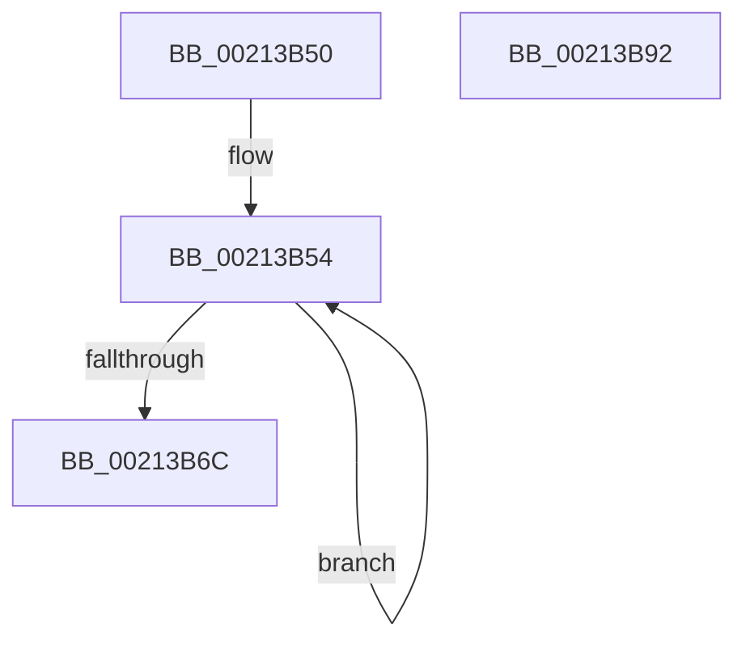

# ExpAllocateOwnerEntryForLegacyShim

- RVA: `0x00213B50`–`0x00213B93` (길이 `67` bytes)
- VA: `0x0000000140213B50`
- 실행 섹션: `.text`
- PDB 이름 있음: `예`; PDB Function 태그: `아니요`
- unwind 정보 RVA: `0x0005C788`
- 디코드: `18`개 명령, `67/67` bytes 표시
- 미해석 바이트: `0` (있으면 어셈블리에 `.byte`로 보존)

> 이 문서는 커널 이미지의 기계어와 PDB 기호를 분석해 생성했습니다. 4번과 5번은 함수 원형과 자료형을 바이너리 사용 방식에서 추정한 C 해석이며 원본 소스 복구 결과는 아닙니다.

## 1. Dependencies

- 직접 호출 지점: **1**; 고유 호출 대상: **1**
- 직접 호출자로 확인된 함수: **8**
- RIP 상대 이미지 참조: **0**

### Outgoing calls
- `0x00213B62` → [ExAllocatePool2](../../poolcode/B8/ExAllocatePool2_function_00B820F0.md) (function, `0x00B820F0`)

### Direct callers
- [sub_00213555](Unknown_function_00213555.md) at `0x00213555`
- [sub_00213798](Unknown_function_00213798.md) at `0x00213798`
- [ExEnterPriorityRegionAndAcquireResourceShared](ExEnterPriorityRegionAndAcquireResourceShared_function_00213870.md) at `0x00213908`
- [sub_00213CA6](Unknown_function_00213CA6.md) at `0x00213CC4`
- [sub_00213CA6](Unknown_function_00213CA6.md) at `0x00213CFD`
- [sub_0025F912](../25/Unknown_function_0025F912.md) at `0x0025F937`
- [SepCanTokenMatchAllPackageSid](../2F/SepCanTokenMatchAllPackageSid_function_002FFE90.md) at `0x002FFFBD`
- [ExpFastResourceLegacyAcquireSharedStarveExclusive](../3B/ExpFastResourceLegacyAcquireSharedStarveExclusive_function_003BDC18.md) at `0x003BDC2C`
- [ExpFastResourceLegacyConvertExclusiveToShared](../41/ExpFastResourceLegacyConvertExclusiveToShared_function_00416000.md) at `0x004160B7`

### Static image references
- 디코드된 RIP-relative 메모리 참조가 없습니다.

## 2. Other-region calls and transfers

- 다른 실행 섹션으로 향하는 call: **1**
  - `0x00213B62` → [ExAllocatePool2](../../poolcode/B8/ExAllocatePool2_function_00B820F0.md) (`.text` → `POOLCODE`)
- 별도 외부 분기/꼬리 이동을 확인하지 못했습니다.

## 3. Assembly (complete function range)

```asm
00213B50  48 83 EC 28                     sub rsp, 0x28
00213B54  BA 28 00 00 00                  mov edx, 0x28
00213B59  41 B8 46 52 4F 45               mov r8d, 0x454f5246
00213B5F  8D 4A 18                        lea ecx, [rdx + 0x18]
00213B62  E8 89 E5 96 00                  call 0x140b820f0
00213B67  48 85 C0                        test rax, rax
00213B6A  74 E8                           je 0x140213b54
00213B6C  33 C9                           xor ecx, ecx
00213B6E  0F 57 C0                        xorps xmm0, xmm0
00213B71  0F 11 00                        movups xmmword ptr [rax], xmm0
00213B74  0F 11 40 10                     movups xmmword ptr [rax + 0x10], xmm0
00213B78  48 89 48 20                     mov qword ptr [rax + 0x20], rcx
00213B7C  65 48 8B 0C 25 88 01 00 00      mov rcx, qword ptr gs:[0x188]
00213B85  80 48 25 01                     or byte ptr [rax + 0x25], 1
00213B89  48 89 48 10                     mov qword ptr [rax + 0x10], rcx
00213B8D  48 83 C4 28                     add rsp, 0x28
00213B91  C3                              ret
00213B92  CC                              int3
```

## 4. C-style interpretation (structured pseudocode)

```c
__int64 __fastcall ExpAllocateOwnerEntryForLegacyShim(void)
{
    __int64 result;
    __int64 v_rsp;

    v_rsp = (v_rsp) - (40);
loc_00213B54:
    result = ExAllocatePool2(40 + 24, 40, (unsigned int)(0x454F5246ULL), a4);
    if (result == 0) goto loc_00213B54;
    a1 = 0;
    *(unsigned __int64 *)(result) = v_xmm0;
    *(unsigned __int64 *)(result + 16) = v_xmm0;
    *(unsigned __int64 *)(result + 32) = 0;
    *(unsigned __int64 *)(result + 16) = *(unsigned __int64 *)(gs_base + (0 + 392));
    v_rsp = (v_rsp) + (40);
    return result;
}
```

## 5. (Beta) C Style

```c
void ExpAllocateOwnerEntryForLegacyShim(void)
{
    int64_t result;
    int64_t local_rsp;

    local_rsp = (local_rsp) - (40);
loc_00213B54:
    result = ExAllocatePool2(40 + 24, 40, (uint32_t)(0x454F5246ULL), a4);
    if (result == 0) goto loc_00213B54;
    a1 = 0;
    *(uint64_t *)(result) = v_xmm0;
    *(uint64_t *)(result + 0x10) = v_xmm0;
    *(uint64_t *)(result + 0x20) = 0;
    *(uint64_t *)(result + 0x10) = *(uint64_t *)(gs_base + (0 + 0x188));
    local_rsp = (local_rsp) + (40);
    return result;
}
```

## 6. Execution-region graph

[열기: 2D/3D 그래프와 함수 탐색 컨트롤 패널](../../../control-panel.html?section=text&rva=0x00213B50&view=graph)

- 2D 그래프는 위에서 아래로 흐르고, 3D 그래프는 빈 공간을 드래그해 회전합니다. Shift+드래그는 이동, 휠은 확대·축소, 함수 노드 선택은 대상 보고서 이동입니다.

### Static fallback


