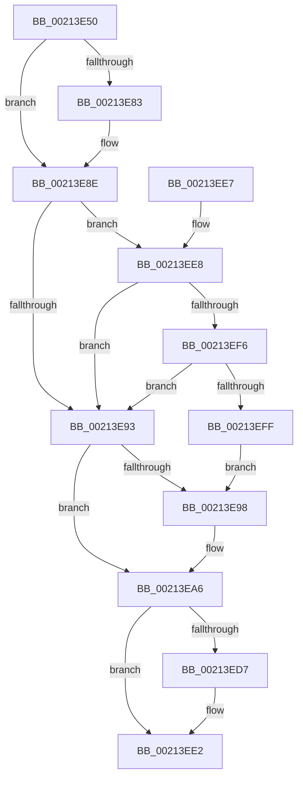

# ExpApplyPrewaitBoost

- RVA: `0x00213E50`–`0x00213F01` (길이 `177` bytes)
- VA: `0x0000000140213E50`
- 실행 섹션: `.text`
- PDB 이름 있음: `예`; PDB Function 태그: `아니요`
- unwind 정보 RVA: `0x0005E0D8`
- 디코드: `46`개 명령, `177/177` bytes 표시
- 미해석 바이트: `0` (있으면 어셈블리에 `.byte`로 보존)

> 이 문서는 커널 이미지의 기계어와 PDB 기호를 분석해 생성했습니다. 4번과 5번은 함수 원형과 자료형을 바이너리 사용 방식에서 추정한 C 해석이며 원본 소스 복구 결과는 아닙니다.

## 1. Dependencies

- 직접 호출 지점: **1**; 고유 호출 대상: **1**
- 직접 호출자로 확인된 함수: **2**
- RIP 상대 이미지 참조: **0**

### Outgoing calls
- `0x00213EDD` → [ExpApplyPriorityBoost](ExpApplyPriorityBoost_function_00213F10.md) (function, `0x00213F10`)

### Direct callers
- [ExpAcquireSharedStarveExclusive](../34/ExpAcquireSharedStarveExclusive_function_003411C0.md) at `0x003417C2`
- [sub_006E96C4](../6E/Unknown_function_006E96C4.md) at `0x006E9740`

### Static image references
- 디코드된 RIP-relative 메모리 참조가 없습니다.

## 2. Other-region calls and transfers

- 다른 실행 섹션으로 향하는 call: **0**
- 별도 외부 분기/꼬리 이동을 확인하지 못했습니다.

## 3. Assembly (complete function range)

```asm
00213E50  48 83 EC 28                     sub rsp, 0x28
00213E54  65 4C 8B 14 25 88 01 00 00      mov r10, qword ptr gs:[0x188]
00213E5D  4C 8B D9                        mov r11, rcx
00213E60  45 33 C0                        xor r8d, r8d
00213E63  49 8B 92 20 02 00 00            mov rdx, qword ptr [r10 + 0x220]
00213E6A  41 8B 82 A0 05 00 00            mov eax, dword ptr [r10 + 0x5a0]
00213E71  C1 E8 09                        shr eax, 9
00213E74  83 E0 07                        and eax, 7
00213E77  48 8B 8A A0 02 00 00            mov rcx, qword ptr [rdx + 0x2a0]
00213E7E  48 85 C9                        test rcx, rcx
00213E81  74 0B                           je 0x140213e8e
00213E83  8B 89 3C 04 00 00               mov ecx, dword ptr [rcx + 0x43c]
00213E89  3B C1                           cmp eax, ecx
00213E8B  0F 4D C1                        cmovge eax, ecx
00213E8E  83 F8 02                        cmp eax, 2
00213E91  7C 55                           jl 0x140213ee8
00213E93  83 F8 01                        cmp eax, 1
00213E96  7E 0E                           jle 0x140213ea6
00213E98  41 F6 43 1A 04                  test byte ptr [r11 + 0x1a], 4
00213E9D  B8 04 00 00 00                  mov eax, 4
00213EA2  44 0F 44 C0                     cmove r8d, eax
00213EA6  45 0F B7 4B 1A                  movzx r9d, word ptr [r11 + 0x1a]
00213EAB  41 8B C8                        mov ecx, r8d
00213EAE  41 0F BE 82 C3 00 00 00         movsx eax, byte ptr [r10 + 0xc3]
00213EB6  83 C9 02                        or ecx, 2
00213EB9  41 F6 C1 02                     test r9b, 2
00213EBD  41 0F 45 C8                     cmovne ecx, r8d
00213EC1  41 C1 E9 08                     shr r9d, 8
00213EC5  8B D1                           mov edx, ecx
00213EC7  81 CA 00 FF 00 00               or edx, 0xff00
00213ECD  41 3B C1                        cmp eax, r9d
00213ED0  0F 4E D1                        cmovle edx, ecx
00213ED3  85 D2                           test edx, edx
00213ED5  74 0B                           je 0x140213ee2
00213ED7  4D 8B C2                        mov r8, r10
00213EDA  49 8B CB                        mov rcx, r11
00213EDD  E8 2E 00 00 00                  call 0x140213f10
00213EE2  48 83 C4 28                     add rsp, 0x28
00213EE6  C3                              ret
00213EE7  CC                              int3
00213EE8  65 48 8B 0C 25 88 01 00 00      mov rcx, qword ptr gs:[0x188]
00213EF1  4C 3B D1                        cmp r10, rcx
00213EF4  75 9D                           jne 0x140213e93
00213EF6  45 39 82 E0 05 00 00            cmp dword ptr [r10 + 0x5e0], r8d
00213EFD  74 94                           je 0x140213e93
00213EFF  EB 97                           jmp 0x140213e98
```

## 4. C-style interpretation (structured pseudocode)

```c
__int64 __fastcall ExpApplyPrewaitBoost(__int64 a1, __int64 a2, int a3)
{
    __int64 result;
    __int64 v_rsp;

    v_rsp = (v_rsp) - (40);
    a3 = 0;
    result = (unsigned int)(((unsigned int)(*(unsigned int *)(*(unsigned __int64 *)(gs_base + (0 + 392)) + 1440))) >> (9));
    result = (unsigned int)((result) & (7));
    if (*(unsigned __int64 *)(*(unsigned __int64 *)(*(unsigned __int64 *)(gs_base + (0 + 392)) + 544) + 672) != 0) {
        a1 = *(unsigned int *)(*(unsigned __int64 *)(*(unsigned __int64 *)(*(unsigned __int64 *)(gs_base + (0 + 392)) + 544) + 672) + 1084);
        if (((unsigned int)(result)) >= ((unsigned int)(a1))) { result = (unsigned int)(a1); }
    }
    if (((unsigned int)(result)) < 2) goto loc_00213EE8;
loc_00213E93:
    if (((unsigned int)(result)) >= = 1) {
        result = 4;
        if (((*(unsigned __int8 *)(a1 + 26)) & (4)) == 0) { a3 = (unsigned int)(result); }
    }
    a1 = (unsigned int)(((unsigned int)(a3)) | (2));
    if ((((unsigned __int8)(*(unsigned __int16 *)(a1 + 26))) & (2)) != 0) { a1 = a3; }
    a4 = (unsigned int)((*(unsigned __int16 *)(a1 + 26)) >> (8));
    a2 = (unsigned int)(((unsigned int)((unsigned int)(a1))) | (0xFF00ULL));
    if (((unsigned int)((__int8)(*(unsigned __int8 *)(*(unsigned __int64 *)(gs_base + (0 + 392)) + 195)))) <= ((unsigned int)(a4))) { a2 = (unsigned int)(a1); }
    result = (__int8)(*(unsigned __int8 *)(*(unsigned __int64 *)(gs_base + (0 + 392)) + 195));
    if ((unsigned int)(a2) != 0) {
        a3 = *(unsigned __int64 *)(gs_base + (0 + 392));
        a1 = a1;
        result = ExpApplyPriorityBoost(a1, a2, a3, a4);
    }
    v_rsp = (v_rsp) + (40);
    return result;
loc_00213EE8:
    if ((*(unsigned __int64 *)(gs_base + (0 + 392))) != (*(unsigned __int64 *)(gs_base + (0 + 392)))) goto loc_00213E93;
    if ((*(unsigned int *)(*(unsigned __int64 *)(gs_base + (0 + 392)) + 1504)) == a3) goto loc_00213E93;
    goto loc_00213E98;
}
```

## 5. (Beta) C Style

```c
int64_t ExpApplyPrewaitBoost(void *Arg1, int64_t Arg2, int32_t Arg3)
{
    uint8_t *arg1 = (uint8_t *)Arg1;

    int64_t result;
    int64_t local_rsp;

    local_rsp = (local_rsp) - (40);
    Arg3 = 0;
    result = (uint32_t)(((uint32_t)(*(uint32_t *)(*(uint64_t *)(gs_base + (0 + 0x188)) + 0x5A0))) >> (9));
    result = (uint32_t)((result) & (7));
    if (*(uint64_t *)(*(uint64_t *)(*(uint64_t *)(gs_base + (0 + 0x188)) + 0x220) + 0x2A0) != 0) {
        Arg1 = *(uint32_t *)(*(uint64_t *)(*(uint64_t *)(*(uint64_t *)(gs_base + (0 + 0x188)) + 0x220) + 0x2A0) + 0x43C);
        if (((uint32_t)(result)) >= ((uint32_t)(Arg1))) { result = (uint32_t)(Arg1); }
    }
    if (((uint32_t)(result)) < 2) goto loc_00213EE8;
loc_00213E93:
    if (((uint32_t)(result)) >= = 1) {
        result = 4;
        if (((*(uint8_t *)(arg1 + 0x1A)) & (4)) == 0) { Arg3 = (uint32_t)(result); }
    }
    Arg1 = (uint32_t)(((uint32_t)(Arg3)) | (2));
    if ((((uint8_t)(*(uint16_t *)(arg1 + 0x1A))) & (2)) != 0) { Arg1 = Arg3; }
    a4 = (uint32_t)((*(uint16_t *)(arg1 + 0x1A)) >> (8));
    Arg2 = (uint32_t)(((uint32_t)((uint32_t)(Arg1))) | (0xFF00ULL));
    if (((uint32_t)((int8_t)(*(uint8_t *)(*(uint64_t *)(gs_base + (0 + 0x188)) + 0xC3)))) <= ((uint32_t)(a4))) { Arg2 = (uint32_t)(Arg1); }
    result = (int8_t)(*(uint8_t *)(*(uint64_t *)(gs_base + (0 + 0x188)) + 0xC3));
    if ((uint32_t)(Arg2) != 0) {
        Arg3 = *(uint64_t *)(gs_base + (0 + 0x188));
        Arg1 = Arg1;
        result = ExpApplyPriorityBoost(Arg1, Arg2, Arg3, a4);
    }
    local_rsp = (local_rsp) + (40);
    return result;
loc_00213EE8:
    if ((*(uint64_t *)(gs_base + (0 + 0x188))) != (*(uint64_t *)(gs_base + (0 + 0x188)))) goto loc_00213E93;
    if ((*(uint32_t *)(*(uint64_t *)(gs_base + (0 + 0x188)) + 0x5E0)) == Arg3) goto loc_00213E93;
    goto loc_00213E98;
}
```

### 관측된 메모리 오프셋

구조체 형식이 확인되지 않은 접근은 인자 기준의 오프셋으로만 기록했습니다.

| 기준 인자 | 오프셋 표현 | 폭 (bit) | 접근 |
|---|---:|---:|---|
| `Arg1` | `+ 0x1A` | `8` | `R` |
| `Arg1` | `+ 0x1A` | `16` | `R` |

## 6. Execution-region graph

[열기: 2D/3D 그래프와 함수 탐색 컨트롤 패널](../../../control-panel.html?section=text&rva=0x00213E50&view=graph)

- 2D 그래프는 위에서 아래로 흐르고, 3D 그래프는 빈 공간을 드래그해 회전합니다. Shift+드래그는 이동, 휠은 확대·축소, 함수 노드 선택은 대상 보고서 이동입니다.

### Static fallback


