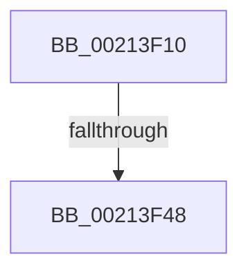

# ExpApplyPriorityBoost

- RVA: `0x00213F10`–`0x00213F4F` (길이 `63` bytes)
- VA: `0x0000000140213F10`
- 실행 섹션: `.text`
- PDB 이름 있음: `예`; PDB Function 태그: `아니요`
- unwind 정보 RVA: `0x0005E0E4`
- 디코드: `18`개 명령, `63/63` bytes 표시
- 미해석 바이트: `0` (있으면 어셈블리에 `.byte`로 보존)

> 이 문서는 커널 이미지의 기계어와 PDB 기호를 분석해 생성했습니다. 4번과 5번은 함수 원형과 자료형을 바이너리 사용 방식에서 추정한 C 해석이며 원본 소스 복구 결과는 아닙니다.

## 1. Dependencies

- 직접 호출 지점: **0**; 고유 호출 대상: **0**
- 직접 호출자로 확인된 함수: **5**
- RIP 상대 이미지 참조: **0**

### Outgoing calls
- 직접 디코드된 call 명령이 없습니다.

### Direct callers
- [ExpAcquireResourceSharedLite](ExpAcquireResourceSharedLite_function_00212040.md) at `0x00212D66`
- [ExpApplyPrewaitBoost](ExpApplyPrewaitBoost_function_00213E50.md) at `0x00213EDD`
- [sub_00215166](Unknown_function_00215166.md) at `0x00215412`
- [ExpConvertExclusiveToSharedLite](../34/ExpConvertExclusiveToSharedLite_function_0034F7A8.md) at `0x0034F8B2`
- [ExpApplyRewaitBoost](../4B/ExpApplyRewaitBoost_function_004B9510.md) at `0x004B9522`

### Static image references
- 디코드된 RIP-relative 메모리 참조가 없습니다.

## 2. Other-region calls and transfers

- 다른 실행 섹션으로 향하는 call: **0**
- call이 아닌 외부 분기/꼬리 이동: **1**
  - `0x00213F42` → [sub_002142EA](Unknown_function_002142EA.md) (`tail-transfer`)

## 3. Assembly (complete function range)

```asm
00213F10  4C 8B DC                        mov r11, rsp
00213F13  49 89 4B 08                     mov qword ptr [r11 + 8], rcx
00213F17  55                              push rbp
00213F18  56                              push rsi
00213F19  41 54                           push r12
00213F1B  41 56                           push r14
00213F1D  49 8D 6B A1                     lea rbp, [r11 - 0x5f]
00213F21  48 81 EC 98 00 00 00            sub rsp, 0x98
00213F28  33 C0                           xor eax, eax
00213F2A  0F 57 C0                        xorps xmm0, xmm0
00213F2D  F6 41 1A 08                     test byte ptr [rcx + 0x1a], 8
00213F31  49 8B F0                        mov rsi, r8
00213F34  44 8B E2                        mov r12d, edx
00213F37  48 89 45 E7                     mov qword ptr [rbp - 0x19], rax
00213F3B  4C 8B F1                        mov r14, rcx
00213F3E  0F 11 45 D7                     movups xmmword ptr [rbp - 0x29], xmm0
00213F42  0F 85 A2 03 00 00               jne 0x1402142ea
00213F48  49 8B 80 20 02 00 00            mov rax, qword ptr [r8 + 0x220]
```

## 4. C-style interpretation (structured pseudocode)

```c
__int64 __fastcall ExpApplyPriorityBoost(__int64 a1, int a2, __int64 a3)
{
    __int64 result;
    __int64 v_rsp;

    *(unsigned __int64 *)(v_rsp + 8) = a1;
    v_rsp = (v_rsp) - (152);
    result = 0;
    *(unsigned __int64 *)(v_rsp - 95 - 25) = 0;
    *(unsigned __int64 *)(v_rsp - 95 - 41) = v_xmm0;
    return *(unsigned __int64 *)(a3 + 544);
}
```

## 5. (Beta) C Style

```c
int64_t ExpApplyPriorityBoost(void *Arg1, int32_t Arg2, void *Arg3)
{
    uint8_t *arg1 = (uint8_t *)Arg1;
    uint8_t *arg3 = (uint8_t *)Arg3;

    int64_t result;
    int64_t local_rsp;

    *(void **)(local_rsp + 0x8) = Arg1;
    local_rsp = (local_rsp) - (152);
    result = 0;
    *(uint64_t *)(local_rsp - 0x5F - 0x19) = 0;
    *(uint64_t *)(local_rsp - 0x5F - 0x29) = v_xmm0;
    return *(uint64_t *)(arg3 + 0x220);
}
```

### 관측된 메모리 오프셋

구조체 형식이 확인되지 않은 접근은 인자 기준의 오프셋으로만 기록했습니다.

| 기준 인자 | 오프셋 표현 | 폭 (bit) | 접근 |
|---|---:|---:|---|
| `Arg1` | `+ 0x1A` | `8` | `R` |
| `Arg3` | `+ 0x220` | `64` | `R` |

## 6. Execution-region graph

[열기: 2D/3D 그래프와 함수 탐색 컨트롤 패널](../../../control-panel.html?section=text&rva=0x00213F10&view=graph)

- 2D 그래프는 위에서 아래로 흐르고, 3D 그래프는 빈 공간을 드래그해 회전합니다. Shift+드래그는 이동, 휠은 확대·축소, 함수 노드 선택은 대상 보고서 이동입니다.

### Static fallback


