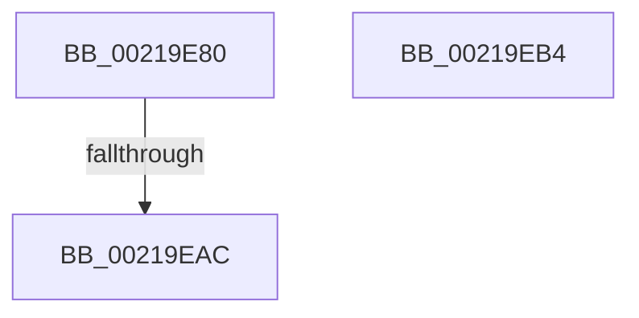

# ExpCommitWakeFastResource

- RVA: `0x00219E80`–`0x00219EB5` (길이 `53` bytes)
- VA: `0x0000000140219E80`
- 실행 섹션: `.text`
- PDB 이름 있음: `예`; PDB Function 태그: `아니요`
- unwind 정보 RVA: `0x0005EC34`
- 디코드: `21`개 명령, `53/53` bytes 표시
- 미해석 바이트: `0` (있으면 어셈블리에 `.byte`로 보존)

> 이 문서는 커널 이미지의 기계어와 PDB 기호를 분석해 생성했습니다. 4번과 5번은 함수 원형과 자료형을 바이너리 사용 방식에서 추정한 C 해석이며 원본 소스 복구 결과는 아닙니다.

## 1. Dependencies

- 직접 호출 지점: **0**; 고유 호출 대상: **0**
- 직접 호출자로 확인된 함수: **2**
- RIP 상대 이미지 참조: **0**

### Outgoing calls
- 직접 디코드된 call 명령이 없습니다.

### Direct callers
- [ExpReleaseDisownedFastResourceShared](../41/ExpReleaseDisownedFastResourceShared_function_00416338.md) at `0x004163F3`
- [ExpReleaseDisownedFastResourceExclusive](../41/ExpReleaseDisownedFastResourceExclusive_function_00416470.md) at `0x00416545`

### Static image references
- 디코드된 RIP-relative 메모리 참조가 없습니다.

## 2. Other-region calls and transfers

- 다른 실행 섹션으로 향하는 call: **0**
- call이 아닌 외부 분기/꼬리 이동: **1**
  - `0x00219EAA` → [sub_00219EB5](Unknown_function_00219EB5.md) (`tail-transfer`)

## 3. Assembly (complete function range)

```asm
00219E80  40 53                           push rbx
00219E82  56                              push rsi
00219E83  57                              push rdi
00219E84  48 83 EC 50                     sub rsp, 0x50
00219E88  48 8B 39                        mov rdi, qword ptr [rcx]
00219E8B  41 8B C1                        mov eax, r9d
00219E8E  83 E0 01                        and eax, 1
00219E91  48 8B F1                        mov rsi, rcx
00219E94  8D 04 45 01 00 00 00            lea eax, [rax*2 + 1]
00219E9B  8B D8                           mov ebx, eax
00219E9D  83 CB 04                        or ebx, 4
00219EA0  41 F6 C1 02                     test r9b, 2
00219EA4  0F 44 D8                        cmove ebx, eax
00219EA7  48 85 FF                        test rdi, rdi
00219EAA  75 09                           jne 0x140219eb5
00219EAC  48 83 C4 50                     add rsp, 0x50
00219EB0  5F                              pop rdi
00219EB1  5E                              pop rsi
00219EB2  5B                              pop rbx
00219EB3  C3                              ret
00219EB4  CC                              int3
```

## 4. C-style interpretation (structured pseudocode)

```c
__int64 __fastcall ExpCommitWakeFastResource(__int64 a1, __int64 a2, __int64 a3, int a4)
{
    __int64 result;
    __int64 v_rbx;
    __int64 v_rsp;

    v_rsp = (v_rsp) - (80);
    result = (unsigned int)(((unsigned int)(a4)) & (1));
    v_rbx = (unsigned int)(((unsigned int)((unsigned int)(result * 2 + 1))) | (4));
    if ((((unsigned __int8)(a4)) & (2)) == 0) { v_rbx = (unsigned int)(result * 2 + 1); }
    v_rsp = (v_rsp) + (80);
    return result * 2 + 1;
}
```

## 5. (Beta) C Style

```c
int64_t ExpCommitWakeFastResource(void *Arg1, int64_t Arg2, int64_t Arg3, int32_t Arg4)
{
    uint8_t *arg1 = (uint8_t *)Arg1;

    int64_t result;
    int64_t local_rbx;
    int64_t local_rsp;

    local_rsp = (local_rsp) - (80);
    result = (uint32_t)(((uint32_t)(Arg4)) & (1));
    local_rbx = (uint32_t)(((uint32_t)((uint32_t)(result * 2 + 1))) | (4));
    if ((((uint8_t)(Arg4)) & (2)) == 0) { local_rbx = (uint32_t)(result * 2 + 1); }
    local_rsp = (local_rsp) + (80);
    return result * 2 + 1;
}
```

### 관측된 메모리 오프셋

구조체 형식이 확인되지 않은 접근은 인자 기준의 오프셋으로만 기록했습니다.

| 기준 인자 | 오프셋 표현 | 폭 (bit) | 접근 |
|---|---:|---:|---|
| `Arg1` | `+ 0x0` | `64` | `R` |

## 6. Execution-region graph

[열기: 2D/3D 그래프와 함수 탐색 컨트롤 패널](../../../control-panel.html?section=text&rva=0x00219E80&view=graph)

- 2D 그래프는 위에서 아래로 흐르고, 3D 그래프는 빈 공간을 드래그해 회전합니다. Shift+드래그는 이동, 휠은 확대·축소, 함수 노드 선택은 대상 보고서 이동입니다.

### Static fallback


