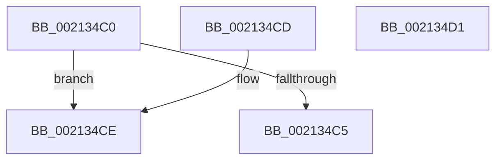

# ExpGetThreadResourceHint

- RVA: `0x002134C0`–`0x002134D2` (길이 `18` bytes)
- VA: `0x00000001402134C0`
- 실행 섹션: `.text`
- PDB 이름 있음: `예`; PDB Function 태그: `아니요`
- unwind 정보 RVA: `0x000DB714`
- 디코드: `8`개 명령, `18/18` bytes 표시
- 미해석 바이트: `0` (있으면 어셈블리에 `.byte`로 보존)

> 이 문서는 커널 이미지의 기계어와 PDB 기호를 분석해 생성했습니다. 4번과 5번은 함수 원형과 자료형을 바이너리 사용 방식에서 추정한 C 해석이며 원본 소스 복구 결과는 아닙니다.

## 1. Dependencies

- 직접 호출 지점: **0**; 고유 호출 대상: **0**
- 직접 호출자로 확인된 함수: **5**
- RIP 상대 이미지 참조: **0**

### Outgoing calls
- 직접 디코드된 call 명령이 없습니다.

### Direct callers
- [ExpAcquireResourceSharedLite](ExpAcquireResourceSharedLite_function_00212040.md) at `0x00212119`
- [ExpAcquireSharedStarveExclusive](../34/ExpAcquireSharedStarveExclusive_function_003411C0.md) at `0x0034147F`
- [ExpAcquireSharedStarveExclusive](../34/ExpAcquireSharedStarveExclusive_function_003411C0.md) at `0x00341672`
- [ExAcquireSharedWaitForExclusive](../3D/ExAcquireSharedWaitForExclusive_function_003D43F0.md) at `0x003D450C`
- [ExpTryConvertSharedToExclusiveLite](../65/ExpTryConvertSharedToExclusiveLite_function_00658F30.md) at `0x00658F82`
- [sub_006E96C4](../6E/Unknown_function_006E96C4.md) at `0x006E97A4`

### Static image references
- 디코드된 RIP-relative 메모리 참조가 없습니다.

## 2. Other-region calls and transfers

- 다른 실행 섹션으로 향하는 call: **0**
- 별도 외부 분기/꼬리 이동을 확인하지 못했습니다.

## 3. Assembly (complete function range)

```asm
002134C0  F6 C1 03                        test cl, 3
002134C3  75 09                           jne 0x1402134ce
002134C5  0F B6 81 60 04 00 00            movzx eax, byte ptr [rcx + 0x460]
002134CC  C3                              ret
002134CD  CC                              int3
002134CE  33 C0                           xor eax, eax
002134D0  C3                              ret
002134D1  CC                              int3
```

## 4. C-style interpretation (structured pseudocode)

```c
__int64 __fastcall ExpGetThreadResourceHint(__int64 a1)
{
    __int64 result;

    if ((((unsigned __int8)(a1)) & (3)) != 0) goto loc_002134CE;
    return *(unsigned __int8 *)(a1 + 1120);
loc_002134CE:
    result = 0;
    return result;
}
```

## 5. (Beta) C Style

```c
int64_t ExpGetThreadResourceHint(int64_t Arg1)
{
    int64_t result;

    if ((((uint8_t)(Arg1)) & (3)) != 0) goto loc_002134CE;
    return *(uint8_t *)(Arg1 + 0x460);
loc_002134CE:
    result = 0;
    return result;
}
```

## 6. Execution-region graph

[열기: 2D/3D 그래프와 함수 탐색 컨트롤 패널](../../../control-panel.html?section=text&rva=0x002134C0&view=graph)

- 2D 그래프는 위에서 아래로 흐르고, 3D 그래프는 빈 공간을 드래그해 회전합니다. Shift+드래그는 이동, 휠은 확대·축소, 함수 노드 선택은 대상 보고서 이동입니다.

### Static fallback


