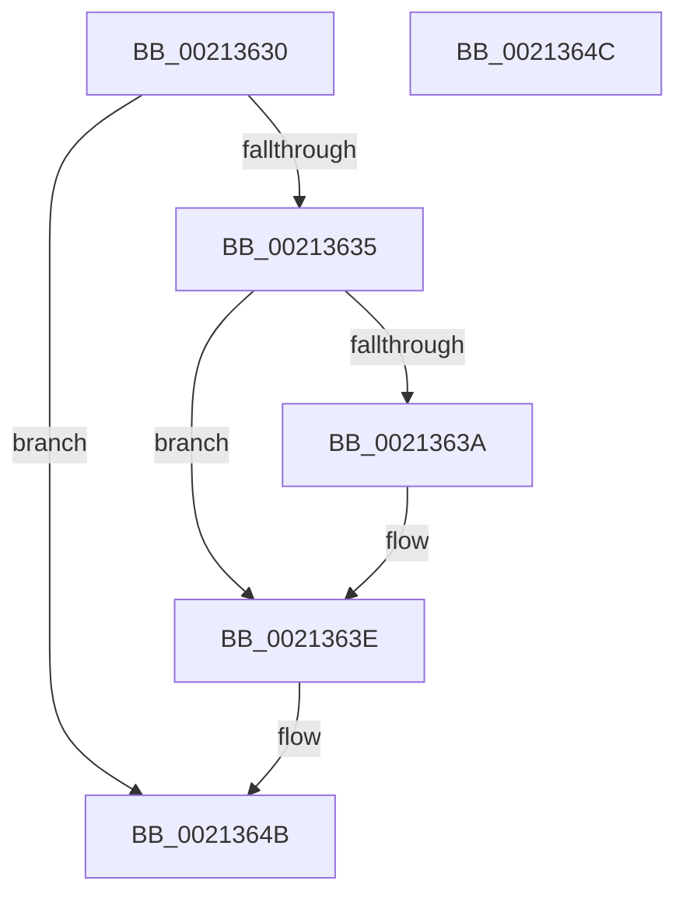

# ExpSaveAbHandle

- RVA: `0x00213630`–`0x0021364D` (길이 `29` bytes)
- VA: `0x0000000140213630`
- 실행 섹션: `.text`
- PDB 이름 있음: `예`; PDB Function 태그: `아니요`
- unwind 정보 RVA: `0x000DB714`
- 디코드: `12`개 명령, `29/29` bytes 표시
- 미해석 바이트: `0` (있으면 어셈블리에 `.byte`로 보존)

> 이 문서는 커널 이미지의 기계어와 PDB 기호를 분석해 생성했습니다. 4번과 5번은 함수 원형과 자료형을 바이너리 사용 방식에서 추정한 C 해석이며 원본 소스 복구 결과는 아닙니다.

## 1. Dependencies

- 직접 호출 지점: **0**; 고유 호출 대상: **0**
- 직접 호출자로 확인된 함수: **2**
- RIP 상대 이미지 참조: **0**

### Outgoing calls
- 직접 디코드된 call 명령이 없습니다.

### Direct callers
- [sub_00211104](Unknown_function_00211104.md) at `0x0021119B`
- [sub_00211E87](Unknown_function_00211E87.md) at `0x00211EED`

### Static image references
- 디코드된 RIP-relative 메모리 참조가 없습니다.

## 2. Other-region calls and transfers

- 다른 실행 섹션으로 향하는 call: **0**
- 별도 외부 분기/꼬리 이동을 확인하지 못했습니다.

## 3. Assembly (complete function range)

```asm
00213630  48 85 D2                        test rdx, rdx
00213633  74 16                           je 0x14021364b
00213635  45 84 C0                        test r8b, r8b
00213638  74 04                           je 0x14021363e
0021363A  C6 42 0A 01                     mov byte ptr [rdx + 0xa], 1
0021363E  0F B6 42 08                     movzx eax, byte ptr [rdx + 8]
00213642  24 3F                           and al, 0x3f
00213644  02 C0                           add al, al
00213646  0C 01                           or al, 1
00213648  88 41 24                        mov byte ptr [rcx + 0x24], al
0021364B  C3                              ret
0021364C  CC                              int3
```

## 4. C-style interpretation (structured pseudocode)

```c
__int64 __fastcall ExpSaveAbHandle(__int64 a1, __int64 a2, unsigned __int8 a3)
{
    __int64 result;

    if (a2 == 0) goto loc_0021364B;
    if (a3 != 0) {
        *(unsigned __int8 *)(a2 + 10) = 1;
    }
    result = (unsigned __int8)((*(unsigned __int8 *)(a2 + 8)) & (63));
    result = (unsigned __int8)((result) + ((unsigned __int8)(result)));
    result = (unsigned __int8)((result) | (1));
    *(unsigned __int8 *)(a1 + 36) = (unsigned __int8)(result);
loc_0021364B:
    return result;
}
```

## 5. (Beta) C Style

```c
int64_t ExpSaveAbHandle(void *Arg1, int64_t Arg2, uint8_t Arg3)
{
    uint8_t *arg1 = (uint8_t *)Arg1;

    int64_t result;

    if (Arg2 == 0) goto loc_0021364B;
    if (Arg3 != 0) {
        *(uint8_t *)(Arg2 + 0xA) = 1;
    }
    result = (uint8_t)((*(uint8_t *)(Arg2 + 0x8)) & (63));
    result = (uint8_t)((result) + ((uint8_t)(result)));
    result = (uint8_t)((result) | (1));
    *(uint8_t *)(arg1 + 0x24) = (uint8_t)(result);
loc_0021364B:
    return result;
}
```

### 관측된 메모리 오프셋

구조체 형식이 확인되지 않은 접근은 인자 기준의 오프셋으로만 기록했습니다.

| 기준 인자 | 오프셋 표현 | 폭 (bit) | 접근 |
|---|---:|---:|---|
| `Arg1` | `+ 0x24` | `8` | `W` |

## 6. Execution-region graph

[열기: 2D/3D 그래프와 함수 탐색 컨트롤 패널](../../../control-panel.html?section=text&rva=0x00213630&view=graph)

- 2D 그래프는 위에서 아래로 흐르고, 3D 그래프는 빈 공간을 드래그해 회전합니다. Shift+드래그는 이동, 휠은 확대·축소, 함수 노드 선택은 대상 보고서 이동입니다.

### Static fallback


