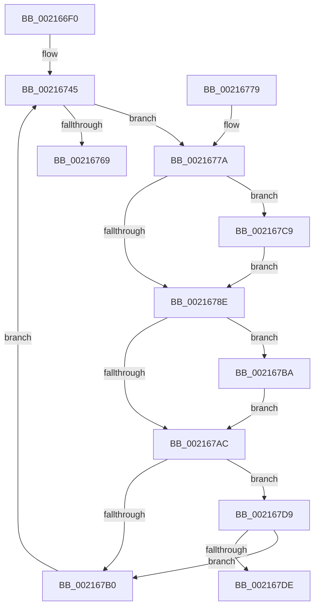

# ExpWaitForResource

- RVA: `0x002166F0`–`0x002167EB` (길이 `251` bytes)
- VA: `0x00000001402166F0`
- 실행 섹션: `.text`
- PDB 이름 있음: `예`; PDB Function 태그: `예`
- unwind 정보 RVA: `0x0005E340`
- 디코드: `71`개 명령, `251/251` bytes 표시
- 미해석 바이트: `0` (있으면 어셈블리에 `.byte`로 보존)

> 이 문서는 커널 이미지의 기계어와 PDB 기호를 분석해 생성했습니다. 4번과 5번은 함수 원형과 자료형을 바이너리 사용 방식에서 추정한 C 해석이며 원본 소스 복구 결과는 아닙니다.

## 1. Dependencies

- 직접 호출 지점: **3**; 고유 호출 대상: **3**
- 직접 호출자로 확인된 함수: **4**
- RIP 상대 이미지 참조: **4**

### Outgoing calls
- `0x0021675D` → [KeWaitForSingleObject](../20/KeWaitForSingleObject_function_0020E6B0.md) (function, `0x0020E6B0`)
- `0x002167B3` → [ExpApplyRewaitBoost](../4B/ExpApplyRewaitBoost_function_004B9510.md) (function, `0x004B9510`)
- `0x002167D2` → [PerfLogExecutiveResourceWait](../4B/PerfLogExecutiveResourceWait_function_004B9E90.md) (function, `0x004B9E90`)

### Direct callers
- [ExpAcquireResourceSharedLite](ExpAcquireResourceSharedLite_function_00212040.md) at `0x00212D78`
- [sub_00215166](Unknown_function_00215166.md) at `0x00215424`
- [ExpAcquireSharedStarveExclusive](../34/ExpAcquireSharedStarveExclusive_function_003411C0.md) at `0x003417D4`
- [sub_006E96C4](../6E/Unknown_function_006E96C4.md) at `0x006E9752`

### Static image references
- `0x0021673E` → RVA `0x0065D5E0` (`ExpResourceTimeoutCaptureLiveDump`; read)
- `0x00216782` → RVA `0x00FC6B04` (`ALMOSTRO`; read)
- `0x0021678E` → RVA `0x00EFA100` (`.data`; read)
- `0x002167BA` → RVA `0x00EEEFEC` (`.data`; read)

## 2. Other-region calls and transfers

- 다른 실행 섹션으로 향하는 call: **0**
- call이 아닌 외부 분기/꼬리 이동: **1**
  - `0x002167E6` → [sub_006D678E](../6D/Unknown_function_006D678E.md) (`tail-transfer`)

## 3. Assembly (complete function range)

```asm
002166F0  4C 89 4C 24 20                  mov qword ptr [rsp + 0x20], r9
002166F5  44 89 44 24 18                  mov dword ptr [rsp + 0x18], r8d
002166FA  48 89 54 24 10                  mov qword ptr [rsp + 0x10], rdx
002166FF  48 89 4C 24 08                  mov qword ptr [rsp + 8], rcx
00216704  53                              push rbx
00216705  56                              push rsi
00216706  57                              push rdi
00216707  41 54                           push r12
00216709  41 55                           push r13
0021670B  41 56                           push r14
0021670D  41 57                           push r15
0021670F  48 83 EC 50                     sub rsp, 0x50
00216713  45 8B F0                        mov r14d, r8d
00216716  48 8B FA                        mov rdi, rdx
00216719  48 8B F1                        mov rsi, rcx
0021671C  65 FF 04 25 68 90 00 00         inc dword ptr gs:[0x9068]
00216724  45 33 FF                        xor r15d, r15d
00216727  45 33 E4                        xor r12d, r12d
0021672A  48 8D 59 44                     lea rbx, [rcx + 0x44]
0021672E  48 89 5C 24 40                  mov qword ptr [rsp + 0x40], rbx
00216733  FF 03                           inc dword ptr [rbx]
00216735  48 C7 44 24 38 C0 B4 B3 FF      mov qword ptr [rsp + 0x38], 0xffffffffffb3b4c0
0021673E  4C 8D 2D 9B 6E 44 00            lea r13, [rip + 0x446e9b]
00216745  48 8D 4F 18                     lea rcx, [rdi + 0x18]
00216749  48 8D 44 24 38                  lea rax, [rsp + 0x38]
0021674E  48 89 44 24 20                  mov qword ptr [rsp + 0x20], rax
00216753  45 33 C9                        xor r9d, r9d
00216756  45 33 C0                        xor r8d, r8d
00216759  41 8D 51 1B                     lea edx, [r9 + 0x1b]
0021675D  E8 4E 7F FF FF                  call 0x14020e6b0
00216762  3D 02 01 00 00                  cmp eax, 0x102
00216767  74 11                           je 0x14021677a
00216769  48 83 C4 50                     add rsp, 0x50
0021676D  41 5F                           pop r15
0021676F  41 5E                           pop r14
00216771  41 5D                           pop r13
00216773  41 5C                           pop r12
00216775  5F                              pop rdi
00216776  5E                              pop rsi
00216777  5B                              pop rbx
00216778  C3                              ret
00216779  CC                              int3
0021677A  41 FF C7                        inc r15d
0021677D  44 89 7C 24 34                  mov dword ptr [rsp + 0x34], r15d
00216782  F7 05 78 03 DB 00 00 00 02 00   test dword ptr [rip + 0xdb0378], 0x20000
0021678C  75 3B                           jne 0x1402167c9
0021678E  48 8B 05 6B 39 CE 00            mov rax, qword ptr [rip + 0xce396b]
00216795  48 89 44 24 38                  mov qword ptr [rsp + 0x38], rax
0021679A  41 FF C4                        inc r12d
0021679D  8B 46 54                        mov eax, dword ptr [rsi + 0x54]
002167A0  89 84 24 A8 00 00 00            mov dword ptr [rsp + 0xa8], eax
002167A7  83 F8 FF                        cmp eax, -1
002167AA  74 0E                           je 0x1402167ba
002167AC  85 C0                           test eax, eax
002167AE  75 29                           jne 0x1402167d9
002167B0  48 8B CE                        mov rcx, rsi
002167B3  E8 58 2D 2A 00                  call 0x1404b9510
002167B8  EB 8B                           jmp 0x140216745
002167BA  8B 05 2C 88 CD 00               mov eax, dword ptr [rip + 0xcd882c]
002167C0  89 84 24 A8 00 00 00            mov dword ptr [rsp + 0xa8], eax
002167C7  EB E3                           jmp 0x1402167ac
002167C9  45 8B C7                        mov r8d, r15d
002167CC  48 8B D6                        mov rdx, rsi
002167CF  41 8B CE                        mov ecx, r14d
002167D2  E8 B9 36 2A 00                  call 0x1404b9e90
002167D7  EB B5                           jmp 0x14021678e
002167D9  44 3B E0                        cmp r12d, eax
002167DC  76 D2                           jbe 0x1402167b0
002167DE  0F 0D 4E 50                     prefetchw byte ptr [rsi + 0x50]
002167E2  0F B6 46 50                     movzx eax, byte ptr [rsi + 0x50]
002167E6  E9 A3 FF 4B 00                  jmp 0x1406d678e
```

## 4. C-style interpretation (structured pseudocode)

```c
__int64 __fastcall ExpWaitForResource(__int64 a1, __int64 a2, int a3, __int64 a4)
{
    __int64 result;
    __int64 v_r12;
    __int64 v_r15;
    __int64 v_rsp;
    unsigned __int64 v_stack_m48;
    unsigned __int64 v_stack_m50;
    unsigned __int64 v_stack_m68;
    unsigned __int64 v_stack_p10;
    unsigned int v_stack_p18;
    unsigned __int64 v_stack_p20;
    unsigned int v_stack_p34;
    unsigned __int64 v_stack_p38;
    unsigned __int64 v_stack_p8;
    unsigned int v_stack_pA8;

    v_stack_p20 = a4;
    v_stack_p18 = a3;
    v_stack_p10 = a2;
    v_stack_p8 = a1;
    v_rsp = (v_rsp) - (80);
    v_r15 = 0;
    v_r12 = 0;
    v_stack_m48 = a1 + 68;
    v_stack_m50 = 0xFFFFFFFFFFB3B4C0ULL;
loc_00216745:
    v_stack_m68 = v_stack_m50;
    a4 = 0;
    a3 = 0;
    result = KeWaitForSingleObject(a2 + 24, a4 + 27, a3, a4);
    if (((unsigned int)(result)) == 258) goto loc_0021677A;
    v_rsp = (v_rsp) + (80);
    return result;
loc_0021677A:
    v_r15 = (unsigned int)((v_r15) + 1);
    v_stack_p34 = (unsigned int)(v_r15);
    if (((*(unsigned int *)(v_rip + 14353272)) & (0x20000ULL)) != 0) goto loc_002167C9;
loc_0021678E:
    v_stack_p38 = *(unsigned __int64 *)(v_rip + 13515115);
    v_r12 = (unsigned int)((v_r12) + 1);
    v_stack_pA8 = (unsigned int)((unsigned int)(*(unsigned int *)(a1 + 84)));
    if (((unsigned int)((unsigned int)(*(unsigned int *)(a1 + 84)))) == -1) goto loc_002167BA;
loc_002167AC:
    if ((unsigned int)((unsigned int)(*(unsigned int *)(a1 + 84))) != 0) goto loc_002167D9;
loc_002167B0:
    result = ExpApplyRewaitBoost(a1, a4 + 27, a3, a4);
    goto loc_00216745;
loc_002167BA:
    v_stack_pA8 = (unsigned int)((unsigned int)(*(unsigned int *)(v_rip + 13469740)));
    goto loc_002167AC;
loc_002167C9:
    result = PerfLogExecutiveResourceWait((unsigned int)((unsigned int)((unsigned int)(a3))), a1, (unsigned int)((unsigned int)(v_r15)), a4);
    goto loc_0021678E;
loc_002167D9:
    if (((unsigned int)(v_r12)) <= ((unsigned int)(result))) goto loc_002167B0;
}
```

## 5. (Beta) C Style

```c
int64_t ExpWaitForResource(void *Arg1, void *Arg2, int32_t Arg3, int64_t Arg4)
{
    uint8_t *arg1 = (uint8_t *)Arg1;
    uint8_t *arg2 = (uint8_t *)Arg2;

    int64_t result;
    int64_t local_r12;
    int64_t local_r15;
    int64_t local_rsp;
    uint64_t v_stack_m48;
    uint64_t v_stack_m50;
    uint64_t v_stack_m68;
    uint64_t v_stack_p10;
    uint32_t v_stack_p18;
    uint64_t v_stack_p20;
    uint32_t v_stack_p34;
    uint64_t v_stack_p38;
    uint64_t v_stack_p8;
    uint32_t v_stack_pA8;

    v_stack_p20 = Arg4;
    v_stack_p18 = Arg3;
    v_stack_p10 = Arg2;
    v_stack_p8 = Arg1;
    local_rsp = (local_rsp) - (80);
    local_r15 = 0;
    local_r12 = 0;
    v_stack_m48 = Arg1 + 68;
    v_stack_m50 = 0xFFFFFFFFFFB3B4C0ULL;
loc_00216745:
    v_stack_m68 = v_stack_m50;
    Arg4 = 0;
    Arg3 = 0;
    result = KeWaitForSingleObject(Arg2 + 24, Arg4 + 27, Arg3, Arg4);
    if (((uint32_t)(result)) == 258) goto loc_0021677A;
    local_rsp = (local_rsp) + (80);
    return result;
loc_0021677A:
    local_r15 = (uint32_t)((local_r15) + 1);
    v_stack_p34 = (uint32_t)(local_r15);
    if (((*(uint32_t *)(v_rip + 0xDB0378)) & (0x20000ULL)) != 0) goto loc_002167C9;
loc_0021678E:
    v_stack_p38 = *(uint64_t *)(v_rip + 0xCE396B);
    local_r12 = (uint32_t)((local_r12) + 1);
    v_stack_pA8 = (uint32_t)((uint32_t)(*(uint32_t *)(arg1 + 0x54)));
    if (((uint32_t)((uint32_t)(*(uint32_t *)(arg1 + 0x54)))) == -1) goto loc_002167BA;
loc_002167AC:
    if ((uint32_t)((uint32_t)(*(uint32_t *)(arg1 + 0x54))) != 0) goto loc_002167D9;
loc_002167B0:
    result = ExpApplyRewaitBoost(Arg1, Arg4 + 27, Arg3, Arg4);
    goto loc_00216745;
loc_002167BA:
    v_stack_pA8 = (uint32_t)((uint32_t)(*(uint32_t *)(v_rip + 0xCD882C)));
    goto loc_002167AC;
loc_002167C9:
    result = PerfLogExecutiveResourceWait((uint32_t)((uint32_t)((uint32_t)(Arg3))), Arg1, (uint32_t)((uint32_t)(local_r15)), Arg4);
    goto loc_0021678E;
loc_002167D9:
    if (((uint32_t)(local_r12)) <= ((uint32_t)(result))) goto loc_002167B0;
}
```

### 관측된 메모리 오프셋

구조체 형식이 확인되지 않은 접근은 인자 기준의 오프셋으로만 기록했습니다.

| 기준 인자 | 오프셋 표현 | 폭 (bit) | 접근 |
|---|---:|---:|---|
| `Arg1` | `+ 0x0` | `32` | `R/W` |
| `Arg1` | `+ 0x44` | `64` | `R` |
| `Arg1` | `+ 0x50` | `8` | `R` |
| `Arg1` | `+ 0x54` | `32` | `R` |
| `Arg2` | `+ 0x18` | `64` | `R` |

## 6. Execution-region graph

[열기: 2D/3D 그래프와 함수 탐색 컨트롤 패널](../../../control-panel.html?section=text&rva=0x002166F0&view=graph)

- 2D 그래프는 위에서 아래로 흐르고, 3D 그래프는 빈 공간을 드래그해 회전합니다. Shift+드래그는 이동, 휠은 확대·축소, 함수 노드 선택은 대상 보고서 이동입니다.

### Static fallback


