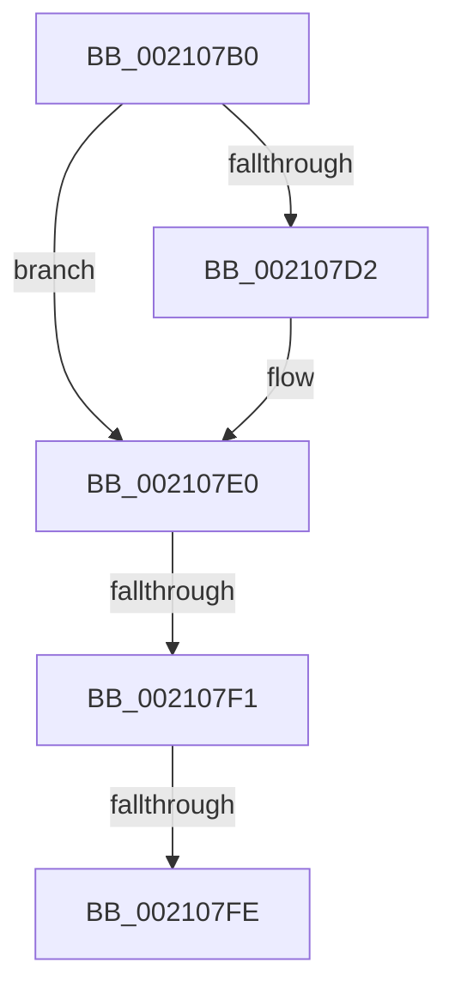

# IopDropIrp

- RVA: `0x002107B0`–`0x00210801` (길이 `81` bytes)
- VA: `0x00000001402107B0`
- 실행 섹션: `.text`
- PDB 이름 있음: `예`; PDB Function 태그: `아니요`
- unwind 정보 RVA: `0x0005DCF0`
- 디코드: `22`개 명령, `81/81` bytes 표시
- 미해석 바이트: `0` (있으면 어셈블리에 `.byte`로 보존)

> 이 문서는 커널 이미지의 기계어와 PDB 기호를 분석해 생성했습니다. 4번과 5번은 함수 원형과 자료형을 바이너리 사용 방식에서 추정한 C 해석이며 원본 소스 복구 결과는 아닙니다.

## 1. Dependencies

- 직접 호출 지점: **1**; 고유 호출 대상: **1**
- 직접 호출자로 확인된 함수: **6**
- RIP 상대 이미지 참조: **0**

### Outgoing calls
- `0x002107D8` → [ExFreePoolWithTag](../../poolcode/B8/ExFreePoolWithTag_function_00B82870.md) (function, `0x00B82870`)

### Direct callers
- [IopfCompleteRequest](../29/IopfCompleteRequest_function_0029B5F8.md) at `0x0029BD4D`
- [IopIoRingCompleteIrp](../3E/IopIoRingCompleteIrp_function_003ED13C.md) at `0x003ED1F1`
- [IopCopyCompleteReadIrp](../4E/IopCopyCompleteReadIrp_function_004E83F0.md) at `0x004E85F4`
- [IopCopyCompleteReadRequest](../4E/IopCopyCompleteReadRequest_function_004E8760.md) at `0x004E8813`
- [sub_006D6658](../6D/Unknown_function_006D6658.md) at `0x006D66D0`
- [IopFreeCompletionListPackets](../../page/9A/IopFreeCompletionListPackets_function_009A8248.md) at `0x009A8270`

### Static image references
- 디코드된 RIP-relative 메모리 참조가 없습니다.

## 2. Other-region calls and transfers

- 다른 실행 섹션으로 향하는 call: **1**
  - `0x002107D8` → [ExFreePoolWithTag](../../poolcode/B8/ExFreePoolWithTag_function_00B82870.md) (`.text` → `POOLCODE`)
- call이 아닌 외부 분기/꼬리 이동: **2**
  - `0x002107EB` → [sub_002109A2 + 0x20](Unknown_function_002109A2.md) (`tail-transfer`)
  - `0x002107F8` → [sub_002109A2](Unknown_function_002109A2.md) (`tail-transfer`)

## 3. Assembly (complete function range)

```asm
002107B0  48 89 5C 24 10                  mov qword ptr [rsp + 0x10], rbx
002107B5  48 89 6C 24 18                  mov qword ptr [rsp + 0x18], rbp
002107BA  48 89 7C 24 20                  mov qword ptr [rsp + 0x20], rdi
002107BF  41 56                           push r14
002107C1  48 83 EC 20                     sub rsp, 0x20
002107C5  8B 41 10                        mov eax, dword ptr [rcx + 0x10]
002107C8  4C 8B F2                        mov r14, rdx
002107CB  48 8B E9                        mov rbp, rcx
002107CE  A8 20                           test al, 0x20
002107D0  74 0E                           je 0x1402107e0
002107D2  48 8B 49 18                     mov rcx, qword ptr [rcx + 0x18]
002107D6  33 D2                           xor edx, edx
002107D8  E8 93 20 97 00                  call 0x140b82870
002107DD  8B 45 10                        mov eax, dword ptr [rbp + 0x10]
002107E0  48 8B 4D 08                     mov rcx, qword ptr [rbp + 8]
002107E4  48 8D 7D 10                     lea rdi, [rbp + 0x10]
002107E8  48 85 C9                        test rcx, rcx
002107EB  0F 85 D1 01 00 00               jne 0x1402109c2
002107F1  48 8B 4D 50                     mov rcx, qword ptr [rbp + 0x50]
002107F5  48 85 C9                        test rcx, rcx
002107F8  0F 85 A4 01 00 00               jne 0x1402109a2
002107FE  8B 45 10                        mov eax, dword ptr [rbp + 0x10]
```

## 4. C-style interpretation (structured pseudocode)

```c
__int64 __fastcall IopDropIrp(__int64 a1, __int64 a2)
{
    __int64 result;
    __int64 v_rsp;
    unsigned __int64 v_stack_p10;
    unsigned __int64 v_stack_p18;
    unsigned __int64 v_stack_p20;

    v_stack_p10 = v_rbx;
    v_stack_p18 = v_rbp;
    v_stack_p20 = v_rdi;
    v_rsp = (v_rsp) - (32);
    result = (unsigned int)(*(unsigned int *)(a1 + 16));
    if ((((unsigned __int8)((unsigned int)(*(unsigned int *)(a1 + 16)))) & (32)) != 0) {
        a1 = *(unsigned __int64 *)(a1 + 24);
        a2 = 0;
        result = ExFreePoolWithTag(a1, a2, a3, a4);
        result = *(unsigned int *)(a1 + 16);
    }
    return (unsigned int)(*(unsigned int *)(a1 + 16));
}
```

## 5. (Beta) C Style

```c
int64_t IopDropIrp(void *Arg1, int64_t Arg2)
{
    uint8_t *arg1 = (uint8_t *)Arg1;

    int64_t result;
    int64_t local_rsp;
    uint64_t v_stack_p10;
    uint64_t v_stack_p18;
    uint64_t v_stack_p20;

    v_stack_p10 = local_rbx;
    v_stack_p18 = local_rbp;
    v_stack_p20 = local_rdi;
    local_rsp = (local_rsp) - (32);
    result = (uint32_t)(*(uint32_t *)(arg1 + 0x10));
    if ((((uint8_t)((uint32_t)(*(uint32_t *)(arg1 + 0x10)))) & (32)) != 0) {
        Arg1 = *(uint64_t *)(arg1 + 0x18);
        Arg2 = 0;
        result = ExFreePoolWithTag(Arg1, Arg2, a3, a4);
        result = *(uint32_t *)(arg1 + 0x10);
    }
    return (uint32_t)(*(uint32_t *)(arg1 + 0x10));
}
```

### 관측된 메모리 오프셋

구조체 형식이 확인되지 않은 접근은 인자 기준의 오프셋으로만 기록했습니다.

| 기준 인자 | 오프셋 표현 | 폭 (bit) | 접근 |
|---|---:|---:|---|
| `Arg1` | `+ 0x8` | `64` | `R` |
| `Arg1` | `+ 0x10` | `32` | `R` |
| `Arg1` | `+ 0x10` | `64` | `R` |
| `Arg1` | `+ 0x18` | `64` | `R` |
| `Arg1` | `+ 0x50` | `64` | `R` |

## 6. Execution-region graph

[열기: 2D/3D 그래프와 함수 탐색 컨트롤 패널](../../../control-panel.html?section=text&rva=0x002107B0&view=graph)

- 2D 그래프는 위에서 아래로 흐르고, 3D 그래프는 빈 공간을 드래그해 회전합니다. Shift+드래그는 이동, 휠은 확대·축소, 함수 노드 선택은 대상 보고서 이동입니다.

### Static fallback


