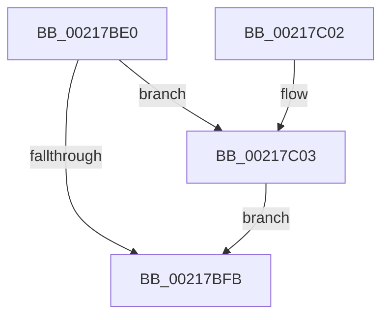

# KeDisableInterrupts

- RVA: `0x00217BE0`–`0x00217C0C` (길이 `44` bytes)
- VA: `0x0000000140217BE0`
- 실행 섹션: `.text`
- PDB 이름 있음: `예`; PDB Function 태그: `아니요`
- unwind 정보 RVA: `0x0005E6F0`
- 디코드: `14`개 명령, `44/44` bytes 표시
- 미해석 바이트: `0` (있으면 어셈블리에 `.byte`로 보존)

> 이 문서는 커널 이미지의 기계어와 PDB 기호를 분석해 생성했습니다. 4번과 5번은 함수 원형과 자료형을 바이너리 사용 방식에서 추정한 C 해석이며 원본 소스 복구 결과는 아닙니다.

## 1. Dependencies

- 직접 호출 지점: **0**; 고유 호출 대상: **0**
- 직접 호출자로 확인된 함수: **105**
- RIP 상대 이미지 참조: **0**

### Outgoing calls
- 직접 디코드된 call 명령이 없습니다.

### Direct callers
- [PpmIdleSnapConcurrency](../20/PpmIdleSnapConcurrency_function_00204694.md) at `0x002046B8`
- [sub_00208EAD](../20/Unknown_function_00208EAD.md) at `0x00208EB9`
- [sub_002099FA](../20/Unknown_function_002099FA.md) at `0x00209CEE`
- [sub_002099FA](../20/Unknown_function_002099FA.md) at `0x00209D68`
- [sub_002099FA](../20/Unknown_function_002099FA.md) at `0x00209DED`
- [sub_0020C2D4](../20/Unknown_function_0020C2D4.md) at `0x0020CB75`
- [sub_0020C2D4](../20/Unknown_function_0020C2D4.md) at `0x0020CC3E`
- [sub_0020C2D4](../20/Unknown_function_0020C2D4.md) at `0x0020CD1F`
- [sub_0020D8DF](../20/Unknown_function_0020D8DF.md) at `0x0020DC09`
- [sub_0020D8DF](../20/Unknown_function_0020D8DF.md) at `0x0020DC76`
- [sub_0020D8DF](../20/Unknown_function_0020D8DF.md) at `0x0020DD28`
- [KeWaitForSingleObject](../20/KeWaitForSingleObject_function_0020E6B0.md) at `0x0020F294`
- [KeWaitForSingleObject](../20/KeWaitForSingleObject_function_0020E6B0.md) at `0x0020F302`
- [KeWaitForSingleObject](../20/KeWaitForSingleObject_function_0020E6B0.md) at `0x0020F4D8`
- [ExpAcquireResourceSharedLite](ExpAcquireResourceSharedLite_function_00212040.md) at `0x00212211`
- [ExpAcquireResourceSharedLite](ExpAcquireResourceSharedLite_function_00212040.md) at `0x002125EA`
- [sub_00214E58](Unknown_function_00214E58.md) at `0x00214F88`
- [sub_00216F9F](Unknown_function_00216F9F.md) at `0x0021701B`
- [sub_002171C2](Unknown_function_002171C2.md) at `0x00217214`
- [KiSetAddressPolicy](KiSetAddressPolicy_function_002178A0.md) at `0x002178A9`
- [sub_00217C3C](Unknown_function_00217C3C.md) at `0x00217C5B`
- [sub_0021B161](Unknown_function_0021B161.md) at `0x0021B196`
- [sub_0021B161](Unknown_function_0021B161.md) at `0x0021B202`
- [sub_0021B161](Unknown_function_0021B161.md) at `0x0021B286`
- [KiSetNextClockTickDueTime](../23/KiSetNextClockTickDueTime_function_002363F0.md) at `0x00236433`
- [sub_0025D903](../25/Unknown_function_0025D903.md) at `0x0025DBCF`
- [sub_0025D903](../25/Unknown_function_0025D903.md) at `0x0025DF8C`
- [sub_0025FB5C](../25/Unknown_function_0025FB5C.md) at `0x0025FD13`
- [sub_0025FB5C](../25/Unknown_function_0025FB5C.md) at `0x002600C8`
- [sub_00260366](../26/Unknown_function_00260366.md) at `0x0026084D`
- [sub_00261DFE](../26/Unknown_function_00261DFE.md) at `0x00261EB8`
- [IopDecrementDeviceObjectRef](../27/IopDecrementDeviceObjectRef_function_00270970.md) at `0x00270A66`
- [sub_0027256E](../27/Unknown_function_0027256E.md) at `0x002725C0`
- [sub_00273F95](../27/Unknown_function_00273F95.md) at `0x0027414F`
- [sub_00273F95](../27/Unknown_function_00273F95.md) at `0x00274518`
- [sub_0027475D](../27/Unknown_function_0027475D.md) at `0x00274935`
- [sub_0027475D](../27/Unknown_function_0027475D.md) at `0x00274C8A`
- [MiDeleteVaDirect](../27/MiDeleteVaDirect_function_00277560.md) at `0x002783C2`
- [MiReleaseFaultState](../27/MiReleaseFaultState_function_0027D290.md) at `0x0027D500`
- [sub_0027D95C](../27/Unknown_function_0027D95C.md) at `0x0027DA7B`
- [MiLockLowestValidPageTableEx](../28/MiLockLowestValidPageTableEx_function_00280D10.md) at `0x002812BA`
- [PpmPerfSetProcessorIdle](../2C/PpmPerfSetProcessorIdle_function_002CFD7C.md) at `0x002CFDEB`
- [PpmParkReportParkedCore](../2D/PpmParkReportParkedCore_function_002D8488.md) at `0x002D850B`
- [PpmPerfApplyProcessorState](../2D/PpmPerfApplyProcessorState_function_002DA4BC.md) at `0x002DA626`
- [PpmUpdatePerformanceFeedback](../2D/PpmUpdatePerformanceFeedback_function_002DE580.md) at `0x002DE647`
- [HvlpSlowSendSyntheticClusterIpiEx](../30/HvlpSlowSendSyntheticClusterIpiEx_function_003034E0.md) at `0x00303549`
- [HvlRetargetDeviceInterrupt](../30/HvlRetargetDeviceInterrupt_function_003062A0.md) at `0x00306550`
- [HvlRetargetDeviceInterrupt](../30/HvlRetargetDeviceInterrupt_function_003062A0.md) at `0x00306582`
- [HvlGetSparseGpaPagesAccessState](../30/HvlGetSparseGpaPagesAccessState_function_00306A78.md) at `0x00306C32`
- [HvlGetSparseGpaPagesAccessState](../30/HvlGetSparseGpaPagesAccessState_function_00306A78.md) at `0x00306C5E`
- [HvlDmaMapDeviceLogicalRange](../30/HvlDmaMapDeviceLogicalRange_function_003077D0.md) at `0x00307B02`
- [HvlDmaMapDeviceLogicalRange](../30/HvlDmaMapDeviceLogicalRange_function_003077D0.md) at `0x00307B19`
- [sub_00313017](../31/Unknown_function_00313017.md) at `0x0031301F`
- [sub_00342D39](../34/Unknown_function_00342D39.md) at `0x00342D51`
- [ExpAcquireSpinLockDisabled](../38/ExpAcquireSpinLockDisabled_function_00386858.md) at `0x0038686C`
- [KeRcuReadUnlock](../38/KeRcuReadUnlock_function_0038A070.md) at `0x0038A091`
- [KeRcuReadLock](../38/KeRcuReadLock_function_0038A1A0.md) at `0x0038A1CD`
- [sub_0039192C](../39/Unknown_function_0039192C.md) at `0x00391940`
- [sub_00391AFF](../39/Unknown_function_00391AFF.md) at `0x00391B03`
- [sub_00391D5F](../39/Unknown_function_00391D5F.md) at `0x00391D7D`
- [NtWaitForWorkViaWorkerFactory](../39/NtWaitForWorkViaWorkerFactory_function_00394270.md) at `0x00394AA6`
- [KeClockInterruptNotify](../39/KeClockInterruptNotify_function_0039A970.md) at `0x0039AE53`
- [KeClockInterruptNotify](../39/KeClockInterruptNotify_function_0039A970.md) at `0x0039AFB5`
- [KeClockInterruptNotify](../39/KeClockInterruptNotify_function_0039A970.md) at `0x0039B01E`
- [KeClockInterruptNotify](../39/KeClockInterruptNotify_function_0039A970.md) at `0x0039B0A4`
- [KiUpdateTime](../39/KiUpdateTime_function_0039B530.md) at `0x0039B5A7`
- [KiUpdateRunTime](../39/KiUpdateRunTime_function_0039BB70.md) at `0x0039BBCF`
- [PpmExecutePeriodicPerfCheck](../39/PpmExecutePeriodicPerfCheck_function_0039D0CC.md) at `0x0039D136`
- [KiCheckForPendingQosUpdate](../39/KiCheckForPendingQosUpdate_function_0039DD48.md) at `0x0039DDAA`
- [KiCheckForPendingQosUpdate](../39/KiCheckForPendingQosUpdate_function_0039DD48.md) at `0x0039DE36`
- [KiSetClockIntervalToMinimumRequested](../39/KiSetClockIntervalToMinimumRequested_function_0039DF1C.md) at `0x0039DF5D`
- [sub_003A385F](../3A/Unknown_function_003A385F.md) at `0x003A3869`
- [KiResetForceIdle](../3A/KiResetForceIdle_function_003A4160.md) at `0x003A419F`
- [sub_003C6144](../3C/Unknown_function_003C6144.md) at `0x003C6163`
- [sub_003C6144](../3C/Unknown_function_003C6144.md) at `0x003C61E6`
- [sub_003C6144](../3C/Unknown_function_003C6144.md) at `0x003C626D`
- [IopCheckDeviceAndDriver](../3F/IopCheckDeviceAndDriver_function_003FCBE0.md) at `0x003FCCEA`
- [sub_0040EACB](../40/Unknown_function_0040EACB.md) at `0x0040EB93`
- [PpmParkSnapNodeStatistics](../41/PpmParkSnapNodeStatistics_function_0041419C.md) at `0x004141F5`
- [HvlMapSparseGpaPages](../42/HvlMapSparseGpaPages_function_0042A160.md) at `0x0042A2AA`
- [HvlMapSparseGpaPages](../42/HvlMapSparseGpaPages_function_0042A160.md) at `0x0042A2BC`
- [HvlGetGpaPagesAccessState](../42/HvlGetGpaPagesAccessState_function_0042A3D4.md) at `0x0042A461`
- [HvlGetGpaPagesAccessState](../42/HvlGetGpaPagesAccessState_function_0042A3D4.md) at `0x0042A4C8`
- [sub_0043C71A](../43/Unknown_function_0043C71A.md) at `0x0043C71F`
- [sub_0043C740](../43/Unknown_function_0043C740.md) at `0x0043C790`
- [HvlpSlowFlushAddressSpaceTb](../44/HvlpSlowFlushAddressSpaceTb_function_004402C4.md) at `0x00440329`
- [KxReenterRetpolinedCode](../44/KxReenterRetpolinedCode_function_0044EE64.md) at `0x0044EE68`
- [KiWakeAddressAll](../45/KiWakeAddressAll_function_0045B334.md) at `0x0045B34C`
- [HvlMapGpaPages](../46/HvlMapGpaPages_function_00462934.md) at `0x00462A9A`
- [KeExitRetpoline](../46/KeExitRetpoline_function_00468E7C.md) at `0x00468E90`
- [KeRemoveQueueDpcEx](../46/KeRemoveQueueDpcEx_function_0046CDC0.md) at `0x0046CE58`
- [HvlpAcquireHypercallPage](../47/HvlpAcquireHypercallPage_function_00471410.md) at `0x0047149E`
- [IopLiveDumpProcessCorralStateChange](../47/IopLiveDumpProcessCorralStateChange_function_00471C7C.md) at `0x00471DDC`
- [HvlDmaMapDeviceSparsePages](../47/HvlDmaMapDeviceSparsePages_function_0047A390.md) at `0x0047A617`
- [HvlDmaMapDeviceSparsePages](../47/HvlDmaMapDeviceSparsePages_function_0047A390.md) at `0x0047A62A`
- [KiDpcRuntimeHistoryHashTableCleanupDpcRoutine](../48/KiDpcRuntimeHistoryHashTableCleanupDpcRoutine_function_00482F60.md) at `0x0048300A`
- [HvlDmaUnmapDeviceSparsePages](../48/HvlDmaUnmapDeviceSparsePages_function_004844C0.md) at `0x0048470B`
- [HvlDmaUnmapDeviceSparsePages](../48/HvlDmaUnmapDeviceSparsePages_function_004844C0.md) at `0x0048471E`
- [PpmIdleUpdateConcurrency](../48/PpmIdleUpdateConcurrency_function_004854C0.md) at `0x004854EC`
- [PpmIdleSnapConcurrencyIdleTime](../4A/PpmIdleSnapConcurrencyIdleTime_function_004A0BD4.md) at `0x004A0C00`
- [HvlLpWriteMultipleMsr](../4A/HvlLpWriteMultipleMsr_function_004A35E0.md) at `0x004A3734`
- [HvlLpWriteMultipleMsr](../4A/HvlLpWriteMultipleMsr_function_004A35E0.md) at `0x004A3746`
- [HvlpSlowFlushListTbEx](../4A/HvlpSlowFlushListTbEx_function_004AFCF8.md) at `0x004AFEB0`
- [KiUpdateSystemTime](../4B/KiUpdateSystemTime_function_004B1570.md) at `0x004B1598`
- [HvlLpReadMultipleMsr](../4B/HvlLpReadMultipleMsr_function_004BC3B0.md) at `0x004BC58A`
- [HvlLpReadMultipleMsr](../4B/HvlLpReadMultipleMsr_function_004BC3B0.md) at `0x004BC5BA`
- [RtlpFcWriteHighLowHigh](../4C/RtlpFcWriteHighLowHigh_function_004C84BC.md) at `0x004C84CB`
- [HvlpSetPowerProperty](../4C/HvlpSetPowerProperty_function_004C9124.md) at `0x004C919B`
- [PpmInstallFeedbackCounters](../4D/PpmInstallFeedbackCounters_function_004D477C.md) at `0x004D4836`
- [KeFreezeExecution](../4D/KeFreezeExecution_function_004DFA40.md) at `0x004DFAA0`
- [HvlSetQpcBias](../4F/HvlSetQpcBias_function_004F8EF0.md) at `0x004F8F4E`
- [KiInitializeProcessorCycleAccumulation](../5B/KiInitializeProcessorCycleAccumulation_function_005B2014.md) at `0x005B208A`
- [KeSrcuReadLock](../5C/KeSrcuReadLock_function_005C2090.md) at `0x005C20A5`
- [KeSrcuReadUnlock](../5C/KeSrcuReadUnlock_function_005C2140.md) at `0x005C2155`
- [KiSrcuNotifyGracePeriodStartedOnCpu](../5C/KiSrcuNotifyGracePeriodStartedOnCpu_function_005C2788.md) at `0x005C27B1`
- [KiSrcuNotifyWorkerDpcRoutine](../5C/KiSrcuNotifyWorkerDpcRoutine_function_005C28D0.md) at `0x005C290C`
- [KiFreezeTargetExecution](../5C/KiFreezeTargetExecution_function_005C30A0.md) at `0x005C310D`
- [KiBugCheckRecoveryFreezeProcessorDpc](../5C/KiBugCheckRecoveryFreezeProcessorDpc_function_005C7360.md) at `0x005C736A`
- [KiBugCheckRecoveryPrepareForCrashDump](../5C/KiBugCheckRecoveryPrepareForCrashDump_function_005C7410.md) at `0x005C7472`
- [KiUpdateBugcheckRecoveryProgress](../5C/KiUpdateBugcheckRecoveryProgress_function_005C7E1C.md) at `0x005C7E50`
- [KiFixupControlProtectionKernelModeReturnMismatch](../5C/KiFixupControlProtectionKernelModeReturnMismatch_function_005C8028.md) at `0x005C808A`
- [KiAcquireReleaseDpcData](../5C/KiAcquireReleaseDpcData_function_005C8404.md) at `0x005C841F`
- [MiReapplyImportOptimizationWorker](../68/MiReapplyImportOptimizationWorker_function_00682720.md) at `0x00682764`
- [sub_006DD630](../6D/Unknown_function_006DD630.md) at `0x006DD630`
- [sub_006E5E2E](../6E/Unknown_function_006E5E2E.md) at `0x006E5E2E`
- [sub_006F3C0A](../6F/Unknown_function_006F3C0A.md) at `0x006F3C92`
- [PnprQuiesceProcessorDpc](../../pagelk/B6/PnprQuiesceProcessorDpc_function_00B64B50.md) at `0x00B64BF2`
- [PopSaveHiberContext](../../pagelk/B6/PopSaveHiberContext_function_00B6F050.md) at `0x00B6F16A`
- [PopHandleNextState](../../pagelk/B7/PopHandleNextState_function_00B77350.md) at `0x00B77692`
- [KiCalibrateTimeAdjustment](../../pagelk/B7/KiCalibrateTimeAdjustment_function_00B797E0.md) at `0x00B7983C`
- [KiSetPageAttributesTable](../../pagelk/B7/KiSetPageAttributesTable_function_00B7D7FC.md) at `0x00B7D82D`
- [KeLoadMTRR](../../pagelk/B7/KeLoadMTRR_function_00B7DDA0.md) at `0x00B7DE32`
- [sub_00B80868](../../pagelk/B8/Unknown_function_00B80868.md) at `0x00B80868`
- [ExpComputeCyclesPerYield](../../init/C1/ExpComputeCyclesPerYield_function_00C1AF20.md) at `0x00C1AF2F`
- [KiComputeDispatchInterruptCost](../../init/C3/KiComputeDispatchInterruptCost_function_00C377C0.md) at `0x00C3793E`

### Static image references
- 디코드된 RIP-relative 메모리 참조가 없습니다.

## 2. Other-region calls and transfers

- 다른 실행 섹션으로 향하는 call: **0**
- 별도 외부 분기/꼬리 이동을 확인하지 못했습니다.

## 3. Assembly (complete function range)

```asm
00217BE0  48 9C                           pushfq
00217BE2  8B 04 24                        mov eax, dword ptr [rsp]
00217BE5  FA                              cli
00217BE6  65 48 8B 0C 25 20 00 00 00      mov rcx, qword ptr gs:[0x20]
00217BEF  48 8B 91 B8 8E 00 00            mov rdx, qword ptr [rcx + 0x8eb8]
00217BF6  48 85 D2                        test rdx, rdx
00217BF9  75 08                           jne 0x140217c03
00217BFB  C1 E8 09                        shr eax, 9
00217BFE  24 01                           and al, 1
00217C00  59                              pop rcx
00217C01  C3                              ret
00217C02  CC                              int3
00217C03  F0 81 0A 00 00 20 00            lock or dword ptr [rdx], 0x200000
00217C0A  EB EF                           jmp 0x140217bfb
```

## 4. C-style interpretation (structured pseudocode)

```c
__int64 __fastcall KeDisableInterrupts(void)
{
    __int64 result;
    unsigned int v_stack_m8;

    if (*(unsigned __int64 *)(*(unsigned __int64 *)(gs_base + (0 + 32)) + 36536) != 0) goto loc_00217C03;
loc_00217BFB:
    result = (unsigned int)(((unsigned int)(v_stack_m8)) >> (9));
    result = (unsigned __int8)((result) & (1));
    return result;
loc_00217C03:
    goto loc_00217BFB;
}
```

## 5. (Beta) C Style

```c
void KeDisableInterrupts(void)
{
    int64_t result;
    uint32_t v_stack_m8;

    if (*(uint64_t *)(*(uint64_t *)(gs_base + (0 + 0x20)) + 0x8EB8) != 0) goto loc_00217C03;
loc_00217BFB:
    result = (uint32_t)(((uint32_t)(v_stack_m8)) >> (9));
    result = (uint8_t)((result) & (1));
    return result;
loc_00217C03:
    goto loc_00217BFB;
}
```

## 6. Execution-region graph

[열기: 2D/3D 그래프와 함수 탐색 컨트롤 패널](../../../control-panel.html?section=text&rva=0x00217BE0&view=graph)

- 2D 그래프는 위에서 아래로 흐르고, 3D 그래프는 빈 공간을 드래그해 회전합니다. Shift+드래그는 이동, 휠은 확대·축소, 함수 노드 선택은 대상 보고서 이동입니다.

### Static fallback


