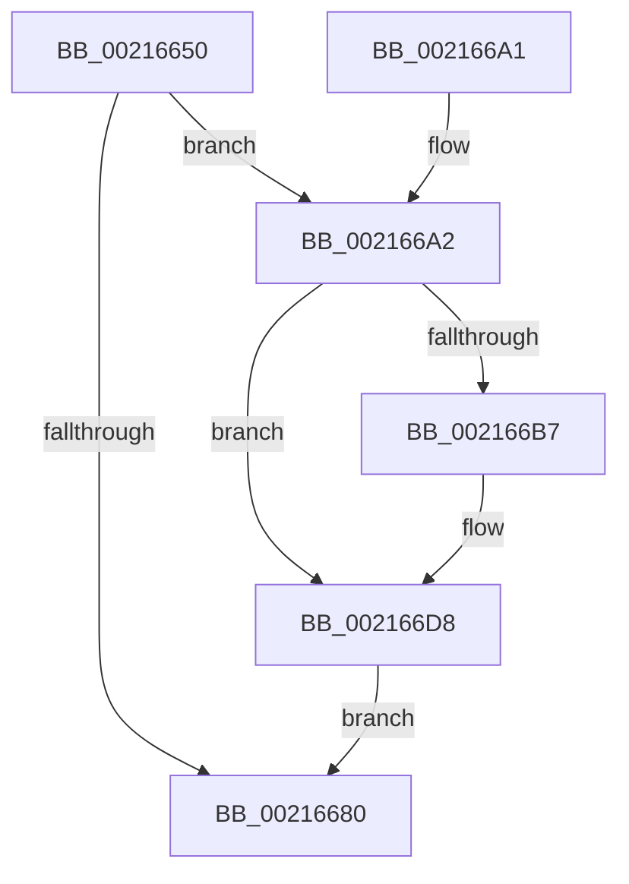

# KeForceAttachProcess

- RVA: `0x00216650`–`0x002166DF` (길이 `143` bytes)
- VA: `0x0000000140216650`
- 실행 섹션: `.text`
- PDB 이름 있음: `예`; PDB Function 태그: `아니요`
- unwind 정보 RVA: `0x0005E32C`
- 디코드: `34`개 명령, `143/143` bytes 표시
- 미해석 바이트: `0` (있으면 어셈블리에 `.byte`로 보존)

> 이 문서는 커널 이미지의 기계어와 PDB 기호를 분석해 생성했습니다. 4번과 5번은 함수 원형과 자료형을 바이너리 사용 방식에서 추정한 C 해석이며 원본 소스 복구 결과는 아닙니다.

## 1. Dependencies

- 직접 호출 지점: **3**; 고유 호출 대상: **3**
- 직접 호출자로 확인된 함수: **8**
- RIP 상대 이미지 참조: **1**

### Outgoing calls
- `0x0021668A` → [KiStackAttachProcess](KiStackAttachProcess_function_00216820.md) (function, `0x00216820`)
- `0x00216697` → [_security_check_cookie](../6A/_security_check_cookie_function_006AC640.md) (function, `0x006AC640`)
- `0x002166D2` → [KeBugCheckEx](../4F/KeBugCheckEx_function_004FD660.md) (function, `0x004FD660`)

### Direct callers
- [MiLockStealUserVm](../2B/MiLockStealUserVm_function_002B3EDC.md) at `0x002B4074`
- [MiTrimSharedPageFromViews](../2E/MiTrimSharedPageFromViews_function_002E16F8.md) at `0x002E1853`
- [MiReleaseOutSwappedProcessCommit](../3C/MiReleaseOutSwappedProcessCommit_function_003C8320.md) at `0x003C8340`
- [MiReAcquireOutSwappedProcessCommit](../66/MiReAcquireOutSwappedProcessCommit_function_0066F598.md) at `0x0066F5BC`
- [MiReleaseCommitForResetPages](../66/MiReleaseCommitForResetPages_function_0066FAF8.md) at `0x0066FB18`
- [MmReleaseCommitForMemResetPages](../66/MmReleaseCommitForMemResetPages_function_0066FDCC.md) at `0x0066FEA2`
- [sub_006F5914](../6F/Unknown_function_006F5914.md) at `0x006F5950`
- [PopHandleNextState](../../pagelk/B7/PopHandleNextState_function_00B77350.md) at `0x00B775BF`

### Static image references
- `0x00216654` → RVA `0x00E0A740` (`.data`; read)

## 2. Other-region calls and transfers

- 다른 실행 섹션으로 향하는 call: **0**
- 별도 외부 분기/꼬리 이동을 확인하지 못했습니다.

## 3. Assembly (complete function range)

```asm
00216650  48 83 EC 78                     sub rsp, 0x78
00216654  48 8B 05 E5 40 BF 00            mov rax, qword ptr [rip + 0xbf40e5]
0021665B  48 33 C4                        xor rax, rsp
0021665E  48 89 44 24 60                  mov qword ptr [rsp + 0x60], rax
00216663  0F 57 C0                        xorps xmm0, xmm0
00216666  41 8B C0                        mov eax, r8d
00216669  4C 8B C2                        mov r8, rdx
0021666C  0F 11 44 24 30                  movups xmmword ptr [rsp + 0x30], xmm0
00216671  0F 11 44 24 40                  movups xmmword ptr [rsp + 0x40], xmm0
00216676  0F 11 44 24 50                  movups xmmword ptr [rsp + 0x50], xmm0
0021667B  48 85 D2                        test rdx, rdx
0021667E  74 22                           je 0x1402166a2
00216680  83 E0 01                        and eax, 1
00216683  8D 14 45 01 00 00 00            lea edx, [rax*2 + 1]
0021668A  E8 91 01 00 00                  call 0x140216820
0021668F  48 8B 4C 24 60                  mov rcx, qword ptr [rsp + 0x60]
00216694  48 33 CC                        xor rcx, rsp
00216697  E8 A4 5F 49 00                  call 0x1406ac640
0021669C  48 83 C4 78                     add rsp, 0x78
002166A0  C3                              ret
002166A1  CC                              int3
002166A2  65 4C 8B 04 25 88 01 00 00      mov r8, qword ptr gs:[0x188]
002166AB  41 0F B6 90 4A 02 00 00         movzx edx, byte ptr [r8 + 0x24a]
002166B3  84 D2                           test dl, dl
002166B5  74 21                           je 0x1402166d8
002166B7  4D 8B 80 B8 00 00 00            mov r8, qword ptr [r8 + 0xb8]
002166BE  44 8B CA                        mov r9d, edx
002166C1  48 8B D1                        mov rdx, rcx
002166C4  48 C7 44 24 20 00 00 00 00      mov qword ptr [rsp + 0x20], 0
002166CD  B9 05 00 00 00                  mov ecx, 5
002166D2  E8 89 6F 2E 00                  call 0x1404fd660
002166D7  CC                              int3
002166D8  4C 8D 44 24 30                  lea r8, [rsp + 0x30]
002166DD  EB A1                           jmp 0x140216680
```

## 4. C-style interpretation (structured pseudocode)

```c
__int64 __fastcall KeForceAttachProcess(__int64 a1, __int64 a2, int a3)
{
    __int64 result;
    __int64 v_rsp;
    unsigned __int64 v_stack_m18;
    unsigned __int64 v_stack_m28;
    unsigned __int64 v_stack_m38;
    unsigned __int64 v_stack_m48;
    unsigned __int64 v_stack_p20;
    unsigned __int64 v_stack_p30;

    v_rsp = (v_rsp) - (120);
    result = (*(unsigned __int64 *)(v_rip + 12533989)) ^ (v_rsp);
    v_stack_m18 = result;
    v_stack_m48 = v_xmm0;
    v_stack_m38 = v_xmm0;
    v_stack_m28 = v_xmm0;
    if (a2 == 0) goto loc_002166A2;
loc_00216680:
    result = (unsigned int)(((unsigned int)(a3)) & (1));
    result = KiStackAttachProcess(a1, result * 2 + 1, a2, a4);
    a1 = (v_stack_m18) ^ (v_rsp);
    result = _security_check_cookie(a1, result * 2 + 1, a2, a4);
    v_rsp = (v_rsp) + (120);
    return result;
loc_002166A2:
    if ((unsigned __int8)(*(unsigned __int8 *)(*(unsigned __int64 *)(gs_base + (0 + 392)) + 586)) != 0) {
        a3 = *(unsigned __int64 *)(*(unsigned __int64 *)(gs_base + (0 + 392)) + 184);
        a4 = (unsigned int)(*(unsigned __int8 *)(*(unsigned __int64 *)(gs_base + (0 + 392)) + 586));
        a2 = a1;
        v_stack_p20 = 0;
        a1 = 5;
        result = KeBugCheckEx(a1, a2, a3, a4);
    }
    goto loc_00216680;
}
```

## 5. (Beta) C Style

```c
int64_t KeForceAttachProcess(int64_t Arg1, int64_t Arg2, int32_t Arg3)
{
    int64_t result;
    int64_t local_rsp;
    uint64_t v_stack_m18;
    uint64_t v_stack_m28;
    uint64_t v_stack_m38;
    uint64_t v_stack_m48;
    uint64_t v_stack_p20;
    uint64_t v_stack_p30;

    local_rsp = (local_rsp) - (120);
    result = (*(uint64_t *)(v_rip + 0xBF40E5)) ^ (local_rsp);
    v_stack_m18 = result;
    v_stack_m48 = v_xmm0;
    v_stack_m38 = v_xmm0;
    v_stack_m28 = v_xmm0;
    if (Arg2 == 0) goto loc_002166A2;
loc_00216680:
    result = (uint32_t)(((uint32_t)(Arg3)) & (1));
    result = KiStackAttachProcess(Arg1, result * 2 + 1, Arg2, a4);
    Arg1 = (v_stack_m18) ^ (local_rsp);
    result = _security_check_cookie(Arg1, result * 2 + 1, Arg2, a4);
    local_rsp = (local_rsp) + (120);
    return result;
loc_002166A2:
    if ((uint8_t)(*(uint8_t *)(*(uint64_t *)(gs_base + (0 + 0x188)) + 0x24A)) != 0) {
        Arg3 = *(uint64_t *)(*(uint64_t *)(gs_base + (0 + 0x188)) + 0xB8);
        a4 = (uint32_t)(*(uint8_t *)(*(uint64_t *)(gs_base + (0 + 0x188)) + 0x24A));
        Arg2 = Arg1;
        v_stack_p20 = 0;
        Arg1 = 5;
        result = KeBugCheckEx(Arg1, Arg2, Arg3, a4);
    }
    goto loc_00216680;
}
```

## 6. Execution-region graph

[열기: 2D/3D 그래프와 함수 탐색 컨트롤 패널](../../../control-panel.html?section=text&rva=0x00216650&view=graph)

- 2D 그래프는 위에서 아래로 흐르고, 3D 그래프는 빈 공간을 드래그해 회전합니다. Shift+드래그는 이동, 휠은 확대·축소, 함수 노드 선택은 대상 보고서 이동입니다.

### Static fallback


