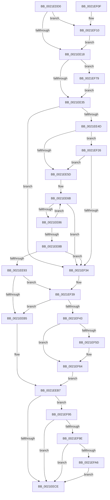

# KeInsertPriQueue

- RVA: `0x0021EDD0`–`0x0021EFB6` (길이 `486` bytes)
- VA: `0x000000014021EDD0`
- 실행 섹션: `.text`
- PDB 이름 있음: `예`; PDB Function 태그: `아니요`
- unwind 정보 RVA: `0x0005F0EC`
- 디코드: `120`개 명령, `486/486` bytes 표시
- 미해석 바이트: `0` (있으면 어셈블리에 `.byte`로 보존)

> 이 문서는 커널 이미지의 기계어와 PDB 기호를 분석해 생성했습니다. 4번과 5번은 함수 원형과 자료형을 바이너리 사용 방식에서 추정한 C 해석이며 원본 소스 복구 결과는 아닙니다.

## 1. Dependencies

- 직접 호출 지점: **7**; 고유 호출 대상: **7**
- 직접 호출자로 확인된 함수: **2**
- RIP 상대 이미지 참조: **2**

### Outgoing calls
- `0x0021EE38` → [KiAcquireKobjectLockSafe](../25/KiAcquireKobjectLockSafe_function_00251C90.md) (function, `0x00251C90`)
- `0x0021EEA4` → [KiWakePriQueueWaiter](KiWakePriQueueWaiter_function_0021F720.md) (function, `0x0021F720`)
- `0x0021EEE9` → [KiExitDispatcher](../25/KiExitDispatcher_function_00251CF0.md) (function, `0x00251CF0`)
- `0x0021EF17` → [KiRaiseIrqlProcessIrqlFlags](../4F/KiRaiseIrqlProcessIrqlFlags_function_004F56FC.md) (function, `0x004F56FC`)
- `0x0021EF7C` → [KeIsThreadRunning](../39/KeIsThreadRunning_function_00396720.md) (function, `0x00396720`)
- `0x0021EF8B` → [EtwTracePriQEnqueueWork](../4D/EtwTracePriQEnqueueWork_function_004D3C4C.md) (function, `0x004D3C4C`)
- `0x0021EFAC` → [EtwTracePriQEnqueueFailed](../64/EtwTracePriQEnqueueFailed_function_0064FEB4.md) (function, `0x0064FEB4`)

### Direct callers
- [sub_0035853D](../35/Unknown_function_0035853D.md) at `0x0035858F`
- [ExpTryQueueWorkItem](../39/ExpTryQueueWorkItem_function_0039801C.md) at `0x00398148`

### Static image references
- `0x0021EE0B` → RVA `0x00FC6D20` (`ALMOSTRO`; read)
- `0x0021EE21` → RVA `0x00FC6B04` (`ALMOSTRO`; read)

## 2. Other-region calls and transfers

- 다른 실행 섹션으로 향하는 call: **0**
- 별도 외부 분기/꼬리 이동을 확인하지 못했습니다.

## 3. Assembly (complete function range)

```asm
0021EDD0  48 89 5C 24 08                  mov qword ptr [rsp + 8], rbx
0021EDD5  48 89 6C 24 18                  mov qword ptr [rsp + 0x18], rbp
0021EDDA  48 89 74 24 20                  mov qword ptr [rsp + 0x20], rsi
0021EDDF  48 89 54 24 10                  mov qword ptr [rsp + 0x10], rdx
0021EDE4  57                              push rdi
0021EDE5  41 54                           push r12
0021EDE7  41 55                           push r13
0021EDE9  41 56                           push r14
0021EDEB  41 57                           push r15
0021EDED  48 83 EC 30                     sub rsp, 0x30
0021EDF1  4D 63 F8                        movsxd r15, r8d
0021EDF4  48 8D 59 08                     lea rbx, [rcx + 8]
0021EDF8  48 8B F9                        mov rdi, rcx
0021EDFB  45 32 F6                        xor r14b, r14b
0021EDFE  45 0F 20 C4                     mov r12, cr8
0021EE02  B8 02 00 00 00                  mov eax, 2
0021EE07  44 0F 22 C0                     mov cr8, rax
0021EE0B  83 3D 0E 7F DA 00 00            cmp dword ptr [rip + 0xda7f0e], 0
0021EE12  0F 85 F8 00 00 00               jne 0x14021ef10
0021EE18  65 48 8B 2C 25 20 00 00 00      mov rbp, qword ptr gs:[0x20]
0021EE21  F7 05 D9 7C DA 00 00 00 00 01   test dword ptr [rip + 0xda7cd9], 0x1000000
0021EE2B  4C 8B 6D 08                     mov r13, qword ptr [rbp + 8]
0021EE2F  0F 85 44 01 00 00               jne 0x14021ef79
0021EE35  48 8B CF                        mov rcx, rdi
0021EE38  E8 53 2E 03 00                  call 0x140251c90
0021EE3D  8B B4 24 80 00 00 00            mov esi, dword ptr [rsp + 0x80]
0021EE44  48 39 1B                        cmp qword ptr [rbx], rbx
0021EE47  0F 84 E7 00 00 00               je 0x14021ef34
0021EE4D  49 8B 85 E8 00 00 00            mov rax, qword ptr [r13 + 0xe8]
0021EE54  48 3B C7                        cmp rax, rdi
0021EE57  0F 84 C9 00 00 00               je 0x14021ef26
0021EE5D  33 D2                           xor edx, edx
0021EE5F  4C 8D 87 98 02 00 00            lea r8, [rdi + 0x298]
0021EE66  B8 20 00 00 00                  mov eax, 0x20
0021EE6B  41 8B 48 FC                     mov ecx, dword ptr [r8 - 4]
0021EE6F  4D 8D 40 FC                     lea r8, [r8 - 4]
0021EE73  03 D1                           add edx, ecx
0021EE75  48 FF C8                        dec rax
0021EE78  8B 8F 98 02 00 00               mov ecx, dword ptr [rdi + 0x298]
0021EE7E  3B D1                           cmp edx, ecx
0021EE80  0F 83 AE 00 00 00               jae 0x14021ef34
0021EE86  49 3B C7                        cmp rax, r15
0021EE89  7F E0                           jg 0x14021ee6b
0021EE8B  3B D1                           cmp edx, ecx
0021EE8D  0F 83 A1 00 00 00               jae 0x14021ef34
0021EE93  48 8B 5C 24 68                  mov rbx, qword ptr [rsp + 0x68]
0021EE98  45 8B CF                        mov r9d, r15d
0021EE9B  4C 8B C3                        mov r8, rbx
0021EE9E  48 8B D7                        mov rdx, rdi
0021EEA1  48 8B CD                        mov rcx, rbp
0021EEA4  E8 77 08 00 00                  call 0x14021f720
0021EEA9  44 0F B6 F0                     movzx r14d, al
0021EEAD  84 C0                           test al, al
0021EEAF  0F 84 84 00 00 00               je 0x14021ef39
0021EEB5  32 C9                           xor cl, cl
0021EEB7  F0 81 27 7F FF FF FF            lock and dword ptr [rdi], 0xffffff7f
0021EEBE  F7 05 3C 7C DA 00 00 00 00 01   test dword ptr [rip + 0xda7c3c], 0x1000000
0021EEC8  0F 85 C7 00 00 00               jne 0x14021ef95
0021EECE  40 80 E6 01                     and sil, 1
0021EED2  44 88 64 24 20                  mov byte ptr [rsp + 0x20], r12b
0021EED7  40 F6 DE                        neg sil
0021EEDA  48 8B CD                        mov rcx, rbp
0021EEDD  1B D2                           sbb edx, edx
0021EEDF  45 33 C9                        xor r9d, r9d
0021EEE2  83 E2 03                        and edx, 3
0021EEE5  45 8D 41 01                     lea r8d, [r9 + 1]
0021EEE9  E8 02 2E 03 00                  call 0x140251cf0
0021EEEE  48 8B 5C 24 60                  mov rbx, qword ptr [rsp + 0x60]
0021EEF3  41 0F B6 C6                     movzx eax, r14b
0021EEF7  48 8B 6C 24 70                  mov rbp, qword ptr [rsp + 0x70]
0021EEFC  48 8B 74 24 78                  mov rsi, qword ptr [rsp + 0x78]
0021EF01  48 83 C4 30                     add rsp, 0x30
0021EF05  41 5F                           pop r15
0021EF07  41 5E                           pop r14
0021EF09  41 5D                           pop r13
0021EF0B  41 5C                           pop r12
0021EF0D  5F                              pop rdi
0021EF0E  C3                              ret
0021EF0F  CC                              int3
0021EF10  0F B6 D0                        movzx edx, al
0021EF13  41 0F B6 CC                     movzx ecx, r12b
0021EF17  E8 E0 67 2D 00                  call 0x1404f56fc
0021EF1C  48 8B 54 24 68                  mov rdx, qword ptr [rsp + 0x68]
0021EF21  E9 F2 FE FF FF                  jmp 0x14021ee18
0021EF26  41 80 BD 83 02 00 00 0F         cmp byte ptr [r13 + 0x283], 0xf
0021EF2E  0F 85 29 FF FF FF               jne 0x14021ee5d
0021EF34  48 8B 5C 24 68                  mov rbx, qword ptr [rsp + 0x68]
0021EF39  40 F6 C6 02                     test sil, 2
0021EF3D  0F 85 72 FF FF FF               jne 0x14021eeb5
0021EF43  FF 47 04                        inc dword ptr [rdi + 4]
0021EF46  49 8B D7                        mov rdx, r15
0021EF49  48 C1 E2 04                     shl rdx, 4
0021EF4D  48 83 C2 18                     add rdx, 0x18
0021EF51  48 03 D7                        add rdx, rdi
0021EF54  48 8B 42 08                     mov rax, qword ptr [rdx + 8]
0021EF58  48 39 10                        cmp qword ptr [rax], rdx
0021EF5B  74 07                           je 0x14021ef64
0021EF5D  B9 03 00 00 00                  mov ecx, 3
0021EF62  CD 29                           int 0x29
0021EF64  48 89 13                        mov qword ptr [rbx], rdx
0021EF67  B1 01                           mov cl, 1
0021EF69  48 89 43 08                     mov qword ptr [rbx + 8], rax
0021EF6D  48 89 18                        mov qword ptr [rax], rbx
0021EF70  48 89 5A 08                     mov qword ptr [rdx + 8], rbx
0021EF74  E9 3E FF FF FF                  jmp 0x14021eeb7
0021EF79  49 8B CD                        mov rcx, r13
0021EF7C  E8 9F 77 17 00                  call 0x140396720
0021EF81  44 0F B6 C8                     movzx r9d, al
0021EF85  49 8B CD                        mov rcx, r13
0021EF88  45 8B C7                        mov r8d, r15d
0021EF8B  E8 BC 4C 2B 00                  call 0x1404d3c4c
0021EF90  E9 A0 FE FF FF                  jmp 0x14021ee35
0021EF95  45 84 F6                        test r14b, r14b
0021EF98  0F 85 30 FF FF FF               jne 0x14021eece
0021EF9E  84 C9                           test cl, cl
0021EFA0  0F 85 28 FF FF FF               jne 0x14021eece
0021EFA6  48 8B D3                        mov rdx, rbx
0021EFA9  49 8B CD                        mov rcx, r13
0021EFAC  E8 03 0F 43 00                  call 0x14064feb4
0021EFB1  E9 18 FF FF FF                  jmp 0x14021eece
```

## 4. C-style interpretation (structured pseudocode)

```c
__int64 __fastcall KeInsertPriQueue(__int64 a1, __int64 a2, int a3, __int64 a4, unsigned int a5)
{
    __int64 result;
    __int64 v_r14;
    __int64 v_rsi;
    __int64 v_rsp;
    unsigned __int8 v_stack_m38;
    unsigned __int64 v_stack_p10;
    unsigned __int64 v_stack_p18;
    unsigned __int64 v_stack_p20;
    unsigned __int64 v_stack_p68;
    unsigned __int64 v_stack_p8;

    v_stack_p8 = v_rbx;
    v_stack_p18 = v_rbp;
    v_stack_p20 = v_rsi;
    v_stack_p10 = a2;
    v_rsp = (v_rsp) - (48);
    v_r14 = 0;
    if ((*(unsigned int *)(v_rip + 14319374)) != 0) goto loc_0021EF10;
loc_0021EE18:
    if (((*(unsigned int *)(v_rip + 14318809)) & (0x1000000ULL)) != 0) goto loc_0021EF79;
loc_0021EE35:
    result = KiAcquireKobjectLockSafe(a1, a2, a3, a4);
    if ((*(unsigned __int64 *)(a1 + 8)) == (a1 + 8)) goto loc_0021EF34;
    if ((*(unsigned __int64 *)(*(unsigned __int64 *)(*(unsigned __int64 *)(gs_base + (0 + 32)) + 8) + 232)) == a1) goto loc_0021EF26;
loc_0021EE5D:
    a2 = 0;
loc_0021EE6B:
    a2 = (unsigned int)((a2) + ((unsigned int)((unsigned int)(*(unsigned int *)(a1 + 664 - 4)))));
    result = (32) - 1;
    if (((unsigned int)(a2)) >= ((unsigned int)((unsigned int)(*(unsigned int *)(a1 + 664))))) goto loc_0021EF34;
    if (result > ((int)(a3))) goto loc_0021EE6B;
    if (((unsigned int)(a2)) >= ((unsigned int)((unsigned int)(*(unsigned int *)(a1 + 664))))) goto loc_0021EF34;
    result = KiWakePriQueueWaiter(*(unsigned __int64 *)(gs_base + (0 + 32)), a1, v_stack_p10, (unsigned int)((unsigned int)((int)(a3))));
    if ((unsigned __int8)(result) == 0) goto loc_0021EF39;
loc_0021EEB5:
    a1 = 0;
loc_0021EEB7:
    if (((*(unsigned int *)(v_rip + 14318652)) & (0x1000000ULL)) != 0) goto loc_0021EF95;
loc_0021EECE:
    v_rsi = (unsigned __int8)(((unsigned int)(a5)) & (1));
    v_stack_m38 = (unsigned __int8)(v_cr8);
    v_rsi = (unsigned __int8)(-(v_rsi));
    a4 = 0;
    a2 = (unsigned int)((a1) & (3));
    result = KiExitDispatcher(*(unsigned __int64 *)(gs_base + (0 + 32)), a2, a4 + 1, a4);
    v_rsp = (v_rsp) + (48);
    return (unsigned __int8)((unsigned __int8)(result));
loc_0021EF10:
    result = KiRaiseIrqlProcessIrqlFlags((unsigned __int8)(v_cr8), (unsigned __int8)((unsigned __int8)((unsigned __int8)(result))), a4 + 1, a4);
    goto loc_0021EE18;
loc_0021EF26:
    if ((*(unsigned __int8 *)(*(unsigned __int64 *)(*(unsigned __int64 *)(gs_base + (0 + 32)) + 8) + 643)) != 15) goto loc_0021EE5D;
loc_0021EF34:
loc_0021EF39:
    if ((((unsigned __int8)(v_stack_p20)) & (2)) != 0) goto loc_0021EEB5;
    a2 = ((int)(a3)) << (4);
    a2 = (a2) + (24);
    a2 = (a2) + (0);
    if ((*(unsigned __int64 *)(*(unsigned __int64 *)(a2 + 8))) != a2) {
        a1 = 3;
    }
    *(unsigned __int64 *)(v_stack_p68) = a2;
    *(unsigned __int64 *)(v_stack_p68 + 8) = *(unsigned __int64 *)(a2 + 8);
    *(unsigned __int64 *)(*(unsigned __int64 *)(a2 + 8)) = v_stack_p68;
    *(unsigned __int64 *)(a2 + 8) = v_stack_p68;
    goto loc_0021EEB7;
loc_0021EF79:
    result = KeIsThreadRunning(*(unsigned __int64 *)(*(unsigned __int64 *)(gs_base + (0 + 32)) + 8), a2, a4 + 1, a4);
    result = EtwTracePriQEnqueueWork(*(unsigned __int64 *)(*(unsigned __int64 *)(gs_base + (0 + 32)) + 8), a2, (unsigned int)((unsigned int)((int)(a3))), (unsigned __int8)(result));
    goto loc_0021EE35;
loc_0021EF95:
    if ((unsigned __int8)((unsigned __int8)(result)) != 0) goto loc_0021EECE;
    if ((unsigned __int8)(*(unsigned __int64 *)(*(unsigned __int64 *)(gs_base + (0 + 32)) + 8)) != 0) goto loc_0021EECE;
    result = EtwTracePriQEnqueueFailed(*(unsigned __int64 *)(*(unsigned __int64 *)(gs_base + (0 + 32)) + 8), v_stack_p68, (unsigned int)((unsigned int)((int)(a3))), (unsigned __int8)(result));
    goto loc_0021EECE;
}
```

## 5. (Beta) C Style

```c
int64_t KeInsertPriQueue(void *Arg1, int64_t Arg2, int32_t Arg3, int64_t Arg4, uint32_t Arg5)
{
    uint8_t *arg1 = (uint8_t *)Arg1;

    int64_t result;
    int64_t local_r14;
    int64_t local_rsi;
    int64_t local_rsp;
    uint8_t v_stack_m38;
    uint64_t v_stack_p10;
    uint64_t v_stack_p18;
    uint64_t v_stack_p20;
    uint64_t v_stack_p68;
    uint64_t v_stack_p8;

    v_stack_p8 = local_rbx;
    v_stack_p18 = local_rbp;
    v_stack_p20 = local_rsi;
    v_stack_p10 = Arg2;
    local_rsp = (local_rsp) - (48);
    local_r14 = 0;
    if ((*(uint32_t *)(v_rip + 0xDA7F0E)) != 0) goto loc_0021EF10;
loc_0021EE18:
    if (((*(uint32_t *)(v_rip + 0xDA7CD9)) & (0x1000000ULL)) != 0) goto loc_0021EF79;
loc_0021EE35:
    result = KiAcquireKobjectLockSafe(Arg1, Arg2, Arg3, Arg4);
    if ((*(uint64_t *)(arg1 + 0x8)) == (Arg1 + 8)) goto loc_0021EF34;
    if ((*(uint64_t *)(*(uint64_t *)(*(uint64_t *)(gs_base + (0 + 0x20)) + 0x8) + 0xE8)) == Arg1) goto loc_0021EF26;
loc_0021EE5D:
    Arg2 = 0;
loc_0021EE6B:
    Arg2 = (uint32_t)((Arg2) + ((uint32_t)((uint32_t)(*(uint32_t *)(arg1 + 0x298 - 0x4)))));
    result = (32) - 1;
    if (((uint32_t)(Arg2)) >= ((uint32_t)((uint32_t)(*(uint32_t *)(arg1 + 0x298))))) goto loc_0021EF34;
    if (result > ((int32_t)(Arg3))) goto loc_0021EE6B;
    if (((uint32_t)(Arg2)) >= ((uint32_t)((uint32_t)(*(uint32_t *)(arg1 + 0x298))))) goto loc_0021EF34;
    result = KiWakePriQueueWaiter(*(uint64_t *)(gs_base + (0 + 0x20)), Arg1, v_stack_p10, (uint32_t)((uint32_t)((int32_t)(Arg3))));
    if ((uint8_t)(result) == 0) goto loc_0021EF39;
loc_0021EEB5:
    Arg1 = 0;
loc_0021EEB7:
    if (((*(uint32_t *)(v_rip + 0xDA7C3C)) & (0x1000000ULL)) != 0) goto loc_0021EF95;
loc_0021EECE:
    local_rsi = (uint8_t)(((uint32_t)(Arg5)) & (1));
    v_stack_m38 = (uint8_t)(v_cr8);
    local_rsi = (uint8_t)(-(local_rsi));
    Arg4 = 0;
    Arg2 = (uint32_t)((Arg1) & (3));
    result = KiExitDispatcher(*(uint64_t *)(gs_base + (0 + 0x20)), Arg2, Arg4 + 1, Arg4);
    local_rsp = (local_rsp) + (48);
    return (uint8_t)((uint8_t)(result));
loc_0021EF10:
    result = KiRaiseIrqlProcessIrqlFlags((uint8_t)(v_cr8), (uint8_t)((uint8_t)((uint8_t)(result))), Arg4 + 1, Arg4);
    goto loc_0021EE18;
loc_0021EF26:
    if ((*(uint8_t *)(*(uint64_t *)(*(uint64_t *)(gs_base + (0 + 0x20)) + 0x8) + 0x283)) != 15) goto loc_0021EE5D;
loc_0021EF34:
loc_0021EF39:
    if ((((uint8_t)(v_stack_p20)) & (2)) != 0) goto loc_0021EEB5;
    Arg2 = ((int32_t)(Arg3)) << (4);
    Arg2 = (Arg2) + (24);
    Arg2 = (Arg2) + (0);
    if ((*(uint64_t *)(*(uint64_t *)(Arg2 + 0x8))) != Arg2) {
        Arg1 = 3;
    }
    *(uint64_t *)(v_stack_p68) = Arg2;
    *(uint64_t *)(v_stack_p68 + 0x8) = *(uint64_t *)(Arg2 + 0x8);
    *(uint64_t *)(*(uint64_t *)(Arg2 + 0x8)) = v_stack_p68;
    *(uint64_t *)(Arg2 + 0x8) = v_stack_p68;
    goto loc_0021EEB7;
loc_0021EF79:
    result = KeIsThreadRunning(*(uint64_t *)(*(uint64_t *)(gs_base + (0 + 0x20)) + 0x8), Arg2, Arg4 + 1, Arg4);
    result = EtwTracePriQEnqueueWork(*(uint64_t *)(*(uint64_t *)(gs_base + (0 + 0x20)) + 0x8), Arg2, (uint32_t)((uint32_t)((int32_t)(Arg3))), (uint8_t)(result));
    goto loc_0021EE35;
loc_0021EF95:
    if ((uint8_t)((uint8_t)(result)) != 0) goto loc_0021EECE;
    if ((uint8_t)(*(uint64_t *)(*(uint64_t *)(gs_base + (0 + 0x20)) + 0x8)) != 0) goto loc_0021EECE;
    result = EtwTracePriQEnqueueFailed(*(uint64_t *)(*(uint64_t *)(gs_base + (0 + 0x20)) + 0x8), v_stack_p68, (uint32_t)((uint32_t)((int32_t)(Arg3))), (uint8_t)(result));
    goto loc_0021EECE;
}
```

### 관측된 메모리 오프셋

구조체 형식이 확인되지 않은 접근은 인자 기준의 오프셋으로만 기록했습니다.

| 기준 인자 | 오프셋 표현 | 폭 (bit) | 접근 |
|---|---:|---:|---|
| `Arg1` | `- 0x4` | `32` | `R` |
| `Arg1` | `- 0x4` | `64` | `R` |
| `Arg1` | `+ 0x0` | `32` | `R/W` |
| `Arg1` | `+ 0x0` | `64` | `R` |
| `Arg1` | `+ 0x4` | `32` | `R/W` |
| `Arg1` | `+ 0x8` | `64` | `R` |
| `Arg1` | `+ 0x298` | `32` | `R` |
| `Arg1` | `+ 0x298` | `64` | `R` |

## 6. Execution-region graph

[열기: 2D/3D 그래프와 함수 탐색 컨트롤 패널](../../../control-panel.html?section=text&rva=0x0021EDD0&view=graph)

- 2D 그래프는 위에서 아래로 흐르고, 3D 그래프는 빈 공간을 드래그해 회전합니다. Shift+드래그는 이동, 휠은 확대·축소, 함수 노드 선택은 대상 보고서 이동입니다.

### Static fallback


