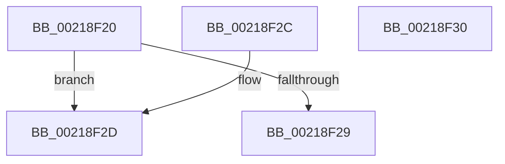

# KeIsForceParkingEnabled

- RVA: `0x00218F20`–`0x00218F31` (길이 `17` bytes)
- VA: `0x0000000140218F20`
- 실행 섹션: `.text`
- PDB 이름 있음: `예`; PDB Function 태그: `아니요`
- unwind 정보 RVA: `0x000DB714`
- 디코드: `8`개 명령, `17/17` bytes 표시
- 미해석 바이트: `0` (있으면 어셈블리에 `.byte`로 보존)

> 이 문서는 커널 이미지의 기계어와 PDB 기호를 분석해 생성했습니다. 4번과 5번은 함수 원형과 자료형을 바이너리 사용 방식에서 추정한 C 해석이며 원본 소스 복구 결과는 아닙니다.

## 1. Dependencies

- 직접 호출 지점: **0**; 고유 호출 대상: **0**
- 직접 호출자로 확인된 함수: **11**
- RIP 상대 이미지 참조: **1**

### Outgoing calls
- 직접 디코드된 call 명령이 없습니다.

### Direct callers
- [sub_00218B2B](Unknown_function_00218B2B.md) at `0x00218C66`
- [sub_00218B2B](Unknown_function_00218B2B.md) at `0x00218D9C`
- [KiQueueReadyThread](KiQueueReadyThread_function_0021C7B0.md) at `0x0021CBE0`
- [sub_00254461](../25/Unknown_function_00254461.md) at `0x00254510`
- [sub_002546EC](../25/Unknown_function_002546EC.md) at `0x00254A88`
- [KiAttemptToScheduleThreadToBusyIsolationUnit](../25/KiAttemptToScheduleThreadToBusyIsolationUnit_function_00259B00.md) at `0x0025A198`
- [KiAdjustReadyQueueScanOwnerOnParkingChange](../30/KiAdjustReadyQueueScanOwnerOnParkingChange_function_0030BD30.md) at `0x0030BD8E`
- [KiSearchForNewThread](../35/KiSearchForNewThread_function_00355C98.md) at `0x00355D52`
- [PpmHeteroUpdateHgsConfiguration](../3B/PpmHeteroUpdateHgsConfiguration_function_003BF344.md) at `0x003BFA59`
- [KiUpdateProcessAvailableCpuState](../3C/KiUpdateProcessAvailableCpuState_function_003C00B4.md) at `0x003C0132`
- [KiUpdateLocalReadyQueueStatisticsOnInsertion](../4A/KiUpdateLocalReadyQueueStatisticsOnInsertion_function_004A9290.md) at `0x004A92CB`
- [KiUpdateSystemAvailableCpuState](../5B/KiUpdateSystemAvailableCpuState_function_005B9B04.md) at `0x005B9B3F`

### Static image references
- `0x00218F20` → RVA `0x00FC52E0` (`ALMOSTRO`; read)

## 2. Other-region calls and transfers

- 다른 실행 섹션으로 향하는 call: **0**
- 별도 외부 분기/꼬리 이동을 확인하지 못했습니다.

## 3. Assembly (complete function range)

```asm
00218F20  83 3D B9 C3 DA 00 00            cmp dword ptr [rip + 0xdac3b9], 0
00218F27  74 04                           je 0x140218f2d
00218F29  B0 01                           mov al, 1
00218F2B  C3                              ret
00218F2C  CC                              int3
00218F2D  32 C0                           xor al, al
00218F2F  C3                              ret
00218F30  CC                              int3
```

## 4. C-style interpretation (structured pseudocode)

```c
__int64 __fastcall KeIsForceParkingEnabled(void)
{
    __int64 result;

    if ((*(unsigned int *)(v_rip + 14336953)) == 0) goto loc_00218F2D;
    return 1;
loc_00218F2D:
    result = 0;
    return result;
}
```

## 5. (Beta) C Style

```c
void KeIsForceParkingEnabled(void)
{
    int64_t result;

    if ((*(uint32_t *)(v_rip + 0xDAC3B9)) == 0) goto loc_00218F2D;
    return 1;
loc_00218F2D:
    result = 0;
    return result;
}
```

## 6. Execution-region graph

[열기: 2D/3D 그래프와 함수 탐색 컨트롤 패널](../../../control-panel.html?section=text&rva=0x00218F20&view=graph)

- 2D 그래프는 위에서 아래로 흐르고, 3D 그래프는 빈 공간을 드래그해 회전합니다. Shift+드래그는 이동, 휠은 확대·축소, 함수 노드 선택은 대상 보고서 이동입니다.

### Static fallback


