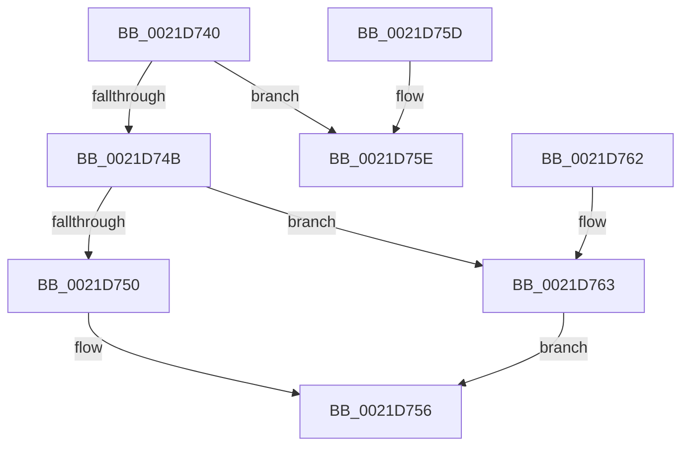

# KeIsUserVaAccessAllowed

- RVA: `0x0021D740`–`0x0021D768` (길이 `40` bytes)
- VA: `0x000000014021D740`
- 실행 섹션: `.text`
- PDB 이름 있음: `예`; PDB Function 태그: `아니요`
- unwind 정보 RVA: `0x0005F080`
- 디코드: `17`개 명령, `40/40` bytes 표시
- 미해석 바이트: `0` (있으면 어셈블리에 `.byte`로 보존)

> 이 문서는 커널 이미지의 기계어와 PDB 기호를 분석해 생성했습니다. 4번과 5번은 함수 원형과 자료형을 바이너리 사용 방식에서 추정한 C 해석이며 원본 소스 복구 결과는 아닙니다.

## 1. Dependencies

- 직접 호출 지점: **0**; 고유 호출 대상: **0**
- 직접 호출자로 확인된 함수: **4**
- RIP 상대 이미지 참조: **1**

### Outgoing calls
- 직접 디코드된 call 명령이 없습니다.

### Direct callers
- [sub_0021B896](Unknown_function_0021B896.md) at `0x0021B944`
- [sub_0021C5F2](Unknown_function_0021C5F2.md) at `0x0021C64C`
- [MiValidFault](../32/MiValidFault_function_003280B4.md) at `0x003283C1`
- [MiDbgCopyMemory](../68/MiDbgCopyMemory_function_00684A18.md) at `0x00684AD6`

### Static image references
- `0x0021D742` → RVA `0x00FC6BF0` (`ALMOSTRO`; read)

## 2. Other-region calls and transfers

- 다른 실행 섹션으로 향하는 call: **0**
- 별도 외부 분기/꼬리 이동을 확인하지 못했습니다.

## 3. Assembly (complete function range)

```asm
0021D740  48 9C                           pushfq
0021D742  83 3D A7 94 DA 00 00            cmp dword ptr [rip + 0xda94a7], 0
0021D749  74 13                           je 0x14021d75e
0021D74B  48 85 C9                        test rcx, rcx
0021D74E  74 13                           je 0x14021d763
0021D750  8B 81 78 01 00 00               mov eax, dword ptr [rcx + 0x178]
0021D756  C1 E8 12                        shr eax, 0x12
0021D759  24 01                           and al, 1
0021D75B  59                              pop rcx
0021D75C  C3                              ret
0021D75D  CC                              int3
0021D75E  B0 01                           mov al, 1
0021D760  59                              pop rcx
0021D761  C3                              ret
0021D762  CC                              int3
0021D763  8B 04 24                        mov eax, dword ptr [rsp]
0021D766  EB EE                           jmp 0x14021d756
```

## 4. C-style interpretation (structured pseudocode)

```c
__int64 __fastcall KeIsUserVaAccessAllowed(__int64 a1)
{
    __int64 result;
    unsigned int v_stack_p8;

    if ((*(unsigned int *)(v_rip + 14324903)) == 0) goto loc_0021D75E;
    if (a1 == 0) goto loc_0021D763;
loc_0021D756:
    result = (unsigned int)(((unsigned int)(*(unsigned int *)(a1 + 376))) >> (18));
    result = (unsigned __int8)((result) & (1));
    return result;
loc_0021D75E:
    return 1;
loc_0021D763:
    goto loc_0021D756;
}
```

## 5. (Beta) C Style

```c
int64_t KeIsUserVaAccessAllowed(int64_t Arg1)
{
    int64_t result;
    uint32_t v_stack_p8;

    if ((*(uint32_t *)(v_rip + 0xDA94A7)) == 0) goto loc_0021D75E;
    if (Arg1 == 0) goto loc_0021D763;
loc_0021D756:
    result = (uint32_t)(((uint32_t)(*(uint32_t *)(Arg1 + 0x178))) >> (18));
    result = (uint8_t)((result) & (1));
    return result;
loc_0021D75E:
    return 1;
loc_0021D763:
    goto loc_0021D756;
}
```

## 6. Execution-region graph

[열기: 2D/3D 그래프와 함수 탐색 컨트롤 패널](../../../control-panel.html?section=text&rva=0x0021D740&view=graph)

- 2D 그래프는 위에서 아래로 흐르고, 3D 그래프는 빈 공간을 드래그해 회전합니다. Shift+드래그는 이동, 휠은 확대·축소, 함수 노드 선택은 대상 보고서 이동입니다.

### Static fallback


