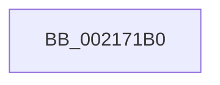

# KeReleaseInStackQueuedSpinLockFromDpcLevel

- RVA: `0x002171B0`–`0x002171C2` (길이 `18` bytes)
- VA: `0x00000001402171B0`
- 실행 섹션: `.text`
- PDB 이름 있음: `예`; PDB Function 태그: `아니요`
- unwind 정보 RVA: `0x0005E53C`
- 디코드: `5`개 명령, `18/18` bytes 표시
- 미해석 바이트: `0` (있으면 어셈블리에 `.byte`로 보존)

> 이 문서는 커널 이미지의 기계어와 PDB 기호를 분석해 생성했습니다. 4번과 5번은 함수 원형과 자료형을 바이너리 사용 방식에서 추정한 C 해석이며 원본 소스 복구 결과는 아닙니다.

## 1. Dependencies

- 직접 호출 지점: **0**; 고유 호출 대상: **0**
- 직접 호출자로 확인된 함수: **86**
- RIP 상대 이미지 참조: **1**

### Outgoing calls
- 직접 디코드된 call 명령이 없습니다.

### Direct callers
- [ExpAcquireFastResourceSharedSlow](ExpAcquireFastResourceSharedSlow_function_00211260.md) at `0x0021178E`
- [IoBoostThreadIoPriority](IoBoostThreadIoPriority_function_00216110.md) at `0x0021652C`
- [IoBoostThreadIoPriority](IoBoostThreadIoPriority_function_00216110.md) at `0x0021654C`
- [KiAbConvertWaiterToOwnerEntry](KiAbConvertWaiterToOwnerEntry_function_00219430.md) at `0x002195B4`
- [KiAbConvertWaiterToOwnerEntry](KiAbConvertWaiterToOwnerEntry_function_00219430.md) at `0x002196B5`
- [KiAbConvertWaiterToOwnerEntry](KiAbConvertWaiterToOwnerEntry_function_00219430.md) at `0x00219798`
- [KiAbConvertWaiterToOwnerEntry](KiAbConvertWaiterToOwnerEntry_function_00219430.md) at `0x002197E9`
- [KiAbConvertWaiterToOwnerEntry](KiAbConvertWaiterToOwnerEntry_function_00219430.md) at `0x00219AA2`
- [KiAbEntryGetLockedHeadEntry](../22/KiAbEntryGetLockedHeadEntry_function_002213C0.md) at `0x0022142C`
- [sub_00221431](../22/Unknown_function_00221431.md) at `0x00221560`
- [sub_00221431](../22/Unknown_function_00221431.md) at `0x0022157A`
- [sub_00221FB6](../22/Unknown_function_00221FB6.md) at `0x002222E3`
- [sub_00221FB6](../22/Unknown_function_00221FB6.md) at `0x00222360`
- [sub_00221FB6](../22/Unknown_function_00221FB6.md) at `0x002223AF`
- [sub_00221FB6](../22/Unknown_function_00221FB6.md) at `0x0022245D`
- [sub_00221FB6](../22/Unknown_function_00221FB6.md) at `0x00222683`
- [sub_00221FB6](../22/Unknown_function_00221FB6.md) at `0x00222995`
- [MiUnlockWorkingSetOptimal](../23/MiUnlockWorkingSetOptimal_function_00238DFC.md) at `0x00238EDA`
- [sub_0023A0D5](../23/Unknown_function_0023A0D5.md) at `0x0023A0FB`
- [MiProbeAndLockPages](../23/MiProbeAndLockPages_function_0023B4F0.md) at `0x0023B6CC`
- [MiProbeAndLockPages](../23/MiProbeAndLockPages_function_0023B4F0.md) at `0x0023B757`
- [sub_0023B894](../23/Unknown_function_0023B894.md) at `0x0023B8FE`
- [sub_0023B894](../23/Unknown_function_0023B894.md) at `0x0023B97E`
- [MiLockPageLeafPageTable](../23/MiLockPageLeafPageTable_function_0023D160.md) at `0x0023D50A`
- [MiLockPageLeafPageTable](../23/MiLockPageLeafPageTable_function_0023D160.md) at `0x0023D5F2`
- [sub_00248832](../24/Unknown_function_00248832.md) at `0x00248A36`
- [sub_00248B10](../24/Unknown_function_00248B10.md) at `0x00248C50`
- [KiAbEntryRemoveFromTree](../26/KiAbEntryRemoveFromTree_function_00262410.md) at `0x00262B38`
- [sub_002630C6](../26/Unknown_function_002630C6.md) at `0x00263171`
- [CcReferenceSharedCacheMapByVacb](../26/CcReferenceSharedCacheMapByVacb_function_0026FCBC.md) at `0x0026FD25`
- [KiAbReleaseLocksForEntry](../27/KiAbReleaseLocksForEntry_function_002721F8.md) at `0x00272211`
- [IoGetDeviceAttachmentBaseRef](../27/IoGetDeviceAttachmentBaseRef_function_00272710.md) at `0x00272752`
- [IoGetDeviceAttachmentBaseRefWithTag](../27/IoGetDeviceAttachmentBaseRefWithTag_function_00272788.md) at `0x002727D3`
- [sub_00272850](../27/Unknown_function_00272850.md) at `0x00272878`
- [CcGetVacbMiss](../27/CcGetVacbMiss_function_00272900.md) at `0x00272A7D`
- [CcGetVacbMiss](../27/CcGetVacbMiss_function_00272900.md) at `0x00272F69`
- [IoGetAttachedDeviceReferenceWithTag](../27/IoGetAttachedDeviceReferenceWithTag_function_00273B84.md) at `0x00273BD1`
- [sub_00275BEF](../27/Unknown_function_00275BEF.md) at `0x00275EF1`
- [sub_002760C1](../27/Unknown_function_002760C1.md) at `0x00276119`
- [MiDeleteVaDirect](../27/MiDeleteVaDirect_function_00277560.md) at `0x002786C3`
- [MiDeleteVaDirect](../27/MiDeleteVaDirect_function_00277560.md) at `0x002788F2`
- [MiWalkPageTablesRecursively](../27/MiWalkPageTablesRecursively_function_002796C0.md) at `0x0027B397`
- [MiWalkPageTablesRecursively](../27/MiWalkPageTablesRecursively_function_002796C0.md) at `0x0027B533`
- [sub_0027BB85](../27/Unknown_function_0027BB85.md) at `0x0027BE9D`
- [MiCaptureDeleteHierarchy](../27/MiCaptureDeleteHierarchy_function_0027F5F0.md) at `0x0027FC48`
- [MiCaptureDeleteHierarchy](../27/MiCaptureDeleteHierarchy_function_0027F5F0.md) at `0x0027FD32`
- [KiAbDeferredProcessingWorker](../30/KiAbDeferredProcessingWorker_function_0030DEB0.md) at `0x0030E426`
- [KiAbDeferredProcessingWorker](../30/KiAbDeferredProcessingWorker_function_0030DEB0.md) at `0x0030E43C`
- [KiAbDeferredProcessingWorker](../30/KiAbDeferredProcessingWorker_function_0030DEB0.md) at `0x0030E508`
- [KiAbDeferredProcessingWorker](../30/KiAbDeferredProcessingWorker_function_0030DEB0.md) at `0x0030E51E`
- [KeTerminateThread](../35/KeTerminateThread_function_00355138.md) at `0x00355212`
- [CcFlushCachePreProcess](../35/CcFlushCachePreProcess_function_0035A9B0.md) at `0x0035AB32`
- [CcFlushCachePreProcess](../35/CcFlushCachePreProcess_function_0035A9B0.md) at `0x0035AEEC`
- [KeStartThread](../3C/KeStartThread_function_003C21B8.md) at `0x003C242F`
- [CcNotifyExternalCachesInternal](../3C/CcNotifyExternalCachesInternal_function_003C9E00.md) at `0x003C9EE0`
- [CcMapAndCopyInToCache](../3C/CcMapAndCopyInToCache_function_003CA7F0.md) at `0x003CB35D`
- [CcInitializeCacheMapInternal](../3C/CcInitializeCacheMapInternal_function_003CC720.md) at `0x003CCB23`
- [CcInitializeCacheMapInternal](../3C/CcInitializeCacheMapInternal_function_003CC720.md) at `0x003CCEC5`
- [CcInitializeCacheMapInternal](../3C/CcInitializeCacheMapInternal_function_003CC720.md) at `0x003CCFE0`
- [CcInitializeCacheMapInternal](../3C/CcInitializeCacheMapInternal_function_003CC720.md) at `0x003CD0C7`
- [CcInitializeCacheMapInternal](../3C/CcInitializeCacheMapInternal_function_003CC720.md) at `0x003CD196`
- [KeInsertDeviceQueue](../3D/KeInsertDeviceQueue_function_003DD900.md) at `0x003DD9D5`
- [KeRemoveDeviceQueue](../3D/KeRemoveDeviceQueue_function_003DF890.md) at `0x003DF920`
- [ExpConvertFastResourceExclusiveToShared](../41/ExpConvertFastResourceExclusiveToShared_function_00416110.md) at `0x004161E1`
- [ExpReleaseDisownedFastResourceShared](../41/ExpReleaseDisownedFastResourceShared_function_00416338.md) at `0x004163C2`
- [ExpReleaseDisownedFastResourceExclusive](../41/ExpReleaseDisownedFastResourceExclusive_function_00416470.md) at `0x00416538`
- [KiAbForceProcessLockEntry](../41/KiAbForceProcessLockEntry_function_00419078.md) at `0x00419172`
- [KiAbForceProcessLockEntry](../41/KiAbForceProcessLockEntry_function_00419078.md) at `0x004191BC`
- [IopInterlockedDecrementUlong](../42/IopInterlockedDecrementUlong_function_004282A0.md) at `0x0042830B`
- [IopDereferenceVpbAndFree](../43/IopDereferenceVpbAndFree_function_0043F474.md) at `0x0043F4DD`
- [CcDereferenceVacbArray](../44/CcDereferenceVacbArray_function_004427B0.md) at `0x004427F1`
- [HsaAttachDeviceDomainInternal](../44/HsaAttachDeviceDomainInternal_function_0044DD24.md) at `0x0044DDFB`
- [HsaIommuSendCommand](../44/HsaIommuSendCommand_function_0044E1DC.md) at `0x0044E332`
- [CcSetLogHandleForFileEx](../44/CcSetLogHandleForFileEx_function_0044EA30.md) at `0x0044EC53`
- [CcIsThereDirtyLoggedPages](../45/CcIsThereDirtyLoggedPages_function_0045BBF0.md) at `0x0045BCEA`
- [KeRemoveByKeyDeviceQueue](../45/KeRemoveByKeyDeviceQueue_function_0045FB30.md) at `0x0045FC01`
- [KeInsertByKeyDeviceQueue](../45/KeInsertByKeyDeviceQueue_function_0045FD80.md) at `0x0045FDE8`
- [CcWaitForUninitializeCacheMap](../46/CcWaitForUninitializeCacheMap_function_004633F0.md) at `0x004634FE`
- [KeReleaseInStackQueuedSpinLockForDpc](../46/KeReleaseInStackQueuedSpinLockForDpc_function_0046A3E0.md) at `0x0046A3F9`
- [IvtIommuWaitCommand](../46/IvtIommuWaitCommand_function_0046A594.md) at `0x0046A673`
- [IvtIommuSendCommand](../46/IvtIommuSendCommand_function_0046A6E4.md) at `0x0046A827`
- [WmipNotificationIrpCancel](../49/WmipNotificationIrpCancel_function_00491BA0.md) at `0x00491BD7`
- [CcSerializeWithLazyWriter](../4B/CcSerializeWithLazyWriter_function_004B4490.md) at `0x004B44DF`
- [CcSerializeWithLazyWriter](../4B/CcSerializeWithLazyWriter_function_004B4490.md) at `0x004B453C`
- [CcUpdateTimeOnLogHandles](../4C/CcUpdateTimeOnLogHandles_function_004C6D0C.md) at `0x004C6D8B`
- [CcSetLoggedDataThreshold](../4C/CcSetLoggedDataThreshold_function_004C8D50.md) at `0x004C8DD4`
- [IvtAllocateContextTable](../4D/IvtAllocateContextTable_function_004DE0D4.md) at `0x004DE1E2`
- [IvtAllocateContextTable](../4D/IvtAllocateContextTable_function_004DE0D4.md) at `0x004DE231`
- [IvtAllocateScalableModePasidTables](../56/IvtAllocateScalableModePasidTables_function_0056E8DC.md) at `0x0056EBD1`
- [IvtAttachDeviceDomainInternal](../56/IvtAttachDeviceDomainInternal_function_0056ED90.md) at `0x0056EEDE`
- [IvtConfigureAts](../56/IvtConfigureAts_function_0056F1F0.md) at `0x0056F32E`
- [IvtDrainSvmPageRequests](../56/IvtDrainSvmPageRequests_function_0056F4B0.md) at `0x0056F5BD`
- [IvtFreeScalableModePasidTables](../56/IvtFreeScalableModePasidTables_function_0056F980.md) at `0x0056FA1F`
- [IvtLegacyAllocateScalableModePasidTables](../57/IvtLegacyAllocateScalableModePasidTables_function_00570B20.md) at `0x00570DA7`
- [IvtLegacyAttachDeviceDomainInternal](../57/IvtLegacyAttachDeviceDomainInternal_function_00570EDC.md) at `0x00570FE0`
- [IvtLegacyConfigureAts](../57/IvtLegacyConfigureAts_function_00571270.md) at `0x00571306`
- [IvtLegacySetDevicePasidTable](../57/IvtLegacySetDevicePasidTable_function_00571EE0.md) at `0x00571F6D`
- [IvtSetDevicePasidTable](../57/IvtSetDevicePasidTable_function_005724D0.md) at `0x005725A3`
- [HsaAllocatePasidTables](../57/HsaAllocatePasidTables_function_005735DC.md) at `0x00573704`
- [HsaFreePasidTables](../57/HsaFreePasidTables_function_0057401C.md) at `0x0057409C`
- [HsaUpdateRemappingTableInDeviceTableEntry](../57/HsaUpdateRemappingTableInDeviceTableEntry_function_005751DC.md) at `0x005752B6`
- [CcIncrementWriteBehindPriority](../57/CcIncrementWriteBehindPriority_function_0057B8AC.md) at `0x0057B95D`
- [CcIncrementWriteBehindPriority](../57/CcIncrementWriteBehindPriority_function_0057B8AC.md) at `0x0057BA14`
- [CcIsThereDirtyDataEx](../57/CcIsThereDirtyDataEx_function_0057D7B0.md) at `0x0057D863`
- [DifKeReleaseInStackQueuedSpinLockFromDpcLevelWrapper](../63/DifKeReleaseInStackQueuedSpinLockFromDpcLevelWrapper_function_00631510.md) at `0x006315D6`
- [ExpReleaseSvmAgentsLock](../65/ExpReleaseSvmAgentsLock_function_0065B4F0.md) at `0x0065B4F9`
- [ExpShareAddressSpaceWithDevice](../65/ExpShareAddressSpaceWithDevice_function_0065B528.md) at `0x0065B729`
- [ExpShareAddressSpaceWithDevice](../65/ExpShareAddressSpaceWithDevice_function_0065B528.md) at `0x0065B937`
- [ExpShareAddressSpaceWithDevice](../65/ExpShareAddressSpaceWithDevice_function_0065B528.md) at `0x0065BA89`
- [sub_006E2C34](../6E/Unknown_function_006E2C34.md) at `0x006E2C4C`
- [sub_006E855E](../6E/Unknown_function_006E855E.md) at `0x006E859D`
- [sub_006E8840](../6E/Unknown_function_006E8840.md) at `0x006E88A3`
- [sub_006EA4E8](../6E/Unknown_function_006EA4E8.md) at `0x006EA50D`
- [sub_006EA56C](../6E/Unknown_function_006EA56C.md) at `0x006EA69C`
- [sub_006EA71E](../6E/Unknown_function_006EA71E.md) at `0x006EA735`
- [sub_006F2A56](../6F/Unknown_function_006F2A56.md) at `0x006F2AB8`
- [sub_006F2BBA](../6F/Unknown_function_006F2BBA.md) at `0x006F2BD1`
- [PnprMirrorMarkedPages](../../pagelk/B6/PnprMirrorMarkedPages_function_00B6480C.md) at `0x00B648D4`

### Static image references
- `0x002171B6` → RVA `0x00FC6B06` (`ALMOSTRO`; read)

## 2. Other-region calls and transfers

- 다른 실행 섹션으로 향하는 call: **0**
- call이 아닌 외부 분기/꼬리 이동: **1**
  - `0x002171C0` → [sub_00217238 + 0x1](Unknown_function_00217238.md) (`tail-transfer`)

## 3. Assembly (complete function range)

```asm
002171B0  40 57                           push rdi
002171B2  48 83 EC 20                     sub rsp, 0x20
002171B6  F6 05 49 F9 DA 00 01            test byte ptr [rip + 0xdaf949], 1
002171BD  48 8B F9                        mov rdi, rcx
002171C0  75 77                           jne 0x140217239
```

## 4. C-style interpretation (structured pseudocode)

```c
void __fastcall KeReleaseInStackQueuedSpinLockFromDpcLevel(__int64 a1)
{
    __int64 v_rsp;

    v_rsp = (v_rsp) - (32);
}
```

## 5. (Beta) C Style

```c
void KeReleaseInStackQueuedSpinLockFromDpcLevel(int64_t Arg1)
{
    int64_t local_rsp;

    local_rsp = (local_rsp) - (32);
}
```

## 6. Execution-region graph

[열기: 2D/3D 그래프와 함수 탐색 컨트롤 패널](../../../control-panel.html?section=text&rva=0x002171B0&view=graph)

- 2D 그래프는 위에서 아래로 흐르고, 3D 그래프는 빈 공간을 드래그해 회전합니다. Shift+드래그는 이동, 휠은 확대·축소, 함수 노드 선택은 대상 보고서 이동입니다.

### Static fallback


