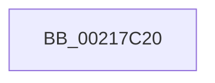

# KeWakeAddressAll

- RVA: `0x00217C20`–`0x00217C3C` (길이 `28` bytes)
- VA: `0x0000000140217C20`
- 실행 섹션: `.text`
- PDB 이름 있음: `예`; PDB Function 태그: `예`
- unwind 정보 RVA: `0x0005E6FC`
- 디코드: `5`개 명령, `28/28` bytes 표시
- 미해석 바이트: `0` (있으면 어셈블리에 `.byte`로 보존)

> 이 문서는 커널 이미지의 기계어와 PDB 기호를 분석해 생성했습니다. 4번과 5번은 함수 원형과 자료형을 바이너리 사용 방식에서 추정한 C 해석이며 원본 소스 복구 결과는 아닙니다.

## 1. Dependencies

- 직접 호출 지점: **0**; 고유 호출 대상: **0**
- 직접 호출자로 확인된 함수: **76**
- RIP 상대 이미지 참조: **1**

### Outgoing calls
- 직접 디코드된 call 명령이 없습니다.

### Direct callers
- [ExpAcquireFastResourceSharedSlow](ExpAcquireFastResourceSharedSlow_function_00211260.md) at `0x002114BB`
- [ExpAcquireResourceSharedLite](ExpAcquireResourceSharedLite_function_00212040.md) at `0x002128B2`
- [sub_00213F4F](Unknown_function_00213F4F.md) at `0x00214185`
- [sub_00213F4F](Unknown_function_00213F4F.md) at `0x0021428F`
- [sub_00215166](Unknown_function_00215166.md) at `0x002152D9`
- [sub_00215EFE](Unknown_function_00215EFE.md) at `0x00215F52`
- [KiReleaseThreadStateLock](KiReleaseThreadStateLock_function_00217910.md) at `0x002179C4`
- [KiReleaseQueuedSpinLockInstrumented](KiReleaseQueuedSpinLockInstrumented_function_002179F0.md) at `0x00217A5C`
- [sub_00218B2B](Unknown_function_00218B2B.md) at `0x00218CCF`
- [sub_0021BAB9](Unknown_function_0021BAB9.md) at `0x0021BC37`
- [KiQueueReadyThread](KiQueueReadyThread_function_0021C7B0.md) at `0x0021CD29`
- [KiSetPriorityThread](../22/KiSetPriorityThread_function_00220E78.md) at `0x002212C8`
- [KiSwapDirectoryTableBaseTarget](../22/KiSwapDirectoryTableBaseTarget_function_00227FF0.md) at `0x00228128`
- [KiSwapDirectoryTableBaseTarget](../22/KiSwapDirectoryTableBaseTarget_function_00227FF0.md) at `0x00228144`
- [MiReacquireHigherPageTableLock](../23/MiReacquireHigherPageTableLock_function_00239650.md) at `0x00239818`
- [IopCompleteIrpInFileObjectList](../24/IopCompleteIrpInFileObjectList_function_0024F330.md) at `0x0024F667`
- [sub_00254461](../25/Unknown_function_00254461.md) at `0x00254571`
- [KiSearchForNewThreadsForRescheduleContext](../25/KiSearchForNewThreadsForRescheduleContext_function_00258620.md) at `0x00259338`
- [KiAttemptToScheduleThreadToBusyIsolationUnit](../25/KiAttemptToScheduleThreadToBusyIsolationUnit_function_00259B00.md) at `0x0025AE95`
- [sub_0025D903](../25/Unknown_function_0025D903.md) at `0x0025E268`
- [sub_0025E5F6](../25/Unknown_function_0025E5F6.md) at `0x0025E66C`
- [sub_00260366](../26/Unknown_function_00260366.md) at `0x0026051F`
- [ExReleaseFastResource](../26/ExReleaseFastResource_function_002613D0.md) at `0x0026177A`
- [KiAbEntryRemoveFromTree](../26/KiAbEntryRemoveFromTree_function_00262410.md) at `0x00262655`
- [KiAbEntryRemoveFromTree](../26/KiAbEntryRemoveFromTree_function_00262410.md) at `0x002628FF`
- [sub_00262D5A](../26/Unknown_function_00262D5A.md) at `0x00262E88`
- [IopCheckVpbMounted](../27/IopCheckVpbMounted_function_00270540.md) at `0x00270630`
- [IopCheckVpbMounted](../27/IopCheckVpbMounted_function_00270540.md) at `0x00270778`
- [MiWalkPageTablesRecursively](../27/MiWalkPageTablesRecursively_function_002796C0.md) at `0x0027AF9F`
- [MiCaptureDeleteHierarchy](../27/MiCaptureDeleteHierarchy_function_0027F5F0.md) at `0x0027F9F4`
- [MiMakeSystemAddressValid](../27/MiMakeSystemAddressValid_function_0027FF70.md) at `0x0028076B`
- [sub_00281DE9](../28/Unknown_function_00281DE9.md) at `0x002820BD`
- [sub_002822AC](../28/Unknown_function_002822AC.md) at `0x002823EF`
- [KiRescheduleThreadAfterAffinityChange](../30/KiRescheduleThreadAfterAffinityChange_function_0030C9E8.md) at `0x0030CC68`
- [sub_0030E8E0](../30/Unknown_function_0030E8E0.md) at `0x0030EC0D`
- [sub_0030EE9F](../30/Unknown_function_0030EE9F.md) at `0x0030F133`
- [sub_0030F26B](../30/Unknown_function_0030F26B.md) at `0x0030F3B8`
- [KiSearchForNewThreadsOnTarget](../30/KiSearchForNewThreadsOnTarget_function_0030F500.md) at `0x00310E5E`
- [sub_00341DB3](../34/Unknown_function_00341DB3.md) at `0x00341ECE`
- [PfpPartitionGetFirst](../34/PfpPartitionGetFirst_function_00342ED0.md) at `0x00342FA8`
- [KiParkCurrentProcessor](../35/KiParkCurrentProcessor_function_003533A4.md) at `0x00353691`
- [KiJoinCooperativeIdleSearch](../35/KiJoinCooperativeIdleSearch_function_00353D1C.md) at `0x00353F44`
- [KiSendHeteroRescheduleIntRequestHelper](../35/KiSendHeteroRescheduleIntRequestHelper_function_0035420C.md) at `0x00354835`
- [KeQueryTotalCycleTimeThread](../37/KeQueryTotalCycleTimeThread_function_0037EF20.md) at `0x0037FADF`
- [NtWaitForWorkViaWorkerFactory](../39/NtWaitForWorkViaWorkerFactory_function_00394270.md) at `0x003945E5`
- [MiUpdatePageThresholdsDpc](../3B/MiUpdatePageThresholdsDpc_function_003BD050.md) at `0x003BD0A1`
- [MiUpdatePageThresholdsDpc](../3B/MiUpdatePageThresholdsDpc_function_003BD050.md) at `0x003BD1AF`
- [ExpAcquireFastResourceExclusiveSlow](../3B/ExpAcquireFastResourceExclusiveSlow_function_003BE2E0.md) at `0x003BE59E`
- [ExpAcquireFastResourceExclusiveSlow](../3B/ExpAcquireFastResourceExclusiveSlow_function_003BE2E0.md) at `0x003BE60E`
- [AlpcpQueueIoCompletionPort](../3F/AlpcpQueueIoCompletionPort_function_003FF760.md) at `0x003FF873`
- [AlpcpLookasidePacketCallbackRoutine](../41/AlpcpLookasidePacketCallbackRoutine_function_00419D50.md) at `0x00419E54`
- [sub_0041B277](../41/Unknown_function_0041B277.md) at `0x0041B2B7`
- [IopVerifyDeviceObjectOnStack](../41/IopVerifyDeviceObjectOnStack_function_0041B3B0.md) at `0x0041B4E8`
- [sub_0041D9E2](../41/Unknown_function_0041D9E2.md) at `0x0041DA25`
- [sub_00420EA4](../42/Unknown_function_00420EA4.md) at `0x00420EE3`
- [KeSignalCallDpcSynchronize](../43/KeSignalCallDpcSynchronize_function_0043DFA0.md) at `0x0043E053`
- [ExpGetPoolTagInfoTarget](../44/ExpGetPoolTagInfoTarget_function_004407D0.md) at `0x00440983`
- [ExpGetPoolTagInfoTarget](../44/ExpGetPoolTagInfoTarget_function_004407D0.md) at `0x004409D8`
- [MiDemoteSlabEntriesDpc](../44/MiDemoteSlabEntriesDpc_function_0044C3C0.md) at `0x0044C5F0`
- [MiDemoteSlabEntriesDpc](../44/MiDemoteSlabEntriesDpc_function_0044C3C0.md) at `0x0044C606`
- [KiScanSharedReadyThreads](../46/KiScanSharedReadyThreads_function_0046F120.md) at `0x0046F39C`
- [KiLeaveCooperativeIdleSearch](../47/KiLeaveCooperativeIdleSearch_function_0047A010.md) at `0x0047A168`
- [KiSetSystemTimeDpc](../48/KiSetSystemTimeDpc_function_00486130.md) at `0x0048625E`
- [KiSetSystemTimeDpc](../48/KiSetSystemTimeDpc_function_00486130.md) at `0x004863AF`
- [KiSetSystemTimeDpc](../48/KiSetSystemTimeDpc_function_00486130.md) at `0x004863CE`
- [MiJumpStackTarget](../48/MiJumpStackTarget_function_0048BC10.md) at `0x0048BD3D`
- [MiJumpStackTarget](../48/MiJumpStackTarget_function_0048BC10.md) at `0x0048BD61`
- [MiWritePteHighLevelIsr](../4C/MiWritePteHighLevelIsr_function_004C2FC0.md) at `0x004C30F6`
- [MiWritePteHighLevelIsr](../4C/MiWritePteHighLevelIsr_function_004C2FC0.md) at `0x004C3171`
- [MiWritePteHighLevelIsr](../4C/MiWritePteHighLevelIsr_function_004C2FC0.md) at `0x004C332B`
- [MiWritePteHighLevelIsr](../4C/MiWritePteHighLevelIsr_function_004C2FC0.md) at `0x004C3439`
- [MiWritePteHighLevelIsr](../4C/MiWritePteHighLevelIsr_function_004C2FC0.md) at `0x004C3465`
- [KiDisarmForceParkDutyCyclingIfNecessary](../4F/KiDisarmForceParkDutyCyclingIfNecessary_function_004FA9E4.md) at `0x004FAAF0`
- [KiArmForceParkDutyCyclingForLocalReadyQueue](../4F/KiArmForceParkDutyCyclingForLocalReadyQueue_function_004FAB54.md) at `0x004FAC2D`
- [KiOptimizeSpecCtrlSettingsWorker](../5B/KiOptimizeSpecCtrlSettingsWorker_function_005BF5A0.md) at `0x005BF806`
- [KiOptimizeSpecCtrlSettingsWorker](../5B/KiOptimizeSpecCtrlSettingsWorker_function_005BF5A0.md) at `0x005BFC9C`
- [KiOptimizeSpecCtrlSettingsWorker](../5B/KiOptimizeSpecCtrlSettingsWorker_function_005BF5A0.md) at `0x005C0242`
- [KiAdjustUserIsolationDomainThread](../5C/KiAdjustUserIsolationDomainThread_function_005C3B54.md) at `0x005C3E32`
- [KeAbCrossThreadDelete](../5C/KeAbCrossThreadDelete_function_005C517C.md) at `0x005C5425`
- [ExpLimitInsertDpc](../65/ExpLimitInsertDpc_function_00656BF0.md) at `0x00656C46`
- [ExpLimitInsertDpc](../65/ExpLimitInsertDpc_function_00656BF0.md) at `0x00656C92`
- [ExpAeThresholdInitWorker](../65/ExpAeThresholdInitWorker_function_0065D680.md) at `0x0065D6DD`
- [MiFreeUnusedPfnPagesDpc](../67/MiFreeUnusedPfnPagesDpc_function_00672150.md) at `0x0067219E`
- [MiFreeUnusedPfnPagesDpc](../67/MiFreeUnusedPfnPagesDpc_function_00672150.md) at `0x00672293`
- [MiMakeIoRangePermanentDpc](../67/MiMakeIoRangePermanentDpc_function_0067C540.md) at `0x0067C591`
- [MiMakeIoRangePermanentDpc](../67/MiMakeIoRangePermanentDpc_function_0067C540.md) at `0x0067C68C`
- [MiReapplyImportOptimizationWorker](../68/MiReapplyImportOptimizationWorker_function_00682720.md) at `0x006827AE`
- [MiDbgCopyMemoryTarget](../68/MiDbgCopyMemoryTarget_function_00684E70.md) at `0x00684ED3`
- [MiDbgCopyMemoryTarget](../68/MiDbgCopyMemoryTarget_function_00684E70.md) at `0x006850B0`
- [MiChangeSlabIdentitiesDpc](../68/MiChangeSlabIdentitiesDpc_function_0068CF10.md) at `0x0068CF62`
- [MiChangeSlabIdentitiesDpc](../68/MiChangeSlabIdentitiesDpc_function_0068CF10.md) at `0x0068D079`
- [MiSpecialPurposeMemoryCacheUpdateDpc](../69/MiSpecialPurposeMemoryCacheUpdateDpc_function_00695240.md) at `0x0069528B`
- [MiSpecialPurposeMemoryCacheUpdateDpc](../69/MiSpecialPurposeMemoryCacheUpdateDpc_function_00695240.md) at `0x006953E9`
- [MiDpcGangTarget](../69/MiDpcGangTarget_function_00697E60.md) at `0x00697F63`
- [MiDpcGangTarget](../69/MiDpcGangTarget_function_00697E60.md) at `0x00698098`
- [sub_006E825E](../6E/Unknown_function_006E825E.md) at `0x006E82A4`
- [sub_006F3522](../6F/Unknown_function_006F3522.md) at `0x006F3557`
- [sub_006F3522](../6F/Unknown_function_006F3522.md) at `0x006F35B7`
- [sub_006F487E](../6F/Unknown_function_006F487E.md) at `0x006F4897`
- [sub_006FBAB6](../6F/Unknown_function_006FBAB6.md) at `0x006FBAFC`
- [KeStartAllProcessors](../../init/C3/KeStartAllProcessors_function_00C36F78.md) at `0x00C37769`

### Static image references
- `0x00217C2A` → RVA `0x00E0A740` (`.data`; read)

## 2. Other-region calls and transfers

- 다른 실행 섹션으로 향하는 call: **0**
- 별도 외부 분기/꼬리 이동을 확인하지 못했습니다.

## 3. Assembly (complete function range)

```asm
00217C20  4C 8B DC                        mov r11, rsp
00217C23  48 81 EC 48 01 00 00            sub rsp, 0x148
00217C2A  48 8B 05 0F 2B BF 00            mov rax, qword ptr [rip + 0xbf2b0f]
00217C31  48 33 C4                        xor rax, rsp
00217C34  48 89 84 24 30 01 00 00         mov qword ptr [rsp + 0x130], rax
```

## 4. C-style interpretation (structured pseudocode)

```c
__int64 __fastcall KeWakeAddressAll(void)
{
    __int64 result;
    __int64 v_rsp;
    unsigned __int64 v_stack_m18;

    v_rsp = (v_rsp) - (328);
    result = (*(unsigned __int64 *)(v_rip + 12528399)) ^ (v_rsp);
    v_stack_m18 = result;
    return result;
}
```

## 5. (Beta) C Style

```c
void KeWakeAddressAll(void)
{
    int64_t result;
    int64_t local_rsp;
    uint64_t v_stack_m18;

    local_rsp = (local_rsp) - (328);
    result = (*(uint64_t *)(v_rip + 0xBF2B0F)) ^ (local_rsp);
    v_stack_m18 = result;
    return result;
}
```

## 6. Execution-region graph

[열기: 2D/3D 그래프와 함수 탐색 컨트롤 패널](../../../control-panel.html?section=text&rva=0x00217C20&view=graph)

- 2D 그래프는 위에서 아래로 흐르고, 3D 그래프는 빈 공간을 드래그해 회전합니다. Shift+드래그는 이동, 휠은 확대·축소, 함수 노드 선택은 대상 보고서 이동입니다.

### Static fallback


