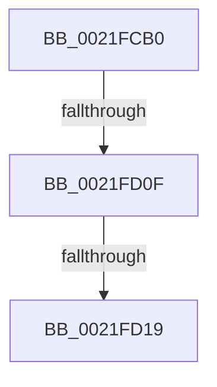

# KiAbIoBoostOwners

- RVA: `0x0021FCB0`–`0x0021FD23` (길이 `115` bytes)
- VA: `0x000000014021FCB0`
- 실행 섹션: `.text`
- PDB 이름 있음: `예`; PDB Function 태그: `아니요`
- unwind 정보 RVA: `0x0005F290`
- 디코드: `32`개 명령, `115/115` bytes 표시
- 미해석 바이트: `0` (있으면 어셈블리에 `.byte`로 보존)

> 이 문서는 커널 이미지의 기계어와 PDB 기호를 분석해 생성했습니다. 4번과 5번은 함수 원형과 자료형을 바이너리 사용 방식에서 추정한 C 해석이며 원본 소스 복구 결과는 아닙니다.

## 1. Dependencies

- 직접 호출 지점: **0**; 고유 호출 대상: **0**
- 직접 호출자로 확인된 함수: **3**
- RIP 상대 이미지 참조: **0**

### Outgoing calls
- 직접 디코드된 call 명령이 없습니다.

### Direct callers
- [KiAbConvertWaiterToOwnerEntry](KiAbConvertWaiterToOwnerEntry_function_00219430.md) at `0x002197C1`
- [sub_00221FB6](../22/Unknown_function_00221FB6.md) at `0x00222389`
- [sub_00221FB6](../22/Unknown_function_00221FB6.md) at `0x00222437`
- [KiAbForceProcessLockEntry](../41/KiAbForceProcessLockEntry_function_00419078.md) at `0x00419193`

### Static image references
- 디코드된 RIP-relative 메모리 참조가 없습니다.

## 2. Other-region calls and transfers

- 다른 실행 섹션으로 향하는 call: **0**
- call이 아닌 외부 분기/꼬리 이동: **2**
  - `0x0021FD09` → [sub_0021FEBB](Unknown_function_0021FEBB.md) (`tail-transfer`)
  - `0x0021FD13` → [sub_00220015](../22/Unknown_function_00220015.md) (`tail-transfer`)

## 3. Assembly (complete function range)

```asm
0021FCB0  4C 89 4C 24 20                  mov qword ptr [rsp + 0x20], r9
0021FCB5  4C 89 44 24 18                  mov qword ptr [rsp + 0x18], r8
0021FCBA  53                              push rbx
0021FCBB  55                              push rbp
0021FCBC  56                              push rsi
0021FCBD  57                              push rdi
0021FCBE  41 55                           push r13
0021FCC0  41 56                           push r14
0021FCC2  48 83 EC 78                     sub rsp, 0x78
0021FCC6  48 8B 59 30                     mov rbx, qword ptr [rcx + 0x30]
0021FCCA  33 FF                           xor edi, edi
0021FCCC  89 7C 24 50                     mov dword ptr [rsp + 0x50], edi
0021FCD0  F6 C2 01                        test dl, 1
0021FCD3  0F B6 44 24 51                  movzx eax, byte ptr [rsp + 0x51]
0021FCD8  41 BE 02 00 00 00               mov r14d, 2
0021FCDE  41 0F 45 C6                     cmovne eax, r14d
0021FCE2  89 7C 24 58                     mov dword ptr [rsp + 0x58], edi
0021FCE6  88 44 24 51                     mov byte ptr [rsp + 0x51], al
0021FCEA  41 84 D6                        test r14b, dl
0021FCED  0F B6 44 24 52                  movzx eax, byte ptr [rsp + 0x52]
0021FCF2  41 BA 01 00 00 00               mov r10d, 1
0021FCF8  41 0F 45 C2                     cmovne eax, r10d
0021FCFC  4D 8B E9                        mov r13, r9
0021FCFF  88 44 24 52                     mov byte ptr [rsp + 0x52], al
0021FD03  48 8B F1                        mov rsi, rcx
0021FD06  48 85 DB                        test rbx, rbx
0021FD09  0F 85 AC 01 00 00               jne 0x14021febb
0021FD0F  80 7E 09 00                     cmp byte ptr [rsi + 9], 0
0021FD13  0F 85 FC 02 00 00               jne 0x140220015
0021FD19  0F B6 46 08                     movzx eax, byte ptr [rsi + 8]
0021FD1D  48 8B DE                        mov rbx, rsi
0021FD20  83 E0 3F                        and eax, 0x3f
```

## 4. C-style interpretation (structured pseudocode)

```c
__int64 __fastcall KiAbIoBoostOwners(__int64 a1, unsigned __int8 a2, __int64 a3, __int64 a4)
{
    __int64 result;
    __int64 v_rdi;
    __int64 v_rsp;
    unsigned int v_stack_m50;
    unsigned __int8 v_stack_m56;
    unsigned __int8 v_stack_m57;
    unsigned int v_stack_m58;
    unsigned __int64 v_stack_p18;
    unsigned __int64 v_stack_p20;

    v_stack_p20 = a4;
    v_stack_p18 = a3;
    v_rsp = (v_rsp) - (120);
    v_rdi = 0;
    v_stack_m58 = 0;
    result = v_stack_m57;
    if (((a2) & (1)) != 0) { result = 2; }
    v_stack_m50 = 0;
    v_stack_m57 = (unsigned __int8)(result);
    result = v_stack_m56;
    if (((2) & (a2)) != 0) { result = 1; }
    v_stack_m56 = (unsigned __int8)(result);
    result = (unsigned int)((*(unsigned __int8 *)(a1 + 8)) & (63));
    return result;
}
```

## 5. (Beta) C Style

```c
int64_t KiAbIoBoostOwners(void *Arg1, uint8_t Arg2, int64_t Arg3, int64_t Arg4)
{
    uint8_t *arg1 = (uint8_t *)Arg1;

    int64_t result;
    int64_t local_rdi;
    int64_t local_rsp;
    uint32_t v_stack_m50;
    uint8_t v_stack_m56;
    uint8_t v_stack_m57;
    uint32_t v_stack_m58;
    uint64_t v_stack_p18;
    uint64_t v_stack_p20;

    v_stack_p20 = Arg4;
    v_stack_p18 = Arg3;
    local_rsp = (local_rsp) - (120);
    local_rdi = 0;
    v_stack_m58 = 0;
    result = v_stack_m57;
    if (((Arg2) & (1)) != 0) { result = 2; }
    v_stack_m50 = 0;
    v_stack_m57 = (uint8_t)(result);
    result = v_stack_m56;
    if (((2) & (Arg2)) != 0) { result = 1; }
    v_stack_m56 = (uint8_t)(result);
    result = (uint32_t)((*(uint8_t *)(arg1 + 0x8)) & (63));
    return result;
}
```

### 관측된 메모리 오프셋

구조체 형식이 확인되지 않은 접근은 인자 기준의 오프셋으로만 기록했습니다.

| 기준 인자 | 오프셋 표현 | 폭 (bit) | 접근 |
|---|---:|---:|---|
| `Arg1` | `+ 0x8` | `8` | `R` |
| `Arg1` | `+ 0x9` | `8` | `R` |
| `Arg1` | `+ 0x30` | `64` | `R` |

## 6. Execution-region graph

[열기: 2D/3D 그래프와 함수 탐색 컨트롤 패널](../../../control-panel.html?section=text&rva=0x0021FCB0&view=graph)

- 2D 그래프는 위에서 아래로 흐르고, 3D 그래프는 빈 공간을 드래그해 회전합니다. Shift+드래그는 이동, 휠은 확대·축소, 함수 노드 선택은 대상 보고서 이동입니다.

### Static fallback


