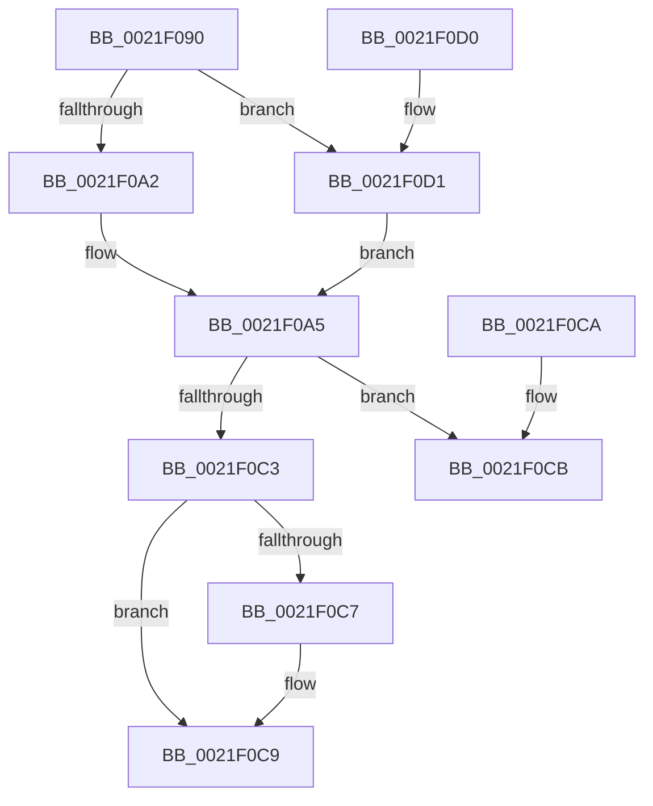

# KiAbOwnerComputeCpuPriorityKey

- RVA: `0x0021F090`–`0x0021F0DA` (길이 `74` bytes)
- VA: `0x000000014021F090`
- 실행 섹션: `.text`
- PDB 이름 있음: `예`; PDB Function 태그: `아니요`
- unwind 정보 RVA: `0x000DB714`
- 디코드: `24`개 명령, `74/74` bytes 표시
- 미해석 바이트: `0` (있으면 어셈블리에 `.byte`로 보존)

> 이 문서는 커널 이미지의 기계어와 PDB 기호를 분석해 생성했습니다. 4번과 5번은 함수 원형과 자료형을 바이너리 사용 방식에서 추정한 C 해석이며 원본 소스 복구 결과는 아닙니다.

## 1. Dependencies

- 직접 호출 지점: **0**; 고유 호출 대상: **0**
- 직접 호출자로 확인된 함수: **7**
- RIP 상대 이미지 참조: **0**

### Outgoing calls
- 직접 디코드된 call 명령이 없습니다.

### Direct callers
- [KiAbConvertWaiterToOwnerEntry](KiAbConvertWaiterToOwnerEntry_function_00219430.md) at `0x0021988A`
- [sub_0021F2D7](Unknown_function_0021F2D7.md) at `0x0021F2DD`
- [sub_0021FD23](Unknown_function_0021FD23.md) at `0x0021FE3A`
- [sub_002206D0](../22/Unknown_function_002206D0.md) at `0x002207E5`
- [sub_002219E9](../22/Unknown_function_002219E9.md) at `0x002219EC`
- [sub_00221FB6](../22/Unknown_function_00221FB6.md) at `0x00221FD1`
- [sub_00221FB6](../22/Unknown_function_00221FB6.md) at `0x00222134`
- [sub_00221FB6](../22/Unknown_function_00221FB6.md) at `0x002227FA`
- [sub_00221FB6](../22/Unknown_function_00221FB6.md) at `0x002228B5`
- [sub_00221FB6](../22/Unknown_function_00221FB6.md) at `0x00222A00`
- [sub_00221FB6](../22/Unknown_function_00221FB6.md) at `0x00222A21`
- [KiAbDeferredProcessingWorker](../30/KiAbDeferredProcessingWorker_function_0030DEB0.md) at `0x0030E241`
- [KiAbDeferredProcessingWorker](../30/KiAbDeferredProcessingWorker_function_0030DEB0.md) at `0x0030E338`

### Static image references
- 디코드된 RIP-relative 메모리 참조가 없습니다.

## 2. Other-region calls and transfers

- 다른 실행 섹션으로 향하는 call: **0**
- 별도 외부 분기/꼬리 이동을 확인하지 못했습니다.

## 3. Assembly (complete function range)

```asm
0021F090  8B 41 50                        mov eax, dword ptr [rcx + 0x50]
0021F093  C7 44 24 08 00 00 00 00         mov dword ptr [rsp + 8], 0
0021F09B  25 FF FF FF 3F                  and eax, 0x3fffffff
0021F0A0  77 2F                           ja 0x14021f0d1
0021F0A2  45 32 C0                        xor r8b, r8b
0021F0A5  0F B6 41 08                     movzx eax, byte ptr [rcx + 8]
0021F0A9  83 E0 3F                        and eax, 0x3f
0021F0AC  48 6B D0 58                     imul rdx, rax, 0x58
0021F0B0  48 2B CA                        sub rcx, rdx
0021F0B3  48 8B 41 F0                     mov rax, qword ptr [rcx - 0x10]
0021F0B7  0F B6 80 33 02 00 00            movzx eax, byte ptr [rax + 0x233]
0021F0BE  41 3A C0                        cmp al, r8b
0021F0C1  7E 08                           jle 0x14021f0cb
0021F0C3  3C 1E                           cmp al, 0x1e
0021F0C5  7E 02                           jle 0x14021f0c9
0021F0C7  B0 1E                           mov al, 0x1e
0021F0C9  C3                              ret
0021F0CA  CC                              int3
0021F0CB  41 0F B6 C0                     movzx eax, r8b
0021F0CF  C3                              ret
0021F0D0  CC                              int3
0021F0D1  44 0F BD C0                     bsr r8d, eax
0021F0D5  41 FE C0                        inc r8b
0021F0D8  EB CB                           jmp 0x14021f0a5
```

## 4. C-style interpretation (structured pseudocode)

```c
__int64 __fastcall KiAbOwnerComputeCpuPriorityKey(__int64 a1, __int64 a2, unsigned __int8 a3)
{
    __int64 result;
    unsigned int v_stack_p8;

    v_stack_p8 = 0;
    result = (unsigned int)(((unsigned int)(*(unsigned int *)(a1 + 80))) & (0x3FFFFFFFULL));
    if (condition_is_above) goto loc_0021F0D1;
    a3 = 0;
loc_0021F0A5:
    result = (unsigned int)((*(unsigned __int8 *)(a1 + 8)) & (63));
    a2 = (a2) * (result);
    a1 = (a1) - (a2);
    if (((unsigned __int8)(*(unsigned __int8 *)(*(unsigned __int64 *)(a1 - 16) + 563))) <= 0) goto loc_0021F0CB;
    result = *(unsigned __int8 *)(*(unsigned __int64 *)(a1 - 16) + 563);
    if (((unsigned __int8)(*(unsigned __int8 *)(*(unsigned __int64 *)(a1 - 16) + 563))) >= = 30) {
        result = 30;
    }
    return result;
loc_0021F0CB:
    return 0;
loc_0021F0D1:
    a3 = (unsigned __int8)((a3) + 1);
    goto loc_0021F0A5;
}
```

## 5. (Beta) C Style

```c
int64_t KiAbOwnerComputeCpuPriorityKey(void *Arg1, int64_t Arg2, uint8_t Arg3)
{
    uint8_t *arg1 = (uint8_t *)Arg1;

    int64_t result;
    uint32_t v_stack_p8;

    v_stack_p8 = 0;
    result = (uint32_t)(((uint32_t)(*(uint32_t *)(arg1 + 0x50))) & (0x3FFFFFFFULL));
    if (condition_is_above) goto loc_0021F0D1;
    Arg3 = 0;
loc_0021F0A5:
    result = (uint32_t)((*(uint8_t *)(arg1 + 0x8)) & (63));
    Arg2 = (Arg2) * (result);
    Arg1 = (Arg1) - (Arg2);
    if (((uint8_t)(*(uint8_t *)(*(uint64_t *)(arg1 - 0x10) + 0x233))) <= 0) goto loc_0021F0CB;
    result = *(uint8_t *)(*(uint64_t *)(arg1 - 0x10) + 0x233);
    if (((uint8_t)(*(uint8_t *)(*(uint64_t *)(arg1 - 0x10) + 0x233))) >= = 30) {
        result = 30;
    }
    return result;
loc_0021F0CB:
    return 0;
loc_0021F0D1:
    Arg3 = (uint8_t)((Arg3) + 1);
    goto loc_0021F0A5;
}
```

### 관측된 메모리 오프셋

구조체 형식이 확인되지 않은 접근은 인자 기준의 오프셋으로만 기록했습니다.

| 기준 인자 | 오프셋 표현 | 폭 (bit) | 접근 |
|---|---:|---:|---|
| `Arg1` | `- 0x10` | `64` | `R` |
| `Arg1` | `+ 0x8` | `8` | `R` |
| `Arg1` | `+ 0x50` | `32` | `R` |

## 6. Execution-region graph

[열기: 2D/3D 그래프와 함수 탐색 컨트롤 패널](../../../control-panel.html?section=text&rva=0x0021F090&view=graph)

- 2D 그래프는 위에서 아래로 흐르고, 3D 그래프는 빈 공간을 드래그해 회전합니다. Shift+드래그는 이동, 휠은 확대·축소, 함수 노드 선택은 대상 보고서 이동입니다.

### Static fallback


