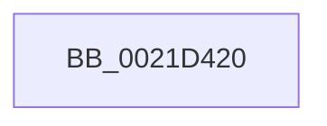

# KiAbProcessPreContextSwitch

- RVA: `0x0021D420`–`0x0021D44D` (길이 `45` bytes)
- VA: `0x000000014021D420`
- 실행 섹션: `.text`
- PDB 이름 있음: `예`; PDB Function 태그: `아니요`
- unwind 정보 RVA: `0x0005EFA8`
- 디코드: `14`개 명령, `45/45` bytes 표시
- 미해석 바이트: `0` (있으면 어셈블리에 `.byte`로 보존)

> 이 문서는 커널 이미지의 기계어와 PDB 기호를 분석해 생성했습니다. 4번과 5번은 함수 원형과 자료형을 바이너리 사용 방식에서 추정한 C 해석이며 원본 소스 복구 결과는 아닙니다.

## 1. Dependencies

- 직접 호출 지점: **0**; 고유 호출 대상: **0**
- 직접 호출자로 확인된 함수: **8**
- RIP 상대 이미지 참조: **0**

### Outgoing calls
- 직접 디코드된 call 명령이 없습니다.

### Direct callers
- [KiHandleDeferredPreemption](../20/KiHandleDeferredPreemption_function_00202ECC.md) at `0x00202F1B`
- [KeYieldExecution](../20/KeYieldExecution_function_00209FA0.md) at `0x0020A057`
- [sub_0021B896](Unknown_function_0021B896.md) at `0x0021B8B0`
- [sub_0021C5F2](Unknown_function_0021C5F2.md) at `0x0021C645`
- [sub_0021D7F8](Unknown_function_0021D7F8.md) at `0x0021D804`
- [KiCheckForThreadDispatch](../25/KiCheckForThreadDispatch_function_00250648.md) at `0x002506FC`
- [sub_00251E24](../25/Unknown_function_00251E24.md) at `0x00251E29`
- [KiSwapThread](../35/KiSwapThread_function_00355640.md) at `0x00355675`

### Static image references
- 디코드된 RIP-relative 메모리 참조가 없습니다.

## 2. Other-region calls and transfers

- 다른 실행 섹션으로 향하는 call: **0**
- call이 아닌 외부 분기/꼬리 이동: **1**
  - `0x0021D447` → [sub_0021D4DD](Unknown_function_0021D4DD.md) (`tail-transfer`)

## 3. Assembly (complete function range)

```asm
0021D420  89 54 24 10                     mov dword ptr [rsp + 0x10], edx
0021D424  53                              push rbx
0021D425  55                              push rbp
0021D426  56                              push rsi
0021D427  57                              push rdi
0021D428  41 55                           push r13
0021D42A  48 83 EC 50                     sub rsp, 0x50
0021D42E  48 8B B1 78 04 00 00            mov rsi, qword ptr [rcx + 0x478]
0021D435  48 8D 81 78 04 00 00            lea rax, [rcx + 0x478]
0021D43C  45 33 D2                        xor r10d, r10d
0021D43F  8B EA                           mov ebp, edx
0021D441  4C 8B E9                        mov r13, rcx
0021D444  48 85 F6                        test rsi, rsi
0021D447  0F 84 90 00 00 00               je 0x14021d4dd
```

## 4. C-style interpretation (structured pseudocode)

```c
__int64 __fastcall KiAbProcessPreContextSwitch(__int64 a1, int a2)
{
    __int64 v_r10;
    __int64 v_rsp;
    unsigned int v_stack_p10;

    v_stack_p10 = a2;
    v_rsp = (v_rsp) - (80);
    v_r10 = 0;
}
```

## 5. (Beta) C Style

```c
int64_t KiAbProcessPreContextSwitch(void *Arg1, int32_t Arg2)
{
    uint8_t *arg1 = (uint8_t *)Arg1;

    int64_t local_r10;
    int64_t local_rsp;
    uint32_t v_stack_p10;

    v_stack_p10 = Arg2;
    local_rsp = (local_rsp) - (80);
    local_r10 = 0;
}
```

### 관측된 메모리 오프셋

구조체 형식이 확인되지 않은 접근은 인자 기준의 오프셋으로만 기록했습니다.

| 기준 인자 | 오프셋 표현 | 폭 (bit) | 접근 |
|---|---:|---:|---|
| `Arg1` | `+ 0x478` | `64` | `R` |

## 6. Execution-region graph

[열기: 2D/3D 그래프와 함수 탐색 컨트롤 패널](../../../control-panel.html?section=text&rva=0x0021D420&view=graph)

- 2D 그래프는 위에서 아래로 흐르고, 3D 그래프는 빈 공간을 드래그해 회전합니다. Shift+드래그는 이동, 휠은 확대·축소, 함수 노드 선택은 대상 보고서 이동입니다.

### Static fallback


