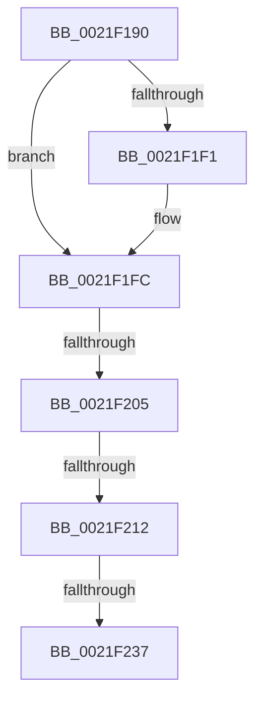

# KiAbSetMinimumThreadPriority

- RVA: `0x0021F190`–`0x0021F244` (길이 `180` bytes)
- VA: `0x000000014021F190`
- 실행 섹션: `.text`
- PDB 이름 있음: `예`; PDB Function 태그: `아니요`
- unwind 정보 RVA: `0x0005F178`
- 디코드: `45`개 명령, `180/180` bytes 표시
- 미해석 바이트: `0` (있으면 어셈블리에 `.byte`로 보존)

> 이 문서는 커널 이미지의 기계어와 PDB 기호를 분석해 생성했습니다. 4번과 5번은 함수 원형과 자료형을 바이너리 사용 방식에서 추정한 C 해석이며 원본 소스 복구 결과는 아닙니다.

## 1. Dependencies

- 직접 호출 지점: **0**; 고유 호출 대상: **0**
- 직접 호출자로 확인된 함수: **5**
- RIP 상대 이미지 참조: **0**

### Outgoing calls
- 직접 디코드된 call 명령이 없습니다.

### Direct callers
- [KiAbConvertWaiterToOwnerEntry](KiAbConvertWaiterToOwnerEntry_function_00219430.md) at `0x00219920`
- [sub_0021FEBB](Unknown_function_0021FEBB.md) at `0x0021FEE9`
- [sub_002207EF](../22/Unknown_function_002207EF.md) at `0x00220827`
- [sub_00221FB6](../22/Unknown_function_00221FB6.md) at `0x002227E1`
- [sub_00221FB6](../22/Unknown_function_00221FB6.md) at `0x0022289C`
- [KiAbDeferredProcessingWorker](../30/KiAbDeferredProcessingWorker_function_0030DEB0.md) at `0x0030E620`
- [KiAbDeferredProcessingWorker](../30/KiAbDeferredProcessingWorker_function_0030DEB0.md) at `0x0030E665`

### Static image references
- 디코드된 RIP-relative 메모리 참조가 없습니다.

## 2. Other-region calls and transfers

- 다른 실행 섹션으로 향하는 call: **0**
- call이 아닌 외부 분기/꼬리 이동: **3**
  - `0x0021F1FF` → [sub_0021F343](Unknown_function_0021F343.md) (`tail-transfer`)
  - `0x0021F20C` → [sub_0021F691](Unknown_function_0021F691.md) (`tail-transfer`)
  - `0x0021F231` → [sub_0021F2D7](Unknown_function_0021F2D7.md) (`tail-transfer`)

## 3. Assembly (complete function range)

```asm
0021F190  4C 89 4C 24 20                  mov qword ptr [rsp + 0x20], r9
0021F195  4C 89 44 24 18                  mov qword ptr [rsp + 0x18], r8
0021F19A  48 89 4C 24 08                  mov qword ptr [rsp + 8], rcx
0021F19F  53                              push rbx
0021F1A0  55                              push rbp
0021F1A1  57                              push rdi
0021F1A2  41 54                           push r12
0021F1A4  41 55                           push r13
0021F1A6  41 57                           push r15
0021F1A8  48 83 EC 78                     sub rsp, 0x78
0021F1AC  0F B6 41 08                     movzx eax, byte ptr [rcx + 8]
0021F1B0  48 8B D9                        mov rbx, rcx
0021F1B3  83 E0 3F                        and eax, 0x3f
0021F1B6  4C 8B EA                        mov r13, rdx
0021F1B9  4C 6B D0 58                     imul r10, rax, 0x58
0021F1BD  4C 8B C1                        mov r8, rcx
0021F1C0  49 2B DA                        sub rbx, r10
0021F1C3  48 8B 5B F0                     mov rbx, qword ptr [rbx - 0x10]
0021F1C7  0F B6 83 C3 00 00 00            movzx eax, byte ptr [rbx + 0xc3]
0021F1CE  8B AB A0 05 00 00               mov ebp, dword ptr [rbx + 0x5a0]
0021F1D4  88 44 24 50                     mov byte ptr [rsp + 0x50], al
0021F1D8  48 8B 83 20 02 00 00            mov rax, qword ptr [rbx + 0x220]
0021F1DF  C1 ED 09                        shr ebp, 9
0021F1E2  83 E5 07                        and ebp, 7
0021F1E5  48 8B 80 A0 02 00 00            mov rax, qword ptr [rax + 0x2a0]
0021F1EC  48 85 C0                        test rax, rax
0021F1EF  74 0B                           je 0x14021f1fc
0021F1F1  8B 80 3C 04 00 00               mov eax, dword ptr [rax + 0x43c]
0021F1F7  3B E8                           cmp ebp, eax
0021F1F9  0F 4D E8                        cmovge ebp, eax
0021F1FC  83 FD 02                        cmp ebp, 2
0021F1FF  0F 8C 3E 01 00 00               jl 0x14021f343
0021F205  83 BB E8 05 00 00 00            cmp dword ptr [rbx + 0x5e8], 0
0021F20C  0F 85 7F 04 00 00               jne 0x14021f691
0021F212  C6 84 24 B8 00 00 00 01         mov byte ptr [rsp + 0xb8], 1
0021F21A  48 8B 84 24 D8 00 00 00         mov rax, qword ptr [rsp + 0xd8]
0021F222  33 FF                           xor edi, edi
0021F224  F6 41 0B 01                     test byte ptr [rcx + 0xb], 1
0021F228  44 8B FF                        mov r15d, edi
0021F22B  89 7C 24 54                     mov dword ptr [rsp + 0x54], edi
0021F22F  89 38                           mov dword ptr [rax], edi
0021F231  0F 85 A0 00 00 00               jne 0x14021f2d7
0021F237  0F B6 41 28                     movzx eax, byte ptr [rcx + 0x28]
0021F23B  4D 0F BE 65 00                  movsx r12, byte ptr [r13]
0021F240  4D 8D 48 50                     lea r9, [r8 + 0x50]
```

## 4. C-style interpretation (structured pseudocode)

```c
__int64 __fastcall KiAbSetMinimumThreadPriority(__int64 a1, __int64 a2, __int64 a3, __int64 a4, __int64 a5, __int64 a6)
{
    __int64 result;
    __int64 v_r10;
    __int64 v_rbp;
    __int64 v_rbx;
    __int64 v_rdi;
    __int64 v_rsp;
    unsigned int v_stack_m54;
    unsigned __int8 v_stack_m58;
    unsigned __int8 v_stack_p10;
    unsigned __int64 v_stack_p18;
    unsigned __int64 v_stack_p20;
    unsigned __int64 v_stack_p8;

    v_stack_p20 = a4;
    v_stack_p18 = a3;
    v_stack_p8 = a1;
    v_rsp = (v_rsp) - (120);
    result = (unsigned int)((*(unsigned __int8 *)(a1 + 8)) & (63));
    v_r10 = (v_r10) * (result);
    v_rbx = (a1) - (v_r10);
    v_stack_m58 = (unsigned __int8)(*(unsigned __int8 *)(*(unsigned __int64 *)(v_rbx - 16) + 195));
    v_rbp = (unsigned int)(((unsigned int)(*(unsigned int *)(*(unsigned __int64 *)(v_rbx - 16) + 1440))) >> (9));
    v_rbp = (unsigned int)((v_rbp) & (7));
    result = *(unsigned __int64 *)(*(unsigned __int64 *)(*(unsigned __int64 *)(v_rbx - 16) + 544) + 672);
    if (*(unsigned __int64 *)(*(unsigned __int64 *)(*(unsigned __int64 *)(v_rbx - 16) + 544) + 672) != 0) {
        result = *(unsigned int *)(*(unsigned __int64 *)(*(unsigned __int64 *)(*(unsigned __int64 *)(v_rbx - 16) + 544) + 672) + 1084);
        if (((unsigned int)(v_rbp)) >= ((unsigned int)(result))) { v_rbp = (unsigned int)(result); }
    }
    v_stack_p10 = 1;
    v_rdi = 0;
    v_stack_m54 = 0;
    *(unsigned int *)(a6) = 0;
    return *(unsigned __int8 *)(a1 + 40);
}
```

## 5. (Beta) C Style

```c
int64_t KiAbSetMinimumThreadPriority(void *Arg1, void *Arg2, int64_t Arg3, int64_t Arg4, uint64_t Arg5, void *Arg6)
{
    uint8_t *arg1 = (uint8_t *)Arg1;
    uint8_t *arg2 = (uint8_t *)Arg2;
    uint8_t *arg6 = (uint8_t *)Arg6;

    int64_t result;
    int64_t local_r10;
    int64_t local_rbp;
    int64_t local_rbx;
    int64_t local_rdi;
    int64_t local_rsp;
    uint32_t v_stack_m54;
    uint8_t v_stack_m58;
    uint8_t v_stack_p10;
    uint64_t v_stack_p18;
    uint64_t v_stack_p20;
    uint64_t v_stack_p8;

    v_stack_p20 = Arg4;
    v_stack_p18 = Arg3;
    v_stack_p8 = Arg1;
    local_rsp = (local_rsp) - (120);
    result = (uint32_t)((*(uint8_t *)(arg1 + 0x8)) & (63));
    local_r10 = (local_r10) * (result);
    local_rbx = (Arg1) - (local_r10);
    v_stack_m58 = (uint8_t)(*(uint8_t *)(*(uint64_t *)(local_rbx - 0x10) + 0xC3));
    local_rbp = (uint32_t)(((uint32_t)(*(uint32_t *)(*(uint64_t *)(local_rbx - 0x10) + 0x5A0))) >> (9));
    local_rbp = (uint32_t)((local_rbp) & (7));
    result = *(uint64_t *)(*(uint64_t *)(*(uint64_t *)(local_rbx - 0x10) + 0x220) + 0x2A0);
    if (*(uint64_t *)(*(uint64_t *)(*(uint64_t *)(local_rbx - 0x10) + 0x220) + 0x2A0) != 0) {
        result = *(uint32_t *)(*(uint64_t *)(*(uint64_t *)(*(uint64_t *)(local_rbx - 0x10) + 0x220) + 0x2A0) + 0x43C);
        if (((uint32_t)(local_rbp)) >= ((uint32_t)(result))) { local_rbp = (uint32_t)(result); }
    }
    v_stack_p10 = 1;
    local_rdi = 0;
    v_stack_m54 = 0;
    *(uint32_t *)(arg6) = 0;
    return *(uint8_t *)(arg1 + 0x28);
}
```

### 관측된 메모리 오프셋

구조체 형식이 확인되지 않은 접근은 인자 기준의 오프셋으로만 기록했습니다.

| 기준 인자 | 오프셋 표현 | 폭 (bit) | 접근 |
|---|---:|---:|---|
| `Arg1` | `- 0x10` | `64` | `R` |
| `Arg1` | `+ 0x8` | `8` | `R` |
| `Arg1` | `+ 0xB` | `8` | `R` |
| `Arg1` | `+ 0x28` | `8` | `R` |
| `Arg1` | `+ 0x50` | `64` | `R` |
| `Arg2` | `+ 0x0` | `8` | `R` |
| `Arg6` | `+ 0x0` | `32` | `W` |

## 6. Execution-region graph

[열기: 2D/3D 그래프와 함수 탐색 컨트롤 패널](../../../control-panel.html?section=text&rva=0x0021F190&view=graph)

- 2D 그래프는 위에서 아래로 흐르고, 3D 그래프는 빈 공간을 드래그해 회전합니다. Shift+드래그는 이동, 휠은 확대·축소, 함수 노드 선택은 대상 보고서 이동입니다.

### Static fallback


