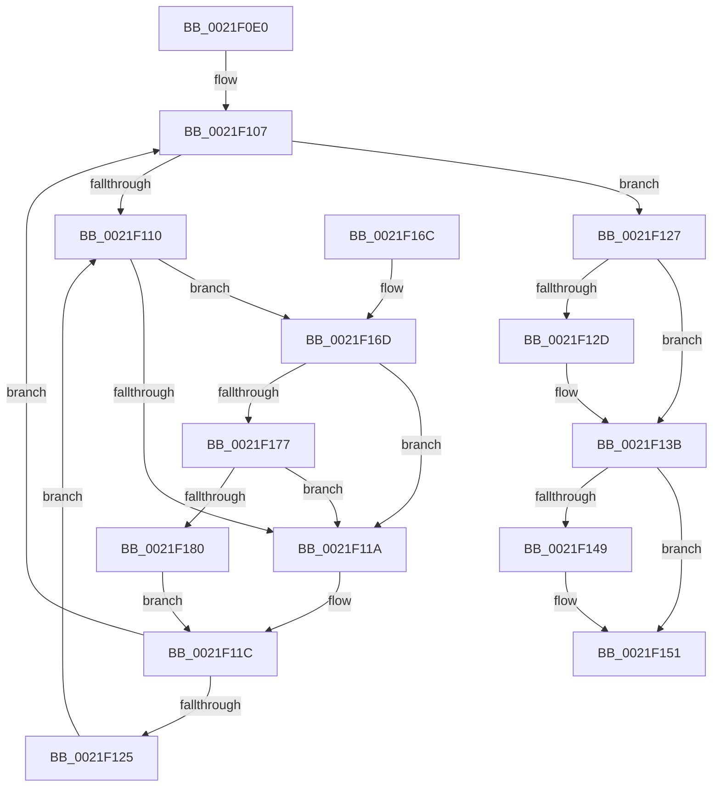

# KiAbThreadInsertList

- RVA: `0x0021F0E0`–`0x0021F189` (길이 `169` bytes)
- VA: `0x000000014021F0E0`
- 실행 섹션: `.text`
- PDB 이름 있음: `예`; PDB Function 태그: `아니요`
- unwind 정보 RVA: `0x0005F15C`
- 디코드: `49`개 명령, `169/169` bytes 표시
- 미해석 바이트: `0` (있으면 어셈블리에 `.byte`로 보존)

> 이 문서는 커널 이미지의 기계어와 PDB 기호를 분석해 생성했습니다. 4번과 5번은 함수 원형과 자료형을 바이너리 사용 방식에서 추정한 C 해석이며 원본 소스 복구 결과는 아닙니다.

## 1. Dependencies

- 직접 호출 지점: **2**; 고유 호출 대상: **2**
- 직접 호출자로 확인된 함수: **15**
- RIP 상대 이미지 참조: **2**

### Outgoing calls
- `0x0021F177` → [KiCheckVpBackingLongSpinWaitHypercall](../30/KiCheckVpBackingLongSpinWaitHypercall_function_0030F490.md) (function, `0x0030F490`)
- `0x0021F182` → [HvlNotifyLongSpinWait](../30/HvlNotifyLongSpinWait_function_0030F460.md) (function, `0x0030F460`)

### Direct callers
- [ExpAcquireResourceSharedLite](ExpAcquireResourceSharedLite_function_00212040.md) at `0x0021320F`
- [ExEnterPriorityRegionAndAcquireResourceShared](ExEnterPriorityRegionAndAcquireResourceShared_function_00213870.md) at `0x00213A71`
- [sub_002142F9](Unknown_function_002142F9.md) at `0x00214A78`
- [sub_002142F9](Unknown_function_002142F9.md) at `0x00214B23`
- [sub_00215166](Unknown_function_00215166.md) at `0x002157B2`
- [sub_00215F5C](Unknown_function_00215F5C.md) at `0x00216084`
- [KiAbConvertWaiterToOwnerEntry](KiAbConvertWaiterToOwnerEntry_function_00219430.md) at `0x00219AD6`
- [sub_0021EFFA](Unknown_function_0021EFFA.md) at `0x0021F034`
- [sub_0021F36F](Unknown_function_0021F36F.md) at `0x0021F5A2`
- [sub_0021F36F](Unknown_function_0021F36F.md) at `0x0021F5D4`
- [sub_00220023](../22/Unknown_function_00220023.md) at `0x0022003B`
- [sub_00220023](../22/Unknown_function_00220023.md) at `0x00220113`
- [sub_00220023](../22/Unknown_function_00220023.md) at `0x00220145`
- [sub_002209D5](../22/Unknown_function_002209D5.md) at `0x002209ED`
- [sub_002209D5](../22/Unknown_function_002209D5.md) at `0x00220AC5`
- [sub_002209D5](../22/Unknown_function_002209D5.md) at `0x00220AF7`
- [PsBoostThreadIo](../39/PsBoostThreadIo_function_003927C0.md) at `0x00392886`
- [PsBoostThreadIoEx](../39/PsBoostThreadIoEx_function_00392C00.md) at `0x00392CD3`
- [KeAbProcessBaseIoPriorityChangeInternal](../3C/KeAbProcessBaseIoPriorityChangeInternal_function_003C406C.md) at `0x003C410A`
- [PsEnterPriorityRegion](../3F/PsEnterPriorityRegion_function_003F8CD0.md) at `0x003F8E46`
- [sub_0041FC7E](../41/Unknown_function_0041FC7E.md) at `0x0041FCB8`

### Static image references
- `0x0021F112` → RVA `0x00FC52AC` (`ALMOSTRO`; reference)
- `0x0021F16D` → RVA `0x00FC6AB8` (`ALMOSTRO`; read)

## 2. Other-region calls and transfers

- 다른 실행 섹션으로 향하는 call: **0**
- 별도 외부 분기/꼬리 이동을 확인하지 못했습니다.

## 3. Assembly (complete function range)

```asm
0021F0E0  48 89 5C 24 08                  mov qword ptr [rsp + 8], rbx
0021F0E5  48 89 6C 24 10                  mov qword ptr [rsp + 0x10], rbp
0021F0EA  48 89 74 24 18                  mov qword ptr [rsp + 0x18], rsi
0021F0EF  48 89 7C 24 20                  mov qword ptr [rsp + 0x20], rdi
0021F0F4  41 56                           push r14
0021F0F6  48 83 EC 20                     sub rsp, 0x20
0021F0FA  33 FF                           xor edi, edi
0021F0FC  49 8B F0                        mov rsi, r8
0021F0FF  33 ED                           xor ebp, ebp
0021F101  4C 8B F2                        mov r14, rdx
0021F104  48 8B D9                        mov rbx, rcx
0021F107  F0 48 0F BA 6B 40 00            lock bts qword ptr [rbx + 0x40], 0
0021F10E  73 17                           jae 0x14021f127
0021F110  FF C5                           inc ebp
0021F112  85 2D 94 61 DA 00               test dword ptr [rip + 0xda6194], ebp
0021F118  74 53                           je 0x14021f16d
0021F11A  F3 90                           pause
0021F11C  48 8B 43 40                     mov rax, qword ptr [rbx + 0x40]
0021F120  48 85 C0                        test rax, rax
0021F123  74 E2                           je 0x14021f107
0021F125  EB E9                           jmp 0x14021f110
0021F127  48 83 3E 01                     cmp qword ptr [rsi], 1
0021F12B  75 0E                           jne 0x14021f13b
0021F12D  49 8B 06                        mov rax, qword ptr [r14]
0021F130  BF 01 00 00 00                  mov edi, 1
0021F135  48 89 06                        mov qword ptr [rsi], rax
0021F138  49 89 36                        mov qword ptr [r14], rsi
0021F13B  48 C7 43 40 00 00 00 00         mov qword ptr [rbx + 0x40], 0
0021F143  8B C7                           mov eax, edi
0021F145  85 FF                           test edi, edi
0021F147  74 08                           je 0x14021f151
0021F149  66 F0 FF 83 64 03 00 00         lock inc word ptr [rbx + 0x364]
0021F151  48 8B 5C 24 30                  mov rbx, qword ptr [rsp + 0x30]
0021F156  48 8B 6C 24 38                  mov rbp, qword ptr [rsp + 0x38]
0021F15B  48 8B 74 24 40                  mov rsi, qword ptr [rsp + 0x40]
0021F160  48 8B 7C 24 48                  mov rdi, qword ptr [rsp + 0x48]
0021F165  48 83 C4 20                     add rsp, 0x20
0021F169  41 5E                           pop r14
0021F16B  C3                              ret
0021F16C  CC                              int3
0021F16D  8B 05 45 79 DA 00               mov eax, dword ptr [rip + 0xda7945]
0021F173  A8 40                           test al, 0x40
0021F175  74 A3                           je 0x14021f11a
0021F177  E8 14 03 0F 00                  call 0x14030f490
0021F17C  84 C0                           test al, al
0021F17E  74 9A                           je 0x14021f11a
0021F180  8B CD                           mov ecx, ebp
0021F182  E8 D9 02 0F 00                  call 0x14030f460
0021F187  EB 93                           jmp 0x14021f11c
```

## 4. C-style interpretation (structured pseudocode)

```c
__int64 __fastcall KiAbThreadInsertList(__int64 a1, __int64 a2, __int64 a3)
{
    __int64 result;
    __int64 v_rbp;
    __int64 v_rdi;
    __int64 v_rsp;
    unsigned __int64 v_stack_p10;
    unsigned __int64 v_stack_p18;
    unsigned __int64 v_stack_p20;
    unsigned __int64 v_stack_p8;

    v_stack_p8 = v_rbx;
    v_stack_p10 = v_rbp;
    v_stack_p18 = v_rsi;
    v_stack_p20 = v_rdi;
    v_rsp = (v_rsp) - (32);
    v_rdi = 0;
    v_rbp = 0;
loc_0021F107:
    if (condition_is_above_or_equal) goto loc_0021F127;
loc_0021F110:
    v_rbp = (unsigned int)((v_rbp) + 1);
    if (((*(unsigned int *)(v_rip + 14311828)) & ((unsigned int)(v_rbp))) == 0) goto loc_0021F16D;
loc_0021F11A:
loc_0021F11C:
    if (*(unsigned __int64 *)(a1 + 64) == 0) goto loc_0021F107;
    goto loc_0021F110;
loc_0021F127:
    result = *(unsigned __int64 *)(a1 + 64);
    if ((*(unsigned __int64 *)(a3)) == 1) {
        result = *(unsigned __int64 *)(a2);
        v_rdi = 1;
        *(unsigned __int64 *)(a3) = result;
        *(unsigned __int64 *)(a2) = a3;
    }
    *(unsigned __int64 *)(a1 + 64) = 0;
    if ((unsigned int)(v_rdi) != 0) {
    }
    v_rsp = (v_rsp) + (32);
    return (unsigned int)((unsigned int)(v_rdi));
loc_0021F16D:
    if ((((unsigned __int8)((unsigned int)(*(unsigned int *)(v_rip + 14317893)))) & (64)) == 0) goto loc_0021F11A;
    result = KiCheckVpBackingLongSpinWaitHypercall(a1, a2, a3, a4);
    if ((unsigned __int8)(result) == 0) goto loc_0021F11A;
    result = HvlNotifyLongSpinWait((unsigned int)((unsigned int)(v_stack_p10)), a2, a3, a4);
    goto loc_0021F11C;
}
```

## 5. (Beta) C Style

```c
int64_t KiAbThreadInsertList(void *Arg1, void *Arg2, void *Arg3)
{
    uint8_t *arg1 = (uint8_t *)Arg1;
    uint8_t *arg2 = (uint8_t *)Arg2;
    uint8_t *arg3 = (uint8_t *)Arg3;

    int64_t result;
    int64_t local_rbp;
    int64_t local_rdi;
    int64_t local_rsp;
    uint64_t v_stack_p10;
    uint64_t v_stack_p18;
    uint64_t v_stack_p20;
    uint64_t v_stack_p8;

    v_stack_p8 = local_rbx;
    v_stack_p10 = local_rbp;
    v_stack_p18 = local_rsi;
    v_stack_p20 = local_rdi;
    local_rsp = (local_rsp) - (32);
    local_rdi = 0;
    local_rbp = 0;
loc_0021F107:
    if (condition_is_above_or_equal) goto loc_0021F127;
loc_0021F110:
    local_rbp = (uint32_t)((local_rbp) + 1);
    if (((*(uint32_t *)(v_rip + 0xDA6194)) & ((uint32_t)(local_rbp))) == 0) goto loc_0021F16D;
loc_0021F11A:
loc_0021F11C:
    if (*(uint64_t *)(arg1 + 0x40) == 0) goto loc_0021F107;
    goto loc_0021F110;
loc_0021F127:
    result = *(uint64_t *)(arg1 + 0x40);
    if ((*(uint64_t *)(arg3)) == 1) {
        result = *(uint64_t *)(arg2);
        local_rdi = 1;
        *(uint64_t *)(arg3) = result;
        *(void **)(arg2) = Arg3;
    }
    *(uint64_t *)(arg1 + 0x40) = 0;
    if ((uint32_t)(local_rdi) != 0) {
    }
    local_rsp = (local_rsp) + (32);
    return (uint32_t)((uint32_t)(local_rdi));
loc_0021F16D:
    if ((((uint8_t)((uint32_t)(*(uint32_t *)(v_rip + 0xDA7945)))) & (64)) == 0) goto loc_0021F11A;
    result = KiCheckVpBackingLongSpinWaitHypercall(Arg1, Arg2, Arg3, a4);
    if ((uint8_t)(result) == 0) goto loc_0021F11A;
    result = HvlNotifyLongSpinWait((uint32_t)((uint32_t)(v_stack_p10)), Arg2, Arg3, a4);
    goto loc_0021F11C;
}
```

### 관측된 메모리 오프셋

구조체 형식이 확인되지 않은 접근은 인자 기준의 오프셋으로만 기록했습니다.

| 기준 인자 | 오프셋 표현 | 폭 (bit) | 접근 |
|---|---:|---:|---|
| `Arg1` | `+ 0x40` | `64` | `R` |
| `Arg1` | `+ 0x40` | `64` | `R/W` |
| `Arg1` | `+ 0x40` | `64` | `W` |
| `Arg1` | `+ 0x364` | `16` | `R/W` |
| `Arg2` | `+ 0x0` | `64` | `R` |
| `Arg2` | `+ 0x0` | `64` | `W` |
| `Arg3` | `+ 0x0` | `64` | `R` |
| `Arg3` | `+ 0x0` | `64` | `W` |

## 6. Execution-region graph

[열기: 2D/3D 그래프와 함수 탐색 컨트롤 패널](../../../control-panel.html?section=text&rva=0x0021F0E0&view=graph)

- 2D 그래프는 위에서 아래로 흐르고, 3D 그래프는 빈 공간을 드래그해 회전합니다. Shift+드래그는 이동, 휠은 확대·축소, 함수 노드 선택은 대상 보고서 이동입니다.

### Static fallback


